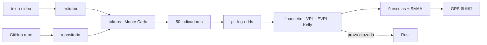

<!--
AnalisadorPreditivoMinimoViaveldeProjetos
Autor: ProfBru - Bruno Penedo © 2026 - TODOS OS DIREITOS RESERVADOS
E-mail: profbruanbima@gmail.com

TEMPLATE DO MOTOR DE READMEs — não editar os 12 READMEs à mão.
  • O que está aqui é ESTRUTURA (nunca traduzida): imagens, comandos, caminhos, badges de stack.
  • Marcadores b:<chave> entre chaves duplas são BLOCOS DE PROSA (traduzidos) — vêm de readme.blocos.json.
  • Marcadores lang:<nome> entre chaves duplas são preenchidos pelo gerador (seletor, frase de direitos).
Estilo: template do ECC (hero, seletor, badges, guia rápido, cards, o que tem dentro)
+ progressão D19: DOR → SOLUÇÃO → PROVA VISUAL → APLICAÇÃO → INSTALAÇÃO → PROFUNDIDADE → LICENÇA.
Gerar:  python3 public/foundations/pipeline/gerar_readmes.py
-->

<div align="center">

# 🧭 Analisador Preditivo Mínimo Viável de Projetos


**ProfBru © 2026**

### Das prädiktive Navi, das sagt, ob eine Idee Ihre Tokens verdient — vor dem ersten Token.

**Ein Satz Idee geht hinein. Heraus kommt ein Urteil 🟢🟡🔴, wie viele Tokens Strukturieren, Planen und Programmieren kosten, was es gegenüber einem risikofreien Zins wert ist — und worauf Sie verzichten sollten.**

   


[Português](README.md) · [English](README.en.md) · [Español](README.es.md) · [Français](README.fr.md) · **Deutsch** · [中文](README.zh.md) · [한국어](README.ko.md) · [हिन्दी](README.hi.md) · [עברית](README.he.md) · [Русский](README.ru.md) · [Svenska](README.sv.md) · [Suomi](README.fi.md)

</div>

> [!IMPORTANT]
> **Klug wählen und verzichten, bevor man ausgibt, ist einer der größten Vorteile, die es gibt.** Wer weiß, wo man Zeit und Geld NICHT einsetzt, hat das halbe Spiel schon gewonnen. Dieses Projekt macht aus dieser Disziplin eine Methode: prädiktiv, prüfbar, mit einer wissenschaftlichen Quelle hinter jeder Zahl.

## ⚡ In 60 Sekunden starten

Kein Server, kein API-Schlüssel, keine Cloud. Läuft auf Ihrem Rechner, offline. Ausgabe auf brasilianischem Portugiesisch.

```bash
git clone <url-do-repositorio> AnalisadorPreditivoMinimoViaveldeProjetos
cd AnalisadorPreditivoMinimoViaveldeProjetos/public/foundations/pipeline
pip install -r requisitos.txt
python3 analisar.py ideia "App para clínicas lembrarem pacientes pelo WhatsApp com assinatura mensal"
```

Fertig: Der Bericht erscheint im Terminal mit Ampel, empfohlenem Pfad, Tokens P10/P50/P90 je Phase, Erwartungswert gegenüber dem CDI (dem brasilianischen risikofreien Referenzzins) und den Fragen, denen Sie ausweichen. Mehrere Ideen vergleichen? Nutzen Sie `comparar`. Nur die Token-Kosten? Nutzen Sie `tokens`.

<div align="center">

<table>
<tr>
<td width="33%" align="center"><b>🧭 Eine Idee, ein Satz</b><br/><sub>Auch ohne Nische, Branche oder Zahlen. Das Navi misst die eigene Unwissenheit und erlaubt nie, im Blindflug zu investieren.</sub><br/><code>analisar.py ideia</code></td>
<td width="33%" align="center"><b>⚖️ Wählen und verzichten</b><br/><sub>Mehrere Ideen nebeneinander: welche verfolgen, welche sofort beenden, welche wirklich gleichauf liegen.</sub><br/><code>analisar.py comparar</code></td>
<td width="33%" align="center"><b>🪙 Was es in Tokens kostet</b><br/><sub>Strukturieren, Planen, Programmieren — P10/P50/P90 und US$ je Modell, mit Tail-Risiko.</sub><br/><code>analisar.py tokens</code></td>
</tr>
</table>

</div>

---

## 💀 Das Problem: Sie entscheiden mit einer Tabelle — und die Tabelle entscheidet nichts

Denken Sie an Ihre letzte teure Entscheidung. **Die Smartphones** für den Vertrieb. **Das Elektroauto** für die Flotte. **Der Lieferant** für einen Dreijahresvertrag. **Die Startup-Idee**, in die Sie sechs Monate Nächte gesteckt haben. Im größeren Maßstab derselbe Schmerz: **welcher Panzer, welches Flugzeug, welches Abwehrsystem** eine Armee für dreißig Jahre kauft; **welches Projekt** ein Vorstand mit dem Jahresbudget genehmigt.

Fast immer ist das Ritual dasselbe: eine **Tabelle**, eine **Bewertungsmatrix**, ein paar **Filter**. Und drei Fallen, die niemand sieht:

| Was Sie getan haben | Was wirklich passiert ist |
|---|---|
| 🔻 **Die Tabelle nach einer Spalte sortiert** | Sie haben nach EINEM Kriterium entschieden. Die anderen sieben waren nur da, um Gründlichkeit vorzutäuschen. |
| 🔢 **Punkte in einer gewichteten Matrix addiert** | Sie haben das Desaster mit dem Durchschnitt ausgeglichen: Eine Option mit katastrophaler Sicherheit „holte auf“, weil sie beim Preis glänzte. |
| 🔍 **Nach „erfüllt alles“ gefiltert** | Die Liste war leer; Sie haben die störende Anforderung gelockert — genau die, die das Veto hätte sein müssen. |

Und nun gibt es neue Kosten, unsichtbar in jeder Tabelle: **Tokens**. Mit KI-Agenten wurde Bauen billig und schnell — und deshalb ist es leicht geworden, Wochen und Hunderte Dollar damit zu verbringen, perfekt **die falsche Idee** zu bauen.

> [!WARNING]
> **Tabellen, Matrizen und Ranking-Filter reichen für eine gute Entscheidung nicht aus.** Sie können nicht sagen, wie *unsicher* Sie sind, bestrafen kein Desaster bei einem kritischen Kriterium, zählen nicht die Kosten des *Betriebs* dessen, was Sie bauen werden, und — das Schlimmste — sagen nie **„jetzt nicht investieren“**. Ein Werkzeug, das nie Verzicht empfiehlt, ist keine Entscheidungshilfe: Es ist ein Rechtfertigungsgenerator.

### Der Moment, in dem die Entscheidung stirbt

Es ist im Meeting, wenn jemand fragt: *„Und wenn Sicherheit 30 % statt 25 % wöge?“* — und der Sieger wechselt. Oder sechs Monate später, wenn das Projekt fertig, funktionsfähig, getestet ist… und niemand dafür bezahlt. Startup-Post-Mortems nennen seit einem Jahrzehnt dieselbe Ursache Nummer eins: **Es gab keinen Marktbedarf** (35–42 % der Fälle, CB Insights). Die richtige Frage war nie *„Können wir es bauen?“*. Sie lautete *„Sollten wir?“* — und sie hat eine Antwort **vor** dem ersten Token.

---

## 💊 Die Lösung: ein prädiktives Navi vor jedem Token

**Sie schreiben die Idee so auf, wie sie in Ihrem Kopf ist — ein Satz genügt.** In Sekunden erledigt der Analysator, wofür ein seriöses Gremium Wochen bräuchte:

1. **Erkennt die Referenzklasse** der Idee (B2B-SaaS, Automatisierung, Marktplatz, Trading, Gesundheit…) und startet bei deren Basisrate — die *Outside View*, die vor dem Enthusiasmus des Autors schützt.
2. **Misst 50 Indikatoren in 11 Dimensionen** — Nachfrage, Markt, technische Machbarkeit, Wirtschaftlichkeit, Dauerhaftigkeit, Skalierbarkeit, Kumulativität, Robustheit, Ausrichtung, Information und Finanzarbitrage — jeweils mit **Note, Konfidenz, Beleg und wissenschaftlicher Quelle**.
3. **Schätzt die Tokens** für Strukturieren, Planen und Programmieren mit **200.000 Simulationen** und dem fetten Ende von IT-Projekten und rechnet sie in US$ je Modell und menschliche Aufsichtsstunden um.
4. **Rechnet, was die Tabelle vergisst:** Kosten für Bau **und Betrieb**, mit dem CDI abgezinster Erwartungswert, Break-even-Wahrscheinlichkeit, Wert des Vorab-Tests (EVPI), Kelly-Anteil und Grenznutzen jedes zusätzlichen Real.
5. **Lässt neun Entscheidungsschulen abstimmen** (ELECTRE I und II, PROMETHEE II, MAUT, MCDA-C, AHP-TOPSIS 2n, VIKOR, TODIM, SAPEVO-M) über fünf Pfade — nicht investieren, erst testen, MVP, Vollprojekt, Code wiederverwenden — und **stört Gewichte und Noten tausendfach**, um zu sagen, ob die Wahl ROBUST, WAHRSCHEINLICH oder FRAGIL ist.

<div align="center">

| ❌ Was die Tabelle sagt | ✅ Was das prädiktive Navi sagt |
|---|---|
| „Die Idee hat Note 7,8.“ | **„🟡 ERST TESTEN. Die Information ist R$ 4.586 wert, der Test kostet R$ 850. Führen Sie dieses 5-Tage-Experiment durch; fällt es negativ aus, beenden Sie die Idee.“** |
| „Das schaffen wir in zwei Wochen.“ | **„P50 von 13,7 Mio. Tokens, P90 von 40,1 Mio. — und 23 Stunden Ihrer Review-Zeit. Die dominanten Kosten sind nicht das Bauen: es ist der Betrieb.“** |
| *(sagt es nie)* | **„🔴 JETZT NICHT INVESTIEREN. Kein Pfad schlägt den CDI mit akzeptablem Risiko nach heutigem Wissensstand.“** |

</div>

**Ein ehrliches System muss sagen können: „Vertrauen Sie mir hier nicht.“** Ist die Beschreibung vage, sagt das Navi es — und die Entscheidung wird nie im Blindflug grün.

---

## 🖼️ So funktioniert es — ein Screen pro Sub-Skill

Alle Screens wurden vom Analysator selbst erzeugt (`gerar_telas.py`), mit festem Seed: Sie reproduzieren jede Zahl auf Ihrem Rechner. Die Beschriftungen sind auf brasilianischem Portugiesisch, der Ausgabesprache des Werkzeugs.

### 1. `ideia` — das Navi in einem Panel

<div align="center"></div>

**Das Problem, das es löst:** Sie brauchen keinen 40-seitigen Bericht, um zu entscheiden, ob Sie anfangen; Sie brauchen ein Urteil und die fünf Zahlen dahinter.

Ampel mit Beschriftung (nie nur Farbe), empfohlener Pfad, Robustheit, Tragfähigkeitswahrscheinlichkeit mit 80-%-Intervall, Tokens P50/P90, Baukosten, Erwartungswert und EVPI.

> **Lesart:** Die Idee für Zahnarztpraxen hat 50 % Tragfähigkeit — gut —, doch das Urteil lautet 🟡 **ERST TESTEN**: Das Ergebnis zu kennen ist R$ 4.586 wert, das Experiment kostet R$ 850. Billige Information zu kaufen, bevor man Tokens ausgibt, ist die rationale Entscheidung — selbst bei einer vielversprechenden Idee.

### 2. `tokens` — was Strukturieren, Planen und Programmieren kostet

<div align="center"></div>
<div align="center"></div>

**Das Problem, das es löst:** „Das geht schnell“ ist der teuerste Satz im Engineering. KI-Agenten schwanken bei derselben Aufgabe um bis zu 30× im Token-Verbrauch (Bai et al., 2026), und jedes 6. IT-Projekt überzieht sein Budget um 200 % (Flyvbjerg & Budzier, 2011).

Der Schätzer zählt Dateien, Integrationen und Komplexität aus dem Text, wendet den Verbrauch je Tätigkeit an (lesen, schreiben, bearbeiten, testen, prüfen), das Wachstum des Kontexts und Nacharbeit, und führt 200.000 Simulationen mit fettem Ende aus.

> **Lesart:** Programmieren macht ~80 % der Tokens aus, und die Eingabe (der bei jedem Schritt neu gelesene Kontext) 97 % davon. Die Spanne P10–P90 umfasst eine Größenordnung — deshalb entscheidet das Navi nach dem P90, nicht nach dem Durchschnitt.

### 3. Pfade — wählen **und** verzichten

<div align="center"></div>

**Das Problem, das es löst:** Die Tabelle vergleicht Ideen; sie vergleicht nie *Arten, in dieselbe Idee zu investieren*. Und die Art zählt mehr als die Idee.

Fünf Pfade: **A0** nicht investieren (Geld im CDI), **A1** 5-Tage-Minimalexperiment, **A2** schlankes MVP, **A3** Vollprojekt, **A4** vorhandenen Code wiederverwenden. Jeweils mit gebundenem Kapital, Erwartungswert, Verlustwahrscheinlichkeit und Zeit bis zum ersten Beleg.

> **Lesart:** Das MVP hat den höchsten Erwartungswert in Reais, doch das 5-Tage-Experiment gewinnt den Konsens — es erreicht den Beleg 4× schneller, mit 13 % Verlustrisiko. Der Bericht benennt den **Verzicht**: Mit A1 halten Sie das P90-Exposure des Vollprojekts aus dem Risiko, bis Belege vorliegen.

### 4. Die Abstimmung der neun multikriteriellen Schulen

<div align="center"></div>

**Das Problem, das es löst:** Jede multikriterielle Methode ist eine andere Theorie darüber, was „besser“ heißt. Nur eine zu nutzen heißt, die Antwort zusammen mit der Frage zu wählen.

MAUT addiert Nutzwerte; ELECTRE legt ein Veto gegen das Desaster ein; PROMETHEE stuft Präferenzen ab; VIKOR weigert sich, das schlechteste Kriterium zu kompensieren; TODIM gewichtet Verluste stärker als Gewinne (Prospect Theory); SAPEVO-M akzeptiert das ordinale Urteil eines Gremiums.

> **Lesart:** Sieben der neun Schulen setzen das Minimalexperiment auf Platz 1. Wenn unabhängige Theorien übereinstimmen, überlebt die Entscheidung das Meeting.

### 5. Indikatoren — und was die Wahrscheinlichkeit bewegt hat

<div align="center"></div>
<div align="center"></div>

**Das Problem, das es löst:** „Note 7,8“ ohne Erklärung überzeugt niemanden. Hier zeigt jede Dimension Note, Konfidenz und wie stark sie die Wahrscheinlichkeit nach oben oder unten gedrückt hat.

Der vollständige Katalog (`analisar.py indicadores`) listet die 50 Indikatoren mit Formel, wissenschaftlicher Quelle und dem **Mindestbeleg**, der jede Note absichern würde — statt sie zu erfinden.

> **Lesart:** Problem & Nachfrage hob die Wahrscheinlichkeit am stärksten (Schmerz, Häufigkeit und 3 interessierte Praxen); Markt & Vielfalt blieb neutral — ein einziges Nutzungssegment, Shannon-Entropie null. Genau das muss das nächste Kundengespräch testen.

### 6. `comparar` — mehrere Ideen, eine Entscheidung

<div align="center"></div>

**Das Problem, das es löst:** Sie haben fünf Ideen und Energie für eine. Ein Ranking mit „Sieger um 0,3 Punkte“ ist Rauschen, verkleidet als Gewissheit.

Die Ideen werden parallel analysiert (`ProcessPoolExecutor`) und von den neun Schulen mit **doppelter Robustheit** bewertet: unsichere Gewichte und unsichere Noten (SMAA). Das Urteil verwendet die kleinere der beiden.

> **Lesart:** Bei unsicheren Gewichten gewinnt Idee 4 immer; bei unsicheren Noten nur in 60 % der Fälle — technisches Unentschieden mit Idee 1. Das Navi sagt es klar: Wählen Sie nicht nach dem Ranking, führen Sie das Experiment für beide durch. Und es rät, auf den Marktplatz und den Arbitrage-Bot **sofort zu verzichten**, die in keinem plausiblen Szenario gewinnen.

### 7. `repo` — hat die Idee schon Code auf GitHub?

<div align="center"></div>
<div align="center"></div>

**Das Problem, das es löst:** Vorhandener Code sieht nach Ersparnis aus, kostet aber Lesen, Anpassen und manchmal eine Lizenz, die Sie nicht nutzen dürfen.

Der Analysator erstellt einen isolierten flachen Klon (nichts aus dem Repository wird ausgeführt), misst Zeilen je Sprache, Tests, CI, Lizenz und Alter des letzten Commits und berechnet die Reife (Software-TRL). Die Reife senkt die Programmier-Tokens; das Lesen fließt in die Strukturier-Tokens ein.

> **Lesart:** Bei einem MIT-Repository auf TRL-5 erscheint der Pfad „wiederverwenden“ (A4) unter den Alternativen — und der Konsens bevorzugt dennoch das MVP, denn das Anpassen von Vorhandenem beseitigt die Marktfrage nicht.

### 8. Finanzarbitrage und Kapitalgewinne

<div align="center"></div>
<div align="center"></div>

**Das Problem, das es löst:** Trading- und Arbitrage-Ideen sehen nach geschenktem Geld aus — bis Transaktionskosten, Steuern und Alpha-Zerfall auftauchen.

Ist die Idee eine Finanzstrategie, kommt eine eigene Dimension ins Modell (Beständigkeit des Vorteils, Kosten und Latenz, statistische Validierung, regulatorisches Risiko), und der Bericht verlangt Out-of-Sample-Backtest, Sharpe und Drawdown vor jedem Produkt-Token. Bei jeder Idee wird das Token-Kapital mit der risikofreien Alternative verglichen: dem CDI.

> **Lesart:** Der in einem Satz beschriebene Krypto-Arbitrage-Bot landet bei 🟡 **ERST TESTEN** mit 12 % Tragfähigkeit; die Automatisierung des Bankabgleichs daneben erhält 🟢 **IN DAS MVP INVESTIEREN** mit 4 Monaten Amortisation. Derselbe Autor, derselbe Tag: Der Unterschied liegt darin, wo sich Zeit auszahlt.

### 9. Wenn die Idee noch zu vage ist

<div align="center"></div>

**Das Problem, das es löst:** Die schlechteste Entscheidung ist nicht, Nein zu einer guten Idee zu sagen — sondern Ja zu einer Idee, die es noch nicht gibt.

Für „eine coole Idee“ misst das Navi 0 % Vollständigkeit, liefert ein sehr breites Wahrscheinlichkeitsintervall, listet die unbeantworteten Kernfragen und markiert das Urteil als FRAGIL.

> **Lesart:** 🔴 **JETZT NICHT INVESTIEREN** — nicht aus Pessimismus, sondern mangels Information. Der Bericht selbst sagt, was zuerst herauszufinden ist (wer den Schmerz hat, was er kostet, wie Geld verdient wird).

### 10. `prompt` — mit einem LLM vertiefen, und zwar richtig

<div align="center"></div>

**Das Problem, das es löst:** LLMs finden hervorragend logische Lücken und schlagen Experimente vor — und erfinden schlecht kalibrierte Gewichte und Noten; als Richter neigen sie dazu, fast allem zuzustimmen.

Darum übernimmt der Analysator den quantitativen Teil und liefert einen fertigen Master-Prompt, bereits mit Klasse, Wahrscheinlichkeit, Tokens und Pfad, der das LLM nur um das bittet, was es gut kann: unbequeme Fragen, Umkehrbarkeitstest, Minimalexperiment und Abhängigkeitskarte.

> **Lesart:** Die Zahl kommt vom Modell; das Hinterfragen vom LLM. Jeder in seiner Rolle.

### 11. `--relatorio` — das Dossier als PDF, HTML und Markdown

<div align="center"> </div>

**Das Problem, das es löst:** Eine wichtige Entscheidung muss zirkulieren — im Gremium, beim Partner, im Postfach des Investors — und sie muss belegen, wer sie unterzeichnet hat.

Mit `--relatorio` erscheint jede Analyse in drei Formaten: **Markdown** (versionierbar), eigenständiges **HTML** (eingebettete Screens, helles und dunkles Theme) und **PDF im OCR-Format** — jede Seite ist ein Bild mit dem großen ProfBru-Zeichen bei 50 % Transparenz im Hintergrund, überlagert von einer unsichtbaren Textebene, die das Dokument durchsuchbar und kopierbar macht, ohne ein reines Text-PDF zu sein.

> **Lesart:** Dasselbe Navi aus dem Terminal wird zu einem sechsseitigen Dossier mit den fünf Screens im Anhang, bereit für das Meeting — und die Suche nach „experimento mínimo“ findet jedes Vorkommen im PDF.

📎 [`docs/exemplos/gps_clinica.pdf`](docs/exemplos/gps_clinica.pdf) · [`.html`](docs/exemplos/gps_clinica.html) · [`.md`](docs/exemplos/gps_clinica.md)

---

## 🎯 Wofür es dient — maßgeschneidert wählen und verzichten

Dieselbe Methode dient jeder Entscheidung, bei der **Optionen sich widersprechen, Informationen unvollständig sind und Fehler teuer werden**:

<div align="center">

| Bereich | Entscheidung | Warum die Tabelle versagt |
|---|---|---|
| **Ideen und Startups** | welche Idee in den nächsten 90 Tagen Tokens, Zeit und Kapital verdient | ignoriert die Basisrate der Klasse und die Betriebskosten |
| **KI-Projekte** | MVP, Vollprojekt oder nur ein Test — und mit welchem Modell | schätzt weder Tokens noch Tail noch Review-Stunden |
| **Vorstands- und Unternehmensentscheidungen** | Projektportfolio, Lieferant, Make-or-Buy | gleicht ein Veto mit dem Durchschnitt aus; misst keine Robustheit |
| **Geräte und Smartphones** | welches Gerät das reale Nutzungsportfolio abdeckt | misst weder Nutzungsvielfalt (Shannon) noch Grenznutzen |
| **Elektroautos und Flotten** | Reichweite × Gesamtkosten × Infrastruktur | zählt korrelierte Kriterien doppelt |
| **Streitkräfte** | Panzer, Flugzeuge, Systeme für 30 Jahre | ein schlechtes kritisches Kriterium muss ein Veto sein, nicht ausgeglichen werden |
| **Trading und Arbitrage** | den Bot bauen oder das Geld im CDI lassen? | vergisst Transaktionskosten, Steuern und Alpha-Zerfall |
| **Kleine und mittlere Unternehmen** | den manuellen Prozess automatisieren oder nicht | vergleicht die jährliche Ersparnis nicht mit den P90-Kosten |

</div>

> [!NOTE]
> Die Annahmen (Wechselkurs, CDI, Horizont, Wert Ihrer Stunde, erwarteter Umsatz, Kapital) sind Kommandozeilenparameter und werden in jedem Bericht ausgegeben. Ändern Sie sie, und das Urteil wird neu berechnet — die Entscheidung bleibt Ihre, mit offengelegter Rechnung.

---

## 🧩 Warum jede Funktion existiert

| Funktion | Warum sie existiert | Grundlage |
|---|---|---|
| **Referenzklasse** | die beste Prognose für ein Projekt ist die Historie ähnlicher Projekte, nicht der Optimismus des Antragstellers | Kahneman & Lovallo (1993); Flyvbjerg & Gardner (2023) |
| **Wahrscheinlichkeit in Log-Odds mit Konfidenz** | jeder Indikator bewegt die Wahrscheinlichkeit im Verhältnis zum Beleg; ohne Beleg fast gar nicht | interpretierbare Regeln (LLM-AR, 2025); SAISE (2025) |
| **Tokens P10/P50/P90 je Phase** | der Verbrauch von Agenten schwankt bis zu 30× und die Eingabe dominiert die Kosten | Bai et al. (2026); ACEM (2026); tokencast |
| **Betriebskosten, nicht nur Baukosten** | mit KI wurde Bauen billig; was das Geschäft zerbricht, ist der Betrieb | ACEM (2026); CB Insights |
| **Kapitalwert gegenüber dem CDI** | jeder in Tokens ausgegebene Real hat sichere Opportunitätskosten | Dixit & Pindyck (1994) |
| **EVPI — Wert des Vorab-Tests** | manchmal ist der beste Kauf Information, nicht Code | Howard (1966); Camuffo et al. (2020, 2024) |
| **Kelly-Anteil** | wie viel man setzt, zählt so viel wie worauf | Kelly (1956) |
| **Grenznutzen auf der Effizienzgrenze** | entscheidend ist der Wert des NÄCHSTEN investierten Real | Gossen (1854) |
| **Shannon-Entropie, Simpson, HHI, Vielseitigkeitsindex** | eine Idee mit mehreren Nutzungen hat mehr Auswege, wenn der erste Markt scheitert | Shannon (1948); KPIs der Wissensbasis |
| **Neun Schulen + Borda-Konsens** | Übereinstimmung unabhängiger Theorien ist ohne Daten der stärkste Beleg | Roy; Brans; Keeney & Raiffa; Saaty; Opricovic; Gomes |
| **Doppelte Robustheit (Gewichte und Noten)** | ein Sieger, der bei 2 Gewichtspunkten wechselt, ist kein Sieger | SMAA — Lahdelma et al. (1998) |
| **Unbequeme Fragen, Umkehrbarkeit, Minimalexperiment, Abhängigkeiten** | das würde ein skeptischer Investor tun — und das kann ein LLM gut | Wissensbasis des Projekts |
| **Bericht als PDF im OCR-Format, HTML und Markdown** | die Entscheidung muss zirkulieren, durchsuchbar sein und auf jeder Seite die Urheberschaft tragen | PyMuPDF + Pillow, alles lokal |
| **Zweite Engine in Rust** | zwei unabhängige Engines, die übereinstimmen, beweisen die Mathematik, nicht nur den Code | Gegenprüfung bei jedem Lauf |

---

## ⚙️ Installation und Nutzung

| Komponente | Version | Pflicht | Wofür |
|---|---|---|---|
| Python | 3.13 | ✅ | Engine, CLI, Berichte |
| NumPy | 2.x | ✅ | Algebra und Simulation |
| numba | ≥ 0.60 | ⚠️ empfohlen | JIT der Kernel (ohne: gleiche Antwort, langsamer) |
| matplotlib | ≥ 3.7 | ⚠️ für Screens | PNG-Grafiken |
| PyMuPDF · Pillow · markdown | aktuell | ⚠️ für `--relatorio` | PDF, HTML |
| Rust / cargo | stabil | ⭕ optional | zweite Prüf-Engine |
| git · screen | — | ⭕ optional | Repositories analysieren · im Hintergrund laufen |

```bash
cd public/foundations/pipeline
python3 analisar.py ideia "<ideia>" [--repo <url|pasta>] [--relatorio [base]] [--telas pasta/] [--json]
python3 analisar.py comparar "<ideia A>" "<ideia B>" "<ideia C>" [--relatorio]   # ou --arquivo ideias.txt
python3 analisar.py tokens "<ideia>" [--json]
python3 analisar.py repo https://github.com/<usuario>/<projeto>
python3 analisar.py indicadores [--bibliografia]
python3 analisar.py prompt "<ideia>"

# premissas (todas opcionais): --cambio 5.50 --cdi 0.14 --horizonte 12 --valor-hora 80
#                              --receita 3000 --receita-otimista 20000 --capital 50000 --infra-mes 0

./run_all.sh --demo          # < 60 s
./run_all.sh                 # testes + prova cruzada Rust + bench + telas + i18n
./run_all.sh --background    # screen + watchdog de 20 min (screen -r analisadorpreditivominimoviaveldeprojetos)
```

| Sub-Skill | Was er liefert |
|---|---|
| `ideia` | vollständiges Navi einer Idee: Ampel, Pfad, Wahrscheinlichkeit, Tokens, Wirtschaftlichkeit, neun Schulen, Indikatoren, Fragen, Experiment, Abhängigkeiten, Verzicht (Markdown, JSON und Screens) |
| `comparar` | mehrere Ideen parallel: welche verfolgen, welche gleichauf liegen, auf welche sofort verzichten |
| `tokens` | nur die Kosten: Tokens P10/P50/P90 je Phase, US$ je Modell, menschliche Stunden |
| `repo` | Reife eines Repositorys: Zeilen, Sprachen, Tests, CI, Lizenz, Bereitschaft |
| `indicadores` | Katalog der 50 Indikatoren mit Formel, Quelle und Mindestbeleg; `--bibliografia` |
| `prompt` | fertiger Master-Prompt, um die Idee mit einem LLM zu vertiefen |
| `--relatorio` | jede Analyse als Markdown, HTML und PDF im OCR-Format mit Wasserzeichen |

---

## 🧠 Technischer Hintergrund

Aus Text werden **Signale** (Lexikon auf Portugiesisch und Englisch, mit dem Beleg, der jedes ausgelöst hat); Signale bestimmen die **Referenzklasse** und die **funktionale Größe**; die Größe wird zu **Tokens** (Simulation mit fettem Ende); Signale und Größe werden zu **Indikatoren**; die Indikatoren verschieben den **Prior** der Klasse in Log-Odds bis zur **Tragfähigkeitswahrscheinlichkeit**; die Wahrscheinlichkeit speist die **Wirtschaftlichkeit** der fünf Pfade; und die neun Schulen wählen den Pfad — mit gemessener Robustheit.



| Dimension | Was sie fragt |
|---|---|
| Problem & Nachfrage | ist der Schmerz real, häufig, wird er bezahlt? hat ihn jemand außer Ihnen bestätigt? |
| Markt & Vielfalt | wie viele Nutzungen und Segmente (Shannon, Simpson, HHI, Vielseitigkeit)? |
| Technische Machbarkeit | Größe, Integrationen, Echtzeit, vorhandener Code, Resistenz gegen KI-Kommodifizierung |
| Wirtschaftliche Machbarkeit | Kosten, Tail, Sicherheitsmarge, Kapitalwert, Amortisation, Wiederkehr, Kelly, Grenznutzen |
| Dauerhaftigkeit | übersteht sie Zeit, Moden und eine einzelne Plattform? |
| Skalierbarkeit | Grenzkosten, Netzwerkeffekt, Automatisierung |
| Kumulativität | was bleibt beim Scheitern: Code, Daten, Lernen, Pivot-Optionen |
| Robustheit & Risiko | Regulierung, externe Abhängigkeiten, Einzelausführung, maximaler Verlust |
| Ausrichtung & Testbarkeit | Vorteil des Autors, 5-Tage-Experiment, Zeit bis zum Beleg, Nullkosten |
| Information & Unsicherheit | Vollständigkeit der Beschreibung, Klassenkonfidenz, Informationswert |
| Finanzarbitrage | Beständigkeit des Alphas, Kosten, statistische Validierung, Regulierung |

### An der Grenze der Wissenschaft

Kein Indikator kommt ohne Quelle in den Katalog — und ein automatischer Test lässt das Projekt durchfallen, wenn es doch passiert. Unter den 52 Quellen: die aktuelle Literatur zur Vorhersage von Startup-Erfolg mit KI und LLMs (VCBench, SSFF, SAISE, eine Meta-Analyse der Prädiktoren, LLM-AR, kNN-ICL — 2024 bis 2026), zum Token-Verbrauch von Coding-Agenten (Bai, Brynjolfsson, Pentland et al., 2026) und zur Kostenschätzung agentischer Softwareentwicklung (ACEM, 2026), neben den Klassikern hinter jeder Methode: Shannon, Gossen, Kelly, Howard, Kahneman & Tversky, Roy, Saaty, Keeney & Raiffa, Flyvbjerg, Lahdelma (SMAA) und die brasilianische Schule der multikriteriellen Entscheidungsunterstützung. Die vollständige Liste liefert `python3 analisar.py indicadores --bibliografia`.

---

## 🚀 Leistung und Gegenprüfung

| Messung (4 CPUs, Fall Zahnarztpraxen) | Ergebnis |
|---|---|
| Vollständige Analyse einer Idee (200.000 Token-Simulationen + 9 Schulen × 2.000 Universen) | ≈ 1,8 s |
| Mehrere Ideen | parallel mit `ProcessPoolExecutor`, Ergebnis identisch zum seriellen Lauf |
| Übereinstimmung Python × Rust (5 Fälle, je 10 Größen) | maximale Abweichung 2,2 × 10⁻¹⁵ |

Jede Messung wird mit dem Nachweis gespeichert, dass sich das Ergebnis nicht geändert hat: Eine Optimierung, die die Antwort verändert, ist kein Gewinn.

```text
✅ clinica      10 grandezas idênticas · Δ relativo máx 0.0e+00
✅ conciliacao  10 grandezas idênticas · Δ relativo máx 0.0e+00
✅ arbitragem   10 grandezas idênticas · Δ relativo máx 1.3e-15
✅ marketplace  10 grandezas idênticas · Δ relativo máx 2.2e-15
✅ vaga         10 grandezas idênticas · Δ relativo máx 0.0e+00
```

---

## 📁 Was enthalten ist

```
AnalisadorPreditivoMinimoViaveldeProjetos/
├── README.md (+11)
├── projeto.toml
├── docs/                         logo, telas/, CUSTO.md, OPERACAO.md
└── public/foundations/
    ├── pipeline/
    │   ├── analisar.py           CLI (6 sub-skills)
    │   ├── apmv/                 extrator · repositorio · tokens · indicadores · preditivo
    │   │   │                     financeiro · decisao · gps · relatorio · telas · referencias
    │   │   └── mcdm/             ELECTRE I/II · PROMETHEE II · MAUT · MCDA-C · AHP-TOPSIS 2n
    │   │                         VIKOR · TODIM · SAPEVO-M · Borda · Dirichlet
    │   ├── testes_apmv.py · prova_cruzada_rust.py · bench.py · gerar_telas.py
    │   └── run_all.sh · watchdog.sh · verificar_publicacao.sh
    └── rust/analisadorpreditivominimoviaveldeprojetos_core/   apmv_core
```

Alles läuft lokal und ohne laufende Kosten: kein Server, kein API-Schlüssel, kein Netzwerkaufruf während der Analyse (nur `git clone`, wenn Sie ein Repository angeben).

---

## ❓ Fragen, die Sie stellen werden

<details>
<summary><b>Funktioniert es wirklich mit einer Idee aus einem einzigen Satz?</b></summary>

Ja — genau dafür wurde es entworfen. Bei wenig Information startet das Navi bei der Basisrate der Klasse, verbreitert das Wahrscheinlichkeitsintervall und gibt keine Investition frei: Es sagt genau, welche Fragen zuerst zu beantworten sind.
</details>

<details>
<summary><b>Warum nicht einfach ein LLM fragen, ob die Idee gut ist?</b></summary>

Weil LLMs als Richter fast allem zustimmen — und Gewichte und Noten erfinden, die kalibriert wirken. Der Analysator rechnet mit Methode und Quellen; das LLM kommt dort ins Spiel, wo es stark ist, über den Master-Prompt.
</details>

<details>
<summary><b>Woher kommen die Umsätze und Stunden im Bericht?</b></summary>

Aus der Referenzklasse, als vorsichtiges und optimistisches Szenario — und sie erscheinen als Annahmen. Kennen Sie Umsatz, Stundensatz oder Kapital, übergeben Sie sie in der Kommandozeile, und alles wird neu berechnet.
</details>

<details>
<summary><b>Taugt es für Entscheidungen, die nichts mit Software zu tun haben?</b></summary>

Ja. Die neun Schulen, die Robustheit und die Indikatoren zu Vielfalt und Grenznutzen gelten für Geräte, Flotten, Lieferanten und Projekte jeder Art; Tokens sind nur eine der Währungen.
</details>

<details>
<summary><b>Muss ich für die Ausführung etwas bezahlen?</b></summary>

Nein. Es läuft auf Ihrem Rechner, offline. Die einzigen Kosten sind die, die der Bericht selbst schätzt — die Tokens, die Sie danach ausgeben möchten.
</details>

---

## 📜 Lizenz und Urheberschaft

<div align="center">


**ProfBru © 2026**

**Analisador Preditivo Mínimo Viável de Projetos**
Autor: **ProfBru - Bruno Penedo** © 2026 — **ALLE RECHTE VORBEHALTEN**
📧 profbruanbima@gmail.com

</div>

Proprietäre Software. Nutzung, Vervielfältigung, Änderung und Verbreitung bedürfen der ausdrücklichen Genehmigung des Autors. Bibliotheken und Quellen Dritter behalten ihre eigenen Lizenzen und Nennungen.

---

_AnalisadorPreditivoMinimoViaveldeProjetos_
_Autor: **ProfBru - Bruno Penedo** © 2026 — ALLE RECHTE VORBEHALTEN · profbruanbima@gmail.com_
