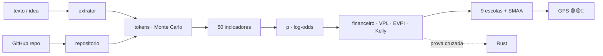

<!--
AnalisadorPreditivoMinimoViaveldeProjetos
Autor: ProfBru - Bruno Penedo © 2026 - TODOS OS DIREITOS RESERVADOS
E-mail: profbruanbima@gmail.com

TEMPLATE DO MOTOR DE READMEs — não editar os 12 READMEs à mão.
  • O que está aqui é ESTRUTURA (nunca traduzida): imagens, comandos, caminhos, badges de stack.
  • Marcadores b:<chave> entre chaves duplas são BLOCOS DE PROSA (traduzidos) — vêm de readme.blocos.json.
  • Marcadores lang:<nome> entre chaves duplas são preenchidos pelo gerador (seletor, frase de direitos).
Estilo: template do ECC (hero, seletor, badges, guia rápido, cards, o que tem dentro)
+ progressão D19: DOR → SOLUÇÃO → PROVA VISUAL → APLICAÇÃO → INSTALAÇÃO → PROFUNDIDADE → LICENÇA.
Gerar:  python3 public/foundations/pipeline/gerar_readmes.py
-->

<div align="center">

# 🧭 Analisador Preditivo Mínimo Viável de Projetos


**ProfBru © 2026**

### The predictive GPS that tells you whether an idea deserves your tokens — before the first token.

**One sentence of idea goes in. Out comes a 🟢🟡🔴 verdict, how many tokens it costs to structure, plan and code it, what it is worth against a risk-free rate — and what you should give up.**

   


[Português](README.md) · **English** · [Español](README.es.md) · [Français](README.fr.md) · [Deutsch](README.de.md) · [中文](README.zh.md) · [한국어](README.ko.md) · [हिन्दी](README.hi.md) · [עברית](README.he.md) · [Русский](README.ru.md) · [Svenska](README.sv.md) · [Suomi](README.fi.md)

</div>

> [!IMPORTANT]
> **Choosing and renouncing wisely, before spending, is one of the biggest edges there is.** Whoever knows where NOT to put time and money has already won half the game. This project turns that discipline into a method: predictive, auditable, with a scientific source behind every number.

## ⚡ Get started in 60 seconds

No server, no API key, no cloud. It runs on your machine, offline. Output in Brazilian Portuguese.

```bash
git clone <url-do-repositorio> AnalisadorPreditivoMinimoViaveldeProjetos
cd AnalisadorPreditivoMinimoViaveldeProjetos/public/foundations/pipeline
pip install -r requisitos.txt
python3 analisar.py ideia "App para clínicas lembrarem pacientes pelo WhatsApp com assinatura mensal"
```

Done: the report prints in the terminal with the traffic light, the recommended route, P10/P50/P90 tokens per phase, the expected value against the CDI (the Brazilian risk-free benchmark rate) and the questions you are avoiding. Want to compare several ideas? Use `comparar`. Only want the token cost? Use `tokens`.

<div align="center">

<table>
<tr>
<td width="33%" align="center"><b>🧭 One idea, one sentence</b><br/><sub>Even with no niche, sector or numbers. The GPS measures its own ignorance and never authorizes investing in the dark.</sub><br/><code>analisar.py ideia</code></td>
<td width="33%" align="center"><b>⚖️ Choose and renounce</b><br/><sub>Several ideas side by side: which to pursue, which to kill now, which are truly tied.</sub><br/><code>analisar.py comparar</code></td>
<td width="33%" align="center"><b>🪙 What it costs in tokens</b><br/><sub>Structure, plan and code — P10/P50/P90 and US$ per model, with tail risk.</sub><br/><code>analisar.py tokens</code></td>
</tr>
</table>

</div>

---

## 💀 The pain: you decide with a spreadsheet — and the spreadsheet decides nothing

Think about the last expensive choice you made. **The phones** for the sales team. **The electric car** for the fleet. **The supplier** for a three-year contract. **The startup idea** you buried six months of nights into. At a larger scale, the same pain: **which armored vehicle, which aircraft, which defense system** an armed force buys for thirty years; **which project** an executive committee approves with the year's budget.

In almost every case the ritual is the same: a **spreadsheet**, a **scoring matrix**, a few **filters**. And three traps nobody sees:

| What you did | What really happened |
|---|---|
| 🔻 **Sorted the spreadsheet by one column** | You decided by ONE criterion. The other seven were there just to feel rigorous. |
| 🔢 **Summed scores in a weighted matrix** | You offset a disaster with the average: an option terrible on safety "tied" because it was great on price. |
| 🔍 **Filtered by "meets everything"** | The list came back empty; you relaxed the inconvenient requirement — exactly the one that should have been the veto. |

And now there is a new cost, invisible in every spreadsheet: **tokens**. With AI agents, building became cheap and fast — which is why it became easy to spend weeks and hundreds of dollars building, perfectly, **the wrong idea**.

> [!WARNING]
> **Spreadsheets, matrices and ranking filters are not enough for a sound choice.** They cannot tell how *uncertain* you are, they do not punish a disaster on a critical criterion, they do not count the cost of *operating* what you will build and — worst of all — they never say **"do not invest now"**. A tool that never recommends renouncing is not decision support: it is a justification generator.

### The moment the decision dies

It is in the meeting, when someone asks: *"What if safety weighed 30% instead of 25%?"* — and the winner changes. Or six months later, when the project is finished, working, tested… and nobody pays for it. Startup post-mortems have pointed to the same number-one cause for a decade: **there was no market need** (35–42% of cases, CB Insights). The right question was never *"can we build it?"*. It was *"should we?"* — and it has an answer **before** the first token.

---

## 💊 The solution: a predictive GPS before every token

**You write the idea the way it is in your head — one sentence is enough.** In seconds, the analyzer does what a serious committee would do in weeks:

1. **Recognizes the idea's reference class** (B2B SaaS, automation, marketplace, trading, healthcare…) and starts from its base rate — the *outside view* that protects against the author's enthusiasm.
2. **Measures 50 indicators across 11 dimensions** — demand, market, technical feasibility, economics, durability, scalability, cumulativeness, robustness, alignment, information and financial arbitrage — each with **score, confidence, evidence and scientific source**.
3. **Estimates the tokens** to structure, plan and code, with **200,000 simulations** and the fat tail of IT projects, and converts them into US$ per model and human supervision hours.
4. **Does the math the spreadsheet forgets:** the cost of building **and of operating**, expected value discounted at the CDI, break-even probability, the value of testing first (EVPI), Kelly fraction and the marginal utility of each extra real.
5. **Puts nine decision schools to a vote** (ELECTRE I and II, PROMETHEE II, MAUT, MCDA-C, AHP-TOPSIS 2n, VIKOR, TODIM, SAPEVO-M) across five routes — don't invest, test first, MVP, full project, reuse code — and **perturbs weights and scores thousands of times** to say whether the choice is ROBUST, PROBABLE or FRAGILE.

<div align="center">

| ❌ What the spreadsheet says | ✅ What the predictive GPS says |
|---|---|
| "The idea scores 7.8." | **"🟡 TEST FIRST. The information is worth R$ 4,586 and the test costs R$ 850. Run this 5-day experiment; if it comes back negative, kill the idea."** |
| "We can build it in two weeks." | **"P50 of 13.7 M tokens, P90 of 40.1 M — and 23 hours of your review. The dominant cost is not building: it is operating."** |
| *(never says it)* | **"🔴 DO NOT INVEST NOW. No route beats the CDI with acceptable risk given what is known today."** |

</div>

**An honest system must be able to say "don't trust me here".** When the description is vague, the GPS says so — and the decision never turns green in the dark.

---

## 🖼️ See it working — one screen per sub-skill

Every screen below was generated by the analyzer itself (`gerar_telas.py`) with a fixed seed: you can reproduce each number on your machine. Labels are in Brazilian Portuguese, the tool's output language.

### 1. `ideia` — the GPS in one panel

<div align="center"></div>

**The pain it solves:** you do not need a 40-page report to decide whether to start; you need a verdict and the five numbers behind it.

Traffic light with a label (never color alone), recommended route, robustness, viability probability with an 80% interval, P50/P90 tokens, cost to build, expected value and EVPI.

> **Reading:** the dental-clinic idea has 50% viability — good — but the verdict is 🟡 **TEST FIRST**: knowing the outcome is worth R$ 4,586 and the experiment costs R$ 850. Buying cheap information before spending tokens is the rational decision, even for a promising idea.

### 2. `tokens` — what it costs to structure, plan and code

<div align="center"></div>
<div align="center"></div>

**The pain it solves:** "we can do it fast" is the most expensive sentence in engineering. AI agents vary up to 30× in tokens on the same task (Bai et al., 2026) and 1 in 6 IT projects overruns its budget by 200% (Flyvbjerg & Budzier, 2011).

The estimator counts files, integrations and complexity from the text, applies the per-activity consumption (read, write, edit, test, review), context growth and rework, and runs 200,000 fat-tailed simulations.

> **Reading:** coding is ~80% of the tokens, and input (the context re-read at every step) is 97% of them. The P10–P90 range spans an order of magnitude — which is why the GPS decides on the P90, not the average.

### 3. Routes — choosing **and** renouncing

<div align="center"></div>

**The pain it solves:** a spreadsheet compares ideas; it never compares *ways of investing* in the same idea. And the way matters more than the idea.

Five routes: **A0** don't invest (money in the CDI), **A1** 5-day minimum experiment, **A2** lean MVP, **A3** full project, **A4** reuse existing code. Each with committed capital, expected value, probability of loss and time to first evidence.

> **Reading:** the MVP has the highest expected value in reais, but the 5-day experiment wins the consensus — it reaches evidence 4× faster with a 13% chance of loss. The report spells out the **renunciation**: by choosing A1 you keep the full project's P90 exposure out of risk until there is evidence.

### 4. The vote of the nine multi-criteria schools

<div align="center"></div>

**The pain it solves:** each multi-criteria method is a different theory of what "better" means. Using only one is choosing the answer together with the question.

MAUT adds utilities; ELECTRE vetoes disaster; PROMETHEE grades preference; VIKOR refuses to compensate the worst criterion; TODIM weighs losses more than gains (Prospect Theory); SAPEVO-M accepts a committee's ordinal judgment.

> **Reading:** seven of the nine schools rank the minimum experiment 1st. When independent theories agree, the decision survives the meeting.

### 5. Indicators — and what moved the probability

<div align="center"></div>
<div align="center"></div>

**The pain it solves:** "score 7.8" without an explanation convinces nobody. Here each dimension shows its score, its confidence and how much it pushed the probability up or down.

The full catalog (`analisar.py indicadores`) lists the 50 indicators with formula, scientific source and the **minimum evidence** that would firm up each score — instead of making it up.

> **Reading:** Problem & Demand raised the probability the most (pain, frequency and 3 interested clinics); Market & Diversity stayed neutral — a single usage segment, Shannon entropy of zero. That is exactly what the next customer conversation needs to test.

### 6. `comparar` — several ideas, one decision

<div align="center"></div>

**The pain it solves:** you have five ideas and energy for one. A ranking with a "winner by 0.3 points" is noise dressed as certainty.

Ideas are analyzed in parallel (`ProcessPoolExecutor`) and voted by the nine schools with **double robustness**: uncertain weights and uncertain scores (SMAA). The verdict uses the lower of the two.

> **Reading:** with uncertain weights, idea 4 always wins; with uncertain scores, only 60% of the time — a statistical tie with idea 1. The GPS says it plainly: don't choose by the ranking, run the experiment for both. And it tells you to **renounce right away** the marketplace and the arbitrage bot, which win in no plausible scenario.

### 7. `repo` — does the idea already have code on GitHub?

<div align="center"></div>
<div align="center"></div>

**The pain it solves:** existing code looks like savings, but it costs reading, adaptation and sometimes a license you cannot use.

The analyzer makes an isolated shallow clone (nothing from the repository is executed), measures lines per language, tests, CI, license and age of the last commit, and computes readiness (software TRL). Maturity reduces coding tokens; reading is added to structuring tokens.

> **Reading:** with an MIT repository at TRL-5, the "reuse" route (A4) appears among the alternatives — and the consensus still prefers the MVP, because adapting what exists does not remove the market question.

### 8. Financial arbitrage and capital gains

<div align="center"></div>
<div align="center"></div>

**The pain it solves:** trading and arbitrage ideas look like free money — until transaction costs, taxes and alpha decay show up.

When the idea is a financial strategy, a dedicated dimension enters the model (persistence of the edge, costs and latency, statistical validation, regulatory exposure) and the report demands an out-of-sample backtest, Sharpe and drawdown before any product token. For every idea, the token capital is compared with the risk-free alternative: the CDI.

> **Reading:** the crypto arbitrage bot described in one sentence lands on 🟡 **TEST FIRST** with 12% viability; the bank-reconciliation automation next to it gets 🟢 **INVEST IN THE MVP** with a 4-month payback. Same author, same day: the difference is where time pays off.

### 9. When the idea is still too vague

<div align="center"></div>

**The pain it solves:** the worst decision is not saying no to a good idea — it is saying yes to an idea that does not exist yet.

For "a cool idea", the GPS measures 0% completeness, returns a very wide probability interval, lists the unanswered essential questions and flags the verdict as FRAGILE.

> **Reading:** 🔴 **DO NOT INVEST NOW** — not out of pessimism, but for lack of information. The report itself says what to find out first (who has the pain, what it costs, how money is made).

### 10. `prompt` — go deeper with an LLM, the right way

<div align="center"></div>

**The pain it solves:** LLMs are great at finding logical holes and proposing experiments — and bad at inventing calibrated weights and scores; as judges, they tend to agree with almost everything.

So the analyzer does the quantitative part and hands you a ready master prompt, already filled with class, probability, tokens and route, asking the LLM only for what it does well: uncomfortable questions, reversibility test, minimum experiment and dependency map.

> **Reading:** the number comes from the model; the questioning comes from the LLM. Each in its own role.

### 11. `--relatorio` — the dossier in PDF, HTML and Markdown

<div align="center"> </div>

**The pain it solves:** an important decision needs to circulate — in the committee, with the partner, in the investor's inbox — and it needs to prove who signed it.

With `--relatorio`, every analysis comes out in three formats: **Markdown** (versionable), self-contained **HTML** (embedded screens, light and dark theme) and **OCR-format PDF** — each page is an image with the large ProfBru mark at 50% transparency in the background, overlaid with an invisible text layer that makes the document searchable and copyable without being a plain-text PDF.

> **Reading:** the same GPS you read in the terminal becomes a six-page dossier with the five screens attached, ready for the meeting — and searching for "experimento mínimo" finds every occurrence in the PDF.

📎 [`docs/exemplos/gps_clinica.pdf`](docs/exemplos/gps_clinica.pdf) · [`.html`](docs/exemplos/gps_clinica.html) · [`.md`](docs/exemplos/gps_clinica.md)

---

## 🎯 What it is for — tailor-made choosing and renouncing

The same method serves any decision where **options contradict each other, information is incomplete and mistakes are expensive**:

<div align="center">

| Domain | Decision | Why the spreadsheet fails |
|---|---|---|
| **Ideas and startups** | which idea deserves tokens, time and capital in the next 90 days | ignores the class base rate and the cost of operating |
| **AI projects** | MVP, full project or just a test — and with which model | does not estimate tokens, tail or review hours |
| **Executive and corporate decisions** | project portfolio, supplier, make-or-buy | offsets a veto with an average; does not measure robustness |
| **Equipment and phones** | which equipment serves the real portfolio of uses | does not measure diversity of uses (Shannon) or marginal utility |
| **Electric cars and fleets** | range × total cost × infrastructure | counts correlated criteria twice |
| **Armed forces** | armored vehicles, aircraft, 30-year systems | a bad critical criterion must veto, not be compensated |
| **Trading and arbitrage** | build the bot or leave the money in the CDI? | forgets transaction costs, taxes and alpha decay |
| **Small and medium businesses** | automate the manual process or not | does not compare annual savings with the P90 cost |

</div>

> [!NOTE]
> The assumptions (exchange rate, CDI, horizon, the value of your hour, expected revenue, capital) are command-line parameters and are printed in every report. Change them and the verdict is recomputed — the decision is yours, with the math in plain sight.

---

## 🧩 Why each feature exists

| Feature | Why it exists | Grounding |
|---|---|---|
| **Reference class** | the best forecast of a project is the history of similar projects, not the optimism of whoever proposes it | Kahneman & Lovallo (1993); Flyvbjerg & Gardner (2023) |
| **Log-odds probability with confidence** | each indicator moves the probability in proportion to the evidence; without evidence, almost nothing | interpretable rules (LLM-AR, 2025); SAISE (2025) |
| **P10/P50/P90 tokens per phase** | agent consumption varies up to 30× and input dominates the cost | Bai et al. (2026); ACEM (2026); tokencast |
| **Cost of operating, not just building** | with AI, building became cheap; what breaks the business is operating | ACEM (2026); CB Insights |
| **NPV against the CDI** | every real spent on tokens has a certain opportunity cost | Dixit & Pindyck (1994) |
| **EVPI — the value of testing first** | sometimes the best purchase is information, not code | Howard (1966); Camuffo et al. (2020, 2024) |
| **Kelly fraction** | how much to bet matters as much as what to bet on | Kelly (1956) |
| **Marginal utility on the efficient frontier** | what matters is the value of the NEXT real invested | Gossen (1854) |
| **Shannon entropy, Simpson, HHI, Versatility Index** | an idea with several uses has more exits if the first market fails | Shannon (1948); knowledge-base KPIs |
| **Nine schools + Borda consensus** | agreement among independent theories is the strongest evidence without data | Roy; Brans; Keeney & Raiffa; Saaty; Opricovic; Gomes |
| **Double robustness (weights and scores)** | a winner that changes with 2 points of weight is not a winner | SMAA — Lahdelma et al. (1998) |
| **Uncomfortable questions, reversibility, minimum experiment, dependencies** | it is what a skeptical investor would do — and what an LLM does well | the project's knowledge base |
| **OCR-format PDF, HTML and Markdown report** | the decision must circulate, be searchable and carry authorship on every page | PyMuPDF + Pillow, all local |
| **Second engine in Rust** | two independent engines that agree prove the math, not just the code | cross-check on every pipeline run |

---

## ⚙️ Installation and usage

| Component | Version | Required | What for |
|---|---|---|---|
| Python | 3.13 | ✅ | engine, CLI, reports |
| NumPy | 2.x | ✅ | algebra and simulation |
| numba | ≥ 0.60 | ⚠️ recommended | kernel JIT (without it: same answer, slower) |
| matplotlib | ≥ 3.7 | ⚠️ for screens | PNG charts |
| PyMuPDF · Pillow · markdown | recent | ⚠️ for `--relatorio` | PDF, HTML |
| Rust / cargo | stable | ⭕ optional | second verification engine |
| git · screen | — | ⭕ optional | analyze repositories · run in the background |

```bash
cd public/foundations/pipeline
python3 analisar.py ideia "<ideia>" [--repo <url|pasta>] [--relatorio [base]] [--telas pasta/] [--json]
python3 analisar.py comparar "<ideia A>" "<ideia B>" "<ideia C>" [--relatorio]   # ou --arquivo ideias.txt
python3 analisar.py tokens "<ideia>" [--json]
python3 analisar.py repo https://github.com/<usuario>/<projeto>
python3 analisar.py indicadores [--bibliografia]
python3 analisar.py prompt "<ideia>"

# premissas (todas opcionais): --cambio 5.50 --cdi 0.14 --horizonte 12 --valor-hora 80
#                              --receita 3000 --receita-otimista 20000 --capital 50000 --infra-mes 0

./run_all.sh --demo          # < 60 s
./run_all.sh                 # testes + prova cruzada Rust + bench + telas + i18n
./run_all.sh --background    # screen + watchdog de 20 min (screen -r analisadorpreditivominimoviaveldeprojetos)
```

| Sub-skill | What it delivers |
|---|---|
| `ideia` | full GPS for one idea: traffic light, route, probability, tokens, economics, nine schools, indicators, questions, experiment, dependencies, renunciation (Markdown, JSON and screens) |
| `comparar` | several ideas in parallel: which to pursue, which are tied, which to renounce right away |
| `tokens` | only the cost: P10/P50/P90 tokens per phase, US$ per model, human hours |
| `repo` | maturity of a repository: lines, languages, tests, CI, license, readiness |
| `indicadores` | catalog of the 50 indicators with formula, source and minimum evidence; `--bibliografia` |
| `prompt` | ready master prompt to explore the idea further with an LLM |
| `--relatorio` | any analysis as Markdown, HTML and OCR-format PDF with watermark |

---

## 🧠 Under the hood

Text becomes **signals** (a Portuguese and English lexicon, keeping the evidence that triggered each one); signals define the **reference class** and the **functional size**; size becomes **tokens** (fat-tailed simulation); signals and size become **indicators**; indicators shift the class **prior** in log-odds to the **viability probability**; the probability feeds the **economics** of the five routes; and the nine schools choose the route — with measured robustness.



| Dimension | What it asks |
|---|---|
| Problem & Demand | is the pain real, frequent, paid for? has anyone outside your head confirmed it? |
| Market & Diversity | how many uses and segments (Shannon, Simpson, HHI, Versatility)? |
| Technical feasibility | size, integrations, real time, existing code, resistance to AI commoditization |
| Economic feasibility | cost, tail, safety margin, NPV, payback, recurrence, Kelly, marginal utility |
| Durability | does it withstand time, fads and a single platform? |
| Scalability | marginal cost, network effect, automation |
| Cumulativeness | what remains if it fails: code, data, learning, pivot options |
| Robustness & Risk | regulation, external dependencies, solo execution, maximum loss |
| Alignment & Testability | author advantage, 5-day experiment, time to evidence, zero cost |
| Information & Uncertainty | completeness of the description, class confidence, value of information |
| Financial arbitrage | alpha persistence, costs, statistical validation, regulation |

### At the frontier of science

No indicator enters the catalog without a source — and an automated test fails the project if that happens. Among the 52 references: the recent literature on AI- and LLM-based startup success prediction (VCBench, SSFF, SAISE, a meta-analysis of predictors, LLM-AR, kNN-ICL — 2024 to 2026), token consumption of coding agents (Bai, Brynjolfsson, Pentland et al., 2026) and cost estimation for agentic engineering (ACEM, 2026), alongside the classics behind each method: Shannon, Gossen, Kelly, Howard, Kahneman & Tversky, Roy, Saaty, Keeney & Raiffa, Flyvbjerg, Lahdelma (SMAA) and the Brazilian school of multi-criteria decision aid. The full list comes out of `python3 analisar.py indicadores --bibliografia`.

---

## 🚀 Performance and cross-check

| Measurement (4 CPUs, clinic case) | Result |
|---|---|
| Full analysis of one idea (200,000 token simulations + 9 schools × 2,000 universes) | ≈ 1.8 s |
| Several ideas | in parallel with `ProcessPoolExecutor`, result identical to serial |
| Python × Rust agreement (5 cases, 10 quantities each) | maximum difference of 2.2 × 10⁻¹⁵ |

Every measurement is recorded with proof that the result did not change: an optimization that alters the answer is not a gain.

```text
✅ clinica      10 grandezas idênticas · Δ relativo máx 0.0e+00
✅ conciliacao  10 grandezas idênticas · Δ relativo máx 0.0e+00
✅ arbitragem   10 grandezas idênticas · Δ relativo máx 1.3e-15
✅ marketplace  10 grandezas idênticas · Δ relativo máx 2.2e-15
✅ vaga         10 grandezas idênticas · Δ relativo máx 0.0e+00
```

---

## 📁 What is inside

```
AnalisadorPreditivoMinimoViaveldeProjetos/
├── README.md (+11)
├── projeto.toml
├── docs/                         logo, telas/, CUSTO.md, OPERACAO.md
└── public/foundations/
    ├── pipeline/
    │   ├── analisar.py           CLI (6 sub-skills)
    │   ├── apmv/                 extrator · repositorio · tokens · indicadores · preditivo
    │   │   │                     financeiro · decisao · gps · relatorio · telas · referencias
    │   │   └── mcdm/             ELECTRE I/II · PROMETHEE II · MAUT · MCDA-C · AHP-TOPSIS 2n
    │   │                         VIKOR · TODIM · SAPEVO-M · Borda · Dirichlet
    │   ├── testes_apmv.py · prova_cruzada_rust.py · bench.py · gerar_telas.py
    │   └── run_all.sh · watchdog.sh · verificar_publicacao.sh
    └── rust/analisadorpreditivominimoviaveldeprojetos_core/   apmv_core
```

Everything runs locally with no recurring cost: no server, no API key, no network call during analysis (only `git clone` when you pass a repository).

---

## ❓ Questions you will ask

<details>
<summary><b>Does it really work with a one-sentence idea?</b></summary>

It does — that is the case it was designed for. With little information, the GPS starts from the class base rate, widens the probability interval and does not authorize investing: it tells you exactly which questions to answer first.
</details>

<details>
<summary><b>Why not just ask an LLM whether the idea is good?</b></summary>

Because LLMs, as judges, agree with almost everything — and invent weights and scores that look calibrated. The analyzer does the math with method and sources; the LLM comes in where it is strong, through the master prompt.
</details>

<details>
<summary><b>Where do the report's revenues and hours come from?</b></summary>

From the reference class, as conservative and optimistic scenarios — and they appear as assumptions. If you know the revenue, the value of your hour or the capital, pass them on the command line and everything is recomputed.
</details>

<details>
<summary><b>Does it work for decisions that are not about software?</b></summary>

Yes. The nine schools, the robustness analysis and the diversity and marginal-utility indicators apply to equipment, fleets, suppliers and projects of any kind; tokens are just one of the currencies.
</details>

<details>
<summary><b>Do I have to pay anything to run it?</b></summary>

No. It runs on your machine, offline. The only cost is the one the report itself estimates — the tokens you decide to spend afterwards.
</details>

---

## 📜 License and authorship

<div align="center">


**ProfBru © 2026**

**Analisador Preditivo Mínimo Viável de Projetos**
Author: **ProfBru - Bruno Penedo** © 2026 — **ALL RIGHTS RESERVED**
📧 profbruanbima@gmail.com

</div>

Proprietary software. Use, copying, modification and distribution require the author's express authorization. Third-party libraries and references keep their own licenses and credits.

---

_AnalisadorPreditivoMinimoViaveldeProjetos_
_Author: **ProfBru - Bruno Penedo** © 2026 — ALL RIGHTS RESERVED · profbruanbima@gmail.com_
