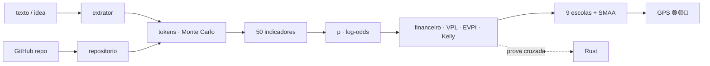

<!--
AnalisadorPreditivoMinimoViaveldeProjetos
Autor: ProfBru - Bruno Penedo © 2026 - TODOS OS DIREITOS RESERVADOS
E-mail: profbruanbima@gmail.com

TEMPLATE DO MOTOR DE READMEs — não editar os 12 READMEs à mão.
  • O que está aqui é ESTRUTURA (nunca traduzida): imagens, comandos, caminhos, badges de stack.
  • Marcadores b:<chave> entre chaves duplas são BLOCOS DE PROSA (traduzidos) — vêm de readme.blocos.json.
  • Marcadores lang:<nome> entre chaves duplas são preenchidos pelo gerador (seletor, frase de direitos).
Estilo: template do ECC (hero, seletor, badges, guia rápido, cards, o que tem dentro)
+ progressão D19: DOR → SOLUÇÃO → PROVA VISUAL → APLICAÇÃO → INSTALAÇÃO → PROFUNDIDADE → LICENÇA.
Gerar:  python3 public/foundations/pipeline/gerar_readmes.py
-->

<div align="center">

# 🧭 Analisador Preditivo Mínimo Viável de Projetos


**ProfBru © 2026**

### El GPS predictivo que dice si una idea merece sus tokens — antes del primer token.

**Entra una frase de idea. Sale un veredicto 🟢🟡🔴, cuántos tokens cuesta estructurarla, planificarla y codificarla, cuánto vale frente a una tasa libre de riesgo — y a qué debe renunciar.**

   


[Português](README.md) · [English](README.en.md) · **Español** · [Français](README.fr.md) · [Deutsch](README.de.md) · [中文](README.zh.md) · [한국어](README.ko.md) · [हिन्दी](README.hi.md) · [עברית](README.he.md) · [Русский](README.ru.md) · [Svenska](README.sv.md) · [Suomi](README.fi.md)

</div>

> [!IMPORTANT]
> **Elegir y renunciar con sabiduría, antes de gastar, es una de las mayores ventajas que existen.** Quien sabe dónde NO poner tiempo y dinero ya ganó la mitad del juego. Este proyecto convierte esa disciplina en método: predictivo, auditable, con una fuente científica detrás de cada número.

## ⚡ Empiece en 60 segundos

Sin servidor, sin clave de API, sin nube. Se ejecuta en su máquina, sin conexión. Salida en portugués de Brasil.

```bash
git clone <url-do-repositorio> AnalisadorPreditivoMinimoViaveldeProjetos
cd AnalisadorPreditivoMinimoViaveldeProjetos/public/foundations/pipeline
pip install -r requisitos.txt
python3 analisar.py ideia "App para clínicas lembrarem pacientes pelo WhatsApp com assinatura mensal"
```

Listo: el informe aparece en la terminal con el semáforo, la ruta recomendada, los tokens P10/P50/P90 por fase, el valor esperado frente al CDI (la tasa de referencia libre de riesgo de Brasil) y las preguntas que está evitando. ¿Quiere comparar varias ideas? Use `comparar`. ¿Solo el costo en tokens? Use `tokens`.

<div align="center">

<table>
<tr>
<td width="33%" align="center"><b>🧭 Una idea, una frase</b><br/><sub>Incluso sin nicho, sector ni números. El GPS mide su propia ignorancia y nunca autoriza invertir a ciegas.</sub><br/><code>analisar.py ideia</code></td>
<td width="33%" align="center"><b>⚖️ Elegir y renunciar</b><br/><sub>Varias ideas lado a lado: cuál seguir, cuál descartar ya, cuáles empatan de verdad.</sub><br/><code>analisar.py comparar</code></td>
<td width="33%" align="center"><b>🪙 Cuánto cuesta en tokens</b><br/><sub>Estructurar, planificar y codificar — P10/P50/P90 y US$ por modelo, con riesgo de cola.</sub><br/><code>analisar.py tokens</code></td>
</tr>
</table>

</div>

---

## 💀 El dolor: usted decide con una hoja de cálculo — y la hoja de cálculo no decide nada

Piense en la última elección cara que hizo. **Los teléfonos** del equipo de ventas. **El coche eléctrico** de la flota. **El proveedor** de un contrato de tres años. **La idea de startup** en la que enterró seis meses de noches. A mayor escala, el mismo dolor: **qué blindado, qué aeronave, qué sistema de defensa** compra una fuerza armada para treinta años; **qué proyecto** aprueba un comité ejecutivo con el presupuesto del año.

En casi todos los casos el ritual es el mismo: una **hoja de cálculo**, una **matriz de puntuación**, algunos **filtros**. Y tres trampas que nadie ve:

| Lo que usted hizo | Lo que pasó de verdad |
|---|---|
| 🔻 **Ordenó la hoja por una columna** | Decidió por UN criterio. Los otros siete estaban ahí solo para dar sensación de rigor. |
| 🔢 **Sumó notas en una matriz ponderada** | Compensó el desastre con la media: una opción pésima en seguridad "empató" porque era excelente en precio. |
| 🔍 **Filtró por "cumple con todo"** | La lista quedó vacía; aflojó el requisito incómodo — justo el que debió ser el veto. |

Y ahora apareció un costo nuevo, invisible en toda hoja de cálculo: **los tokens**. Con agentes de IA, construir se volvió barato y rápido — y por eso se volvió fácil gastar semanas y cientos de dólares construyendo, con perfección, **la idea equivocada**.

> [!WARNING]
> **Las hojas de cálculo, las matrices y los filtros de clasificación son insuficientes para una buena elección.** No saben decir cuán *incierto* está usted, no castigan el desastre en un criterio crítico, no cuentan el costo de *operar* lo que va a construir y — lo peor — nunca dicen **"no invierta ahora"**. Una herramienta que nunca recomienda renunciar no es apoyo a la decisión: es un generador de justificaciones.

### El momento en que la decisión muere

Es en la reunión, cuando alguien pregunta: *"¿Y si la seguridad pesara 30% en vez de 25%?"* — y el ganador cambia. O seis meses después, cuando el proyecto está listo, funcionando, probado… y nadie paga por él. Los post-mortems de startups señalan la misma causa número uno desde hace una década: **no había necesidad de mercado** (35–42% de los casos, CB Insights). La pregunta correcta nunca fue *"¿podemos construirlo?"*. Era *"¿deberíamos?"* — y tiene respuesta **antes** del primer token.

---

## 💊 La solución: un GPS predictivo antes de cada token

**Usted escribe la idea tal como está en su cabeza — basta una frase.** En segundos, el analizador hace lo que un comité serio haría en semanas:

1. **Reconoce la clase de referencia** de la idea (SaaS B2B, automatización, marketplace, trading, salud…) y parte de su tasa base — la *outside view* que protege contra el entusiasmo del autor.
2. **Mide 50 indicadores en 11 dimensiones** — demanda, mercado, viabilidad técnica, economía, durabilidad, escalabilidad, acumulatividad, robustez, alineación, información y arbitraje financiero — cada uno con **nota, confianza, evidencia y fuente científica**.
3. **Estima los tokens** para estructurar, planificar y codificar, con **200 mil simulaciones** y la cola gruesa de los proyectos de TI, y los convierte en US$ por modelo y en horas humanas de supervisión.
4. **Hace la cuenta que la hoja olvida:** costo de construir **y de operar**, valor esperado descontado al CDI, probabilidad de equilibrio, valor de probar antes (EVPI), fracción de Kelly y utilidad marginal de cada real adicional.
5. **Pone a votar a nueve escuelas de decisión** (ELECTRE I y II, PROMETHEE II, MAUT, MCDA-C, AHP-TOPSIS 2n, VIKOR, TODIM, SAPEVO-M) entre cinco rutas — no invertir, probar antes, MVP, proyecto completo, reutilizar código — y **perturba pesos y notas miles de veces** para decir si la elección es ROBUSTA, PROBABLE o FRÁGIL.

<div align="center">

| ❌ Lo que dice la hoja de cálculo | ✅ Lo que dice el GPS predictivo |
|---|---|
| "La idea tiene nota 7,8." | **"🟡 PRUEBE ANTES. La información vale R$ 4.586 y la prueba cuesta R$ 850. Ejecute este experimento de 5 días; si sale negativo, descarte la idea."** |
| "Se puede hacer en dos semanas." | **"P50 de 13,7 M tokens, P90 de 40,1 M — y 23 horas suyas de revisión. El costo dominante no es construir: es operar."** |
| *(nunca lo dice)* | **"🔴 NO INVIERTA AHORA. Ninguna ruta supera al CDI con riesgo aceptable con lo que se sabe hoy."** |

</div>

**Un sistema honesto debe saber decir "no confíe en mí aquí".** Cuando la descripción es vaga, el GPS lo dice — y la decisión nunca se pone verde a ciegas.

---

## 🖼️ Véalo funcionando — una pantalla por sub-skill

Todas las pantallas fueron generadas por el propio analizador (`gerar_telas.py`) con semilla fija: puede reproducir cada número en su máquina. Las etiquetas están en portugués de Brasil, el idioma de salida de la herramienta.

### 1. `ideia` — el GPS en un panel

<div align="center"></div>

**El dolor que resuelve:** no necesita un informe de 40 páginas para decidir si empieza; necesita un veredicto y los cinco números que lo sostienen.

Semáforo con etiqueta (nunca solo color), ruta recomendada, robustez, probabilidad de viabilidad con intervalo del 80%, tokens P50/P90, costo de construir, valor esperado y EVPI.

> **Lectura:** la idea de las clínicas dentales tiene 50% de viabilidad — buena —, pero el veredicto es 🟡 **PRUEBE ANTES**: conocer el resultado vale R$ 4.586 y el experimento cuesta R$ 850. Comprar información barata antes de gastar tokens es la decisión racional, incluso para una idea prometedora.

### 2. `tokens` — cuánto cuesta estructurar, planificar y codificar

<div align="center"></div>
<div align="center"></div>

**El dolor que resuelve:** "se puede hacer rápido" es la frase más cara de la ingeniería. Los agentes de IA varían hasta 30× en tokens en la misma tarea (Bai et al., 2026) y 1 de cada 6 proyectos de TI excede su presupuesto en 200% (Flyvbjerg & Budzier, 2011).

El estimador cuenta archivos, integraciones y complejidad a partir del texto, aplica el consumo por actividad (leer, escribir, editar, probar, revisar), el crecimiento del contexto y el retrabajo, y ejecuta 200 mil simulaciones con cola gruesa.

> **Lectura:** codificar es ~80% de los tokens, y la entrada (el contexto releído en cada paso) es el 97%. El rango P10–P90 abarca un orden de magnitud — por eso el GPS decide por el P90, no por la media.

### 3. Rutas — elegir **y** renunciar

<div align="center"></div>

**El dolor que resuelve:** la hoja de cálculo compara ideas; nunca compara *formas de invertir* en la misma idea. Y la forma importa más que la idea.

Cinco rutas: **A0** no invertir (dinero en el CDI), **A1** experimento mínimo de 5 días, **A2** MVP ligero, **A3** proyecto completo, **A4** reutilizar código existente. Cada una con capital comprometido, valor esperado, probabilidad de pérdida y tiempo hasta la primera evidencia.

> **Lectura:** el MVP tiene el mayor valor esperado en reales, pero el experimento de 5 días gana el consenso — llega a la evidencia 4× más rápido, con 13% de probabilidad de pérdida. El informe explicita la **renuncia**: al elegir A1, usted deja fuera de riesgo la exposición P90 del proyecto completo hasta tener evidencia.

### 4. El voto de las nueve escuelas multicriterio

<div align="center"></div>

**El dolor que resuelve:** cada método multicriterio es una teoría distinta de lo que significa "mejor". Usar solo uno es elegir la respuesta junto con la pregunta.

MAUT suma utilidades; ELECTRE veta el desastre; PROMETHEE gradúa la preferencia; VIKOR se niega a compensar el peor criterio; TODIM pesa la pérdida más que la ganancia (Teoría de las Perspectivas); SAPEVO-M acepta el juicio ordinal de un comité.

> **Lectura:** siete de las nueve escuelas ponen el experimento mínimo en 1.º lugar. Cuando teorías independientes coinciden, la decisión sobrevive a la reunión.

### 5. Indicadores — y lo que movió la probabilidad

<div align="center"></div>
<div align="center"></div>

**El dolor que resuelve:** "nota 7,8" sin explicación no convence a nadie. Aquí cada dimensión muestra la nota, la confianza y cuánto empujó la probabilidad hacia arriba o hacia abajo.

El catálogo completo (`analisar.py indicadores`) lista los 50 indicadores con fórmula, fuente científica y la **evidencia mínima** que confirmaría cada nota — en lugar de inventarla.

> **Lectura:** Problema y Demanda fue la dimensión que más elevó la probabilidad (dolor, frecuencia y 3 clínicas interesadas); Mercado y Diversidad quedó neutra — un único segmento de uso, entropía de Shannon cero. Es exactamente lo que la próxima conversación con clientes debe poner a prueba.

### 6. `comparar` — varias ideas, una decisión

<div align="center"></div>

**El dolor que resuelve:** tiene cinco ideas y energía para una. Un ranking con "ganador por 0,3 puntos" es ruido disfrazado de certeza.

Las ideas se analizan en paralelo (`ProcessPoolExecutor`) y votan las nueve escuelas con **robustez doble**: pesos inciertos y notas inciertas (SMAA). El veredicto usa la menor de las dos.

> **Lectura:** con pesos inciertos, la idea 4 gana siempre; con notas inciertas, solo el 60% de las veces — empate técnico con la idea 1. El GPS lo dice claramente: no elija por el ranking, ejecute el experimento de ambas. Y manda **renunciar ya** al marketplace y al robot de arbitraje, que no ganan en ningún escenario plausible.

### 7. `repo` — ¿la idea ya tiene código en GitHub?

<div align="center"></div>
<div align="center"></div>

**El dolor que resuelve:** el código existente parece un ahorro, pero cuesta lectura, adaptación y a veces una licencia que no se puede usar.

El analizador hace un clon superficial aislado (no se ejecuta nada del repositorio), mide líneas por lenguaje, pruebas, CI, licencia y antigüedad del último commit, y calcula la madurez (TRL de software). La madurez reduce los tokens de codificar; la lectura se suma a los tokens de estructurar.

> **Lectura:** con un repositorio MIT de nivel TRL-5, la ruta "reutilizar" (A4) aparece entre las alternativas — y el consenso aún prefiere el MVP, porque adaptar lo que existe no elimina la pregunta de mercado.

### 8. Arbitraje financiero y ganancias de capital

<div align="center"></div>
<div align="center"></div>

**El dolor que resuelve:** las ideas de trading y arbitraje parecen dinero gratis — hasta que aparecen los costos de transacción, los impuestos y el decaimiento del alfa.

Cuando la idea es una estrategia financiera, entra en el modelo una dimensión propia (persistencia de la ventaja, costos y latencia, validación estadística, exposición regulatoria) y el informe exige backtest fuera de muestra, Sharpe y drawdown antes de cualquier token de producto. Para cualquier idea, el capital-token se compara con la alternativa sin riesgo: el CDI.

> **Lectura:** el robot de arbitraje cripto descrito en una frase queda en 🟡 **PRUEBE ANTES** con 12% de viabilidad; la automatización de la conciliación bancaria, al lado, recibe 🟢 **INVIERTA EN EL MVP** con payback de 4 meses. Mismo autor, mismo día: la diferencia está en dónde rinde el tiempo.

### 9. Cuando la idea aún es demasiado vaga

<div align="center"></div>

**El dolor que resuelve:** la peor decisión no es decir no a una buena idea — es decir sí a una idea que todavía no existe.

Para "una idea genial", el GPS mide completitud del 0%, devuelve un intervalo de probabilidad muy amplio, enumera las preguntas esenciales sin respuesta y marca el veredicto como FRÁGIL.

> **Lectura:** 🔴 **NO INVIERTA AHORA** — no por pesimismo: por falta de información. El propio informe dice qué averiguar antes (quién tiene el dolor, cuánto cuesta, cómo se gana dinero).

### 10. `prompt` — profundice con un LLM, de la forma correcta

<div align="center"></div>

**El dolor que resuelve:** los LLM son excelentes para encontrar huecos lógicos y proponer experimentos — y malos para inventar pesos y notas calibradas; como jueces, tienden a estar de acuerdo con casi todo.

Por eso el analizador hace la parte cuantitativa y entrega un prompt maestro listo, ya con clase, probabilidad, tokens y ruta, pidiendo al LLM solo lo que hace bien: preguntas incómodas, prueba de reversibilidad, experimento mínimo y mapa de dependencias.

> **Lectura:** el número viene del modelo; el cuestionamiento viene del LLM. Cada uno en su papel.

### 11. `--relatorio` — el dossier en PDF, HTML y Markdown

<div align="center"> </div>

**El dolor que resuelve:** una decisión importante necesita circular — en el comité, con el socio, en el correo del inversor — y necesita probar quién la firmó.

Con `--relatorio`, cada análisis sale en tres formatos: **Markdown** (versionable), **HTML** autocontenido (pantallas incrustadas, tema claro y oscuro) y **PDF en formato OCR** — cada página es una imagen con la marca ProfBru grande, al 50% de transparencia, al fondo, y una capa de texto invisible superpuesta que hace el documento buscable y copiable sin ser un PDF de texto plano.

> **Lectura:** el mismo GPS que leyó en la terminal se convierte en un dossier de seis páginas con las cinco pantallas adjuntas, listo para la reunión — y la búsqueda de "experimento mínimo" encuentra cada aparición en el PDF.

📎 [`docs/exemplos/gps_clinica.pdf`](docs/exemplos/gps_clinica.pdf) · [`.html`](docs/exemplos/gps_clinica.html) · [`.md`](docs/exemplos/gps_clinica.md)

---

## 🎯 Para qué sirve — elegir y renunciar a la medida

El mismo método sirve para cualquier decisión en la que **las opciones se contradicen, la información es incompleta y equivocarse sale caro**:

<div align="center">

| Dominio | Decisión | Por qué falla la hoja de cálculo |
|---|---|---|
| **Ideas y startups** | qué idea merece tokens, tiempo y capital en los próximos 90 días | ignora la tasa base de la clase y el costo de operar |
| **Proyectos con IA** | MVP, proyecto completo o solo una prueba — y con qué modelo | no estima tokens, cola ni horas de revisión |
| **Decisiones ejecutivas y corporativas** | portafolio de proyectos, proveedor, make-or-buy | compensa un veto con la media; no mide robustez |
| **Equipos y teléfonos** | qué equipo atiende el portafolio real de usos | no mide diversidad de usos (Shannon) ni utilidad marginal |
| **Coches eléctricos y flotas** | autonomía × costo total × infraestructura | cuenta dos veces criterios correlacionados |
| **Fuerzas armadas** | blindados, aeronaves, sistemas de 30 años | un criterio crítico malo debe vetar, no ser compensado |
| **Trading y arbitraje** | ¿construir el robot o dejar el dinero en el CDI? | olvida costos de transacción, impuestos y decaimiento del alfa |
| **Pequeñas y medianas empresas** | automatizar el proceso manual o no | no compara el ahorro anual con el costo P90 |

</div>

> [!NOTE]
> Los supuestos (tipo de cambio, CDI, horizonte, valor de su hora, ingresos esperados, capital) son parámetros de la línea de comandos y aparecen impresos en cada informe. Cámbielos y el veredicto se recalcula — la decisión es suya, con las cuentas a la vista.

---

## 🧩 Por qué existe cada función

| Función | Por qué existe | Fundamento |
|---|---|---|
| **Clase de referencia** | la mejor previsión de un proyecto es el historial de proyectos similares, no el optimismo de quien lo propone | Kahneman & Lovallo (1993); Flyvbjerg & Gardner (2023) |
| **Probabilidad en log-odds con confianza** | cada indicador mueve la probabilidad en proporción a la evidencia; sin evidencia, casi nada | reglas interpretables (LLM-AR, 2025); SAISE (2025) |
| **Tokens P10/P50/P90 por fase** | el consumo de los agentes varía hasta 30× y la entrada domina el costo | Bai et al. (2026); ACEM (2026); tokencast |
| **Costo de operar, no solo de construir** | con IA, construir se abarató; lo que quiebra el negocio es operar | ACEM (2026); CB Insights |
| **VPN frente al CDI** | cada real gastado en tokens tiene un costo de oportunidad cierto | Dixit & Pindyck (1994) |
| **EVPI — valor de probar antes** | a veces la mejor compra es información, no código | Howard (1966); Camuffo et al. (2020, 2024) |
| **Fracción de Kelly** | cuánto apostar importa tanto como en qué | Kelly (1956) |
| **Utilidad marginal en la frontera eficiente** | lo que importa es el valor del PRÓXIMO real invertido | Gossen (1854) |
| **Entropía de Shannon, Simpson, HHI, Índice de Versatilidad** | una idea con varios usos tiene más salidas si el primer mercado falla | Shannon (1948); KPIs de la base de conocimiento |
| **Nueve escuelas + consenso de Borda** | la coincidencia entre teorías independientes es la evidencia más fuerte sin datos | Roy; Brans; Keeney & Raiffa; Saaty; Opricovic; Gomes |
| **Robustez doble (pesos y notas)** | un ganador que cambia con 2 puntos de peso no es ganador | SMAA — Lahdelma et al. (1998) |
| **Preguntas incómodas, reversibilidad, experimento mínimo, dependencias** | es lo que haría un inversor escéptico — y lo que un LLM hace bien | base de conocimiento del proyecto |
| **Informe en PDF formato OCR, HTML y Markdown** | la decisión debe circular, ser buscable y llevar la autoría en cada página | PyMuPDF + Pillow, todo local |
| **Segundo motor en Rust** | dos motores independientes que coinciden prueban la matemática, no solo el código | verificación cruzada en cada ejecución |

---

## ⚙️ Instalación y uso

| Componente | Versión | Obligatorio | Para qué |
|---|---|---|---|
| Python | 3.13 | ✅ | motor, CLI, informes |
| NumPy | 2.x | ✅ | álgebra y simulación |
| numba | ≥ 0.60 | ⚠️ recomendado | JIT de los kernels (sin él: misma respuesta, más lento) |
| matplotlib | ≥ 3.7 | ⚠️ para pantallas | gráficos PNG |
| PyMuPDF · Pillow · markdown | recientes | ⚠️ para `--relatorio` | PDF, HTML |
| Rust / cargo | estable | ⭕ opcional | segundo motor de verificación |
| git · screen | — | ⭕ opcional | analizar repositorios · ejecutar en segundo plano |

```bash
cd public/foundations/pipeline
python3 analisar.py ideia "<ideia>" [--repo <url|pasta>] [--relatorio [base]] [--telas pasta/] [--json]
python3 analisar.py comparar "<ideia A>" "<ideia B>" "<ideia C>" [--relatorio]   # ou --arquivo ideias.txt
python3 analisar.py tokens "<ideia>" [--json]
python3 analisar.py repo https://github.com/<usuario>/<projeto>
python3 analisar.py indicadores [--bibliografia]
python3 analisar.py prompt "<ideia>"

# premissas (todas opcionais): --cambio 5.50 --cdi 0.14 --horizonte 12 --valor-hora 80
#                              --receita 3000 --receita-otimista 20000 --capital 50000 --infra-mes 0

./run_all.sh --demo          # < 60 s
./run_all.sh                 # testes + prova cruzada Rust + bench + telas + i18n
./run_all.sh --background    # screen + watchdog de 20 min (screen -r analisadorpreditivominimoviaveldeprojetos)
```

| Sub-skill | Qué entrega |
|---|---|
| `ideia` | GPS completo de una idea: semáforo, ruta, probabilidad, tokens, economía, nueve escuelas, indicadores, preguntas, experimento, dependencias, renuncia (Markdown, JSON y pantallas) |
| `comparar` | varias ideas en paralelo: cuál seguir, cuáles empatan, a cuáles renunciar ya |
| `tokens` | solo el costo: tokens P10/P50/P90 por fase, US$ por modelo, horas humanas |
| `repo` | madurez de un repositorio: líneas, lenguajes, pruebas, CI, licencia, preparación |
| `indicadores` | catálogo de los 50 indicadores con fórmula, fuente y evidencia mínima; `--bibliografia` |
| `prompt` | prompt maestro listo para profundizar la idea en un LLM |
| `--relatorio` | cualquier análisis en Markdown, HTML y PDF formato OCR con marca de agua |

---

## 🧠 Cómo funciona por dentro

El texto se convierte en **señales** (léxico en portugués e inglés, conservando la evidencia que disparó cada una); las señales definen la **clase de referencia** y el **tamaño funcional**; el tamaño se convierte en **tokens** (simulación con cola gruesa); señales y tamaño se convierten en **indicadores**; los indicadores desplazan el **prior** de la clase en log-odds hasta la **probabilidad de viabilidad**; la probabilidad alimenta la **economía** de las cinco rutas; y las nueve escuelas eligen la ruta — con robustez medida.



| Dimensión | Qué pregunta |
|---|---|
| Problema y Demanda | ¿el dolor es real, frecuente, se paga? ¿alguien fuera de su cabeza lo confirmó? |
| Mercado y Diversidad | ¿cuántos usos y segmentos (Shannon, Simpson, HHI, Versatilidad)? |
| Viabilidad técnica | tamaño, integraciones, tiempo real, código existente, resistencia a la comoditización por IA |
| Viabilidad económica | costo, cola, margen de seguridad, VPN, payback, recurrencia, Kelly, utilidad marginal |
| Durabilidad | ¿resiste al tiempo, a las modas y a una plataforma única? |
| Escalabilidad | costo marginal, efecto de red, automatización |
| Acumulatividad | qué queda si falla: código, datos, aprendizaje, opciones de pivote |
| Robustez y Riesgo | regulación, dependencias externas, ejecución en solitario, pérdida máxima |
| Alineación y Comprobabilidad | ventaja del autor, experimento de 5 días, tiempo hasta la evidencia, costo cero |
| Información e Incertidumbre | completitud de la descripción, confianza de la clase, valor de la información |
| Arbitraje financiero | persistencia del alfa, costos, validación estadística, regulación |

### En la frontera de la ciencia

Ningún indicador entra en el catálogo sin fuente — y una prueba automática rechaza el proyecto si eso ocurre. Entre las 52 referencias: la literatura reciente sobre predicción del éxito de startups con IA y LLM (VCBench, SSFF, SAISE, un metaanálisis de predictores, LLM-AR, kNN-ICL — de 2024 a 2026), el consumo de tokens de agentes de código (Bai, Brynjolfsson, Pentland et al., 2026) y la estimación de costos de la ingeniería agéntica (ACEM, 2026), junto a los clásicos que sostienen cada método: Shannon, Gossen, Kelly, Howard, Kahneman & Tversky, Roy, Saaty, Keeney & Raiffa, Flyvbjerg, Lahdelma (SMAA) y la escuela brasileña de apoyo multicriterio a la decisión. La lista completa sale de `python3 analisar.py indicadores --bibliografia`.

---

## 🚀 Rendimiento y verificación cruzada

| Medición (4 CPUs, caso de las clínicas) | Resultado |
|---|---|
| Análisis completo de una idea (200 mil simulaciones de tokens + 9 escuelas × 2.000 universos) | ≈ 1,8 s |
| Varias ideas | en paralelo con `ProcessPoolExecutor`, resultado idéntico al serial |
| Concordancia Python × Rust (5 casos, 10 magnitudes cada uno) | diferencia máxima de 2,2 × 10⁻¹⁵ |

Cada medición se registra con la prueba de que el resultado no cambió: una optimización que altera la respuesta no es una ganancia.

```text
✅ clinica      10 grandezas idênticas · Δ relativo máx 0.0e+00
✅ conciliacao  10 grandezas idênticas · Δ relativo máx 0.0e+00
✅ arbitragem   10 grandezas idênticas · Δ relativo máx 1.3e-15
✅ marketplace  10 grandezas idênticas · Δ relativo máx 2.2e-15
✅ vaga         10 grandezas idênticas · Δ relativo máx 0.0e+00
```

---

## 📁 Qué hay dentro

```
AnalisadorPreditivoMinimoViaveldeProjetos/
├── README.md (+11)
├── projeto.toml
├── docs/                         logo, telas/, CUSTO.md, OPERACAO.md
└── public/foundations/
    ├── pipeline/
    │   ├── analisar.py           CLI (6 sub-skills)
    │   ├── apmv/                 extrator · repositorio · tokens · indicadores · preditivo
    │   │   │                     financeiro · decisao · gps · relatorio · telas · referencias
    │   │   └── mcdm/             ELECTRE I/II · PROMETHEE II · MAUT · MCDA-C · AHP-TOPSIS 2n
    │   │                         VIKOR · TODIM · SAPEVO-M · Borda · Dirichlet
    │   ├── testes_apmv.py · prova_cruzada_rust.py · bench.py · gerar_telas.py
    │   └── run_all.sh · watchdog.sh · verificar_publicacao.sh
    └── rust/analisadorpreditivominimoviaveldeprojetos_core/   apmv_core
```

Todo se ejecuta localmente, sin costo recurrente: ningún servidor, ninguna clave de API, ninguna llamada de red durante el análisis (solo el `git clone` cuando usted indica un repositorio).

---

## ❓ Preguntas que usted hará

<details>
<summary><b>¿Funciona incluso con una idea de una sola frase?</b></summary>

Funciona — y es el caso para el que fue diseñado. Con poca información, el GPS parte de la tasa base de la clase, amplía el intervalo de probabilidad y no autoriza invertir: dice exactamente qué preguntas responder antes.
</details>

<details>
<summary><b>¿Por qué no preguntar directamente a un LLM si la idea es buena?</b></summary>

Porque los LLM, como jueces, están de acuerdo con casi todo — e inventan pesos y notas que parecen calibrados. El analizador hace la cuenta con método y fuentes; el LLM entra donde es fuerte, mediante el prompt maestro.
</details>

<details>
<summary><b>¿De dónde vienen los ingresos y las horas del informe?</b></summary>

De la clase de referencia, como escenario conservador y optimista — y aparecen como supuestos. Si conoce los ingresos, el valor de su hora o el capital, páselos en la línea de comandos y todo se recalcula.
</details>

<details>
<summary><b>¿Sirve para decisiones que no son de software?</b></summary>

Sí. Las nueve escuelas, la robustez y los indicadores de diversidad y utilidad marginal valen para equipos, flotas, proveedores y proyectos de cualquier naturaleza; los tokens son solo una de las monedas.
</details>

<details>
<summary><b>¿Tengo que pagar algo para ejecutarlo?</b></summary>

No. Se ejecuta en su máquina, sin conexión. El único costo es el que el propio informe estima — los tokens que usted decida gastar después.
</details>

---

## 📜 Licencia y autoría

<div align="center">


**ProfBru © 2026**

**Analisador Preditivo Mínimo Viável de Projetos**
Autor: **ProfBru - Bruno Penedo** © 2026 — **TODOS LOS DERECHOS RESERVADOS**
📧 profbruanbima@gmail.com

</div>

Software propietario. El uso, la copia, la modificación y la distribución requieren autorización expresa del autor. Las bibliotecas y referencias de terceros conservan sus propias licencias y créditos.

---

_AnalisadorPreditivoMinimoViaveldeProjetos_
_Autor: **ProfBru - Bruno Penedo** © 2026 — TODOS LOS DERECHOS RESERVADOS · profbruanbima@gmail.com_
