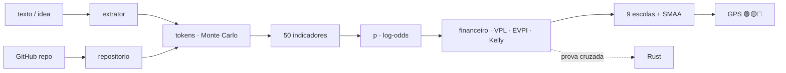

<!--
AnalisadorPreditivoMinimoViaveldeProjetos
Autor: ProfBru - Bruno Penedo © 2026 - TODOS OS DIREITOS RESERVADOS
E-mail: profbruanbima@gmail.com

TEMPLATE DO MOTOR DE READMEs — não editar os 12 READMEs à mão.
  • O que está aqui é ESTRUTURA (nunca traduzida): imagens, comandos, caminhos, badges de stack.
  • Marcadores b:<chave> entre chaves duplas são BLOCOS DE PROSA (traduzidos) — vêm de readme.blocos.json.
  • Marcadores lang:<nome> entre chaves duplas são preenchidos pelo gerador (seletor, frase de direitos).
Estilo: template do ECC (hero, seletor, badges, guia rápido, cards, o que tem dentro)
+ progressão D19: DOR → SOLUÇÃO → PROVA VISUAL → APLICAÇÃO → INSTALAÇÃO → PROFUNDIDADE → LICENÇA.
Gerar:  python3 public/foundations/pipeline/gerar_readmes.py
-->

<div align="center">

# 🧭 Analisador Preditivo Mínimo Viável de Projetos


**ProfBru © 2026**

### Ennustava GPS, joka kertoo, ansaitseeko idea tokenisi — jo ennen ensimmäistä tokenia.

**Sisään menee yhden lauseen idea. Ulos tulee tuomio 🟢🟡🔴, montako tokenia idean jäsentäminen, suunnittelu ja koodaaminen maksaa, paljonko se on arvoinen riskittömään korkoon verrattuna — ja mistä sinun kannattaa luopua.**

   


[Português](README.md) · [English](README.en.md) · [Español](README.es.md) · [Français](README.fr.md) · [Deutsch](README.de.md) · [中文](README.zh.md) · [한국어](README.ko.md) · [हिन्दी](README.hi.md) · [עברית](README.he.md) · [Русский](README.ru.md) · [Svenska](README.sv.md) · **Suomi**

</div>

> [!IMPORTANT]
> **Viisas valitseminen ja luopuminen ennen rahan käyttämistä on yksi suurimmista eduista, joita on olemassa.** Joka tietää, mihin aikaa ja rahaa EI kannata laittaa, on jo voittanut puolet pelistä. Tämä projekti tekee tästä kurinalaisuudesta menetelmän: ennustavan, tarkastettavan ja sellaisen, jossa jokaisen luvun takana on tieteellinen lähde.

## ⚡ Aloita 60 sekunnissa

Ei palvelinta, ei API-avainta, ei pilveä. Toimii omalla koneellasi ilman verkkoyhteyttä. Tuloste on Brasilian portugaliksi.

```bash
git clone <url-do-repositorio> AnalisadorPreditivoMinimoViaveldeProjetos
cd AnalisadorPreditivoMinimoViaveldeProjetos/public/foundations/pipeline
pip install -r requisitos.txt
python3 analisar.py ideia "App para clínicas lembrarem pacientes pelo WhatsApp com assinatura mensal"
```

Valmista: raportti tulostuu päätteeseen liikennevalon, suositellun polun, vaiheittaisten P10/P50/P90-tokenien, CDI:hin (Brasilian riskittömään viitekorkoon) verratun odotusarvon ja välttelemiesi kysymysten kanssa. Haluatko vertailla useita ideoita? Käytä `comparar`. Pelkkä tokenikustannus? Käytä `tokens`.

<div align="center">

<table>
<tr>
<td width="33%" align="center"><b>🧭 Yksi idea, yksi lause</b><br/><sub>Ilman markkinarakoa, toimialaa tai lukuja. GPS mittaa oman tietämättömyytensä eikä koskaan hyväksy sokkona investoimista.</sub><br/><code>analisar.py ideia</code></td>
<td width="33%" align="center"><b>⚖️ Valitse ja luovu</b><br/><sub>Useita ideoita rinnakkain: mitä viedä eteenpäin, mikä lopettaa heti, mitkä ovat aidosti tasoissa.</sub><br/><code>analisar.py comparar</code></td>
<td width="33%" align="center"><b>🪙 Paljonko tokeneina</b><br/><sub>Jäsentäminen, suunnittelu ja koodaus — P10/P50/P90 ja US$ malleittain, häntäriskin kanssa.</sub><br/><code>analisar.py tokens</code></td>
</tr>
</table>

</div>

---

## 💀 Kipupiste: päätät taulukkolaskennalla — eikä taulukko päätä mitään

Ajattele viimeisintä kallista valintaasi. Myyntitiimin **puhelimet**. Ajoneuvokannan **sähköauto**. Kolmen vuoden sopimuksen **toimittaja**. **Startup-idea**, johon upotit puolen vuoden yöt. Suuremmassa mittakaavassa sama kipu: **minkä panssariajoneuvon, minkä lentokoneen, minkä puolustusjärjestelmän** asevoimat hankkivat kolmeksikymmeneksi vuodeksi; **minkä projektin** johtoryhmä hyväksyy vuoden budjetilla.

Lähes aina rituaali on sama: **taulukko**, **pisteytysmatriisi** ja muutama **suodatin**. Ja kolme ansaa, joita kukaan ei näe:

| Mitä teit | Mitä todella tapahtui |
|---|---|
| 🔻 **Lajittelit taulukon yhden sarakkeen mukaan** | Päätit YHDEN kriteerin perusteella. Muut seitsemän olivat mukana vain perusteellisuuden tunteen vuoksi. |
| 🔢 **Laskit pisteet yhteen painotetussa matriisissa** | Kompensoit katastrofin keskiarvolla: turvallisuudeltaan surkea vaihtoehto "pääsi tasoihin", koska se oli hinnaltaan erinomainen. |
| 🔍 **Suodatit ehdolla "täyttää kaiken"** | Lista tyhjeni; löysensit hankalaa vaatimusta — juuri sitä, jonka olisi pitänyt olla veto. |

Ja nyt on tullut uusi kustannus, joka on näkymätön jokaisessa taulukossa: **tokenit**. Tekoälyagenttien myötä rakentamisesta tuli halpaa ja nopeaa — ja siksi on helppo käyttää viikkoja ja satoja dollareita rakentamalla täydellisesti **väärä idea**.

> [!WARNING]
> **Taulukot, matriisit ja järjestyssuodattimet eivät riitä hyvään valintaan.** Ne eivät osaa kertoa, kuinka *epävarma* olet, eivät rankaise katastrofista kriittisessä kriteerissä, eivät laske rakentamasi asian *ylläpidon* kustannuksia ja — mikä pahinta — eivät koskaan sano **"älä investoi nyt"**. Työkalu, joka ei koskaan suosittele luopumista, ei ole päätöksenteon tuki vaan perustelugeneraattori.

### Hetki, jolloin päätös kuolee

Se tapahtuu kokouksessa, kun joku kysyy: *"Entä jos turvallisuuden paino olisi 30 % eikä 25 %?"* — ja voittaja vaihtuu. Tai puoli vuotta myöhemmin, kun projekti on valmis, toimii ja on testattu… eikä kukaan maksa siitä. Epäonnistuneiden startupien jälkianalyysit ovat jo vuosikymmenen ajan osoittaneet saman ykkössyyn: **markkinatarvetta ei ollut** (35–42 % tapauksista, CB Insights). Oikea kysymys ei koskaan ollut *"pystymmekö rakentamaan sen?"*. Se oli *"pitäisikö meidän?"* — ja siihen on vastaus **ennen** ensimmäistä tokenia.

---

## 💊 Ratkaisu: ennustava GPS ennen jokaista tokenia

**Kirjoita idea sellaisena kuin se on päässäsi — yksi lause riittää.** Sekunneissa analysaattori tekee sen, mihin vakavalla työryhmällä menisi viikkoja:

1. **Tunnistaa idean viiteluokan** (B2B-SaaS, automaatio, markkinapaikka, kaupankäynti, terveys…) ja lähtee sen perustasosta — *ulkopuolinen näkökulma*, joka suojaa tekijän innostukselta.
2. **Mittaa 50 indikaattoria 11 ulottuvuudessa** — kysyntä, markkina, tekninen toteutettavuus, talous, kestävyys, skaalautuvuus, kumuloituvuus, robustisuus, yhteensopivuus, informaatio ja rahoitusarbitraasi — jokaisella **pisteet, luottamus, näyttö ja tieteellinen lähde**.
3. **Arvioi tokenit** jäsentämiseen, suunnitteluun ja koodaamiseen **200 000 simulaatiolla** IT-projektien paksu häntä huomioiden ja muuntaa ne malleittaisiksi US$-kustannuksiksi ja ihmisen valvontatunneiksi.
4. **Tekee laskelman, jonka taulukko unohtaa:** rakentamisen **ja ylläpidon** kustannus, CDI:llä diskontattu odotusarvo, kannattavuusrajan todennäköisyys, ensin testaamisen arvo (EVPI), Kellyn osuus ja jokaisen lisäreaalin rajahyöty.
5. **Antaa yhdeksän päätöksentekokoulukunnan äänestää** (ELECTRE I ja II, PROMETHEE II, MAUT, MCDA-C, AHP-TOPSIS 2n, VIKOR, TODIM, SAPEVO-M) viiden polun välillä — älä investoi, testaa ensin, MVP, koko projekti, käytä koodia uudelleen — ja **häiritsee painoja ja pisteitä tuhansia kertoja** kertoakseen, onko valinta VANKKA, TODENNÄKÖINEN vai HAURAS.

<div align="center">

| ❌ Mitä taulukko sanoo | ✅ Mitä ennustava GPS sanoo |
|---|---|
| "Idea saa 7,8 pistettä." | **"🟡 TESTAA ENSIN. Tieto on R$ 4 586 arvoinen ja testi maksaa R$ 850. Aja tämä 5 päivän koe; jos tulos on kielteinen, hylkää idea."** |
| "Teemme sen kahdessa viikossa." | **"P50 13,7 M tokenia, P90 40,1 M — ja 23 tuntia sinun katselmointiasi. Hallitseva kustannus ei ole rakentaminen vaan ylläpito."** |
| *(ei koskaan sano)* | **"🔴 ÄLÄ INVESTOI NYT. Mikään polku ei voita CDI:tä hyväksyttävällä riskillä sen perusteella, mitä nyt tiedetään."** |

</div>

**Rehellisen järjestelmän on osattava sanoa "älä luota minuun tässä".** Kun kuvaus on epämääräinen, GPS sanoo sen — eikä päätös koskaan muutu vihreäksi pimeässä.

---

## 🖼️ Katso toiminnassa — yksi näkymä aliosaamista kohden

Kaikki alla olevat näkymät on tuottanut analysaattori itse (`gerar_telas.py`) kiinteällä siemenluvulla: voit toistaa jokaisen luvun omalla koneellasi. Tekstit ovat Brasilian portugaliksi, joka on työkalun tulostekieli.

### 1. `ideia` — GPS yhdessä paneelissa

<div align="center"></div>

**Kipu, jonka se ratkaisee:** et tarvitse 40-sivuista raporttia päättääksesi, aloitatko; tarvitset tuomion ja viisi lukua sen takana.

Liikennevalo tekstillä (ei koskaan pelkkä väri), suositeltu polku, robustisuus, elinkelpoisuuden todennäköisyys 80 %:n välillä, P50/P90-tokenit, rakentamiskustannus, odotusarvo ja EVPI.

> **Tulkinta:** hammasklinikoiden idean elinkelpoisuus on 50 % — hyvä — mutta tuomio on 🟡 **TESTAA ENSIN**: lopputuloksen tietäminen on R$ 4 586 arvoista ja koe maksaa R$ 850. Halvan tiedon ostaminen ennen tokenien käyttämistä on rationaalinen päätös lupaavallekin idealle.

### 2. `tokens` — paljonko jäsentäminen, suunnittelu ja koodaus maksavat

<div align="center"></div>
<div align="center"></div>

**Kipu, jonka se ratkaisee:** "se käy nopeasti" on insinöörityön kallein lause. Tekoälyagenttien tokenkulutus vaihtelee samassa tehtävässä jopa 30-kertaisesti (Bai ym., 2026), ja joka kuudes IT-projekti ylittää budjettinsa 200 %:lla (Flyvbjerg & Budzier, 2011).

Arvioija laskee tekstistä tiedostot, integraatiot ja monimutkaisuuden, soveltaa toimintokohtaista kulutusta (lukeminen, kirjoittaminen, muokkaus, testaus, katselmointi), kontekstin kasvua ja uudelleentyötä ja ajaa 200 000 paksuhäntäistä simulaatiota.

> **Tulkinta:** koodaus on ~80 % tokeneista, ja syöte (jokaisessa vaiheessa uudelleen luettu konteksti) on niistä 97 %. Väli P10–P90 kattaa kertaluokan — siksi GPS päättää P90:n eikä keskiarvon perusteella.

### 3. Polut — valitseminen **ja** luopuminen

<div align="center"></div>

**Kipu, jonka se ratkaisee:** taulukko vertaa ideoita; se ei koskaan vertaa *tapoja investoida* samaan ideaan. Ja tapa merkitsee enemmän kuin idea.

Viisi polkua: **A0** älä investoi (rahat CDI:hin), **A1** 5 päivän minimikoe, **A2** kevyt MVP, **A3** koko projekti, **A4** olemassa olevan koodin uudelleenkäyttö. Jokaiselle sidottu pääoma, odotusarvo, tappion todennäköisyys ja aika ensimmäiseen näyttöön.

> **Tulkinta:** MVP:llä on suurin odotusarvo reaaleissa, mutta 5 päivän koe voittaa konsensuksen — se saavuttaa näytön 4 kertaa nopeammin 13 %:n tappiotodennäköisyydellä. Raportti tekee **luopumisen** näkyväksi: valitsemalla A1 pidät koko projektin P90-altistuksen riskin ulkopuolella, kunnes näyttöä on.

### 4. Yhdeksän monikriteerikoulukunnan äänestys

<div align="center"></div>

**Kipu, jonka se ratkaisee:** jokainen monikriteerimenetelmä on oma teoriansa siitä, mitä "parempi" tarkoittaa. Vain yhden käyttäminen tarkoittaa vastauksen valitsemista kysymyksen mukana.

MAUT laskee hyödyt yhteen; ELECTRE käyttää vetoa katastrofia vastaan; PROMETHEE porrastaa preferenssin; VIKOR kieltäytyy kompensoimasta huonointa kriteeriä; TODIM painottaa tappiota voittoa enemmän (prospektiteoria); SAPEVO-M hyväksyy työryhmän järjestysasteikollisen arvion.

> **Tulkinta:** yhdeksästä koulukunnasta seitsemän asettaa minimikokeen ensimmäiseksi. Kun riippumattomat teoriat ovat samaa mieltä, päätös kestää kokouksen.

### 5. Indikaattorit — ja mikä liikutti todennäköisyyttä

<div align="center"></div>
<div align="center"></div>

**Kipu, jonka se ratkaisee:** "7,8 pistettä" ilman selitystä ei vakuuta ketään. Tässä jokainen ulottuvuus näyttää pisteensä, luottamuksensa ja sen, kuinka paljon se nosti tai laski todennäköisyyttä.

Koko luettelo (`analisar.py indicadores`) listaa 50 indikaattoria kaavan, tieteellisen lähteen ja sen **vähimmäisnäytön** kanssa, joka vahvistaisi kunkin pistemäärän — keksimisen sijaan.

> **Tulkinta:** Ongelma ja kysyntä nosti todennäköisyyttä eniten (kipu, toistuvuus ja 3 kiinnostunutta klinikkaa); Markkina ja monimuotoisuus pysyi neutraalina — vain yksi käyttösegmentti, Shannonin entropia nolla. Juuri sitä seuraavan asiakaskeskustelun pitää testata.

### 6. `comparar` — monta ideaa, yksi päätös

<div align="center"></div>

**Kipu, jonka se ratkaisee:** sinulla on viisi ideaa ja voimia yhteen. Ranking, jossa on "0,3 pisteen voittaja", on varmuudeksi puettua kohinaa.

Ideat analysoidaan rinnakkain (`ProcessPoolExecutor`), ja yhdeksän koulukuntaa äänestää **kaksinkertaisella robustisuudella**: epävarmat painot ja epävarmat pisteet (SMAA). Tuomio käyttää näistä pienempää.

> **Tulkinta:** epävarmoilla painoilla idea 4 voittaa aina; epävarmoilla pisteillä vain 60 % kerroista — tekninen tasapeli idean 1 kanssa. GPS sanoo sen suoraan: älä valitse rankingin perusteella, tee koe molemmista. Ja se kehottaa **luopumaan heti** markkinapaikasta ja arbitraasibotista, jotka eivät voita yhdessäkään uskottavassa skenaariossa.

### 7. `repo` — onko idealla jo koodia GitHubissa?

<div align="center"></div>
<div align="center"></div>

**Kipu, jonka se ratkaisee:** olemassa oleva koodi näyttää säästöltä, mutta se maksaa lukemista, mukauttamista ja joskus lisenssin, jota et saa käyttää.

Analysaattori tekee eristetyn matalan kloonin (repositoriosta ei suoriteta mitään), mittaa rivit kielittäin, testit, CI:n, lisenssin ja viimeisimmän commitin iän sekä laskee valmiusasteen (ohjelmisto-TRL). Kypsyys vähentää koodaustokeneita; lukeminen lisätään jäsentämisen tokeneihin.

> **Tulkinta:** TRL-5-tason MIT-repositoriolla polku "käytä uudelleen" (A4) ilmestyy vaihtoehtoihin — ja konsensus suosii silti MVP:tä, koska olemassa olevan mukauttaminen ei poista markkinakysymystä.

### 8. Rahoitusarbitraasi ja pääomavoitot

<div align="center"></div>
<div align="center"></div>

**Kipu, jonka se ratkaisee:** kaupankäynti- ja arbitraasi-ideat näyttävät ilmaiselta rahalta — kunnes kaupankäyntikulut, verot ja alfan hiipuminen tulevat esiin.

Kun idea on rahoitusstrategia, malliin tulee oma ulottuvuus (edun pysyvyys, kustannukset ja viive, tilastollinen validointi, sääntelyriski), ja raportti vaatii otoksen ulkopuolisen taaksepäin testauksen, Sharpen luvun ja pudotuksen ennen yhtäkään tuotetokenia. Jokaisessa ideassa token-pääomaa verrataan riskittömään vaihtoehtoon: CDI:hin.

> **Tulkinta:** yhdellä lauseella kuvattu kryptoarbitraasibotti saa 🟡 **TESTAA ENSIN** 12 %:n elinkelpoisuudella; vieressä pankkitäsmäytyksen automaatio saa 🟢 **INVESTOI MVP:HEN** 4 kuukauden takaisinmaksuajalla. Sama tekijä, sama päivä: ero on siinä, missä aika tuottaa.

### 9. Kun idea on vielä liian epämääräinen

<div align="center"></div>

**Kipu, jonka se ratkaisee:** huonoin päätös ei ole sanoa ei hyvälle idealle — vaan sanoa kyllä idealle, jota ei vielä ole olemassa.

Idealle "siisti idea" GPS mittaa 0 %:n kattavuuden, antaa hyvin leveän todennäköisyysvälin, listaa vastaamatta jääneet keskeiset kysymykset ja merkitsee tuomion HAURAAKSI.

> **Tulkinta:** 🔴 **ÄLÄ INVESTOI NYT** — ei pessimismin vaan tiedon puutteen vuoksi. Raportti kertoo itse, mitä on selvitettävä ensin (kenellä kipu on, mitä se maksaa, miten rahaa tehdään).

### 10. `prompt` — syvemmälle LLM:n kanssa, oikealla tavalla

<div align="center"></div>

**Kipu, jonka se ratkaisee:** LLM:t ovat erinomaisia löytämään loogisia aukkoja ja ehdottamaan kokeita — ja huonoja keksimään kalibroituja painoja ja pisteitä; tuomareina ne ovat taipuvaisia hyväksymään lähes kaiken.

Siksi analysaattori tekee määrällisen osan ja antaa valmiin pääkehotteen, johon on jo täytetty luokka, todennäköisyys, tokenit ja polku, ja pyytää LLM:ltä vain sitä, missä se on hyvä: epämukavia kysymyksiä, palautettavuustestin, minimikokeen ja riippuvuuskartan.

> **Tulkinta:** luku tulee mallista; kyseenalaistaminen LLM:ltä. Kumpikin omassa roolissaan.

### 11. `--relatorio` — asiakirja PDF-, HTML- ja Markdown-muodossa

<div align="center"> </div>

**Kipu, jonka se ratkaisee:** tärkeän päätöksen on kierrettävä — työryhmässä, osakkaalla, sijoittajan sähköpostissa — ja sen on osoitettava, kuka sen allekirjoitti.

`--relatorio`-valitsimella jokainen analyysi syntyy kolmessa muodossa: **Markdown** (versioitava), itsenäinen **HTML** (upotetut näkymät, vaalea ja tumma teema) ja **OCR-muotoinen PDF** — jokainen sivu on kuva, jonka taustalla on suuri ProfBru-merkki 50 %:n läpinäkyvyydellä, ja sen päällä näkymätön tekstikerros, joka tekee asiakirjasta haettavan ja kopioitavan olematta pelkkää tekstiä sisältävä PDF.

> **Tulkinta:** sama päätteessä luettu GPS muuttuu kuusisivuiseksi asiakirjaksi, jonka liitteenä on viisi näkymää, valmiina kokoukseen — ja haku "experimento mínimo" löytää PDF:stä jokaisen esiintymän.

📎 [`docs/exemplos/gps_clinica.pdf`](docs/exemplos/gps_clinica.pdf) · [`.html`](docs/exemplos/gps_clinica.html) · [`.md`](docs/exemplos/gps_clinica.md)

---

## 🎯 Mihin se sopii — räätälöity valitseminen ja luopuminen

Sama menetelmä palvelee jokaista päätöstä, jossa **vaihtoehdot ovat ristiriidassa, tieto on puutteellista ja virhe on kallis**:

<div align="center">

| Alue | Päätös | Miksi taulukko epäonnistuu |
|---|---|---|
| **Ideat ja startupit** | mikä idea ansaitsee tokeneita, aikaa ja pääomaa seuraavat 90 päivää | sivuuttaa luokan perustason ja ylläpidon kustannuksen |
| **Tekoälyprojektit** | MVP, koko projekti vai pelkkä testi — ja millä mallilla | ei arvioi tokeneita, häntää eikä katselmointitunteja |
| **Johdon ja yritysten päätökset** | projektisalkku, toimittaja, tehdä itse vai ostaa | kompensoi veton keskiarvolla; ei mittaa robustisuutta |
| **Laitteet ja puhelimet** | mikä laite kattaa todellisen käyttösalkun | ei mittaa käyttöjen monimuotoisuutta (Shannon) eikä rajahyötyä |
| **Sähköautot ja ajoneuvokannat** | toimintamatka × kokonaiskustannus × infrastruktuuri | laskee korreloituneet kriteerit kahteen kertaan |
| **Asevoimat** | panssariajoneuvot, lentokoneet, 30 vuoden järjestelmät | huonon kriittisen kriteerin on oltava veto, ei kompensoitava |
| **Kaupankäynti ja arbitraasi** | rakentaa botti vai jättää rahat CDI:hin? | unohtaa kaupankäyntikulut, verot ja alfan hiipumisen |
| **Pienet ja keskisuuret yritykset** | automatisoidaanko manuaalinen prosessi vai ei | ei vertaa vuotuista säästöä P90-kustannukseen |

</div>

> [!NOTE]
> Oletukset (valuuttakurssi, CDI, aikajänne, tuntisi arvo, odotettu liikevaihto, pääoma) ovat komentorivin parametreja, ja ne tulostetaan jokaiseen raporttiin. Muuta niitä, niin tuomio lasketaan uudelleen — päätös on sinun, laskelmat näkyvillä.

---

## 🧩 Miksi jokainen ominaisuus on olemassa

| Ominaisuus | Miksi se on olemassa | Perusta |
|---|---|---|
| **Viiteluokka** | paras ennuste projektista on samankaltaisten projektien historia, ei ehdottajan optimismi | Kahneman & Lovallo (1993); Flyvbjerg & Gardner (2023) |
| **Todennäköisyys log-oddseina luottamuksen kanssa** | jokainen indikaattori siirtää todennäköisyyttä näytön suhteessa; ilman näyttöä tuskin lainkaan | tulkittavat säännöt (LLM-AR, 2025); SAISE (2025) |
| **P10/P50/P90-tokenit vaiheittain** | agenttien kulutus vaihtelee jopa 30-kertaisesti ja syöte hallitsee kustannusta | Bai ym. (2026); ACEM (2026); tokencast |
| **Ylläpidon kustannus, ei vain rakentamisen** | tekoälyn myötä rakentaminen halpeni; liiketoiminnan kaataa ylläpito | ACEM (2026); CB Insights |
| **Nettonykyarvo CDI:hin nähden** | jokaisella tokeneihin käytetyllä reaalilla on varma vaihtoehtoiskustannus | Dixit & Pindyck (1994) |
| **EVPI — ensin testaamisen arvo** | joskus paras ostos on tieto, ei koodi | Howard (1966); Camuffo ym. (2020, 2024) |
| **Kellyn osuus** | se, paljonko panostaa, on yhtä tärkeää kuin mihin | Kelly (1956) |
| **Rajahyöty tehokkaalla rajalla** | ratkaisevaa on SEURAAVAN sijoitetun reaalin arvo | Gossen (1854) |
| **Shannonin entropia, Simpson, HHI, monipuolisuusindeksi** | monikäyttöisellä idealla on enemmän ulospääsyjä, jos ensimmäinen markkina epäonnistuu | Shannon (1948); tietopohjan KPI:t |
| **Yhdeksän koulukuntaa + Bordan konsensus** | riippumattomien teorioiden yksimielisyys on vahvin näyttö ilman dataa | Roy; Brans; Keeney & Raiffa; Saaty; Opricovic; Gomes |
| **Kaksinkertainen robustisuus (painot ja pisteet)** | voittaja, joka vaihtuu 2 painopisteellä, ei ole voittaja | SMAA — Lahdelma ym. (1998) |
| **Epämukavat kysymykset, palautettavuus, minimikoe, riippuvuudet** | näin toimisi skeptinen sijoittaja — ja tässä LLM on hyvä | projektin tietopohja |
| **Raportti OCR-muotoisena PDF:nä, HTML:nä ja Markdownina** | päätöksen on kierrettävä, oltava haettavissa ja kannettava tekijyyttä joka sivulla | PyMuPDF + Pillow, kaikki paikallisesti |
| **Toinen moottori Rustilla** | kaksi toisistaan riippumatonta, yhtäpitävää moottoria todistaa matematiikan, ei vain koodia | ristiintarkistus jokaisella ajolla |

---

## ⚙️ Asennus ja käyttö

| Komponentti | Versio | Pakollinen | Mihin |
|---|---|---|---|
| Python | 3.13 | ✅ | moottori, CLI, raportit |
| NumPy | 2.x | ✅ | algebra ja simulointi |
| numba | ≥ 0.60 | ⚠️ suositeltu | ytimien JIT (ilman: sama vastaus, hitaampi) |
| matplotlib | ≥ 3.7 | ⚠️ näkymiin | PNG-kaaviot |
| PyMuPDF · Pillow · markdown | tuoreet | ⚠️ `--relatorio`-valitsimeen | PDF, HTML |
| Rust / cargo | vakaa | ⭕ valinnainen | toinen tarkistusmoottori |
| git · screen | — | ⭕ valinnainen | repositorioiden analyysi · ajo taustalla |

```bash
cd public/foundations/pipeline
python3 analisar.py ideia "<ideia>" [--repo <url|pasta>] [--relatorio [base]] [--telas pasta/] [--json]
python3 analisar.py comparar "<ideia A>" "<ideia B>" "<ideia C>" [--relatorio]   # ou --arquivo ideias.txt
python3 analisar.py tokens "<ideia>" [--json]
python3 analisar.py repo https://github.com/<usuario>/<projeto>
python3 analisar.py indicadores [--bibliografia]
python3 analisar.py prompt "<ideia>"

# premissas (todas opcionais): --cambio 5.50 --cdi 0.14 --horizonte 12 --valor-hora 80
#                              --receita 3000 --receita-otimista 20000 --capital 50000 --infra-mes 0

./run_all.sh --demo          # < 60 s
./run_all.sh                 # testes + prova cruzada Rust + bench + telas + i18n
./run_all.sh --background    # screen + watchdog de 20 min (screen -r analisadorpreditivominimoviaveldeprojetos)
```

| Aliosaaminen | Mitä se tuottaa |
|---|---|
| `ideia` | yhden idean täysi GPS: liikennevalo, polku, todennäköisyys, tokenit, talous, yhdeksän koulukuntaa, indikaattorit, kysymykset, koe, riippuvuudet, luopuminen (Markdown, JSON ja näkymät) |
| `comparar` | useita ideoita rinnakkain: mitä viedä eteenpäin, mitkä ovat tasoissa, mistä luopua heti |
| `tokens` | pelkkä kustannus: P10/P50/P90-tokenit vaiheittain, US$ malleittain, ihmistyötunnit |
| `repo` | repositorion kypsyys: rivit, kielet, testit, CI, lisenssi, valmius |
| `indicadores` | 50 indikaattorin luettelo kaavan, lähteen ja vähimmäisnäytön kera; `--bibliografia` |
| `prompt` | valmis pääkehote idean syventämiseen LLM:n kanssa |
| `--relatorio` | mikä tahansa analyysi Markdownina, HTML:nä ja vesileimattuna OCR-muotoisena PDF:nä |

---

## 🧠 Konepellin alla

Teksti muuttuu **signaaleiksi** (portugalin- ja englanninkielinen sanasto, jossa säilyy kunkin signaalin laukaissut näyttö); signaalit määrittävät **viiteluokan** ja **toiminnallisen koon**; koko muuttuu **tokeneiksi** (paksuhäntäinen simulointi); signaalit ja koko muuttuvat **indikaattoreiksi**; indikaattorit siirtävät luokan **ennakkotodennäköisyyttä** log-oddseina **elinkelpoisuuden todennäköisyydeksi**; todennäköisyys syöttää viiden polun **taloutta**; ja yhdeksän koulukuntaa valitsee polun — mitatulla robustisuudella.



| Ulottuvuus | Mitä se kysyy |
|---|---|
| Ongelma ja kysyntä | onko kipu todellinen, toistuva ja maksettava? onko joku muu kuin sinä vahvistanut sen? |
| Markkina ja monimuotoisuus | kuinka monta käyttöä ja segmenttiä (Shannon, Simpson, HHI, monipuolisuus)? |
| Tekninen toteutettavuus | koko, integraatiot, reaaliaikaisuus, olemassa oleva koodi, kestävyys tekoälyn hyödykkeistämistä vastaan |
| Taloudellinen toteutettavuus | kustannus, häntä, turvamarginaali, nettonykyarvo, takaisinmaksu, toistuvuus, Kelly, rajahyöty |
| Kestävyys | kestääkö se aikaa, muoteja ja yhden alustan riippuvuutta? |
| Skaalautuvuus | rajakustannus, verkostovaikutus, automaatio |
| Kumuloituvuus | mitä jää, jos epäonnistuu: koodi, data, oppi, suunnanmuutoksen vaihtoehdot |
| Robustisuus ja riski | sääntely, ulkoiset riippuvuudet, yksin toteuttaminen, suurin tappio |
| Yhteensopivuus ja testattavuus | tekijän etu, 5 päivän koe, aika näyttöön, nollakustannus |
| Informaatio ja epävarmuus | kuvauksen kattavuus, luokan luottamus, tiedon arvo |
| Rahoitusarbitraasi | alfan pysyvyys, kustannukset, tilastollinen validointi, sääntely |

### Tieteen eturintamassa

Yksikään indikaattori ei pääse luetteloon ilman lähdettä — ja jos niin käy, automaattinen testi hylkää projektin. 52 lähteen joukossa on tuore kirjallisuus startupien menestyksen ennustamisesta tekoälyllä ja LLM:illä (VCBench, SSFF, SAISE, ennustetekijöiden meta-analyysi, LLM-AR, kNN-ICL — 2024–2026), koodausagenttien tokenkulutuksesta (Bai, Brynjolfsson, Pentland ym., 2026) ja agenttisen ohjelmistokehityksen kustannusarvioinnista (ACEM, 2026) sekä klassikot, joihin kukin menetelmä nojaa: Shannon, Gossen, Kelly, Howard, Kahneman & Tversky, Roy, Saaty, Keeney & Raiffa, Flyvbjerg, Lahdelma (SMAA) ja brasilialainen monikriteerisen päätöksenteon tuen koulukunta. Koko luettelon saa komennolla `python3 analisar.py indicadores --bibliografia`.

---

## 🚀 Suorituskyky ja ristiintarkistus

| Mittaus (4 suoritinta, klinikkatapaus) | Tulos |
|---|---|
| Yhden idean täysi analyysi (200 000 tokensimulaatiota + 9 koulukuntaa × 2 000 universumia) | ≈ 1,8 s |
| Useita ideoita | rinnakkain `ProcessPoolExecutor`illa, tulos sama kuin peräkkäisajossa |
| Python × Rust -yhtäpitävyys (5 tapausta, kussakin 10 suuretta) | suurin ero 2,2 × 10⁻¹⁵ |

Jokainen mittaus tallennetaan todisteen kanssa siitä, ettei tulos muuttunut: optimointi, joka muuttaa vastausta, ei ole hyöty.

```text
✅ clinica      10 grandezas idênticas · Δ relativo máx 0.0e+00
✅ conciliacao  10 grandezas idênticas · Δ relativo máx 0.0e+00
✅ arbitragem   10 grandezas idênticas · Δ relativo máx 1.3e-15
✅ marketplace  10 grandezas idênticas · Δ relativo máx 2.2e-15
✅ vaga         10 grandezas idênticas · Δ relativo máx 0.0e+00
```

---

## 📁 Mitä sisältää

```
AnalisadorPreditivoMinimoViaveldeProjetos/
├── README.md (+11)
├── projeto.toml
├── docs/                         logo, telas/, CUSTO.md, OPERACAO.md
└── public/foundations/
    ├── pipeline/
    │   ├── analisar.py           CLI (6 sub-skills)
    │   ├── apmv/                 extrator · repositorio · tokens · indicadores · preditivo
    │   │   │                     financeiro · decisao · gps · relatorio · telas · referencias
    │   │   └── mcdm/             ELECTRE I/II · PROMETHEE II · MAUT · MCDA-C · AHP-TOPSIS 2n
    │   │                         VIKOR · TODIM · SAPEVO-M · Borda · Dirichlet
    │   ├── testes_apmv.py · prova_cruzada_rust.py · bench.py · gerar_telas.py
    │   └── run_all.sh · watchdog.sh · verificar_publicacao.sh
    └── rust/analisadorpreditivominimoviaveldeprojetos_core/   apmv_core
```

Kaikki toimii paikallisesti ilman toistuvia kustannuksia: ei palvelinta, ei API-avainta, ei verkkokutsuja analyysin aikana (vain `git clone`, kun annat repositorion).

---

## ❓ Kysymyksiä, joita tulet kysymään

<details>
<summary><b>Toimiiko se todella yhden lauseen idealla?</b></summary>

Toimii — juuri sitä tapausta varten se on suunniteltu. Vähäisellä tiedolla GPS lähtee luokan perustasosta, leventää todennäköisyysväliä eikä hyväksy investointia: se kertoo tarkalleen, mihin kysymyksiin on vastattava ensin.
</details>

<details>
<summary><b>Miksei vain kysytä LLM:ltä, onko idea hyvä?</b></summary>

Koska LLM:t tuomareina hyväksyvät lähes kaiken — ja keksivät painoja ja pisteitä, jotka näyttävät kalibroiduilta. Analysaattori laskee menetelmän ja lähteiden avulla; LLM tulee mukaan siellä, missä se on vahva, pääkehotteen kautta.
</details>

<details>
<summary><b>Mistä raportin liikevaihto ja tunnit tulevat?</b></summary>

Viiteluokasta varovaisena ja optimistisena skenaariona — ja ne näytetään oletuksina. Jos tiedät liikevaihdon, tuntisi arvon tai pääoman, anna ne komentorivillä, niin kaikki lasketaan uudelleen.
</details>

<details>
<summary><b>Sopiiko se päätöksiin, jotka eivät liity ohjelmistoihin?</b></summary>

Sopii. Yhdeksän koulukuntaa, robustisuusanalyysi sekä monimuotoisuuden ja rajahyödyn indikaattorit soveltuvat laitteisiin, ajoneuvokantoihin, toimittajiin ja kaikenlaisiin projekteihin; tokenit ovat vain yksi valuutoista.
</details>

<details>
<summary><b>Pitääkö ajamisesta maksaa jotain?</b></summary>

Ei. Se toimii koneellasi ilman verkkoyhteyttä. Ainoa kustannus on se, jonka raportti itse arvioi — tokenit, jotka päätät käyttää myöhemmin.
</details>

---

## 📜 Lisenssi ja tekijyys

<div align="center">


**ProfBru © 2026**

**Analisador Preditivo Mínimo Viável de Projetos**
Tekijä: **ProfBru - Bruno Penedo** © 2026 — **KAIKKI OIKEUDET PIDÄTETÄÄN**
📧 profbruanbima@gmail.com

</div>

Suljettu ohjelmisto. Käyttö, kopiointi, muokkaus ja jakelu edellyttävät tekijän nimenomaista lupaa. Kolmansien osapuolten kirjastot ja lähteet säilyttävät omat lisenssinsä ja tekijämainintansa.

---

_AnalisadorPreditivoMinimoViaveldeProjetos_
_Tekijä: **ProfBru - Bruno Penedo** © 2026 — KAIKKI OIKEUDET PIDÄTETÄÄN · profbruanbima@gmail.com_
