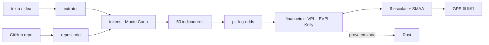

<!--
AnalisadorPreditivoMinimoViaveldeProjetos
Autor: ProfBru - Bruno Penedo © 2026 - TODOS OS DIREITOS RESERVADOS
E-mail: profbruanbima@gmail.com

TEMPLATE DO MOTOR DE READMEs — não editar os 12 READMEs à mão.
  • O que está aqui é ESTRUTURA (nunca traduzida): imagens, comandos, caminhos, badges de stack.
  • Marcadores b:<chave> entre chaves duplas são BLOCOS DE PROSA (traduzidos) — vêm de readme.blocos.json.
  • Marcadores lang:<nome> entre chaves duplas são preenchidos pelo gerador (seletor, frase de direitos).
Estilo: template do ECC (hero, seletor, badges, guia rápido, cards, o que tem dentro)
+ progressão D19: DOR → SOLUÇÃO → PROVA VISUAL → APLICAÇÃO → INSTALAÇÃO → PROFUNDIDADE → LICENÇA.
Gerar:  python3 public/foundations/pipeline/gerar_readmes.py
-->

<div align="center">

# 🧭 Analisador Preditivo Mínimo Viável de Projetos


**ProfBru © 2026**

### Le GPS prédictif qui dit si une idée mérite vos jetons — avant le premier jeton.

**Une phrase d'idée entre. Il en sort un verdict 🟢🟡🔴, le nombre de jetons nécessaires pour la structurer, la planifier et la coder, sa valeur face à un taux sans risque — et ce à quoi vous devez renoncer.**

   


[Português](README.md) · [English](README.en.md) · [Español](README.es.md) · **Français** · [Deutsch](README.de.md) · [中文](README.zh.md) · [한국어](README.ko.md) · [हिन्दी](README.hi.md) · [עברית](README.he.md) · [Русский](README.ru.md) · [Svenska](README.sv.md) · [Suomi](README.fi.md)

</div>

> [!IMPORTANT]
> **Choisir et renoncer avec sagesse, avant de dépenser, est l'un des plus grands avantages qui existent.** Qui sait où NE PAS mettre son temps et son argent a déjà gagné la moitié de la partie. Ce projet transforme cette discipline en méthode : prédictive, auditable, avec une source scientifique derrière chaque chiffre.

## ⚡ Démarrer en 60 secondes

Sans serveur, sans clé d'API, sans cloud. Il tourne sur votre machine, hors ligne. Sortie en portugais du Brésil.

```bash
git clone <url-do-repositorio> AnalisadorPreditivoMinimoViaveldeProjetos
cd AnalisadorPreditivoMinimoViaveldeProjetos/public/foundations/pipeline
pip install -r requisitos.txt
python3 analisar.py ideia "App para clínicas lembrarem pacientes pelo WhatsApp com assinatura mensal"
```

C'est tout : le rapport s'affiche dans le terminal avec le feu tricolore, la voie recommandée, les jetons P10/P50/P90 par phase, la valeur espérée face au CDI (le taux de référence sans risque brésilien) et les questions que vous évitez. Vous voulez comparer plusieurs idées ? Utilisez `comparar`. Seulement le coût en jetons ? Utilisez `tokens`.

<div align="center">

<table>
<tr>
<td width="33%" align="center"><b>🧭 Une idée, une phrase</b><br/><sub>Même sans niche, secteur ni chiffres. Le GPS mesure sa propre ignorance et n'autorise jamais à investir à l'aveugle.</sub><br/><code>analisar.py ideia</code></td>
<td width="33%" align="center"><b>⚖️ Choisir et renoncer</b><br/><sub>Plusieurs idées côte à côte : laquelle poursuivre, laquelle abandonner tout de suite, lesquelles sont vraiment à égalité.</sub><br/><code>analisar.py comparar</code></td>
<td width="33%" align="center"><b>🪙 Combien en jetons</b><br/><sub>Structurer, planifier et coder — P10/P50/P90 et US$ par modèle, avec le risque de queue.</sub><br/><code>analisar.py tokens</code></td>
</tr>
</table>

</div>

---

## 💀 La douleur : vous décidez avec un tableur — et le tableur ne décide rien

Pensez au dernier choix coûteux que vous avez fait. **Les téléphones** de l'équipe commerciale. **La voiture électrique** de la flotte. **Le fournisseur** d'un contrat de trois ans. **L'idée de startup** dans laquelle vous avez enterré six mois de nuits. À plus grande échelle, la même douleur : **quel blindé, quel avion, quel système de défense** une armée achète pour trente ans ; **quel projet** un comité exécutif approuve avec le budget de l'année.

Dans presque tous les cas, le rituel est le même : un **tableur**, une **matrice de notation**, quelques **filtres**. Et trois pièges que personne ne voit :

| Ce que vous avez fait | Ce qui s'est vraiment passé |
|---|---|
| 🔻 **Trié le tableur par une colonne** | Vous avez décidé selon UN critère. Les sept autres n'étaient là que pour donner une impression de rigueur. |
| 🔢 **Additionné des notes dans une matrice pondérée** | Vous avez compensé le désastre par la moyenne : une option catastrophique en sécurité a « égalisé » parce qu'elle était excellente en prix. |
| 🔍 **Filtré par « répond à tout »** | La liste est restée vide ; vous avez assoupli l'exigence gênante — précisément celle qui aurait dû être le veto. |

Et voici un coût nouveau, invisible dans tout tableur : **les jetons**. Avec les agents d'IA, construire est devenu bon marché et rapide — c'est pourquoi il est devenu facile de dépenser des semaines et des centaines de dollars à construire, à la perfection, **la mauvaise idée**.

> [!WARNING]
> **Les tableurs, les matrices et les filtres de classement ne suffisent pas pour un bon choix.** Ils ne savent pas dire à quel point vous êtes *incertain*, ne sanctionnent pas le désastre sur un critère critique, ne comptent pas le coût d'*exploiter* ce que vous allez construire et — le pire — ne disent jamais **« n'investissez pas maintenant »**. Un outil qui ne recommande jamais de renoncer n'est pas une aide à la décision : c'est un générateur de justifications.

### Le moment où la décision meurt

C'est en réunion, quand quelqu'un demande : *« Et si la sécurité pesait 30 % au lieu de 25 % ? »* — et le gagnant change. Ou six mois plus tard, quand le projet est prêt, fonctionnel, testé… et que personne ne le paie. Les post-mortems de startups pointent la même cause numéro un depuis une décennie : **il n'y avait pas de besoin du marché** (35–42 % des cas, CB Insights). La bonne question n'a jamais été *« pouvons-nous le construire ? »*. C'était *« devrions-nous ? »* — et elle a une réponse **avant** le premier jeton.

---

## 💊 La solution : un GPS prédictif avant chaque jeton

**Vous écrivez l'idée telle qu'elle est dans votre tête — une phrase suffit.** En quelques secondes, l'analyseur fait ce qu'un comité sérieux ferait en plusieurs semaines :

1. **Reconnaît la classe de référence** de l'idée (SaaS B2B, automatisation, marketplace, trading, santé…) et part de son taux de base — l'*outside view* qui protège contre l'enthousiasme de l'auteur.
2. **Mesure 50 indicateurs sur 11 dimensions** — demande, marché, faisabilité technique, économie, durabilité, scalabilité, cumulativité, robustesse, alignement, information et arbitrage financier — chacun avec **note, confiance, preuve et source scientifique**.
3. **Estime les jetons** pour structurer, planifier et coder, avec **200 000 simulations** et la queue épaisse des projets informatiques, et les convertit en US$ par modèle et en heures humaines de supervision.
4. **Fait le calcul que le tableur oublie :** coût de construire **et d'exploiter**, valeur espérée actualisée au CDI, probabilité d'équilibre, valeur de tester d'abord (EVPI), fraction de Kelly et utilité marginale de chaque real supplémentaire.
5. **Fait voter neuf écoles de décision** (ELECTRE I et II, PROMETHEE II, MAUT, MCDA-C, AHP-TOPSIS 2n, VIKOR, TODIM, SAPEVO-M) entre cinq voies — ne pas investir, tester d'abord, MVP, projet complet, réutiliser du code — et **perturbe poids et notes des milliers de fois** pour dire si le choix est ROBUSTE, PROBABLE ou FRAGILE.

<div align="center">

| ❌ Ce que dit le tableur | ✅ Ce que dit le GPS prédictif |
|---|---|
| « L'idée a une note de 7,8. » | **« 🟡 TESTEZ D'ABORD. L'information vaut R$ 4 586 et le test coûte R$ 850. Lancez cette expérience de 5 jours ; si elle est négative, abandonnez l'idée. »** |
| « On peut le faire en deux semaines. » | **« P50 de 13,7 M jetons, P90 de 40,1 M — et 23 heures de votre relecture. Le coût dominant n'est pas de construire : c'est d'exploiter. »** |
| *(ne le dit jamais)* | **« 🔴 N'INVESTISSEZ PAS MAINTENANT. Aucune voie ne bat le CDI avec un risque acceptable au vu de ce que l'on sait aujourd'hui. »** |

</div>

**Un système honnête doit savoir dire « ne me faites pas confiance ici ».** Quand la description est vague, le GPS le dit — et la décision ne passe jamais au vert à l'aveugle.

---

## 🖼️ Voir en action — un écran par sous-compétence

Tous les écrans ont été générés par l'analyseur lui-même (`gerar_telas.py`) avec une graine fixe : vous pouvez reproduire chaque chiffre sur votre machine. Les libellés sont en portugais du Brésil, la langue de sortie de l'outil.

### 1. `ideia` — le GPS en un panneau

<div align="center"></div>

**La douleur qu'il résout :** vous n'avez pas besoin d'un rapport de 40 pages pour décider de commencer ; vous avez besoin d'un verdict et des cinq chiffres qui le soutiennent.

Feu tricolore avec libellé (jamais la couleur seule), voie recommandée, robustesse, probabilité de viabilité avec intervalle à 80 %, jetons P50/P90, coût de construction, valeur espérée et EVPI.

> **Lecture :** l'idée des cliniques dentaires a 50 % de viabilité — bonne —, mais le verdict est 🟡 **TESTEZ D'ABORD** : connaître le résultat vaut R$ 4 586 et l'expérience coûte R$ 850. Acheter une information bon marché avant de dépenser des jetons est la décision rationnelle, même pour une idée prometteuse.

### 2. `tokens` — combien coûte structurer, planifier et coder

<div align="center"></div>
<div align="center"></div>

**La douleur qu'il résout :** « on peut le faire vite » est la phrase la plus chère de l'ingénierie. Les agents d'IA varient jusqu'à 30× en jetons sur une même tâche (Bai et al., 2026) et 1 projet informatique sur 6 dépasse son budget de 200 % (Flyvbjerg & Budzier, 2011).

L'estimateur compte fichiers, intégrations et complexité à partir du texte, applique la consommation par activité (lire, écrire, modifier, tester, relire), la croissance du contexte et les reprises, et lance 200 000 simulations à queue épaisse.

> **Lecture :** coder représente ~80 % des jetons, et l'entrée (le contexte relu à chaque étape) en représente 97 %. L'écart P10–P90 couvre un ordre de grandeur — c'est pourquoi le GPS décide sur le P90, pas sur la moyenne.

### 3. Les voies — choisir **et** renoncer

<div align="center"></div>

**La douleur qu'il résout :** le tableur compare des idées ; il ne compare jamais des *façons d'investir* dans la même idée. Et la façon compte plus que l'idée.

Cinq voies : **A0** ne pas investir (argent au CDI), **A1** expérience minimale de 5 jours, **A2** MVP allégé, **A3** projet complet, **A4** réutiliser du code existant. Chacune avec capital engagé, valeur espérée, probabilité de perte et délai jusqu'à la première preuve.

> **Lecture :** le MVP a la plus grande valeur espérée en reais, mais l'expérience de 5 jours remporte le consensus — elle atteint la preuve 4× plus vite, avec 13 % de risque de perte. Le rapport explicite le **renoncement** : en choisissant A1, vous mettez hors risque l'exposition P90 du projet complet jusqu'à obtenir une preuve.

### 4. Le vote des neuf écoles multicritères

<div align="center"></div>

**La douleur qu'il résout :** chaque méthode multicritère est une théorie différente de ce que signifie « meilleur ». N'en utiliser qu'une, c'est choisir la réponse en même temps que la question.

MAUT additionne des utilités ; ELECTRE oppose un veto au désastre ; PROMETHEE gradue la préférence ; VIKOR refuse de compenser le pire critère ; TODIM pèse la perte plus que le gain (théorie des perspectives) ; SAPEVO-M accepte le jugement ordinal d'un comité.

> **Lecture :** sept des neuf écoles placent l'expérience minimale en 1re position. Quand des théories indépendantes s'accordent, la décision survit à la réunion.

### 5. Les indicateurs — et ce qui a fait bouger la probabilité

<div align="center"></div>
<div align="center"></div>

**La douleur qu'il résout :** « note 7,8 » sans explication ne convainc personne. Ici, chaque dimension montre sa note, sa confiance et de combien elle a poussé la probabilité vers le haut ou vers le bas.

Le catalogue complet (`analisar.py indicadores`) liste les 50 indicateurs avec formule, source scientifique et la **preuve minimale** qui confirmerait chaque note — au lieu de l'inventer.

> **Lecture :** Problème et Demande est la dimension qui a le plus élevé la probabilité (douleur, fréquence et 3 cliniques intéressées) ; Marché et Diversité est restée neutre — un seul segment d'usage, entropie de Shannon nulle. C'est exactement ce que la prochaine conversation avec des clients doit tester.

### 6. `comparar` — plusieurs idées, une décision

<div align="center"></div>

**La douleur qu'il résout :** vous avez cinq idées et l'énergie pour une seule. Un classement avec un « gagnant à 0,3 point » est du bruit déguisé en certitude.

Les idées sont analysées en parallèle (`ProcessPoolExecutor`) et soumises au vote des neuf écoles avec une **double robustesse** : poids incertains et notes incertaines (SMAA). Le verdict retient la plus faible des deux.

> **Lecture :** avec des poids incertains, l'idée 4 gagne toujours ; avec des notes incertaines, seulement 60 % du temps — égalité technique avec l'idée 1. Le GPS le dit clairement : ne choisissez pas au classement, lancez l'expérience des deux. Et il vous dit de **renoncer tout de suite** à la marketplace et au robot d'arbitrage, qui ne gagnent dans aucun scénario plausible.

### 7. `repo` — l'idée a-t-elle déjà du code sur GitHub ?

<div align="center"></div>
<div align="center"></div>

**La douleur qu'il résout :** le code existant ressemble à une économie, mais il coûte de la lecture, de l'adaptation et parfois une licence inutilisable.

L'analyseur fait un clone superficiel isolé (rien du dépôt n'est exécuté), mesure lignes par langage, tests, CI, licence et ancienneté du dernier commit, et calcule la maturité (TRL logiciel). La maturité réduit les jetons de codage ; la lecture s'ajoute aux jetons de structuration.

> **Lecture :** avec un dépôt MIT de niveau TRL-5, la voie « réutiliser » (A4) apparaît parmi les alternatives — et le consensus préfère encore le MVP, car adapter l'existant n'élimine pas la question du marché.

### 8. Arbitrage financier et plus-values

<div align="center"></div>
<div align="center"></div>

**La douleur qu'il résout :** les idées de trading et d'arbitrage ressemblent à de l'argent gratuit — jusqu'à ce qu'apparaissent les coûts de transaction, l'impôt et l'érosion de l'alpha.

Quand l'idée est une stratégie financière, une dimension dédiée entre dans le modèle (persistance de l'avantage, coûts et latence, validation statistique, exposition réglementaire) et le rapport exige un backtest hors échantillon, un Sharpe et un drawdown avant tout jeton de produit. Pour toute idée, le capital-jeton est comparé à l'alternative sans risque : le CDI.

> **Lecture :** le robot d'arbitrage crypto décrit en une phrase obtient 🟡 **TESTEZ D'ABORD** avec 12 % de viabilité ; l'automatisation du rapprochement bancaire, juste à côté, obtient 🟢 **INVESTISSEZ DANS LE MVP** avec un retour sur investissement en 4 mois. Même auteur, même jour : la différence, c'est là où le temps rapporte.

### 9. Quand l'idée est encore trop vague

<div align="center"></div>

**La douleur qu'il résout :** la pire décision n'est pas de dire non à une bonne idée — c'est de dire oui à une idée qui n'existe pas encore.

Pour « une idée sympa », le GPS mesure une complétude de 0 %, renvoie un intervalle de probabilité très large, liste les questions essentielles sans réponse et marque le verdict comme FRAGILE.

> **Lecture :** 🔴 **N'INVESTISSEZ PAS MAINTENANT** — non par pessimisme, mais par manque d'information. Le rapport lui-même dit quoi découvrir d'abord (qui a la douleur, combien elle coûte, comment on gagne de l'argent).

### 10. `prompt` — approfondir avec un LLM, de la bonne façon

<div align="center"></div>

**La douleur qu'il résout :** les LLM excellent à trouver des failles logiques et à proposer des expériences — et sont mauvais pour inventer des poids et des notes calibrés ; comme juges, ils ont tendance à approuver presque tout.

L'analyseur fait donc la partie quantitative et fournit un prompt maître prêt à l'emploi, déjà rempli avec la classe, la probabilité, les jetons et la voie, en ne demandant au LLM que ce qu'il fait bien : questions dérangeantes, test de réversibilité, expérience minimale et carte des dépendances.

> **Lecture :** le chiffre vient du modèle ; le questionnement vient du LLM. Chacun dans son rôle.

### 11. `--relatorio` — le dossier en PDF, HTML et Markdown

<div align="center"> </div>

**La douleur qu'il résout :** une décision importante doit circuler — en comité, avec l'associé, dans la boîte mail de l'investisseur — et elle doit prouver qui l'a signée.

Avec `--relatorio`, chaque analyse sort en trois formats : **Markdown** (versionnable), **HTML** autonome (écrans intégrés, thème clair et sombre) et **PDF au format OCR** — chaque page est une image avec la grande marque ProfBru à 50 % de transparence en arrière-plan, recouverte d'une couche de texte invisible qui rend le document consultable et copiable sans être un PDF en texte brut.

> **Lecture :** le même GPS lu dans le terminal devient un dossier de six pages avec les cinq écrans en annexe, prêt pour la réunion — et la recherche de « experimento mínimo » trouve chaque occurrence dans le PDF.

📎 [`docs/exemplos/gps_clinica.pdf`](docs/exemplos/gps_clinica.pdf) · [`.html`](docs/exemplos/gps_clinica.html) · [`.md`](docs/exemplos/gps_clinica.md)

---

## 🎯 À quoi ça sert — choisir et renoncer sur mesure

La même méthode sert toute décision où **les options se contredisent, l'information est incomplète et l'erreur coûte cher** :

<div align="center">

| Domaine | Décision | Pourquoi le tableur échoue |
|---|---|---|
| **Idées et startups** | quelle idée mérite jetons, temps et capital dans les 90 prochains jours | ignore le taux de base de la classe et le coût d'exploitation |
| **Projets avec IA** | MVP, projet complet ou simple test — et avec quel modèle | n'estime ni jetons, ni queue, ni heures de relecture |
| **Décisions exécutives et d'entreprise** | portefeuille de projets, fournisseur, faire ou acheter | compense un veto par une moyenne ; ne mesure pas la robustesse |
| **Équipements et téléphones** | quel équipement couvre le portefeuille réel d'usages | ne mesure ni la diversité d'usages (Shannon) ni l'utilité marginale |
| **Voitures électriques et flottes** | autonomie × coût total × infrastructure | compte deux fois des critères corrélés |
| **Forces armées** | blindés, avions, systèmes pour 30 ans | un critère critique défaillant doit opposer un veto, pas être compensé |
| **Trading et arbitrage** | construire le robot ou laisser l'argent au CDI ? | oublie les coûts de transaction, l'impôt et l'érosion de l'alpha |
| **Petites et moyennes entreprises** | automatiser le processus manuel ou non | ne compare pas l'économie annuelle au coût P90 |

</div>

> [!NOTE]
> Les hypothèses (taux de change, CDI, horizon, valeur de votre heure, revenu attendu, capital) sont des paramètres de la ligne de commande et sont imprimées dans chaque rapport. Changez-les et le verdict est recalculé — la décision vous appartient, avec les calculs en pleine vue.

---

## 🧩 Pourquoi chaque fonctionnalité existe

| Fonctionnalité | Pourquoi elle existe | Fondement |
|---|---|---|
| **Classe de référence** | la meilleure prévision d'un projet est l'historique des projets similaires, pas l'optimisme de son auteur | Kahneman & Lovallo (1993) ; Flyvbjerg & Gardner (2023) |
| **Probabilité en log-odds avec confiance** | chaque indicateur fait bouger la probabilité en proportion de la preuve ; sans preuve, presque rien | règles interprétables (LLM-AR, 2025) ; SAISE (2025) |
| **Jetons P10/P50/P90 par phase** | la consommation des agents varie jusqu'à 30× et l'entrée domine le coût | Bai et al. (2026) ; ACEM (2026) ; tokencast |
| **Coût d'exploitation, pas seulement de construction** | avec l'IA, construire est devenu bon marché ; ce qui casse l'entreprise, c'est l'exploitation | ACEM (2026) ; CB Insights |
| **VAN face au CDI** | chaque real dépensé en jetons a un coût d'opportunité certain | Dixit & Pindyck (1994) |
| **EVPI — valeur de tester d'abord** | parfois, le meilleur achat est l'information, pas le code | Howard (1966) ; Camuffo et al. (2020, 2024) |
| **Fraction de Kelly** | combien miser compte autant que sur quoi | Kelly (1956) |
| **Utilité marginale sur la frontière efficiente** | ce qui compte, c'est la valeur du PROCHAIN real investi | Gossen (1854) |
| **Entropie de Shannon, Simpson, HHI, indice de polyvalence** | une idée aux usages multiples a plus d'issues si le premier marché échoue | Shannon (1948) ; KPI de la base de connaissances |
| **Neuf écoles + consensus de Borda** | l'accord entre théories indépendantes est la preuve la plus forte en l'absence de données | Roy ; Brans ; Keeney & Raiffa ; Saaty ; Opricovic ; Gomes |
| **Double robustesse (poids et notes)** | un gagnant qui change avec 2 points de poids n'est pas un gagnant | SMAA — Lahdelma et al. (1998) |
| **Questions dérangeantes, réversibilité, expérience minimale, dépendances** | c'est ce que ferait un investisseur sceptique — et ce qu'un LLM fait bien | base de connaissances du projet |
| **Rapport en PDF format OCR, HTML et Markdown** | la décision doit circuler, être consultable et porter l'auteur sur chaque page | PyMuPDF + Pillow, tout en local |
| **Second moteur en Rust** | deux moteurs indépendants qui concordent prouvent les mathématiques, pas seulement le code | vérification croisée à chaque exécution |

---

## ⚙️ Installation et utilisation

| Composant | Version | Obligatoire | Pour quoi |
|---|---|---|---|
| Python | 3.13 | ✅ | moteur, CLI, rapports |
| NumPy | 2.x | ✅ | algèbre et simulation |
| numba | ≥ 0.60 | ⚠️ recommandé | JIT des noyaux (sans lui : même réponse, plus lent) |
| matplotlib | ≥ 3.7 | ⚠️ pour les écrans | graphiques PNG |
| PyMuPDF · Pillow · markdown | récents | ⚠️ pour `--relatorio` | PDF, HTML |
| Rust / cargo | stable | ⭕ optionnel | second moteur de vérification |
| git · screen | — | ⭕ optionnel | analyser des dépôts · exécuter en arrière-plan |

```bash
cd public/foundations/pipeline
python3 analisar.py ideia "<ideia>" [--repo <url|pasta>] [--relatorio [base]] [--telas pasta/] [--json]
python3 analisar.py comparar "<ideia A>" "<ideia B>" "<ideia C>" [--relatorio]   # ou --arquivo ideias.txt
python3 analisar.py tokens "<ideia>" [--json]
python3 analisar.py repo https://github.com/<usuario>/<projeto>
python3 analisar.py indicadores [--bibliografia]
python3 analisar.py prompt "<ideia>"

# premissas (todas opcionais): --cambio 5.50 --cdi 0.14 --horizonte 12 --valor-hora 80
#                              --receita 3000 --receita-otimista 20000 --capital 50000 --infra-mes 0

./run_all.sh --demo          # < 60 s
./run_all.sh                 # testes + prova cruzada Rust + bench + telas + i18n
./run_all.sh --background    # screen + watchdog de 20 min (screen -r analisadorpreditivominimoviaveldeprojetos)
```

| Sous-compétence | Ce qu'elle fournit |
|---|---|
| `ideia` | GPS complet d'une idée : feu, voie, probabilité, jetons, économie, neuf écoles, indicateurs, questions, expérience, dépendances, renoncement (Markdown, JSON et écrans) |
| `comparar` | plusieurs idées en parallèle : laquelle suivre, lesquelles sont à égalité, auxquelles renoncer tout de suite |
| `tokens` | seulement le coût : jetons P10/P50/P90 par phase, US$ par modèle, heures humaines |
| `repo` | maturité d'un dépôt : lignes, langages, tests, CI, licence, état de préparation |
| `indicadores` | catalogue des 50 indicateurs avec formule, source et preuve minimale ; `--bibliografia` |
| `prompt` | prompt maître prêt pour approfondir l'idée avec un LLM |
| `--relatorio` | toute analyse en Markdown, HTML et PDF au format OCR avec filigrane |

---

## 🧠 Sous le capot

Le texte devient des **signaux** (lexique portugais et anglais, en conservant la preuve qui a déclenché chacun) ; les signaux définissent la **classe de référence** et la **taille fonctionnelle** ; la taille devient des **jetons** (simulation à queue épaisse) ; signaux et taille deviennent des **indicateurs** ; les indicateurs déplacent le **prior** de la classe en log-odds jusqu'à la **probabilité de viabilité** ; la probabilité alimente l'**économie** des cinq voies ; et les neuf écoles choisissent la voie — avec une robustesse mesurée.



| Dimension | Ce qu'elle demande |
|---|---|
| Problème et Demande | la douleur est-elle réelle, fréquente, payée ? quelqu'un d'autre que vous l'a-t-il confirmée ? |
| Marché et Diversité | combien d'usages et de segments (Shannon, Simpson, HHI, polyvalence) ? |
| Faisabilité technique | taille, intégrations, temps réel, code existant, résistance à la banalisation par l'IA |
| Faisabilité économique | coût, queue, marge de sécurité, VAN, retour sur investissement, récurrence, Kelly, utilité marginale |
| Durabilité | résiste-t-elle au temps, aux modes et à une plateforme unique ? |
| Scalabilité | coût marginal, effet de réseau, automatisation |
| Cumulativité | ce qui reste en cas d'échec : code, données, apprentissage, options de pivot |
| Robustesse et Risque | réglementation, dépendances externes, exécution en solo, perte maximale |
| Alignement et Testabilité | avantage de l'auteur, expérience de 5 jours, délai jusqu'à la preuve, coût zéro |
| Information et Incertitude | complétude de la description, confiance de la classe, valeur de l'information |
| Arbitrage financier | persistance de l'alpha, coûts, validation statistique, réglementation |

### À la frontière de la science

Aucun indicateur n'entre dans le catalogue sans source — et un test automatique fait échouer le projet si cela arrive. Parmi les 52 références : la littérature récente sur la prédiction du succès des startups par IA et LLM (VCBench, SSFF, SAISE, une méta-analyse des prédicteurs, LLM-AR, kNN-ICL — de 2024 à 2026), la consommation de jetons des agents de code (Bai, Brynjolfsson, Pentland et al., 2026) et l'estimation des coûts de l'ingénierie agentique (ACEM, 2026), aux côtés des classiques qui fondent chaque méthode : Shannon, Gossen, Kelly, Howard, Kahneman & Tversky, Roy, Saaty, Keeney & Raiffa, Flyvbjerg, Lahdelma (SMAA) et l'école brésilienne d'aide multicritère à la décision. La liste complète s'obtient avec `python3 analisar.py indicadores --bibliografia`.

---

## 🚀 Performance et vérification croisée

| Mesure (4 CPU, cas des cliniques) | Résultat |
|---|---|
| Analyse complète d'une idée (200 000 simulations de jetons + 9 écoles × 2 000 univers) | ≈ 1,8 s |
| Plusieurs idées | en parallèle avec `ProcessPoolExecutor`, résultat identique au séquentiel |
| Concordance Python × Rust (5 cas, 10 grandeurs chacun) | écart maximal de 2,2 × 10⁻¹⁵ |

Chaque mesure est enregistrée avec la preuve que le résultat n'a pas changé : une optimisation qui modifie la réponse n'est pas un gain.

```text
✅ clinica      10 grandezas idênticas · Δ relativo máx 0.0e+00
✅ conciliacao  10 grandezas idênticas · Δ relativo máx 0.0e+00
✅ arbitragem   10 grandezas idênticas · Δ relativo máx 1.3e-15
✅ marketplace  10 grandezas idênticas · Δ relativo máx 2.2e-15
✅ vaga         10 grandezas idênticas · Δ relativo máx 0.0e+00
```

---

## 📁 Ce qu'il contient

```
AnalisadorPreditivoMinimoViaveldeProjetos/
├── README.md (+11)
├── projeto.toml
├── docs/                         logo, telas/, CUSTO.md, OPERACAO.md
└── public/foundations/
    ├── pipeline/
    │   ├── analisar.py           CLI (6 sub-skills)
    │   ├── apmv/                 extrator · repositorio · tokens · indicadores · preditivo
    │   │   │                     financeiro · decisao · gps · relatorio · telas · referencias
    │   │   └── mcdm/             ELECTRE I/II · PROMETHEE II · MAUT · MCDA-C · AHP-TOPSIS 2n
    │   │                         VIKOR · TODIM · SAPEVO-M · Borda · Dirichlet
    │   ├── testes_apmv.py · prova_cruzada_rust.py · bench.py · gerar_telas.py
    │   └── run_all.sh · watchdog.sh · verificar_publicacao.sh
    └── rust/analisadorpreditivominimoviaveldeprojetos_core/   apmv_core
```

Tout tourne en local, sans coût récurrent : aucun serveur, aucune clé d'API, aucun appel réseau pendant l'analyse (seulement le `git clone` quand vous indiquez un dépôt).

---

## ❓ Les questions que vous allez poser

<details>
<summary><b>Cela fonctionne-t-il vraiment avec une idée d'une seule phrase ?</b></summary>

Oui — c'est le cas pour lequel il a été conçu. Avec peu d'information, le GPS part du taux de base de la classe, élargit l'intervalle de probabilité et n'autorise pas l'investissement : il dit exactement à quelles questions répondre d'abord.
</details>

<details>
<summary><b>Pourquoi ne pas simplement demander à un LLM si l'idée est bonne ?</b></summary>

Parce que les LLM, en tant que juges, approuvent presque tout — et inventent des poids et des notes qui semblent calibrés. L'analyseur fait le calcul avec méthode et sources ; le LLM intervient là où il est fort, via le prompt maître.
</details>

<details>
<summary><b>D'où viennent les revenus et les heures du rapport ?</b></summary>

De la classe de référence, sous forme de scénarios prudent et optimiste — et ils apparaissent comme des hypothèses. Si vous connaissez le revenu, la valeur de votre heure ou le capital, passez-les en ligne de commande et tout est recalculé.
</details>

<details>
<summary><b>Cela sert-il pour des décisions qui ne concernent pas le logiciel ?</b></summary>

Oui. Les neuf écoles, la robustesse et les indicateurs de diversité et d'utilité marginale s'appliquent aux équipements, aux flottes, aux fournisseurs et aux projets de toute nature ; les jetons ne sont qu'une des monnaies.
</details>

<details>
<summary><b>Dois-je payer quelque chose pour l'exécuter ?</b></summary>

Non. Il tourne sur votre machine, hors ligne. Le seul coût est celui que le rapport estime lui-même — les jetons que vous déciderez de dépenser ensuite.
</details>

---

## 📜 Licence et paternité

<div align="center">


**ProfBru © 2026**

**Analisador Preditivo Mínimo Viável de Projetos**
Auteur : **ProfBru - Bruno Penedo** © 2026 — **TOUS DROITS RÉSERVÉS**
📧 profbruanbima@gmail.com

</div>

Logiciel propriétaire. L'utilisation, la copie, la modification et la distribution nécessitent l'autorisation expresse de l'auteur. Les bibliothèques et références tierces conservent leurs propres licences et crédits.

---

_AnalisadorPreditivoMinimoViaveldeProjetos_
_Auteur : **ProfBru - Bruno Penedo** © 2026 — TOUS DROITS RÉSERVÉS · profbruanbima@gmail.com_
