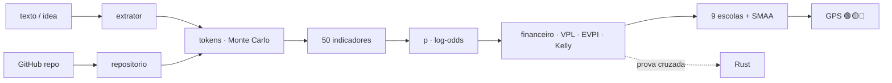

<!--
AnalisadorPreditivoMinimoViaveldeProjetos
Autor: ProfBru - Bruno Penedo © 2026 - TODOS OS DIREITOS RESERVADOS
E-mail: profbruanbima@gmail.com

TEMPLATE DO MOTOR DE READMEs — não editar os 12 READMEs à mão.
  • O que está aqui é ESTRUTURA (nunca traduzida): imagens, comandos, caminhos, badges de stack.
  • Marcadores b:<chave> entre chaves duplas são BLOCOS DE PROSA (traduzidos) — vêm de readme.blocos.json.
  • Marcadores lang:<nome> entre chaves duplas são preenchidos pelo gerador (seletor, frase de direitos).
Estilo: template do ECC (hero, seletor, badges, guia rápido, cards, o que tem dentro)
+ progressão D19: DOR → SOLUÇÃO → PROVA VISUAL → APLICAÇÃO → INSTALAÇÃO → PROFUNDIDADE → LICENÇA.
Gerar:  python3 public/foundations/pipeline/gerar_readmes.py
-->

<div align="center">

# 🧭 Analisador Preditivo Mínimo Viável de Projetos


**ProfBru © 2026**

### ה-GPS החזוי שאומר אם רעיון שווה את הטוקנים שלכם — עוד לפני הטוקן הראשון.

**נכנס משפט אחד של רעיון. יוצאים פסק דין 🟢🟡🔴, כמה טוקנים יעלה לבנות, לתכנן ולקודד אותו, כמה הוא שווה מול ריבית חסרת סיכון — וממה כדאי לכם לוותר.**

   


[Português](README.md) · [English](README.en.md) · [Español](README.es.md) · [Français](README.fr.md) · [Deutsch](README.de.md) · [中文](README.zh.md) · [한국어](README.ko.md) · [हिन्दी](README.hi.md) · **עברית** · [Русский](README.ru.md) · [Svenska](README.sv.md) · [Suomi](README.fi.md)

</div>

> [!IMPORTANT]
> **לבחור ולוותר בחוכמה, לפני שמוציאים, הוא אחד היתרונות הגדולים שיש.** מי שיודע איפה לא להשקיע זמן וכסף כבר ניצח בחצי מהמשחק. הפרויקט הזה הופך את המשמעת הזו לשיטה: חזויה, ניתנת לביקורת, עם מקור מדעי מאחורי כל מספר.

## ⚡ מתחילים ב-60 שניות

בלי שרת, בלי מפתח API, בלי ענן. רץ על המחשב שלכם, ללא חיבור לרשת. הפלט בפורטוגזית ברזילאית.

```bash
git clone <url-do-repositorio> AnalisadorPreditivoMinimoViaveldeProjetos
cd AnalisadorPreditivoMinimoViaveldeProjetos/public/foundations/pipeline
pip install -r requisitos.txt
python3 analisar.py ideia "App para clínicas lembrarem pacientes pelo WhatsApp com assinatura mensal"
```

זהו: הדוח מוצג בטרמינל עם הרמזור, המסלול המומלץ, טוקנים P10/P50/P90 לכל שלב, הערך הצפוי מול ה-CDI (ריבית הייחוס חסרת הסיכון של ברזיל) והשאלות שאתם נמנעים מהן. רוצים להשוות כמה רעיונות? השתמשו ב-`comparar`. רק את עלות הטוקנים? השתמשו ב-`tokens`.

<div align="center">

<table>
<tr>
<td width="33%" align="center"><b>🧭 רעיון אחד, משפט אחד</b><br/><sub>גם בלי נישה, ענף או מספרים. ה-GPS מודד את חוסר הידיעה של עצמו ולעולם לא מאשר להשקיע בעיניים עצומות.</sub><br/><code>analisar.py ideia</code></td>
<td width="33%" align="center"><b>⚖️ לבחור ולוותר</b><br/><sub>כמה רעיונות זה לצד זה: באיזה להמשיך, על איזה לוותר עכשיו, ואילו באמת שקולים.</sub><br/><code>analisar.py comparar</code></td>
<td width="33%" align="center"><b>🪙 כמה זה עולה בטוקנים</b><br/><sub>בנייה, תכנון וקידוד — P10/P50/P90 ו-US$ לכל מודל, כולל סיכון הזנב.</sub><br/><code>analisar.py tokens</code></td>
</tr>
</table>

</div>

---

## 💀 הכאב: אתם מחליטים עם גיליון אלקטרוני — והגיליון לא מחליט כלום

חשבו על הבחירה היקרה האחרונה שעשיתם. **הטלפונים** של צוות המכירות. **הרכב החשמלי** לצי. **הספק** לחוזה של שלוש שנים. **רעיון הסטארט-אפ** שבו קברתם שישה חודשים של לילות. בקנה מידה גדול יותר, אותו כאב: **איזה רכב משוריין, איזה מטוס, איזו מערכת הגנה** צבא קונה לשלושים שנה; **איזה פרויקט** ועדת הנהלה מאשרת בתקציב השנתי.

כמעט תמיד הטקס זהה: **גיליון אלקטרוני**, **מטריצת ניקוד**, כמה **מסננים**. ושלוש מלכודות שאיש אינו רואה:

| מה עשיתם | מה קרה באמת |
|---|---|
| 🔻 **מיינתם לפי עמודה אחת** | החלטתם לפי קריטריון אחד. שבעת האחרים היו שם רק כדי להרגיש יסודיים. |
| 🔢 **סכמתם ציונים במטריצה משוקללת** | קיזזתם אסון בממוצע: אפשרות גרועה בבטיחות "השתוותה" כי הייתה מצוינת במחיר. |
| 🔍 **סיננתם לפי "עומד בהכול"** | הרשימה התרוקנה; ריככתם את הדרישה המפריעה — בדיוק זו שהייתה צריכה להיות וטו. |

ועכשיו הופיעה עלות חדשה, בלתי נראית בכל גיליון: **טוקנים**. עם סוכני AI, הבנייה נעשתה זולה ומהירה — ולכן קל לבזבז שבועות ומאות דולרים על בנייה מושלמת של **הרעיון הלא נכון**.

> [!WARNING]
> **גיליונות, מטריצות ומסנני דירוג אינם מספיקים לבחירה נכונה.** הם לא יודעים לומר עד כמה אתם *לא בטוחים*, לא מענישים אסון בקריטריון קריטי, לא סופרים את עלות *התפעול* של מה שתבנו, והגרוע מכול — לעולם אינם אומרים **"אל תשקיעו עכשיו"**. כלי שלעולם לא ממליץ לוותר אינו תמיכה בהחלטות: הוא מחולל הצדקות.

### הרגע שבו ההחלטה מתה

זה קורה בישיבה, כשמישהו שואל: *"ומה אם משקל הבטיחות היה 30% ולא 25%?"* — והמנצח מתחלף. או חצי שנה אחר כך, כשהפרויקט מוכן, עובד, נבדק… ואף אחד לא משלם עליו. ניתוחי סטארט-אפים שנכשלו מצביעים כבר עשור על אותה סיבה מספר אחת: **לא היה צורך בשוק** (35–42% מהמקרים, CB Insights). השאלה הנכונה מעולם לא הייתה *"האם נוכל לבנות?"*. היא הייתה *"האם כדאי?"* — ויש לה תשובה **לפני** הטוקן הראשון.

---

## 💊 הפתרון: GPS חזוי לפני כל טוקן

**כתבו את הרעיון כפי שהוא בראש שלכם — משפט אחד מספיק.** בתוך שניות, המנתח עושה את מה שוועדה רצינית הייתה עושה בשבועות:

1. **מזהה את מחלקת הייחוס** של הרעיון (SaaS לעסקים, אוטומציה, מרקטפלייס, מסחר, בריאות…) ומתחיל משיעור הבסיס שלה — *המבט החיצוני* שמגן מפני ההתלהבות של הממציא.
2. **מודד 50 מדדים ב-11 ממדים** — ביקוש, שוק, היתכנות טכנית, כלכלה, עמידות, סקלביליות, הצטברות, חוסן, התאמה, מידע וארביטראז' פיננסי — כל אחד עם **ציון, רמת ביטחון, ראיה ומקור מדעי**.
3. **מעריך את הטוקנים** לבנייה, לתכנון ולקידוד, עם **200 אלף סימולציות** והזנב העבה של פרויקטי IT, וממיר אותם ל-US$ לכל מודל ולשעות פיקוח אנושי.
4. **עושה את החשבון שהגיליון שוכח:** עלות הבנייה **והתפעול**, ערך צפוי מהוון ב-CDI, הסתברות איזון, הערך של לבדוק קודם (EVPI), שבר קלי והתועלת השולית של כל ריאל נוסף.
5. **מעמיד להצבעה תשע אסכולות החלטה** (ELECTRE I ו-II, PROMETHEE II, MAUT, MCDA-C, AHP-TOPSIS 2n, VIKOR, TODIM, SAPEVO-M) בין חמישה מסלולים — לא להשקיע, לבדוק קודם, MVP, פרויקט מלא, שימוש חוזר בקוד — ו**מטלטל משקלים וציונים אלפי פעמים** כדי לומר אם הבחירה חסינה, סבירה או שבירה.

<div align="center">

| ❌ מה הגיליון אומר | ✅ מה ה-GPS החזוי אומר |
|---|---|
| "הרעיון קיבל 7.8." | **"🟡 בדקו קודם. המידע שווה R$ 4,586 והבדיקה עולה R$ 850. הריצו את הניסוי בן 5 הימים; אם הוא שלילי, ותרו על הרעיון."** |
| "נבנה את זה בשבועיים." | **"P50 של 13.7 מיליון טוקנים, P90 של 40.1 מיליון — ו-23 שעות סקירה שלכם. העלות הדומיננטית אינה הבנייה: היא התפעול."** |
| *(לעולם לא אומר)* | **"🔴 אל תשקיעו עכשיו. לפי מה שידוע היום, אף מסלול לא מנצח את ה-CDI בסיכון סביר."** |

</div>

**מערכת כנה חייבת לדעת לומר "כאן אל תסמכו עליי".** כשהתיאור מעורפל, ה-GPS אומר זאת — וההחלטה לעולם לא הופכת לירוקה בחושך.

---

## 🖼️ ראו זאת בפעולה — מסך לכל תת-מיומנות

כל המסכים כאן נוצרו על ידי המנתח עצמו (`gerar_telas.py`) עם זרע קבוע: אפשר לשחזר כל מספר במחשב שלכם. התוויות בפורטוגזית ברזילאית, שפת הפלט של הכלי.

### 1. `ideia` — ה-GPS בלוח אחד

<div align="center"></div>

**הכאב שהוא פותר:** לא צריך דוח של 40 עמודים כדי להחליט אם להתחיל; צריך פסק דין וחמשת המספרים שמאחוריו.

רמזור עם תווית (לעולם לא צבע בלבד), מסלול מומלץ, חוסן, הסתברות כדאיות עם מרווח של 80%, טוקנים P50/P90, עלות בנייה, ערך צפוי ו-EVPI.

> **פרשנות:** לרעיון של מרפאות השיניים יש כדאיות של 50% — טובה — אבל פסק הדין הוא 🟡 **בדקו קודם**: לדעת את התוצאה שווה R$ 4,586 והניסוי עולה R$ 850. לקנות מידע זול לפני שמוציאים טוקנים היא ההחלטה הרציונלית, גם לרעיון מבטיח.

### 2. `tokens` — כמה עולה לבנות, לתכנן ולקודד

<div align="center"></div>
<div align="center"></div>

**הכאב שהוא פותר:** "נעשה את זה מהר" הוא המשפט היקר ביותר בהנדסה. סוכני AI משתנים עד פי 30 בטוקנים באותה משימה (Bai et al., 2026), ופרויקט IT אחד מכל 6 חורג מתקציבו ב-200% (Flyvbjerg & Budzier, 2011).

המעריך סופר קבצים, אינטגרציות ומורכבות מהטקסט, מחיל צריכה לפי פעולה (קריאה, כתיבה, עריכה, בדיקה, סקירה), את גדילת ההקשר ואת העבודה החוזרת, ומריץ 200 אלף סימולציות עם זנב עבה.

> **פרשנות:** הקידוד הוא כ-80% מהטוקנים, והקלט (ההקשר שנקרא מחדש בכל צעד) הוא 97% מהם. הטווח P10–P90 משתרע על סדר גודל שלם — ולכן ה-GPS מחליט לפי ה-P90, לא לפי הממוצע.

### 3. מסלולים — לבחור **וגם** לוותר

<div align="center"></div>

**הכאב שהוא פותר:** הגיליון משווה רעיונות; הוא לעולם לא משווה *דרכים להשקיע* באותו רעיון. והדרך חשובה יותר מהרעיון.

חמישה מסלולים: **A0** לא להשקיע (הכסף ב-CDI), **A1** ניסוי מינימלי של 5 ימים, **A2** MVP רזה, **A3** פרויקט מלא, **A4** שימוש חוזר בקוד קיים. לכל אחד הון מחויב, ערך צפוי, הסתברות הפסד וזמן עד הראיה הראשונה.

> **פרשנות:** ל-MVP הערך הצפוי הגבוה ביותר בריאלים, אבל הניסוי בן 5 הימים מנצח בקונצנזוס — הוא מגיע לראיה פי 4 מהר יותר, עם 13% סיכוי להפסד. הדוח מפרש את **הוויתור**: בבחירת A1 אתם משאירים את חשיפת ה-P90 של הפרויקט המלא מחוץ לסיכון עד שיש ראיה.

### 4. ההצבעה של תשע האסכולות הרב-קריטריוניות

<div align="center"></div>

**הכאב שהוא פותר:** כל שיטה רב-קריטריונית היא תיאוריה אחרת של מה זה "טוב יותר". להשתמש רק באחת פירושו לבחור את התשובה יחד עם השאלה.

MAUT מחבר תועלות; ELECTRE מטיל וטו על אסון; PROMETHEE מדרג העדפה; VIKOR מסרב לפצות על הקריטריון הגרוע ביותר; TODIM שוקל הפסד יותר מרווח (תורת הפרוספקט); SAPEVO-M מקבל שיפוט סידורי של ועדה.

> **פרשנות:** שבע מתוך תשע האסכולות מדרגות את הניסוי המינימלי במקום הראשון. כשתיאוריות בלתי תלויות מסכימות, ההחלטה שורדת את הישיבה.

### 5. המדדים — ומה הזיז את ההסתברות

<div align="center"></div>
<div align="center"></div>

**הכאב שהוא פותר:** "ציון 7.8" בלי הסבר לא משכנע אף אחד. כאן כל ממד מציג את הציון, את רמת הביטחון ובכמה הוא דחף את ההסתברות למעלה או למטה.

הקטלוג המלא (`analisar.py indicadores`) מפרט את 50 המדדים עם נוסחה, מקור מדעי ו**הראיה המינימלית** שתבסס כל ציון — במקום להמציא אותו.

> **פרשנות:** בעיה וביקוש הוא הממד שהעלה את ההסתברות יותר מכול (כאב, תדירות ו-3 מרפאות מעוניינות); שוק וגיוון נשאר ניטרלי — מקטע שימוש יחיד, אנטרופיית שאנון אפס. זה בדיוק מה שהשיחה הבאה עם לקוחות צריכה לבדוק.

### 6. `comparar` — כמה רעיונות, החלטה אחת

<div align="center"></div>

**הכאב שהוא פותר:** יש לכם חמישה רעיונות ואנרגיה לאחד. דירוג עם "מנצח ב-0.3 נקודה" הוא רעש בתחפושת של ודאות.

הרעיונות מנותחים במקביל (`ProcessPoolExecutor`) ותשע האסכולות מצביעות עם **חוסן כפול**: משקלים לא ודאיים וציונים לא ודאיים (SMAA). פסק הדין משתמש בנמוך מבין השניים.

> **פרשנות:** עם משקלים לא ודאיים, רעיון 4 מנצח תמיד; עם ציונים לא ודאיים, רק ב-60% מהמקרים — תיקו טכני עם רעיון 1. ה-GPS אומר זאת במפורש: אל תבחרו לפי הדירוג, הריצו ניסוי לשניהם. והוא מורה **לוותר מיד** על המרקטפלייס ועל בוט הארביטראז', שאינם מנצחים בשום תרחיש סביר.

### 7. `repo` — יש לרעיון כבר קוד ב-GitHub?

<div align="center"></div>
<div align="center"></div>

**הכאב שהוא פותר:** קוד קיים נראה כמו חיסכון, אבל הוא עולה בקריאה, בהתאמה ולפעמים ברישיון שאי אפשר להשתמש בו.

המנתח יוצר שיבוט רדוד ומבודד (שום דבר מהמאגר אינו מורץ), מודד שורות לכל שפה, בדיקות, CI, רישיון וגיל הקומיט האחרון, ומחשב מוכנות (TRL לתוכנה). הבשלות מקטינה את טוקני הקידוד; הקריאה מתווספת לטוקני הבנייה.

> **פרשנות:** עם מאגר MIT ברמת TRL-5, מסלול "שימוש חוזר" (A4) מופיע בין החלופות — והקונצנזוס עדיין מעדיף את ה-MVP, כי התאמת הקיים לא מבטלת את שאלת השוק.

### 8. ארביטראז' פיננסי ורווחי הון

<div align="center"></div>
<div align="center"></div>

**הכאב שהוא פותר:** רעיונות מסחר וארביטראז' נראים כמו כסף בחינם — עד שמופיעות עלויות העסקה, המס ושחיקת האלפא.

כשהרעיון הוא אסטרטגיה פיננסית, נכנס למודל ממד ייעודי (יציבות היתרון, עלויות והשהיה, תיקוף סטטיסטי, חשיפה רגולטורית), והדוח דורש בדיקה לאחור מחוץ למדגם, מדד שארפ וירידה מרבית לפני כל טוקן של מוצר. בכל רעיון, הון-הטוקנים מושווה לחלופה חסרת הסיכון: ה-CDI.

> **פרשנות:** בוט הארביטראז' בקריפטו שתואר במשפט אחד מקבל 🟡 **בדקו קודם** עם כדאיות של 12%; אוטומציית ההתאמה הבנקאית לידו מקבלת 🟢 **השקיעו ב-MVP** עם החזר השקעה בתוך 4 חודשים. אותו מחבר, אותו יום: ההבדל הוא היכן הזמן משתלם.

### 9. כשהרעיון עדיין מעורפל מדי

<div align="center"></div>

**הכאב שהוא פותר:** ההחלטה הגרועה ביותר אינה לומר לא לרעיון טוב — אלא לומר כן לרעיון שעדיין לא קיים.

עבור "רעיון מגניב", ה-GPS מודד שלמות של 0%, מחזיר מרווח הסתברות רחב מאוד, מפרט את השאלות המהותיות שלא נענו ומסמן את פסק הדין כשביר.

> **פרשנות:** 🔴 **אל תשקיעו עכשיו** — לא מפסימיות, אלא מחוסר מידע. הדוח עצמו אומר מה לברר קודם (למי יש את הכאב, כמה הוא עולה, איך מרוויחים כסף).

### 10. `prompt` — להעמיק עם LLM, בדרך הנכונה

<div align="center"></div>

**הכאב שהוא פותר:** מודלי שפה מצטיינים במציאת חורים לוגיים ובהצעת ניסויים — וגרועים בהמצאת משקלים וציונים מכוילים; כשופטים, הם נוטים להסכים כמעט עם הכול.

לכן המנתח עושה את החלק הכמותי ומספק פרומפט-אב מוכן, שכבר כולל מחלקה, הסתברות, טוקנים ומסלול, ומבקש מה-LLM רק את מה שהוא עושה היטב: שאלות לא נוחות, מבחן הפיכות, ניסוי מינימלי ומפת תלויות.

> **פרשנות:** המספר מגיע מהמודל; התשאול מגיע מה-LLM. כל אחד בתפקידו.

### 11. `--relatorio` — התיק ב-PDF, HTML ו-Markdown

<div align="center"> </div>

**הכאב שהוא פותר:** החלטה חשובה צריכה להסתובב — בוועדה, עם השותף, בתיבת הדואר של המשקיע — והיא צריכה להוכיח מי חתם עליה.

עם `--relatorio`, כל ניתוח יוצא בשלושה פורמטים: **Markdown** (ניתן לניהול גרסאות), **HTML** עצמאי (מסכים מוטמעים, ערכת נושא בהירה וכהה) ו-**PDF בפורמט OCR** — כל עמוד הוא תמונה עם סימן ProfBru גדול ב-50% שקיפות ברקע, ומעליו שכבת טקסט בלתי נראית שהופכת את המסמך לניתן לחיפוש ולהעתקה בלי להיות PDF של טקסט גולמי.

> **פרשנות:** אותו GPS שקראתם בטרמינל הופך לתיק של שישה עמודים עם חמשת המסכים מצורפים, מוכן לישיבה — וחיפוש "experimento mínimo" מוצא כל מופע ב-PDF.

📎 [`docs/exemplos/gps_clinica.pdf`](docs/exemplos/gps_clinica.pdf) · [`.html`](docs/exemplos/gps_clinica.html) · [`.md`](docs/exemplos/gps_clinica.md)

---

## 🎯 למה זה משמש — בחירה וויתור בהתאמה אישית

אותה שיטה משרתת כל החלטה שבה **האפשרויות סותרות זו את זו, המידע חלקי וטעות עולה ביוקר**:

<div align="center">

| תחום | החלטה | למה הגיליון נכשל |
|---|---|---|
| **רעיונות וסטארט-אפים** | איזה רעיון ראוי לטוקנים, לזמן ולהון ב-90 הימים הקרובים | מתעלם משיעור הבסיס של המחלקה ומעלות התפעול |
| **פרויקטי AI** | MVP, פרויקט מלא או רק בדיקה — ועם איזה מודל | לא מעריך טוקנים, זנב או שעות סקירה |
| **החלטות הנהלה ותאגיד** | תיק פרויקטים, ספק, לייצר או לקנות | מקזז וטו בממוצע; לא מודד חוסן |
| **ציוד וטלפונים** | איזה ציוד משרת את תיק השימושים האמיתי | לא מודד גיוון שימושים (שאנון) או תועלת שולית |
| **רכבים חשמליים וציים** | טווח × עלות כוללת × תשתית | סופר פעמיים קריטריונים מתואמים |
| **כוחות מזוינים** | רכבים משוריינים, מטוסים, מערכות ל-30 שנה | קריטריון קריטי גרוע חייב להטיל וטו, לא להתקזז |
| **מסחר וארביטראז'** | לבנות את הבוט או להשאיר את הכסף ב-CDI? | שוכח עלויות עסקה, מס ושחיקת אלפא |
| **עסקים קטנים ובינוניים** | האם להפוך את התהליך הידני לאוטומטי | לא משווה את החיסכון השנתי לעלות ה-P90 |

</div>

> [!NOTE]
> ההנחות (שער חליפין, CDI, אופק, ערך השעה שלכם, הכנסה צפויה, הון) הן פרמטרים בשורת הפקודה ומודפסות בכל דוח. שנו אותן ופסק הדין יחושב מחדש — ההחלטה שלכם, והחשבון גלוי.

---

## 🧩 למה כל יכולת קיימת

| יכולת | למה היא קיימת | ביסוס |
|---|---|---|
| **מחלקת ייחוס** | התחזית הטובה ביותר לפרויקט היא ההיסטוריה של פרויקטים דומים, לא האופטימיות של מי שמציע אותו | Kahneman & Lovallo (1993); Flyvbjerg & Gardner (2023) |
| **הסתברות ב-log-odds עם רמת ביטחון** | כל מדד מזיז את ההסתברות ביחס לראיה; בלי ראיה, כמעט כלום | כללים פרשניים (LLM-AR, 2025); SAISE (2025) |
| **טוקנים P10/P50/P90 לכל שלב** | צריכת הסוכנים משתנה עד פי 30 והקלט שולט בעלות | Bai et al. (2026); ACEM (2026); tokencast |
| **עלות תפעול, לא רק בנייה** | עם AI, הבנייה הוזלה; מה ששובר את העסק הוא התפעול | ACEM (2026); CB Insights |
| **ערך נוכחי נקי מול ה-CDI** | לכל ריאל שמוצא על טוקנים יש עלות אלטרנטיבית ודאית | Dixit & Pindyck (1994) |
| **EVPI — הערך של לבדוק קודם** | לפעמים הקנייה הטובה ביותר היא מידע, לא קוד | Howard (1966); Camuffo et al. (2020, 2024) |
| **שבר קלי** | כמה להמר חשוב בדיוק כמו על מה | Kelly (1956) |
| **תועלת שולית על החזית היעילה** | מה שחשוב הוא ערכו של הריאל הבא שיושקע | Gossen (1854) |
| **אנטרופיית שאנון, סימפסון, HHI, מדד רב-גוניות** | לרעיון עם כמה שימושים יש יותר יציאות אם השוק הראשון נכשל | Shannon (1948); מדדי בסיס הידע |
| **תשע אסכולות + קונצנזוס בורדה** | הסכמה בין תיאוריות בלתי תלויות היא הראיה החזקה ביותר בהיעדר נתונים | Roy; Brans; Keeney & Raiffa; Saaty; Opricovic; Gomes |
| **חוסן כפול (משקלים וציונים)** | מנצח שמתחלף עם 2 נקודות משקל אינו מנצח | SMAA — Lahdelma et al. (1998) |
| **שאלות לא נוחות, הפיכות, ניסוי מינימלי, תלויות** | זה מה שמשקיע ספקן היה עושה — ומה ש-LLM עושה היטב | בסיס הידע של הפרויקט |
| **דוח ב-PDF בפורמט OCR, HTML ו-Markdown** | ההחלטה צריכה להסתובב, להיות ניתנת לחיפוש ולשאת את שם המחבר בכל עמוד | PyMuPDF + Pillow, הכול מקומי |
| **מנוע שני ב-Rust** | שני מנועים בלתי תלויים שמסכימים מוכיחים את המתמטיקה, לא רק את הקוד | בדיקה צולבת בכל הרצה |

---

## ⚙️ התקנה ושימוש

| רכיב | גרסה | חובה | למה |
|---|---|---|---|
| Python | 3.13 | ✅ | מנוע, CLI, דוחות |
| NumPy | 2.x | ✅ | אלגברה וסימולציה |
| numba | ≥ 0.60 | ⚠️ מומלץ | JIT לליבות (בלעדיו: אותה תשובה, איטי יותר) |
| matplotlib | ≥ 3.7 | ⚠️ למסכים | גרפי PNG |
| PyMuPDF · Pillow · markdown | עדכניות | ⚠️ ל-`--relatorio` | PDF, HTML |
| Rust / cargo | יציב | ⭕ אופציונלי | מנוע אימות שני |
| git · screen | — | ⭕ אופציונלי | ניתוח מאגרים · הרצה ברקע |

```bash
cd public/foundations/pipeline
python3 analisar.py ideia "<ideia>" [--repo <url|pasta>] [--relatorio [base]] [--telas pasta/] [--json]
python3 analisar.py comparar "<ideia A>" "<ideia B>" "<ideia C>" [--relatorio]   # ou --arquivo ideias.txt
python3 analisar.py tokens "<ideia>" [--json]
python3 analisar.py repo https://github.com/<usuario>/<projeto>
python3 analisar.py indicadores [--bibliografia]
python3 analisar.py prompt "<ideia>"

# premissas (todas opcionais): --cambio 5.50 --cdi 0.14 --horizonte 12 --valor-hora 80
#                              --receita 3000 --receita-otimista 20000 --capital 50000 --infra-mes 0

./run_all.sh --demo          # < 60 s
./run_all.sh                 # testes + prova cruzada Rust + bench + telas + i18n
./run_all.sh --background    # screen + watchdog de 20 min (screen -r analisadorpreditivominimoviaveldeprojetos)
```

| תת-מיומנות | מה היא מספקת |
|---|---|
| `ideia` | GPS מלא לרעיון אחד: רמזור, מסלול, הסתברות, טוקנים, כלכלה, תשע אסכולות, מדדים, שאלות, ניסוי, תלויות, ויתור (Markdown, JSON ומסכים) |
| `comparar` | כמה רעיונות במקביל: במה להמשיך, אילו שקולים, על מה לוותר מיד |
| `tokens` | רק העלות: טוקנים P10/P50/P90 לכל שלב, US$ לכל מודל, שעות אדם |
| `repo` | בשלות של מאגר: שורות, שפות, בדיקות, CI, רישיון, מוכנות |
| `indicadores` | קטלוג 50 המדדים עם נוסחה, מקור וראיה מינימלית; `--bibliografia` |
| `prompt` | פרומפט-אב מוכן להעמקת הרעיון ב-LLM |
| `--relatorio` | כל ניתוח כ-Markdown, HTML ו-PDF בפורמט OCR עם סימן מים |

---

## 🧠 איך זה עובד מבפנים

הטקסט הופך ל**אותות** (מילון בפורטוגזית ובאנגלית, תוך שמירת הראיה שהפעילה כל אות); האותות קובעים את **מחלקת הייחוס** ואת **הגודל הפונקציונלי**; הגודל הופך ל**טוקנים** (סימולציה עם זנב עבה); האותות והגודל הופכים ל**מדדים**; המדדים מזיזים את **ההסתברות המוקדמת** של המחלקה ב-log-odds עד ל**הסתברות הכדאיות**; ההסתברות מזינה את **הכלכלה** של חמשת המסלולים; ותשע האסכולות בוחרות את המסלול — עם חוסן מדוד.



| ממד | מה הוא שואל |
|---|---|
| בעיה וביקוש | האם הכאב אמיתי, תכוף, משלמים עליו? האם מישהו מלבדכם אישר? |
| שוק וגיוון | כמה שימושים ומקטעים (שאנון, סימפסון, HHI, רב-גוניות)? |
| היתכנות טכנית | גודל, אינטגרציות, זמן אמת, קוד קיים, עמידות מפני הפיכה לסחורה בידי AI |
| היתכנות כלכלית | עלות, זנב, מרווח ביטחון, ערך נוכחי נקי, החזר, הכנסה חוזרת, קלי, תועלת שולית |
| עמידות | האם הוא שורד זמן, אופנות ופלטפורמה יחידה? |
| סקלביליות | עלות שולית, אפקט רשת, אוטומציה |
| הצטברות | מה נשאר אם נכשל: קוד, נתונים, למידה, אפשרויות פיבוט |
| חוסן וסיכון | רגולציה, תלויות חיצוניות, ביצוע ביחידות, הפסד מרבי |
| התאמה ויכולת בדיקה | יתרון המחבר, ניסוי של 5 ימים, זמן עד ראיה, עלות אפס |
| מידע ואי-ודאות | שלמות התיאור, ביטחון המחלקה, ערך המידע |
| ארביטראז' פיננסי | יציבות האלפא, עלויות, תיקוף סטטיסטי, רגולציה |

### בחזית המדע

אף מדד לא נכנס לקטלוג בלי מקור — ובדיקה אוטומטית מכשילה את הפרויקט אם זה קורה. בין 52 המקורות: הספרות העדכנית על חיזוי הצלחת סטארט-אפים באמצעות AI ומודלי שפה (VCBench, SSFF, SAISE, מטה-אנליזה של מנבאים, LLM-AR, kNN-ICL — 2024 עד 2026), צריכת הטוקנים של סוכני קוד (Bai, Brynjolfsson, Pentland et al., 2026) והערכת עלויות של הנדסה סוכנית (ACEM, 2026), לצד הקלאסיקות שעליהן נשענת כל שיטה: Shannon, Gossen, Kelly, Howard, Kahneman & Tversky, Roy, Saaty, Keeney & Raiffa, Flyvbjerg, Lahdelma (SMAA) והאסכולה הברזילאית לתמיכה רב-קריטריונית בהחלטות. הרשימה המלאה מתקבלת עם `python3 analisar.py indicadores --bibliografia`.

---

## 🚀 ביצועים ובדיקה צולבת

| מדידה (4 מעבדים, מקרה המרפאות) | תוצאה |
|---|---|
| ניתוח מלא של רעיון אחד (200 אלף סימולציות טוקנים + 9 אסכולות × 2,000 יקומים) | ≈ 1.8 שניות |
| כמה רעיונות | במקביל עם `ProcessPoolExecutor`, תוצאה זהה להרצה טורית |
| התאמה Python × Rust (5 מקרים, 10 גדלים בכל אחד) | הפרש מרבי של 2.2 × 10⁻¹⁵ |

כל מדידה נרשמת עם הוכחה שהתוצאה לא השתנתה: אופטימיזציה שמשנה את התשובה אינה רווח.

```text
✅ clinica      10 grandezas idênticas · Δ relativo máx 0.0e+00
✅ conciliacao  10 grandezas idênticas · Δ relativo máx 0.0e+00
✅ arbitragem   10 grandezas idênticas · Δ relativo máx 1.3e-15
✅ marketplace  10 grandezas idênticas · Δ relativo máx 2.2e-15
✅ vaga         10 grandezas idênticas · Δ relativo máx 0.0e+00
```

---

## 📁 מה יש בפנים

```
AnalisadorPreditivoMinimoViaveldeProjetos/
├── README.md (+11)
├── projeto.toml
├── docs/                         logo, telas/, CUSTO.md, OPERACAO.md
└── public/foundations/
    ├── pipeline/
    │   ├── analisar.py           CLI (6 sub-skills)
    │   ├── apmv/                 extrator · repositorio · tokens · indicadores · preditivo
    │   │   │                     financeiro · decisao · gps · relatorio · telas · referencias
    │   │   └── mcdm/             ELECTRE I/II · PROMETHEE II · MAUT · MCDA-C · AHP-TOPSIS 2n
    │   │                         VIKOR · TODIM · SAPEVO-M · Borda · Dirichlet
    │   ├── testes_apmv.py · prova_cruzada_rust.py · bench.py · gerar_telas.py
    │   └── run_all.sh · watchdog.sh · verificar_publicacao.sh
    └── rust/analisadorpreditivominimoviaveldeprojetos_core/   apmv_core
```

הכול רץ מקומית, בלי עלות חוזרת: בלי שרת, בלי מפתח API, בלי קריאת רשת במהלך הניתוח (רק `git clone` כשאתם מציינים מאגר).

---

## ❓ שאלות שתשאלו

<details>
<summary><b>זה באמת עובד עם רעיון של משפט אחד?</b></summary>

כן — זה בדיוק המקרה שלשמו הוא תוכנן. עם מעט מידע, ה-GPS מתחיל משיעור הבסיס של המחלקה, מרחיב את מרווח ההסתברות ואינו מאשר השקעה: הוא אומר בדיוק על אילו שאלות לענות קודם.
</details>

<details>
<summary><b>למה לא פשוט לשאול LLM אם הרעיון טוב?</b></summary>

כי מודלי שפה, כשופטים, מסכימים כמעט עם הכול — וממציאים משקלים וציונים שנראים מכוילים. המנתח מחשב בשיטה ובמקורות; ה-LLM נכנס היכן שהוא חזק, דרך פרומפט-האב.
</details>

<details>
<summary><b>מאיפה מגיעות ההכנסות והשעות שבדוח?</b></summary>

ממחלקת הייחוס, כתרחיש שמרני ותרחיש אופטימי — והן מוצגות כהנחות. אם אתם יודעים את ההכנסה, את ערך השעה שלכם או את ההון, העבירו אותם בשורת הפקודה והכול יחושב מחדש.
</details>

<details>
<summary><b>זה מתאים גם להחלטות שאינן בתחום התוכנה?</b></summary>

כן. תשע האסכולות, ניתוח החוסן ומדדי הגיוון והתועלת השולית חלים על ציוד, ציי רכב, ספקים ופרויקטים מכל סוג; טוקנים הם רק אחד המטבעות.
</details>

<details>
<summary><b>צריך לשלם משהו כדי להריץ?</b></summary>

לא. הוא רץ על המחשב שלכם, ללא רשת. העלות היחידה היא זו שהדוח עצמו מעריך — הטוקנים שתחליטו להוציא אחר כך.
</details>

---

## 📜 רישיון וזכויות יוצרים

<div align="center">


**ProfBru © 2026**

**Analisador Preditivo Mínimo Viável de Projetos**
מחבר: **ProfBru - Bruno Penedo** © 2026 — **כל הזכויות שמורות**
📧 profbruanbima@gmail.com

</div>

תוכנה קניינית. שימוש, העתקה, שינוי והפצה מחייבים אישור מפורש של המחבר. ספריות ומקורות של צד שלישי שומרים על הרישיונות והקרדיטים שלהם.

---

_AnalisadorPreditivoMinimoViaveldeProjetos_
_מחבר: **ProfBru - Bruno Penedo** © 2026 — כל הזכויות שמורות · profbruanbima@gmail.com_
