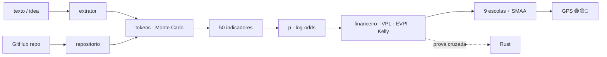

<!--
AnalisadorPreditivoMinimoViaveldeProjetos
Autor: ProfBru - Bruno Penedo © 2026 - TODOS OS DIREITOS RESERVADOS
E-mail: profbruanbima@gmail.com

TEMPLATE DO MOTOR DE READMEs — não editar os 12 READMEs à mão.
  • O que está aqui é ESTRUTURA (nunca traduzida): imagens, comandos, caminhos, badges de stack.
  • Marcadores b:<chave> entre chaves duplas são BLOCOS DE PROSA (traduzidos) — vêm de readme.blocos.json.
  • Marcadores lang:<nome> entre chaves duplas são preenchidos pelo gerador (seletor, frase de direitos).
Estilo: template do ECC (hero, seletor, badges, guia rápido, cards, o que tem dentro)
+ progressão D19: DOR → SOLUÇÃO → PROVA VISUAL → APLICAÇÃO → INSTALAÇÃO → PROFUNDIDADE → LICENÇA.
Gerar:  python3 public/foundations/pipeline/gerar_readmes.py
-->

<div align="center">

# 🧭 Analisador Preditivo Mínimo Viável de Projetos


**ProfBru © 2026**

### पूर्वानुमान करने वाला GPS जो पहले टोकन से पहले बताता है कि कोई विचार आपके टोकन के लायक है या नहीं।

**विचार का एक वाक्य अंदर जाता है। बाहर आता है 🟢🟡🔴 निर्णय, उसे संरचित करने, योजना बनाने और कोड करने में कितने टोकन लगेंगे, जोखिम-मुक्त दर के मुकाबले उसका मूल्य — और आपको किसे छोड़ देना चाहिए।**

   


[Português](README.md) · [English](README.en.md) · [Español](README.es.md) · [Français](README.fr.md) · [Deutsch](README.de.md) · [中文](README.zh.md) · [한국어](README.ko.md) · **हिन्दी** · [עברית](README.he.md) · [Русский](README.ru.md) · [Svenska](README.sv.md) · [Suomi](README.fi.md)

</div>

> [!IMPORTANT]
> **खर्च करने से पहले समझदारी से चुनना और छोड़ना सबसे बड़े लाभों में से एक है।** जो जानता है कि समय और पैसा कहाँ नहीं लगाना है, वह आधा खेल पहले ही जीत चुका है। यह परियोजना उस अनुशासन को एक पद्धति में बदलती है: पूर्वानुमानित, जाँचने योग्य, और हर संख्या के पीछे एक वैज्ञानिक स्रोत।

## ⚡ 60 सेकंड में शुरू करें

न सर्वर, न API कुंजी, न क्लाउड। यह आपकी मशीन पर ऑफ़लाइन चलता है। आउटपुट ब्राज़ीलियाई पुर्तगाली में है।

```bash
git clone <url-do-repositorio> AnalisadorPreditivoMinimoViaveldeProjetos
cd AnalisadorPreditivoMinimoViaveldeProjetos/public/foundations/pipeline
pip install -r requisitos.txt
python3 analisar.py ideia "App para clínicas lembrarem pacientes pelo WhatsApp com assinatura mensal"
```

बस: रिपोर्ट टर्मिनल में ट्रैफ़िक लाइट, अनुशंसित मार्ग, हर चरण के P10/P50/P90 टोकन, CDI (ब्राज़ील की जोखिम-मुक्त संदर्भ दर) के मुकाबले अपेक्षित मूल्य और उन प्रश्नों के साथ दिखती है जिनसे आप बच रहे हैं। कई विचारों की तुलना करनी है? `comparar` का उपयोग करें। केवल टोकन लागत चाहिए? `tokens` का उपयोग करें।

<div align="center">

<table>
<tr>
<td width="33%" align="center"><b>🧭 एक विचार, एक वाक्य</b><br/><sub>बिना निश, क्षेत्र या आँकड़ों के भी। GPS अपनी अज्ञानता को मापता है और कभी अंधेरे में निवेश की अनुमति नहीं देता।</sub><br/><code>analisar.py ideia</code></td>
<td width="33%" align="center"><b>⚖️ चुनें और छोड़ें</b><br/><sub>कई विचार साथ-साथ: किसे आगे बढ़ाएँ, किसे अभी छोड़ें, कौन सच में बराबर हैं।</sub><br/><code>analisar.py comparar</code></td>
<td width="33%" align="center"><b>🪙 टोकन में कितना खर्च</b><br/><sub>संरचना, योजना और कोडिंग — P10/P50/P90 और हर मॉडल के लिए US$, पूँछ-जोखिम सहित।</sub><br/><code>analisar.py tokens</code></td>
</tr>
</table>

</div>

---

## 💀 समस्या: आप स्प्रेडशीट से निर्णय लेते हैं — और स्प्रेडशीट कुछ तय नहीं करती

अपने पिछले महँगे चुनाव के बारे में सोचिए। बिक्री टीम के **फ़ोन**। बेड़े की **इलेक्ट्रिक कार**। तीन साल के अनुबंध का **आपूर्तिकर्ता**। वह **स्टार्टअप विचार** जिसमें आपने छह महीने की रातें लगा दीं। बड़े पैमाने पर भी वही पीड़ा: सेना तीस साल के लिए **कौन-सा बख्तरबंद वाहन, कौन-सा विमान, कौन-सी रक्षा प्रणाली** खरीदे; कार्यकारी समिति साल के बजट से **कौन-सी परियोजना** मंज़ूर करे।

लगभग हर बार रस्म वही होती है: एक **स्प्रेडशीट**, एक **अंक मैट्रिक्स**, कुछ **फ़िल्टर**। और तीन जाल जिन्हें कोई नहीं देखता:

| आपने क्या किया | वास्तव में क्या हुआ |
|---|---|
| 🔻 **स्प्रेडशीट को एक कॉलम से क्रमबद्ध किया** | आपने केवल एक मानदंड से निर्णय लिया। बाकी सात सिर्फ़ गंभीरता का एहसास देने के लिए थे। |
| 🔢 **भारित मैट्रिक्स में अंक जोड़े** | आपने आपदा को औसत से ढक दिया: सुरक्षा में बेहद खराब विकल्प "बराबर" हो गया क्योंकि कीमत में बढ़िया था। |
| 🔍 **"सब कुछ पूरा करता है" से फ़िल्टर किया** | सूची खाली रह गई; आपने असुविधाजनक शर्त ढीली कर दी — ठीक वही जो वीटो होनी चाहिए थी। |

और अब एक नई लागत आ गई है, जो हर स्प्रेडशीट में अदृश्य है: **टोकन**। AI एजेंटों के साथ बनाना सस्ता और तेज़ हो गया — इसीलिए हफ़्ते और सैकड़ों डॉलर खर्च करके **ग़लत विचार** को पूरी तरह बना डालना आसान हो गया है।

> [!WARNING]
> **स्प्रेडशीट, मैट्रिक्स और रैंकिंग फ़िल्टर सही चुनाव के लिए पर्याप्त नहीं हैं।** वे यह नहीं बता सकते कि आप कितने *अनिश्चित* हैं, किसी महत्वपूर्ण मानदंड पर आपदा को दंडित नहीं करते, जो आप बनाएँगे उसे *चलाने* की लागत नहीं गिनते और — सबसे बुरा — कभी नहीं कहते **"अभी निवेश न करें"**। जो उपकरण कभी त्याग की सलाह नहीं देता, वह निर्णय-सहायता नहीं है: वह औचित्य बनाने की मशीन है।

### वह क्षण जब निर्णय मर जाता है

बैठक में, जब कोई पूछता है: *"अगर सुरक्षा का भार 25% की जगह 30% हो तो?"* — और विजेता बदल जाता है। या छह महीने बाद, जब परियोजना तैयार है, चल रही है, परखी जा चुकी है… और कोई उसके लिए भुगतान नहीं करता। स्टार्टअप पोस्ट-मॉर्टम एक दशक से वही नंबर एक कारण बताते आ रहे हैं: **बाज़ार में ज़रूरत ही नहीं थी** (35–42% मामले, CB Insights)। सही प्रश्न कभी *"क्या हम बना सकते हैं?"* नहीं था। प्रश्न था *"क्या हमें बनाना चाहिए?"* — और उसका उत्तर पहले टोकन **से पहले** मिल सकता है।

---

## 💊 समाधान: हर टोकन से पहले एक पूर्वानुमानित GPS

**विचार को वैसे ही लिखिए जैसा वह आपके दिमाग़ में है — एक वाक्य काफ़ी है।** कुछ ही सेकंड में विश्लेषक वह कर देता है जो एक गंभीर समिति हफ़्तों में करती:

1. विचार के **संदर्भ वर्ग** (B2B SaaS, स्वचालन, मार्केटप्लेस, ट्रेडिंग, स्वास्थ्य…) को पहचानता है और उसकी आधार-दर से शुरू करता है — वह *बाहरी दृष्टि* जो लेखक के उत्साह से बचाती है।
2. **11 आयामों में 50 संकेतक मापता है** — माँग, बाज़ार, तकनीकी व्यवहार्यता, अर्थशास्त्र, टिकाऊपन, विस्तारशीलता, संचयशीलता, मज़बूती, संरेखण, सूचना और वित्तीय आर्बिट्राज — हर एक के साथ **अंक, विश्वास, साक्ष्य और वैज्ञानिक स्रोत**।
3. संरचना, योजना और कोडिंग के **टोकन का अनुमान** लगाता है, IT परियोजनाओं की मोटी पूँछ के साथ **2 लाख सिमुलेशन** चलाकर, और उन्हें हर मॉडल के US$ और मानवीय निगरानी के घंटों में बदलता है।
4. **वह हिसाब करता है जो स्प्रेडशीट भूल जाती है:** बनाने **और चलाने** की लागत, CDI पर छूट दिया गया अपेक्षित मूल्य, ब्रेक-ईवन संभावना, पहले परखने का मूल्य (EVPI), केली अंश और हर अतिरिक्त रियाल की सीमांत उपयोगिता।
5. **नौ निर्णय-पद्धतियों से मतदान कराता है** (ELECTRE I और II, PROMETHEE II, MAUT, MCDA-C, AHP-TOPSIS 2n, VIKOR, TODIM, SAPEVO-M) पाँच मार्गों के बीच — निवेश न करें, पहले परखें, MVP, पूरी परियोजना, कोड का पुन: उपयोग — और **भार व अंकों को हज़ारों बार बदलकर** बताता है कि चुनाव मज़बूत, संभावित या नाज़ुक है।

<div align="center">

| ❌ स्प्रेडशीट क्या कहती है | ✅ पूर्वानुमानित GPS क्या कहता है |
|---|---|
| "विचार को 7.8 अंक मिले।" | **"🟡 पहले परखें। जानकारी का मूल्य R$ 4,586 है और परीक्षण की लागत R$ 850। यह 5-दिवसीय प्रयोग चलाइए; नतीजा नकारात्मक हो तो विचार छोड़ दीजिए।"** |
| "दो हफ़्ते में बन जाएगा।" | **"P50 1.37 करोड़ टोकन, P90 4.01 करोड़ — और आपकी समीक्षा के 23 घंटे। मुख्य लागत बनाना नहीं, चलाना है।"** |
| *(कभी नहीं कहती)* | **"🔴 अभी निवेश न करें। आज की जानकारी में कोई भी मार्ग स्वीकार्य जोखिम के साथ CDI को नहीं हराता।"** |

</div>

**एक ईमानदार प्रणाली को कह पाना चाहिए "यहाँ मुझ पर भरोसा मत कीजिए"।** जब विवरण अस्पष्ट हो, GPS यही कहता है — और निर्णय कभी अंधेरे में हरा नहीं होता।

---

## 🖼️ इसे काम करते देखें — हर सब-स्किल की एक स्क्रीन

नीचे की सभी स्क्रीनें स्वयं विश्लेषक (`gerar_telas.py`) ने स्थिर सीड के साथ बनाई हैं: आप हर संख्या अपनी मशीन पर दोहरा सकते हैं। लेबल ब्राज़ीलियाई पुर्तगाली में हैं, जो उपकरण की आउटपुट भाषा है।

### 1. `ideia` — एक पैनल में GPS

<div align="center"></div>

**कौन-सी पीड़ा हल करता है:** शुरू करना है या नहीं, यह तय करने के लिए 40 पन्नों की रिपोर्ट नहीं चाहिए; एक निर्णय और उसे थामने वाली पाँच संख्याएँ चाहिए।

लेबल वाली ट्रैफ़िक लाइट (केवल रंग नहीं), अनुशंसित मार्ग, मज़बूती, 80% अंतराल के साथ व्यवहार्यता की संभावना, P50/P90 टोकन, निर्माण लागत, अपेक्षित मूल्य और EVPI।

> **व्याख्या:** डेंटल क्लिनिक वाले विचार की व्यवहार्यता 50% है — अच्छी — पर निर्णय है 🟡 **पहले परखें**: परिणाम जानने का मूल्य R$ 4,586 है और प्रयोग की लागत R$ 850। टोकन खर्च करने से पहले सस्ती जानकारी ख़रीदना ही तर्कसंगत निर्णय है, आशाजनक विचार के लिए भी।

### 2. `tokens` — संरचना, योजना और कोडिंग की लागत

<div align="center"></div>
<div align="center"></div>

**कौन-सी पीड़ा हल करता है:** "जल्दी बन जाएगा" इंजीनियरिंग का सबसे महँगा वाक्य है। AI एजेंट एक ही काम पर टोकन में 30 गुना तक अलग होते हैं (Bai et al., 2026) और हर 6 में से 1 IT परियोजना बजट से 200% ऊपर जाती है (Flyvbjerg & Budzier, 2011)।

अनुमानक पाठ से फ़ाइलें, इंटीग्रेशन और जटिलता गिनता है, गतिविधि-वार खपत (पढ़ना, लिखना, बदलना, परखना, समीक्षा), संदर्भ की वृद्धि और दोबारा काम लागू करता है, और मोटी पूँछ वाले 2 लाख सिमुलेशन चलाता है।

> **व्याख्या:** कोडिंग लगभग 80% टोकन है, और इनपुट (हर कदम पर दोबारा पढ़ा गया संदर्भ) उनमें से 97%। P10–P90 का दायरा दस गुना तक फैला है — इसीलिए GPS औसत से नहीं, P90 से निर्णय लेता है।

### 3. मार्ग — चुनना **और** छोड़ना

<div align="center"></div>

**कौन-सी पीड़ा हल करता है:** स्प्रेडशीट विचारों की तुलना करती है; वह कभी एक ही विचार में *निवेश के तरीकों* की तुलना नहीं करती। और तरीका विचार से ज़्यादा मायने रखता है।

पाँच मार्ग: **A0** निवेश न करें (पैसा CDI में), **A1** 5-दिवसीय न्यूनतम प्रयोग, **A2** हल्का MVP, **A3** पूरी परियोजना, **A4** मौजूदा कोड का पुन: उपयोग। हर एक के साथ लगाई गई पूँजी, अपेक्षित मूल्य, नुकसान की संभावना और पहले साक्ष्य तक का समय।

> **व्याख्या:** रियाल में सबसे बड़ा अपेक्षित मूल्य MVP का है, पर सहमति 5-दिवसीय प्रयोग जीतता है — वह साक्ष्य तक 4 गुना तेज़ पहुँचता है, नुकसान की 13% संभावना के साथ। रिपोर्ट **त्याग** को स्पष्ट करती है: A1 चुनकर आप पूरी परियोजना के P90 जोखिम को साक्ष्य मिलने तक जोखिम से बाहर रखते हैं।

### 4. नौ बहु-मानदंड पद्धतियों का मतदान

<div align="center"></div>

**कौन-सी पीड़ा हल करता है:** हर बहु-मानदंड पद्धति "बेहतर" के अर्थ का एक अलग सिद्धांत है। केवल एक का उपयोग करना प्रश्न के साथ ही उत्तर चुन लेना है।

MAUT उपयोगिताएँ जोड़ता है; ELECTRE आपदा पर वीटो लगाता है; PROMETHEE वरीयता को क्रमिक बनाता है; VIKOR सबसे खराब मानदंड की भरपाई से इनकार करता है; TODIM नुकसान को लाभ से भारी मानता है (प्रॉस्पेक्ट थ्योरी); SAPEVO-M समिति के क्रमसूचक निर्णय को स्वीकार करता है।

> **व्याख्या:** नौ में से सात पद्धतियाँ न्यूनतम प्रयोग को पहले स्थान पर रखती हैं। जब स्वतंत्र सिद्धांत सहमत होते हैं, तो निर्णय बैठक में टिक जाता है।

### 5. संकेतक — और किसने संभावना को हिलाया

<div align="center"></div>
<div align="center"></div>

**कौन-सी पीड़ा हल करता है:** बिना व्याख्या के "7.8 अंक" किसी को मनाते नहीं। यहाँ हर आयाम अपना अंक, विश्वास और यह दिखाता है कि उसने संभावना को कितना ऊपर या नीचे धकेला।

पूरी सूची (`analisar.py indicadores`) 50 संकेतकों को सूत्र, वैज्ञानिक स्रोत और उस **न्यूनतम साक्ष्य** के साथ दिखाती है जो हर अंक को पक्का करेगा — गढ़ने के बजाय।

> **व्याख्या:** समस्या और माँग ने संभावना को सबसे ज़्यादा बढ़ाया (पीड़ा, आवृत्ति और 3 इच्छुक क्लिनिक); बाज़ार और विविधता तटस्थ रही — उपयोग का केवल एक खंड, शैनन एन्ट्रॉपी शून्य। ग्राहकों से अगली बातचीत को ठीक यही परखना है।

### 6. `comparar` — कई विचार, एक निर्णय

<div align="center"></div>

**कौन-सी पीड़ा हल करता है:** आपके पास पाँच विचार हैं और ऊर्जा एक के लिए। "0.3 अंक से विजेता" वाली रैंकिंग निश्चितता का लिबास पहना शोर है।

विचारों का विश्लेषण समानांतर (`ProcessPoolExecutor`) होता है और नौ पद्धतियाँ **दोहरी मज़बूती** से मतदान करती हैं: अनिश्चित भार और अनिश्चित अंक (SMAA)। निर्णय दोनों में से कम वाले का उपयोग करता है।

> **व्याख्या:** अनिश्चित भार के साथ विचार 4 हमेशा जीतता है; अनिश्चित अंकों के साथ केवल 60% बार — विचार 1 के साथ तकनीकी बराबरी। GPS साफ़ कहता है: रैंकिंग से मत चुनिए, दोनों का प्रयोग कीजिए। और मार्केटप्लेस व आर्बिट्राज बॉट को **अभी छोड़ने** को कहता है, जो किसी भी संभावित परिदृश्य में नहीं जीतते।

### 7. `repo` — क्या विचार का कोड पहले से GitHub पर है?

<div align="center"></div>
<div align="center"></div>

**कौन-सी पीड़ा हल करता है:** मौजूदा कोड बचत जैसा दिखता है, पर उसे पढ़ने, ढालने की लागत होती है और कभी-कभी ऐसा लाइसेंस जिसे आप उपयोग नहीं कर सकते।

विश्लेषक एक अलग उथला क्लोन बनाता है (रिपॉज़िटरी से कुछ भी चलाया नहीं जाता), भाषा-वार पंक्तियाँ, परीक्षण, CI, लाइसेंस और अंतिम कमिट की उम्र मापता है, और तत्परता (सॉफ़्टवेयर TRL) निकालता है। परिपक्वता कोडिंग टोकन घटाती है; पढ़ना संरचना टोकन में जुड़ता है।

> **व्याख्या:** TRL-5 स्तर की MIT रिपॉज़िटरी के साथ "पुन: उपयोग" मार्ग (A4) विकल्पों में आता है — फिर भी सहमति MVP को पसंद करती है, क्योंकि मौजूदा को ढालने से बाज़ार का प्रश्न ख़त्म नहीं होता।

### 8. वित्तीय आर्बिट्राज और पूँजीगत लाभ

<div align="center"></div>
<div align="center"></div>

**कौन-सी पीड़ा हल करता है:** ट्रेडिंग और आर्बिट्राज के विचार मुफ़्त पैसे जैसे लगते हैं — जब तक लेन-देन लागत, कर और अल्फ़ा का क्षय सामने नहीं आते।

जब विचार एक वित्तीय रणनीति हो, तो मॉडल में एक अलग आयाम जुड़ता है (लाभ की स्थिरता, लागत और विलंब, सांख्यिकीय सत्यापन, नियामकीय जोखिम) और रिपोर्ट किसी भी उत्पाद टोकन से पहले नमूने से बाहर का बैकटेस्ट, शार्प और ड्रॉडाउन माँगती है। हर विचार के लिए टोकन-पूँजी की तुलना जोखिम-मुक्त विकल्प से होती है: CDI।

> **व्याख्या:** एक वाक्य में बताया गया क्रिप्टो आर्बिट्राज बॉट 12% व्यवहार्यता के साथ 🟡 **पहले परखें** पाता है; बगल में बैंक मिलान का स्वचालन 4 महीने के पेबैक के साथ 🟢 **MVP में निवेश करें** पाता है। वही लेखक, वही दिन: अंतर यह है कि समय कहाँ फल देता है।

### 9. जब विचार अभी बहुत अस्पष्ट हो

<div align="center"></div>

**कौन-सी पीड़ा हल करता है:** सबसे बुरा निर्णय किसी अच्छे विचार को ना कहना नहीं है — बल्कि ऐसे विचार को हाँ कहना है जो अभी अस्तित्व में ही नहीं है।

"एक बढ़िया विचार" के लिए GPS 0% पूर्णता मापता है, बहुत चौड़ा संभावना-अंतराल देता है, बिना उत्तर के आवश्यक प्रश्न सूचीबद्ध करता है और निर्णय को नाज़ुक चिह्नित करता है।

> **व्याख्या:** 🔴 **अभी निवेश न करें** — निराशावाद से नहीं, जानकारी की कमी से। रिपोर्ट स्वयं बताती है कि पहले क्या पता करना है (पीड़ा किसे है, उसकी लागत कितनी है, पैसा कैसे बनेगा)।

### 10. `prompt` — LLM के साथ गहराई में जाएँ, सही तरीके से

<div align="center"></div>

**कौन-सी पीड़ा हल करता है:** LLM तार्किक खामियाँ ढूँढने और प्रयोग सुझाने में बेहतरीन हैं — और कैलिब्रेटेड भार व अंक गढ़ने में कमज़ोर; निर्णायक के रूप में वे लगभग हर बात से सहमत हो जाते हैं।

इसलिए विश्लेषक मात्रात्मक हिस्सा करता है और एक तैयार मास्टर प्रॉम्प्ट देता है, जिसमें वर्ग, संभावना, टोकन और मार्ग पहले से भरे होते हैं, और LLM से केवल वही माँगता है जो वह अच्छा करता है: असहज प्रश्न, प्रतिवर्तीता परीक्षण, न्यूनतम प्रयोग और निर्भरता-मानचित्र।

> **व्याख्या:** संख्या मॉडल से आती है; प्रश्न LLM से। हर कोई अपनी भूमिका में।

### 11. `--relatorio` — PDF, HTML और Markdown में दस्तावेज़

<div align="center"> </div>

**कौन-सी पीड़ा हल करता है:** महत्वपूर्ण निर्णय को घूमना होता है — समिति में, साझेदार के साथ, निवेशक के ईमेल में — और उसे साबित करना होता है कि उस पर किसने हस्ताक्षर किए।

`--relatorio` के साथ हर विश्लेषण तीन प्रारूपों में आता है: **Markdown** (संस्करण-योग्य), आत्मनिर्भर **HTML** (स्क्रीनें अंतर्निहित, हल्की और गहरी थीम) और **OCR प्रारूप PDF** — हर पृष्ठ एक छवि है जिसकी पृष्ठभूमि में 50% पारदर्शिता पर बड़ा ProfBru चिह्न है, और उसके ऊपर एक अदृश्य पाठ-परत है जो दस्तावेज़ को खोज-योग्य और कॉपी-योग्य बनाती है, बिना शुद्ध पाठ वाली PDF बने।

> **व्याख्या:** टर्मिनल में पढ़ा गया वही GPS पाँच संलग्न स्क्रीनों के साथ छह पन्नों का दस्तावेज़ बन जाता है, बैठक के लिए तैयार — और PDF में "experimento mínimo" खोजने पर हर स्थान मिल जाता है।

📎 [`docs/exemplos/gps_clinica.pdf`](docs/exemplos/gps_clinica.pdf) · [`.html`](docs/exemplos/gps_clinica.html) · [`.md`](docs/exemplos/gps_clinica.md)

---

## 🎯 किस काम आता है — अनुकूलित चुनाव और त्याग

यही पद्धति हर उस निर्णय में काम आती है जहाँ **विकल्प एक-दूसरे का विरोध करते हैं, जानकारी अधूरी है और ग़लती महँगी पड़ती है**:

<div align="center">

| क्षेत्र | निर्णय | स्प्रेडशीट क्यों विफल होती है |
|---|---|---|
| **विचार और स्टार्टअप** | अगले 90 दिनों में कौन-सा विचार टोकन, समय और पूँजी का हक़दार है | वर्ग की आधार-दर और चलाने की लागत को अनदेखा करती है |
| **AI परियोजनाएँ** | MVP, पूरी परियोजना या केवल परीक्षण — और किस मॉडल से | टोकन, पूँछ-जोखिम या समीक्षा घंटों का अनुमान नहीं लगाती |
| **कार्यकारी और कॉर्पोरेट निर्णय** | परियोजना पोर्टफ़ोलियो, आपूर्तिकर्ता, बनाएँ या ख़रीदें | वीटो को औसत से ढकती है; मज़बूती नहीं मापती |
| **उपकरण और फ़ोन** | कौन-सा उपकरण उपयोगों के वास्तविक पोर्टफ़ोलियो को पूरा करता है | उपयोगों की विविधता (शैनन) और सीमांत उपयोगिता नहीं मापती |
| **इलेक्ट्रिक कारें और बेड़े** | रेंज × कुल लागत × अवसंरचना | सहसंबद्ध मानदंडों को दो बार गिनती है |
| **सशस्त्र बल** | बख्तरबंद वाहन, विमान, 30 वर्ष की प्रणालियाँ | खराब महत्वपूर्ण मानदंड को वीटो करना चाहिए, भरपाई नहीं |
| **ट्रेडिंग और आर्बिट्राज** | बॉट बनाएँ या पैसा CDI में छोड़ दें? | लेन-देन लागत, कर और अल्फ़ा क्षय भूल जाती है |
| **लघु और मध्यम उद्यम** | मैनुअल प्रक्रिया को स्वचालित करें या नहीं | वार्षिक बचत की तुलना P90 लागत से नहीं करती |

</div>

> [!NOTE]
> मान्यताएँ (विनिमय दर, CDI, अवधि, आपके एक घंटे का मूल्य, अपेक्षित राजस्व, पूँजी) कमांड-लाइन पैरामीटर हैं और हर रिपोर्ट में छपती हैं। इन्हें बदलिए और निर्णय फिर से गणना हो जाता है — निर्णय आपका है, हिसाब सामने है।

---

## 🧩 हर सुविधा क्यों मौजूद है

| सुविधा | क्यों मौजूद है | आधार |
|---|---|---|
| **संदर्भ वर्ग** | किसी परियोजना का सबसे अच्छा पूर्वानुमान समान परियोजनाओं का इतिहास है, प्रस्तावक का आशावाद नहीं | Kahneman & Lovallo (1993); Flyvbjerg & Gardner (2023) |
| **विश्वास सहित लॉग-ऑड्स संभावना** | हर संकेतक साक्ष्य के अनुपात में संभावना को हिलाता है; साक्ष्य के बिना लगभग नहीं | व्याख्येय नियम (LLM-AR, 2025); SAISE (2025) |
| **हर चरण के P10/P50/P90 टोकन** | एजेंटों की खपत 30 गुना तक बदलती है और इनपुट लागत पर हावी रहता है | Bai et al. (2026); ACEM (2026); tokencast |
| **केवल बनाने की नहीं, चलाने की लागत** | AI के साथ बनाना सस्ता हो गया; व्यवसाय को तोड़ता है चलाना | ACEM (2026); CB Insights |
| **CDI के मुकाबले शुद्ध वर्तमान मूल्य** | टोकन पर खर्च हर रियाल की एक निश्चित अवसर लागत है | Dixit & Pindyck (1994) |
| **EVPI — पहले परखने का मूल्य** | कभी-कभी सबसे अच्छी ख़रीद कोड नहीं, जानकारी होती है | Howard (1966); Camuffo et al. (2020, 2024) |
| **केली अंश** | कितना दाँव लगाना है, उतना ही अहम है जितना किस पर | Kelly (1956) |
| **दक्ष सीमा पर सीमांत उपयोगिता** | मायने रखता है अगले निवेशित रियाल का मूल्य | Gossen (1854) |
| **शैनन एन्ट्रॉपी, सिम्पसन, HHI, बहुमुखता सूचकांक** | कई उपयोगों वाले विचार के पास पहला बाज़ार विफल होने पर ज़्यादा रास्ते होते हैं | Shannon (1948); ज्ञान-आधार के KPI |
| **नौ पद्धतियाँ + बोर्डा सहमति** | डेटा के बिना स्वतंत्र सिद्धांतों की सहमति सबसे मज़बूत साक्ष्य है | Roy; Brans; Keeney & Raiffa; Saaty; Opricovic; Gomes |
| **दोहरी मज़बूती (भार और अंक)** | जो विजेता 2 अंक के भार से बदल जाए, वह विजेता नहीं | SMAA — Lahdelma et al. (1998) |
| **असहज प्रश्न, प्रतिवर्तीता, न्यूनतम प्रयोग, निर्भरताएँ** | यही एक संशयी निवेशक करता — और यही LLM अच्छा करता है | परियोजना का ज्ञान-आधार |
| **OCR प्रारूप PDF, HTML और Markdown रिपोर्ट** | निर्णय को घूमना, खोज-योग्य होना और हर पृष्ठ पर लेखकत्व रखना चाहिए | PyMuPDF + Pillow, सब कुछ स्थानीय |
| **Rust में दूसरा इंजन** | सहमत होने वाले दो स्वतंत्र इंजन गणित को साबित करते हैं, केवल कोड को नहीं | हर रन पर परस्पर जाँच |

---

## ⚙️ स्थापना और उपयोग

| घटक | संस्करण | अनिवार्य | किसलिए |
|---|---|---|---|
| Python | 3.13 | ✅ | इंजन, CLI, रिपोर्ट |
| NumPy | 2.x | ✅ | बीजगणित और सिमुलेशन |
| numba | ≥ 0.60 | ⚠️ अनुशंसित | कर्नेल JIT (इसके बिना: वही उत्तर, धीमा) |
| matplotlib | ≥ 3.7 | ⚠️ स्क्रीनों के लिए | PNG चार्ट |
| PyMuPDF · Pillow · markdown | हालिया | ⚠️ `--relatorio` के लिए | PDF, HTML |
| Rust / cargo | स्थिर | ⭕ वैकल्पिक | दूसरा सत्यापन इंजन |
| git · screen | — | ⭕ वैकल्पिक | रिपॉज़िटरी का विश्लेषण · पृष्ठभूमि में चलाना |

```bash
cd public/foundations/pipeline
python3 analisar.py ideia "<ideia>" [--repo <url|pasta>] [--relatorio [base]] [--telas pasta/] [--json]
python3 analisar.py comparar "<ideia A>" "<ideia B>" "<ideia C>" [--relatorio]   # ou --arquivo ideias.txt
python3 analisar.py tokens "<ideia>" [--json]
python3 analisar.py repo https://github.com/<usuario>/<projeto>
python3 analisar.py indicadores [--bibliografia]
python3 analisar.py prompt "<ideia>"

# premissas (todas opcionais): --cambio 5.50 --cdi 0.14 --horizonte 12 --valor-hora 80
#                              --receita 3000 --receita-otimista 20000 --capital 50000 --infra-mes 0

./run_all.sh --demo          # < 60 s
./run_all.sh                 # testes + prova cruzada Rust + bench + telas + i18n
./run_all.sh --background    # screen + watchdog de 20 min (screen -r analisadorpreditivominimoviaveldeprojetos)
```

| सब-स्किल | क्या देता है |
|---|---|
| `ideia` | एक विचार का पूरा GPS: ट्रैफ़िक लाइट, मार्ग, संभावना, टोकन, अर्थशास्त्र, नौ पद्धतियाँ, संकेतक, प्रश्न, प्रयोग, निर्भरताएँ, त्याग (Markdown, JSON और स्क्रीनें) |
| `comparar` | कई विचार समानांतर में: किसे आगे बढ़ाएँ, कौन बराबर हैं, किसे तुरंत छोड़ें |
| `tokens` | केवल लागत: हर चरण के P10/P50/P90 टोकन, हर मॉडल का US$, मानवीय घंटे |
| `repo` | रिपॉज़िटरी की परिपक्वता: पंक्तियाँ, भाषाएँ, परीक्षण, CI, लाइसेंस, तत्परता |
| `indicadores` | सूत्र, स्रोत और न्यूनतम साक्ष्य के साथ 50 संकेतकों की सूची; `--bibliografia` |
| `prompt` | LLM में विचार को गहराई से परखने के लिए तैयार मास्टर प्रॉम्प्ट |
| `--relatorio` | कोई भी विश्लेषण Markdown, HTML और वॉटरमार्क वाली OCR प्रारूप PDF में |

---

## 🧠 अंदर कैसे काम करता है

पाठ **संकेतों** में बदलता है (पुर्तगाली और अंग्रेज़ी शब्दकोश, हर संकेत को ट्रिगर करने वाला साक्ष्य संभालते हुए); संकेत **संदर्भ वर्ग** और **कार्यात्मक आकार** तय करते हैं; आकार **टोकन** बनता है (मोटी पूँछ वाला सिमुलेशन); संकेत और आकार **संकेतक** बनते हैं; संकेतक लॉग-ऑड्स में वर्ग के **पूर्व** को **व्यवहार्यता की संभावना** तक खिसकाते हैं; संभावना पाँच मार्गों के **अर्थशास्त्र** को पोषित करती है; और नौ पद्धतियाँ मार्ग चुनती हैं — मापी गई मज़बूती के साथ।



| आयाम | क्या पूछता है |
|---|---|
| समस्या और माँग | क्या पीड़ा वास्तविक, बार-बार और भुगतान योग्य है? क्या आपके अलावा किसी ने पुष्टि की है? |
| बाज़ार और विविधता | कितने उपयोग और खंड (शैनन, सिम्पसन, HHI, बहुमुखता)? |
| तकनीकी व्यवहार्यता | आकार, इंटीग्रेशन, रीयल-टाइम, मौजूदा कोड, AI द्वारा जिंसीकरण के प्रति प्रतिरोध |
| आर्थिक व्यवहार्यता | लागत, पूँछ, सुरक्षा मार्जिन, शुद्ध वर्तमान मूल्य, पेबैक, आवर्ती आय, केली, सीमांत उपयोगिता |
| टिकाऊपन | क्या यह समय, फ़ैशन और एकल प्लेटफ़ॉर्म को झेलता है? |
| विस्तारशीलता | सीमांत लागत, नेटवर्क प्रभाव, स्वचालन |
| संचयशीलता | विफल होने पर क्या बचता है: कोड, डेटा, सीख, पिवट विकल्प |
| मज़बूती और जोखिम | विनियमन, बाहरी निर्भरताएँ, अकेले क्रियान्वयन, अधिकतम हानि |
| संरेखण और परखनीयता | लेखक का लाभ, 5-दिवसीय प्रयोग, साक्ष्य तक का समय, शून्य लागत |
| सूचना और अनिश्चितता | विवरण की पूर्णता, वर्ग का विश्वास, सूचना का मूल्य |
| वित्तीय आर्बिट्राज | अल्फ़ा की स्थिरता, लागत, सांख्यिकीय सत्यापन, विनियमन |

### विज्ञान की अग्रिम पंक्ति पर

कोई भी संकेतक स्रोत के बिना सूची में नहीं आता — और ऐसा हुआ तो एक स्वचालित परीक्षण परियोजना को असफल कर देता है। 52 संदर्भों में शामिल हैं: AI और LLM से स्टार्टअप सफलता के पूर्वानुमान पर हालिया शोध (VCBench, SSFF, SAISE, भविष्यवक्ताओं का मेटा-विश्लेषण, LLM-AR, kNN-ICL — 2024 से 2026), कोडिंग एजेंटों की टोकन खपत (Bai, Brynjolfsson, Pentland et al., 2026) और एजेंटिक इंजीनियरिंग की लागत का अनुमान (ACEM, 2026), साथ में हर पद्धति को आधार देने वाले क्लासिक: Shannon, Gossen, Kelly, Howard, Kahneman & Tversky, Roy, Saaty, Keeney & Raiffa, Flyvbjerg, Lahdelma (SMAA) और बहु-मानदंड निर्णय-सहायता का ब्राज़ीलियाई स्कूल। पूरी सूची `python3 analisar.py indicadores --bibliografia` से मिलती है।

---

## 🚀 प्रदर्शन और परस्पर जाँच

| माप (4 CPU, क्लिनिक का मामला) | परिणाम |
|---|---|
| एक विचार का पूरा विश्लेषण (2 लाख टोकन सिमुलेशन + 9 पद्धतियाँ × 2,000 परिदृश्य) | ≈ 1.8 सेकंड |
| कई विचार | `ProcessPoolExecutor` से समानांतर, परिणाम क्रमिक रन के समान |
| Python × Rust सहमति (5 मामले, हर एक में 10 मान) | अधिकतम अंतर 2.2 × 10⁻¹⁵ |

हर माप इस प्रमाण के साथ दर्ज होता है कि परिणाम नहीं बदला: जो अनुकूलन उत्तर बदल दे, वह लाभ नहीं है।

```text
✅ clinica      10 grandezas idênticas · Δ relativo máx 0.0e+00
✅ conciliacao  10 grandezas idênticas · Δ relativo máx 0.0e+00
✅ arbitragem   10 grandezas idênticas · Δ relativo máx 1.3e-15
✅ marketplace  10 grandezas idênticas · Δ relativo máx 2.2e-15
✅ vaga         10 grandezas idênticas · Δ relativo máx 0.0e+00
```

---

## 📁 इसमें क्या है

```
AnalisadorPreditivoMinimoViaveldeProjetos/
├── README.md (+11)
├── projeto.toml
├── docs/                         logo, telas/, CUSTO.md, OPERACAO.md
└── public/foundations/
    ├── pipeline/
    │   ├── analisar.py           CLI (6 sub-skills)
    │   ├── apmv/                 extrator · repositorio · tokens · indicadores · preditivo
    │   │   │                     financeiro · decisao · gps · relatorio · telas · referencias
    │   │   └── mcdm/             ELECTRE I/II · PROMETHEE II · MAUT · MCDA-C · AHP-TOPSIS 2n
    │   │                         VIKOR · TODIM · SAPEVO-M · Borda · Dirichlet
    │   ├── testes_apmv.py · prova_cruzada_rust.py · bench.py · gerar_telas.py
    │   └── run_all.sh · watchdog.sh · verificar_publicacao.sh
    └── rust/analisadorpreditivominimoviaveldeprojetos_core/   apmv_core
```

सब कुछ स्थानीय रूप से, बिना आवर्ती लागत के चलता है: न सर्वर, न API कुंजी, विश्लेषण के दौरान कोई नेटवर्क कॉल नहीं (केवल `git clone` जब आप कोई रिपॉज़िटरी देते हैं)।

---

## ❓ प्रश्न जो आप पूछेंगे

<details>
<summary><b>क्या यह सच में एक वाक्य के विचार के साथ काम करता है?</b></summary>

हाँ — यह इसी स्थिति के लिए बनाया गया है। कम जानकारी में GPS वर्ग की आधार-दर से शुरू करता है, संभावना-अंतराल चौड़ा करता है और निवेश की अनुमति नहीं देता: वह ठीक-ठीक बताता है कि पहले किन प्रश्नों का उत्तर देना है।
</details>

<details>
<summary><b>सीधे किसी LLM से क्यों न पूछें कि विचार अच्छा है या नहीं?</b></summary>

क्योंकि निर्णायक के रूप में LLM लगभग हर बात से सहमत हो जाते हैं — और ऐसे भार व अंक गढ़ लेते हैं जो कैलिब्रेटेड लगते हैं। विश्लेषक पद्धति और स्रोतों के साथ गणना करता है; LLM मास्टर प्रॉम्प्ट के ज़रिए वहाँ आता है जहाँ वह मज़बूत है।
</details>

<details>
<summary><b>रिपोर्ट के राजस्व और घंटे कहाँ से आते हैं?</b></summary>

संदर्भ वर्ग से, रूढ़िवादी और आशावादी परिदृश्यों के रूप में — और वे मान्यताओं के रूप में दिखते हैं। अगर आप राजस्व, अपने घंटे का मूल्य या पूँजी जानते हैं, तो उन्हें कमांड लाइन पर दें और सब फिर से गणना हो जाता है।
</details>

<details>
<summary><b>क्या यह उन निर्णयों के लिए भी काम आता है जो सॉफ़्टवेयर के नहीं हैं?</b></summary>

हाँ। नौ पद्धतियाँ, मज़बूती विश्लेषण और विविधता व सीमांत उपयोगिता के संकेतक उपकरण, बेड़े, आपूर्तिकर्ता और किसी भी तरह की परियोजनाओं पर लागू होते हैं; टोकन तो बस एक मुद्रा है।
</details>

<details>
<summary><b>क्या इसे चलाने के लिए कुछ भुगतान करना होगा?</b></summary>

नहीं। यह आपकी मशीन पर ऑफ़लाइन चलता है। एकमात्र लागत वही है जिसका अनुमान रिपोर्ट स्वयं लगाती है — वे टोकन जिन्हें आप बाद में खर्च करने का निर्णय लेंगे।
</details>

---

## 📜 लाइसेंस और लेखकत्व

<div align="center">


**ProfBru © 2026**

**Analisador Preditivo Mínimo Viável de Projetos**
लेखक: **ProfBru - Bruno Penedo** © 2026 — **सर्वाधिकार सुरक्षित**
📧 profbruanbima@gmail.com

</div>

स्वामित्व वाला सॉफ़्टवेयर। उपयोग, प्रतिलिपि, संशोधन और वितरण के लिए लेखक की स्पष्ट अनुमति आवश्यक है। तृतीय-पक्ष लाइब्रेरी और संदर्भ अपने-अपने लाइसेंस और श्रेय बनाए रखते हैं।

---

_AnalisadorPreditivoMinimoViaveldeProjetos_
_लेखक: **ProfBru - Bruno Penedo** © 2026 — सर्वाधिकार सुरक्षित · profbruanbima@gmail.com_
