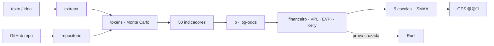

<!--
AnalisadorPreditivoMinimoViaveldeProjetos
Autor: ProfBru - Bruno Penedo © 2026 - TODOS OS DIREITOS RESERVADOS
E-mail: profbruanbima@gmail.com

TEMPLATE DO MOTOR DE READMEs — não editar os 12 READMEs à mão.
  • O que está aqui é ESTRUTURA (nunca traduzida): imagens, comandos, caminhos, badges de stack.
  • Marcadores b:<chave> entre chaves duplas são BLOCOS DE PROSA (traduzidos) — vêm de readme.blocos.json.
  • Marcadores lang:<nome> entre chaves duplas são preenchidos pelo gerador (seletor, frase de direitos).
Estilo: template do ECC (hero, seletor, badges, guia rápido, cards, o que tem dentro)
+ progressão D19: DOR → SOLUÇÃO → PROVA VISUAL → APLICAÇÃO → INSTALAÇÃO → PROFUNDIDADE → LICENÇA.
Gerar:  python3 public/foundations/pipeline/gerar_readmes.py
-->

<div align="center">

# 🧭 Analisador Preditivo Mínimo Viável de Projetos


**ProfBru © 2026**

### 첫 토큰을 쓰기 전에, 아이디어가 토큰을 들일 가치가 있는지 알려 주는 예측형 내비게이션.

**아이디어 한 문장을 넣으면 🟢🟡🔴 판정, 구조화·계획·코딩에 드는 토큰 수, 무위험 금리 대비 가치, 그리고 무엇을 포기해야 하는지가 나옵니다.**

   


[Português](README.md) · [English](README.en.md) · [Español](README.es.md) · [Français](README.fr.md) · [Deutsch](README.de.md) · [中文](README.zh.md) · **한국어** · [हिन्दी](README.hi.md) · [עברית](README.he.md) · [Русский](README.ru.md) · [Svenska](README.sv.md) · [Suomi](README.fi.md)

</div>

> [!IMPORTANT]
> **돈을 쓰기 전에 현명하게 선택하고 포기하는 것은 가장 큰 우위 중 하나입니다.** 시간과 돈을 어디에 쓰지 말아야 하는지 아는 사람은 이미 게임의 절반을 이긴 것입니다. 이 프로젝트는 그 원칙을 방법으로 바꿉니다. 예측 가능하고, 감사 가능하며, 모든 숫자 뒤에 과학적 근거가 있습니다.

## ⚡ 60초 만에 시작하기

서버도, API 키도, 클라우드도 필요 없습니다. 내 컴퓨터에서 오프라인으로 실행됩니다. 출력은 브라질 포르투갈어입니다.

```bash
git clone <url-do-repositorio> AnalisadorPreditivoMinimoViaveldeProjetos
cd AnalisadorPreditivoMinimoViaveldeProjetos/public/foundations/pipeline
pip install -r requisitos.txt
python3 analisar.py ideia "App para clínicas lembrarem pacientes pelo WhatsApp com assinatura mensal"
```

끝입니다. 터미널에 신호등, 권장 경로, 단계별 P10/P50/P90 토큰, CDI(브라질 무위험 기준금리) 대비 기댓값, 그리고 당신이 피하고 있는 질문들이 출력됩니다. 여러 아이디어를 비교하려면 `comparar`, 토큰 비용만 알고 싶다면 `tokens`를 사용하세요.

<div align="center">

<table>
<tr>
<td width="33%" align="center"><b>🧭 아이디어 하나, 문장 하나</b><br/><sub>틈새시장, 업종, 숫자가 없어도 됩니다. 내비게이션은 스스로의 무지를 측정하고 결코 맹목적 투자를 승인하지 않습니다.</sub><br/><code>analisar.py ideia</code></td>
<td width="33%" align="center"><b>⚖️ 선택과 포기</b><br/><sub>여러 아이디어를 나란히: 무엇을 추진하고, 무엇을 지금 접고, 무엇이 진짜 동률인지.</sub><br/><code>analisar.py comparar</code></td>
<td width="33%" align="center"><b>🪙 토큰 비용은 얼마인가</b><br/><sub>구조화·계획·코딩 — P10/P50/P90과 모델별 US$, 꼬리 위험 포함.</sub><br/><code>analisar.py tokens</code></td>
</tr>
</table>

</div>

---

## 💀 문제: 스프레드시트로 결정하지만, 스프레드시트는 아무것도 결정하지 않는다

최근에 내린 비싼 선택을 떠올려 보세요. 영업팀의 **스마트폰**. 법인 차량의 **전기차**. 3년 계약의 **공급업체**. 6개월의 밤을 쏟아부은 **스타트업 아이디어**. 더 큰 규모에서도 같은 고통이 있습니다. 군이 30년 동안 쓸 **장갑차, 항공기, 방어 체계**를 무엇으로 살지, 경영위원회가 한 해 예산으로 **어떤 프로젝트**를 승인할지.

거의 모든 경우 의식은 같습니다. **스프레드시트**, **점수 매트릭스**, 몇 개의 **필터**. 그리고 아무도 보지 못하는 세 가지 함정이 있습니다.

| 당신이 한 일 | 실제로 일어난 일 |
|---|---|
| 🔻 **한 열로 정렬했다** | 단 하나의 기준으로 결정했습니다. 나머지 일곱 개는 엄밀해 보이려고 있었을 뿐입니다. |
| 🔢 **가중 매트릭스에서 점수를 합산했다** | 재앙을 평균으로 상쇄했습니다. 안전성이 최악인 선택지가 가격이 좋아서 "동점"이 됐습니다. |
| 🔍 **"모든 조건 충족"으로 필터링했다** | 목록이 비었고, 거슬리는 요구사항을 완화했습니다. 바로 그것이 거부권이어야 했는데도요. |

이제 모든 스프레드시트에서 보이지 않는 새로운 비용이 생겼습니다. **토큰**입니다. AI 에이전트 덕분에 만드는 일은 싸고 빨라졌고, 그래서 몇 주와 수백 달러를 들여 **잘못된 아이디어**를 완벽하게 만드는 일도 쉬워졌습니다.

> [!WARNING]
> **스프레드시트, 매트릭스, 순위 필터만으로는 올바른 선택에 부족합니다.** 그것들은 당신이 얼마나 *불확실한지* 말해 주지 못하고, 핵심 기준에서의 재앙을 처벌하지 않으며, 만들 것을 *운영*하는 비용을 계산하지 않고, 무엇보다도 결코 **"지금은 투자하지 마라"**고 말하지 않습니다. 포기를 권하지 않는 도구는 의사결정 지원이 아니라 정당화 생성기입니다.

### 결정이 죽는 순간

회의에서 누군가 이렇게 묻는 순간입니다. *"안전성 가중치가 25%가 아니라 30%라면?"* — 그러면 승자가 바뀝니다. 혹은 6개월 뒤, 프로젝트는 완성되고 잘 돌아가고 테스트도 통과했는데… 아무도 돈을 내지 않을 때입니다. 지난 10년간 스타트업 사후 분석은 같은 1순위 원인을 지목해 왔습니다. **시장의 필요가 없었다**(사례의 35–42%, CB Insights). 올바른 질문은 *"만들 수 있는가?"*가 아니라 *"만들어야 하는가?"*였고, 그 답은 첫 토큰 **이전에** 나옵니다.

---

## 💊 해결책: 모든 토큰 이전의 예측형 내비게이션

**머릿속에 있는 그대로 아이디어를 적으세요. 한 문장이면 충분합니다.** 분석기는 진지한 위원회가 몇 주 걸릴 일을 몇 초 만에 해냅니다.

1. 아이디어의 **참조 집단**(B2B SaaS, 자동화, 마켓플레이스, 트레이딩, 헬스케어…)을 인식하고 그 기저율에서 출발합니다. 작성자의 열정으로부터 보호해 주는 *외부 관점*입니다.
2. **11개 차원에서 50개 지표를 측정합니다.** 수요, 시장, 기술적 실현 가능성, 경제성, 지속성, 확장성, 누적성, 강건성, 정렬, 정보, 금융 차익거래 — 각각 **점수, 신뢰도, 근거, 과학적 출처**가 있습니다.
3. 구조화·계획·코딩에 필요한 **토큰을 추정합니다.** IT 프로젝트의 두꺼운 꼬리를 반영한 **20만 회 시뮬레이션**을 수행하고 모델별 US$와 사람의 감독 시간으로 환산합니다.
4. **스프레드시트가 빠뜨리는 계산을 합니다.** 구축 **및 운영** 비용, CDI로 할인한 기댓값, 손익분기 확률, 먼저 검증하는 가치(EVPI), 켈리 비율, 추가 1헤알의 한계효용.
5. **아홉 개 의사결정 학파가 투표합니다**(ELECTRE I·II, PROMETHEE II, MAUT, MCDA-C, AHP-TOPSIS 2n, VIKOR, TODIM, SAPEVO-M). 다섯 경로 — 투자 안 함, 먼저 검증, MVP, 전체 프로젝트, 코드 재사용 — 중에서 고르고, **가중치와 점수를 수천 번 교란**해 그 선택이 강건한지, 유력한지, 취약한지 알려 줍니다.

<div align="center">

| ❌ 스프레드시트의 말 | ✅ 예측형 내비게이션의 말 |
|---|---|
| "이 아이디어는 7.8점입니다." | **"🟡 먼저 검증하라. 정보의 가치는 R$ 4,586, 검증 비용은 R$ 850입니다. 이 5일 실험을 해 보고, 결과가 부정적이면 아이디어를 접으세요."** |
| "2주면 만들 수 있어요." | **"P50 1,370만 토큰, P90 4,010만 — 그리고 당신의 검토 시간 23시간. 지배적인 비용은 만드는 것이 아니라 운영하는 것입니다."** |
| *(결코 말하지 않음)* | **"🔴 지금은 투자하지 마라. 현재 알려진 정보로는 어떤 경로도 수용 가능한 위험으로 CDI를 이기지 못합니다."** |

</div>

**정직한 시스템은 "여기서는 나를 믿지 마세요"라고 말할 수 있어야 합니다.** 설명이 모호하면 내비게이션은 그렇게 말합니다. 결정은 결코 어둠 속에서 초록불이 되지 않습니다.

---

## 🖼️ 실제 화면 — 하위 스킬마다 한 화면

아래 모든 화면은 분석기가 직접(`gerar_telas.py`) 고정 시드로 생성했습니다. 모든 숫자를 내 컴퓨터에서 재현할 수 있습니다. 화면의 라벨은 도구의 출력 언어인 브라질 포르투갈어입니다.

### 1. `ideia` — 한 패널에 담긴 내비게이션

<div align="center"></div>

**해결하는 문제:** 시작할지 결정하는 데 40쪽짜리 보고서는 필요 없습니다. 판정과 그것을 뒷받침하는 다섯 개의 숫자가 필요합니다.

라벨이 붙은 신호등(색만으로 표시하지 않음), 권장 경로, 강건성, 80% 구간을 포함한 실현 가능성 확률, P50/P90 토큰, 구축 비용, 기댓값, EVPI.

> **해석:** 치과 아이디어의 실현 가능성은 50%로 좋은 편이지만, 판정은 🟡 **먼저 검증하라**입니다. 결과를 아는 가치는 R$ 4,586이고 실험 비용은 R$ 850입니다. 토큰을 쓰기 전에 값싼 정보를 사는 것이 유망한 아이디어에도 합리적인 결정입니다.

### 2. `tokens` — 구조화·계획·코딩 비용

<div align="center"></div>
<div align="center"></div>

**해결하는 문제:** "금방 만들 수 있다"는 엔지니어링에서 가장 비싼 말입니다. AI 에이전트는 같은 작업에서도 토큰 사용량이 최대 30배 차이 나고(Bai et al., 2026), IT 프로젝트 6개 중 1개는 예산을 200% 초과합니다(Flyvbjerg & Budzier, 2011).

추정기는 텍스트에서 파일, 연동, 복잡도를 세고, 활동별 소비량(읽기, 쓰기, 수정, 테스트, 리뷰), 컨텍스트 증가, 재작업을 적용해 두꺼운 꼬리를 가진 20만 회 시뮬레이션을 실행합니다.

> **해석:** 코딩이 토큰의 약 80%를 차지하고, 입력(매 단계 다시 읽는 컨텍스트)이 그중 97%입니다. P10–P90 범위는 한 자릿수(10배)에 걸쳐 있습니다. 그래서 내비게이션은 평균이 아니라 P90으로 판단합니다.

### 3. 경로 — 선택 **그리고** 포기

<div align="center"></div>

**해결하는 문제:** 스프레드시트는 아이디어를 비교하지만, 같은 아이디어에 *투자하는 방식*은 비교하지 않습니다. 그리고 방식이 아이디어보다 중요합니다.

다섯 경로: **A0** 투자 안 함(돈은 CDI에), **A1** 5일 최소 실험, **A2** 린 MVP, **A3** 전체 프로젝트, **A4** 기존 코드 재사용. 각각 투입 자본, 기댓값, 손실 확률, 첫 근거까지의 시간을 보여 줍니다.

> **해석:** 헤알 기준 기댓값은 MVP가 가장 높지만, 합의는 5일 실험이 이깁니다. 근거에 4배 빠르게 도달하고 손실 확률은 13%입니다. 보고서는 **포기**를 명시합니다. A1을 고르면 근거가 나올 때까지 전체 프로젝트의 P90 노출을 위험 밖에 둡니다.

### 4. 아홉 개 다기준 학파의 투표

<div align="center"></div>

**해결하는 문제:** 각 다기준 방법은 "더 낫다"는 것이 무엇인지에 대한 서로 다른 이론입니다. 하나만 쓰면 질문과 함께 답을 고르는 셈입니다.

MAUT는 효용을 더하고, ELECTRE는 재앙에 거부권을 행사하며, PROMETHEE는 선호를 단계화하고, VIKOR는 최악의 기준을 보상하지 않으며, TODIM은 이득보다 손실을 무겁게 봅니다(전망 이론). SAPEVO-M은 위원회의 서열 판단을 받아들입니다.

> **해석:** 아홉 학파 중 일곱이 최소 실험을 1위로 꼽습니다. 독립적인 이론들이 일치하면, 그 결정은 회의를 견뎌 냅니다.

### 5. 지표 — 그리고 확률을 움직인 것

<div align="center"></div>
<div align="center"></div>

**해결하는 문제:** 설명 없는 "7.8점"은 아무도 설득하지 못합니다. 여기서는 각 차원이 점수, 신뢰도, 그리고 확률을 얼마나 올리거나 내렸는지 보여 줍니다.

전체 목록(`analisar.py indicadores`)은 50개 지표를 공식, 과학적 출처, 각 점수를 확정할 **최소 근거**와 함께 보여 줍니다. 지어내는 대신에요.

> **해석:** 확률을 가장 많이 올린 차원은 문제와 수요였습니다(고통, 빈도, 관심 있는 치과 3곳). 시장과 다양성은 중립 — 사용 세그먼트가 하나뿐이고 섀넌 엔트로피는 0입니다. 바로 그것이 다음 고객 대화에서 검증해야 할 점입니다.

### 6. `comparar` — 여러 아이디어, 하나의 결정

<div align="center"></div>

**해결하는 문제:** 아이디어는 다섯 개, 에너지는 하나뿐입니다. "0.3점 차 승자"가 있는 순위는 확실성으로 위장한 잡음입니다.

아이디어들은 `ProcessPoolExecutor`로 병렬 분석되고, 아홉 학파가 **이중 강건성**으로 투표합니다. 불확실한 가중치와 불확실한 점수(SMAA)입니다. 판정은 둘 중 낮은 값을 씁니다.

> **해석:** 가중치가 불확실할 때는 아이디어 4가 항상 이기지만, 점수가 불확실할 때는 60%만 이깁니다 — 아이디어 1과 사실상 동률입니다. 내비게이션은 분명히 말합니다. 순위로 고르지 말고 둘 다 실험하라고. 그리고 어떤 그럴듯한 시나리오에서도 이기지 못하는 마켓플레이스와 차익거래 봇은 **지금 바로 포기하라**고 합니다.

### 7. `repo` — 아이디어에 이미 GitHub 코드가 있다면?

<div align="center"></div>
<div align="center"></div>

**해결하는 문제:** 기존 코드는 절약처럼 보이지만, 읽기와 수정 비용이 들고 때로는 쓸 수 없는 라이선스가 따라옵니다.

분석기는 격리된 얕은 복제를 만들고(저장소의 어떤 것도 실행하지 않음), 언어별 코드 줄 수, 테스트, CI, 라이선스, 마지막 커밋 시점을 측정해 준비도(소프트웨어 TRL)를 계산합니다. 성숙도는 코딩 토큰을 줄이고, 읽기 비용은 구조화 토큰에 더해집니다.

> **해석:** TRL-5 수준의 MIT 저장소가 있으면 "재사용" 경로(A4)가 대안에 나타납니다. 그래도 합의는 MVP를 선호합니다. 기존 코드를 고쳐 쓴다고 시장 질문이 사라지지는 않기 때문입니다.

### 8. 금융 차익거래와 자본 이득

<div align="center"></div>
<div align="center"></div>

**해결하는 문제:** 트레이딩과 차익거래 아이디어는 공짜 돈처럼 보입니다. 거래 비용, 세금, 알파 감쇠가 나타나기 전까지는요.

아이디어가 금융 전략이면 전용 차원(우위의 지속성, 비용과 지연, 통계적 검증, 규제 노출)이 모델에 들어가고, 보고서는 제품 토큰을 쓰기 전에 표본 외 백테스트, 샤프 비율, 최대 낙폭을 요구합니다. 모든 아이디어에서 토큰 자본은 무위험 대안인 CDI와 비교됩니다.

> **해석:** 한 문장으로 설명한 암호화폐 차익거래 봇은 실현 가능성 12%로 🟡 **먼저 검증하라**를 받고, 옆의 은행 대사 자동화는 회수 기간 4개월로 🟢 **MVP에 투자하라**를 받습니다. 같은 작성자, 같은 날: 차이는 시간이 어디서 보상받느냐입니다.

### 9. 아이디어가 아직 너무 모호할 때

<div align="center"></div>

**해결하는 문제:** 최악의 결정은 좋은 아이디어에 '아니요'라고 하는 것이 아니라, 아직 존재하지 않는 아이디어에 '예'라고 하는 것입니다.

"멋진 아이디어"에 대해 내비게이션은 완성도 0%를 측정하고, 매우 넓은 확률 구간을 돌려주며, 답하지 않은 핵심 질문을 나열하고, 판정을 취약으로 표시합니다.

> **해석:** 🔴 **지금은 투자하지 마라** — 비관해서가 아니라 정보가 부족해서입니다. 보고서가 먼저 알아내야 할 것(누가 고통을 겪는지, 비용은 얼마인지, 어떻게 돈을 버는지)을 알려 줍니다.

### 10. `prompt` — 올바른 방식으로 LLM과 더 깊이 파고들기

<div align="center"></div>

**해결하는 문제:** LLM은 논리적 허점을 찾고 실험을 제안하는 데 뛰어나지만, 보정된 가중치와 점수를 지어내는 데는 서툽니다. 심판 역할을 맡으면 거의 모든 것에 동의하는 경향이 있습니다.

그래서 분석기가 정량 부분을 맡고, 집단·확률·토큰·경로가 이미 채워진 마스터 프롬프트를 제공합니다. LLM에게는 잘하는 일만 요청합니다. 불편한 질문, 가역성 테스트, 최소 실험, 의존성 지도입니다.

> **해석:** 숫자는 모델에서, 질문은 LLM에서. 각자 제 역할을 합니다.

### 11. `--relatorio` — PDF, HTML, Markdown 문서

<div align="center"> </div>

**해결하는 문제:** 중요한 결정은 위원회에서, 파트너와, 투자자의 메일함에서 돌아다녀야 하고, 누가 서명했는지 증명해야 합니다.

`--relatorio`를 쓰면 모든 분석이 세 형식으로 나옵니다. **Markdown**(버전 관리 가능), 독립형 **HTML**(화면 내장, 라이트·다크 테마), 그리고 **OCR 형식 PDF** — 각 페이지는 배경에 투명도 50%의 큰 ProfBru 마크가 들어간 이미지이며, 그 위에 보이지 않는 텍스트 층이 겹쳐 있어 순수 텍스트 PDF가 아니면서도 검색과 복사가 가능합니다.

> **해석:** 터미널에서 본 그 내비게이션 결과가 다섯 화면을 첨부한 6쪽짜리 문서가 되어 회의에 바로 가져갈 수 있습니다. PDF에서 "experimento mínimo"를 검색하면 모든 위치가 나옵니다.

📎 [`docs/exemplos/gps_clinica.pdf`](docs/exemplos/gps_clinica.pdf) · [`.html`](docs/exemplos/gps_clinica.html) · [`.md`](docs/exemplos/gps_clinica.md)

---

## 🎯 활용 분야 — 맞춤형 선택과 포기

같은 방법은 **선택지가 서로 모순되고, 정보가 불완전하며, 실수의 대가가 큰** 모든 결정에 쓰입니다.

<div align="center">

| 분야 | 결정 | 스프레드시트가 실패하는 이유 |
|---|---|---|
| **아이디어와 스타트업** | 앞으로 90일 동안 어떤 아이디어에 토큰, 시간, 자본을 쓸지 | 집단의 기저율과 운영 비용을 무시함 |
| **AI 프로젝트** | MVP, 전체 프로젝트, 아니면 테스트만 — 그리고 어떤 모델로 | 토큰, 꼬리 위험, 검토 시간을 추정하지 않음 |
| **경영 및 기업 의사결정** | 프로젝트 포트폴리오, 공급업체, 자체 제작 또는 구매 | 거부권을 평균으로 상쇄함; 강건성을 측정하지 않음 |
| **장비와 스마트폰** | 실제 사용 포트폴리오를 충족하는 장비 | 사용 다양성(섀넌)과 한계효용을 측정하지 않음 |
| **전기차와 차량 운영** | 주행거리 × 총비용 × 인프라 | 상관된 기준을 두 번 셈 |
| **군** | 장갑차, 항공기, 30년 운용 체계 | 나쁜 핵심 기준은 보상이 아니라 거부권이 되어야 함 |
| **트레이딩과 차익거래** | 봇을 만들 것인가, 돈을 CDI에 둘 것인가? | 거래 비용, 세금, 알파 감쇠를 잊음 |
| **중소기업** | 수작업 프로세스를 자동화할지 말지 | 연간 절감액을 P90 비용과 비교하지 않음 |

</div>

> [!NOTE]
> 가정(환율, CDI, 기간, 시간당 가치, 예상 매출, 자본)은 명령줄 매개변수이며 모든 보고서에 출력됩니다. 바꾸면 판정이 다시 계산됩니다. 결정은 당신의 몫이며, 계산은 모두 공개됩니다.

---

## 🧩 각 기능이 존재하는 이유

| 기능 | 존재 이유 | 근거 |
|---|---|---|
| **참조 집단** | 프로젝트에 대한 최선의 예측은 제안자의 낙관이 아니라 비슷한 프로젝트의 이력이다 | Kahneman & Lovallo (1993); Flyvbjerg & Gardner (2023) |
| **신뢰도를 반영한 로그 오즈 확률** | 각 지표는 근거에 비례해 확률을 움직이며, 근거가 없으면 거의 움직이지 않는다 | 해석 가능한 규칙(LLM-AR, 2025); SAISE (2025) |
| **단계별 P10/P50/P90 토큰** | 에이전트 소비는 최대 30배 차이 나며 입력이 비용을 지배한다 | Bai et al. (2026); ACEM (2026); tokencast |
| **구축만이 아닌 운영 비용** | AI로 구축은 싸졌고, 사업을 무너뜨리는 것은 운영이다 | ACEM (2026); CB Insights |
| **CDI 대비 순현재가치** | 토큰에 쓰는 모든 헤알에는 확실한 기회비용이 있다 | Dixit & Pindyck (1994) |
| **EVPI — 먼저 검증하는 가치** | 때로는 코드가 아니라 정보가 최고의 구매다 | Howard (1966); Camuffo et al. (2020, 2024) |
| **켈리 비율** | 얼마를 거느냐는 무엇에 거느냐만큼 중요하다 | Kelly (1956) |
| **효율적 경계 위의 한계효용** | 중요한 것은 다음에 투자할 1헤알의 가치다 | Gossen (1854) |
| **섀넌 엔트로피, 심슨, HHI, 범용성 지수** | 용도가 여럿인 아이디어는 첫 시장이 실패해도 출구가 더 많다 | Shannon (1948); 지식 베이스의 KPI |
| **아홉 학파 + 보르다 합의** | 데이터가 없을 때 독립 이론들의 일치가 가장 강한 근거다 | Roy; Brans; Keeney & Raiffa; Saaty; Opricovic; Gomes |
| **이중 강건성(가중치와 점수)** | 가중치 2포인트에 바뀌는 승자는 승자가 아니다 | SMAA — Lahdelma et al. (1998) |
| **불편한 질문, 가역성, 최소 실험, 의존성** | 회의적인 투자자가 할 일이며, LLM이 잘하는 일이다 | 프로젝트 지식 베이스 |
| **OCR 형식 PDF, HTML, Markdown 보고서** | 결정은 유통되고, 검색 가능하며, 모든 페이지에 작성자를 담아야 한다 | PyMuPDF + Pillow, 모두 로컬 |
| **Rust 두 번째 엔진** | 서로 독립적인 두 엔진의 일치는 코드뿐 아니라 수학을 증명한다 | 매 실행 시 교차 검증 |

---

## ⚙️ 설치 및 사용법

| 구성 요소 | 버전 | 필수 | 용도 |
|---|---|---|---|
| Python | 3.13 | ✅ | 엔진, CLI, 보고서 |
| NumPy | 2.x | ✅ | 대수와 시뮬레이션 |
| numba | ≥ 0.60 | ⚠️ 권장 | 커널 JIT(없으면 같은 결과, 더 느림) |
| matplotlib | ≥ 3.7 | ⚠️ 화면용 | PNG 차트 |
| PyMuPDF · Pillow · markdown | 최신 | ⚠️ `--relatorio`용 | PDF, HTML |
| Rust / cargo | 안정판 | ⭕ 선택 | 두 번째 검증 엔진 |
| git · screen | — | ⭕ 선택 | 저장소 분석 · 백그라운드 실행 |

```bash
cd public/foundations/pipeline
python3 analisar.py ideia "<ideia>" [--repo <url|pasta>] [--relatorio [base]] [--telas pasta/] [--json]
python3 analisar.py comparar "<ideia A>" "<ideia B>" "<ideia C>" [--relatorio]   # ou --arquivo ideias.txt
python3 analisar.py tokens "<ideia>" [--json]
python3 analisar.py repo https://github.com/<usuario>/<projeto>
python3 analisar.py indicadores [--bibliografia]
python3 analisar.py prompt "<ideia>"

# premissas (todas opcionais): --cambio 5.50 --cdi 0.14 --horizonte 12 --valor-hora 80
#                              --receita 3000 --receita-otimista 20000 --capital 50000 --infra-mes 0

./run_all.sh --demo          # < 60 s
./run_all.sh                 # testes + prova cruzada Rust + bench + telas + i18n
./run_all.sh --background    # screen + watchdog de 20 min (screen -r analisadorpreditivominimoviaveldeprojetos)
```

| 하위 스킬 | 제공 내용 |
|---|---|
| `ideia` | 아이디어 하나의 전체 내비게이션: 신호등, 경로, 확률, 토큰, 경제성, 아홉 학파, 지표, 질문, 실험, 의존성, 포기(Markdown, JSON, 화면) |
| `comparar` | 여러 아이디어 병렬 분석: 무엇을 추진할지, 무엇이 동률인지, 무엇을 즉시 포기할지 |
| `tokens` | 비용만: 단계별 P10/P50/P90 토큰, 모델별 US$, 사람의 시간 |
| `repo` | 저장소 성숙도: 코드 줄, 언어, 테스트, CI, 라이선스, 준비도 |
| `indicadores` | 공식, 출처, 최소 근거를 포함한 50개 지표 목록; `--bibliografia` |
| `prompt` | LLM으로 아이디어를 심화하는 마스터 프롬프트 |
| `--relatorio` | 모든 분석을 Markdown, HTML, 워터마크가 있는 OCR 형식 PDF로 |

---

## 🧠 내부 동작

텍스트는 **신호**가 되고(포르투갈어·영어 어휘, 각 신호를 촉발한 근거 보존), 신호는 **참조 집단**과 **기능 규모**를 정하며, 규모는 **토큰**이 되고(두꺼운 꼬리 시뮬레이션), 신호와 규모는 **지표**가 됩니다. 지표는 로그 오즈로 집단의 **사전 확률**을 이동시켜 **실현 가능성 확률**에 이르고, 확률은 다섯 경로의 **경제성**에 투입되며, 아홉 학파가 경로를 고릅니다 — 강건성까지 측정해서요.



| 차원 | 묻는 것 |
|---|---|
| 문제와 수요 | 고통은 실재하고 자주 발생하며 돈을 낼 만한가? 당신 말고 누가 확인했는가? |
| 시장과 다양성 | 용도와 세그먼트는 몇 개인가(섀넌, 심슨, HHI, 범용성)? |
| 기술적 실현 가능성 | 규모, 연동, 실시간, 기존 코드, AI 범용화에 대한 저항 |
| 경제적 실현 가능성 | 비용, 꼬리, 안전 마진, 순현재가치, 회수 기간, 반복 매출, 켈리, 한계효용 |
| 지속성 | 시간, 유행, 단일 플랫폼을 견디는가? |
| 확장성 | 한계비용, 네트워크 효과, 자동화 |
| 누적성 | 실패해도 남는 것: 코드, 데이터, 학습, 피벗 옵션 |
| 강건성과 위험 | 규제, 외부 의존성, 1인 실행, 최대 손실 |
| 정렬과 검증 가능성 | 작성자의 우위, 5일 실험, 근거까지의 시간, 무비용 |
| 정보와 불확실성 | 설명의 완성도, 집단 신뢰도, 정보의 가치 |
| 금융 차익거래 | 알파의 지속성, 비용, 통계적 검증, 규제 |

### 과학의 최전선에서

출처 없이 목록에 들어가는 지표는 없습니다. 그런 일이 생기면 자동 테스트가 프로젝트를 불합격시킵니다. 52개 참고문헌에는 AI와 LLM으로 스타트업 성공을 예측하는 최신 연구(VCBench, SSFF, SAISE, 예측 변수 메타분석, LLM-AR, kNN-ICL — 2024~2026년), 코딩 에이전트의 토큰 소비(Bai, Brynjolfsson, Pentland 외, 2026), 에이전트 기반 엔지니어링의 비용 추정(ACEM, 2026)이 포함되며, 각 방법을 뒷받침하는 고전도 함께 있습니다. Shannon, Gossen, Kelly, Howard, Kahneman & Tversky, Roy, Saaty, Keeney & Raiffa, Flyvbjerg, Lahdelma(SMAA), 그리고 브라질 다기준 의사결정 지원 학파입니다. 전체 목록은 `python3 analisar.py indicadores --bibliografia`로 확인할 수 있습니다.

---

## 🚀 성능과 교차 검증

| 측정(CPU 4개, 치과 사례) | 결과 |
|---|---|
| 아이디어 하나의 전체 분석(토큰 시뮬레이션 20만 회 + 9개 학파 × 2,000개 시나리오) | ≈ 1.8초 |
| 여러 아이디어 | `ProcessPoolExecutor`로 병렬 처리, 직렬 실행과 결과 동일 |
| Python × Rust 일치도(5개 사례, 각 10개 값) | 최대 차이 2.2 × 10⁻¹⁵ |

모든 측정은 결과가 바뀌지 않았다는 증거와 함께 기록됩니다. 답을 바꾸는 최적화는 이득이 아닙니다.

```text
✅ clinica      10 grandezas idênticas · Δ relativo máx 0.0e+00
✅ conciliacao  10 grandezas idênticas · Δ relativo máx 0.0e+00
✅ arbitragem   10 grandezas idênticas · Δ relativo máx 1.3e-15
✅ marketplace  10 grandezas idênticas · Δ relativo máx 2.2e-15
✅ vaga         10 grandezas idênticas · Δ relativo máx 0.0e+00
```

---

## 📁 구성 요소

```
AnalisadorPreditivoMinimoViaveldeProjetos/
├── README.md (+11)
├── projeto.toml
├── docs/                         logo, telas/, CUSTO.md, OPERACAO.md
└── public/foundations/
    ├── pipeline/
    │   ├── analisar.py           CLI (6 sub-skills)
    │   ├── apmv/                 extrator · repositorio · tokens · indicadores · preditivo
    │   │   │                     financeiro · decisao · gps · relatorio · telas · referencias
    │   │   └── mcdm/             ELECTRE I/II · PROMETHEE II · MAUT · MCDA-C · AHP-TOPSIS 2n
    │   │                         VIKOR · TODIM · SAPEVO-M · Borda · Dirichlet
    │   ├── testes_apmv.py · prova_cruzada_rust.py · bench.py · gerar_telas.py
    │   └── run_all.sh · watchdog.sh · verificar_publicacao.sh
    └── rust/analisadorpreditivominimoviaveldeprojetos_core/   apmv_core
```

모든 것이 로컬에서 반복 비용 없이 실행됩니다. 서버도, API 키도 없고, 분석 중 네트워크 호출도 없습니다(저장소를 지정할 때의 `git clone`만 예외).

---

## ❓ 자주 묻는 질문

<details>
<summary><b>한 문장짜리 아이디어로도 정말 되나요?</b></summary>

됩니다. 바로 그런 경우를 위해 설계되었습니다. 정보가 적으면 내비게이션은 집단의 기저율에서 출발해 확률 구간을 넓히고 투자를 승인하지 않습니다. 먼저 어떤 질문에 답해야 하는지 정확히 알려 줍니다.
</details>

<details>
<summary><b>LLM에게 아이디어가 좋은지 그냥 물어보면 안 되나요?</b></summary>

LLM은 심판 역할을 하면 거의 모든 것에 동의하고, 보정된 것처럼 보이는 가중치와 점수를 지어내기 때문입니다. 분석기는 방법과 출처로 계산하고, LLM은 마스터 프롬프트를 통해 잘하는 영역에 투입됩니다.
</details>

<details>
<summary><b>보고서의 매출과 시간은 어디서 나오나요?</b></summary>

참조 집단에서 보수적·낙관적 시나리오로 나오며, 가정으로 표시됩니다. 매출, 시간당 가치, 자본을 알고 있다면 명령줄로 전달하세요. 모든 것이 다시 계산됩니다.
</details>

<details>
<summary><b>소프트웨어가 아닌 결정에도 쓸 수 있나요?</b></summary>

네. 아홉 학파, 강건성 분석, 다양성과 한계효용 지표는 장비, 차량, 공급업체, 모든 종류의 프로젝트에 적용됩니다. 토큰은 여러 통화 중 하나일 뿐입니다.
</details>

<details>
<summary><b>실행하는 데 비용이 드나요?</b></summary>

아니요. 내 컴퓨터에서 오프라인으로 실행됩니다. 유일한 비용은 보고서가 추정하는 것, 즉 나중에 쓰기로 결정한 토큰뿐입니다.
</details>

---

## 📜 라이선스 및 저작권

<div align="center">


**ProfBru © 2026**

**Analisador Preditivo Mínimo Viável de Projetos**
작성자: **ProfBru - Bruno Penedo** © 2026 — **모든 권리 보유**
📧 profbruanbima@gmail.com

</div>

독점 소프트웨어입니다. 사용, 복제, 수정, 배포에는 작성자의 명시적 허가가 필요합니다. 제3자 라이브러리와 참고문헌은 각자의 라이선스와 출처 표기를 유지합니다.

---

_AnalisadorPreditivoMinimoViaveldeProjetos_
_작성자: **ProfBru - Bruno Penedo** © 2026 — 모든 권리 보유 · profbruanbima@gmail.com_
