<!--
AnalisadorPreditivoMinimoViaveldeProjetos
Autor: ProfBru - Bruno Penedo © 2026 - TODOS OS DIREITOS RESERVADOS
E-mail: profbruanbima@gmail.com

TEMPLATE DO MOTOR DE READMEs — não editar os 12 READMEs à mão.
  • O que está aqui é ESTRUTURA (nunca traduzida): imagens, comandos, caminhos, badges de stack.
  • Marcadores b:<chave> entre chaves duplas são BLOCOS DE PROSA (traduzidos) — vêm de readme.blocos.json.
  • Marcadores lang:<nome> entre chaves duplas são preenchidos pelo gerador (seletor, frase de direitos).
Estilo: template do ECC (hero, seletor, badges, guia rápido, cards, o que tem dentro)
+ progressão D19: DOR → SOLUÇÃO → PROVA VISUAL → APLICAÇÃO → INSTALAÇÃO → PROFUNDIDADE → LICENÇA.
Gerar:  python3 public/foundations/pipeline/gerar_readmes.py
-->

<div align="center">

# 🧭 Analisador Preditivo Mínimo Viável de Projetos


**ProfBru © 2026**

### O GPS preditivo que diz se uma ideia merece os seus tokens — antes do primeiro token.

**Uma frase de ideia entra. Sai um veredito 🟢🟡🔴, quantos tokens custa estruturar, planejar e codificar, quanto vale contra o CDI — e o que você deve renunciar.**

   


🌐 **Português** · [English](README.en.md) · [Español](README.es.md) · [Français](README.fr.md) · [Deutsch](README.de.md) · [中文](README.zh.md) · [한국어](README.ko.md) · [हिन्दी](README.hi.md) · [עברית](README.he.md) · [Русский](README.ru.md) · [Svenska](README.sv.md) · [Suomi](README.fi.md)

</div>

> [!IMPORTANT]
> **Escolher e renunciar com sabedoria, antes de gastar, é um dos maiores edges que existem.** Quem sabe onde NÃO colocar tempo e dinheiro já ganhou metade do jogo. Este projeto transforma essa disciplina em método: preditivo, auditável, com fonte científica em cada número.

## ⚡ Comece em 60 segundos

Sem servidor, sem chave de API, sem nuvem. Roda na sua máquina, offline. Saída em português do Brasil.

```bash
git clone <url-do-repositorio> AnalisadorPreditivoMinimoViaveldeProjetos
cd AnalisadorPreditivoMinimoViaveldeProjetos/public/foundations/pipeline
pip install -r requisitos.txt
python3 analisar.py ideia "App para clínicas lembrarem pacientes pelo WhatsApp com assinatura mensal"
```

Pronto: o relatório sai no terminal com o semáforo, a rota recomendada, os tokens P10/P50/P90 por fase, o valor esperado contra o CDI e as perguntas que você está evitando. Quer comparar várias ideias? Use `comparar`. Quer só o custo em tokens? Use `tokens`.

<div align="center">

<table>
<tr>
<td width="33%" align="center"><b>🧭 Uma ideia, uma frase</b><br/><sub>Mesmo sem nicho, setor ou números. O GPS mede a própria ignorância e nunca autoriza investir no escuro.</sub><br/><code>analisar.py ideia</code></td>
<td width="33%" align="center"><b>⚖️ Escolher e renunciar</b><br/><sub>Várias ideias lado a lado: qual seguir, qual matar agora, quais empatam de verdade.</sub><br/><code>analisar.py comparar</code></td>
<td width="33%" align="center"><b>🪙 Quanto custa em tokens</b><br/><sub>Estruturar, planejar e codificar — P10/P50/P90 e US$ por modelo, com cauda de risco.</sub><br/><code>analisar.py tokens</code></td>
</tr>
</table>

</div>

---

## 💀 A dor: você decide com planilha — e a planilha não decide nada

Pense na última escolha cara que você fez. **O celular** da equipe de vendas. **O carro elétrico** da frota. **O fornecedor** de um contrato de três anos. **A ideia de startup** em que você enterrou seis meses de noites. Em escala maior, a mesma dor: **qual blindado, qual aeronave, qual sistema de defesa** uma força armada compra por trinta anos; **qual projeto** um comitê executivo aprova com o orçamento do ano.

Em quase todos os casos, o ritual é o mesmo: uma **planilha**, uma **matriz de pontuação**, alguns **filtros**. E três armadilhas que ninguém vê:

| O que você fez | O que aconteceu de verdade |
|---|---|
| 🔻 **Ordenou a planilha por uma coluna** | Decidiu por UM critério. Os outros sete estavam lá só para dar a sensação de rigor. |
| 🔢 **Somou notas numa matriz ponderada** | Compensou o desastre com a média: uma opção péssima em segurança "empatou" porque era ótima em preço. |
| 🔍 **Filtrou por "atende a tudo"** | A lista ficou vazia; você afrouxou o requisito que atrapalhava — exatamente o que deveria ter sido o veto. |

E agora surgiu um custo novo, invisível em toda planilha: **tokens**. Com agentes de IA, construir ficou barato e rápido — e por isso ficou fácil gastar semanas e centenas de dólares construindo, com perfeição, **a ideia errada**.

> [!WARNING]
> **Planilhas, matrizes e filtros de classificação são insuficientes para uma escolha adequada.** Eles não sabem dizer quanto você está *incerto*, não punem o desastre num critério crítico, não contam o custo de *operar* o que você vai construir e — o pior — nunca dizem **"não invista agora"**. Uma ferramenta que nunca recomenda renunciar não é apoio à decisão: é um gerador de justificativas.

### O momento em que a decisão morre

É na reunião, quando alguém pergunta: *"E se o peso da segurança fosse 30% em vez de 25%?"* — e o vencedor muda. Ou seis meses depois, quando o projeto está pronto, funcionando, testado… e ninguém paga por ele. Os post-mortems de startups apontam a mesma causa número 1 há uma década: **não havia necessidade de mercado** (35–42% dos casos, CB Insights). A pergunta certa nunca foi *"conseguimos construir?"*. Era *"devíamos?"* — e ela tem resposta **antes** do primeiro token.

---

## 💊 A solução: um GPS preditivo antes de cada token

**Você escreve a ideia como ela está na sua cabeça — uma frase basta.** O analisador faz, em segundos, o que um comitê sério faria em semanas:

1. **Reconhece a classe de referência** da ideia (SaaS B2B, automação, marketplace, trading, saúde…) e parte da taxa-base dela — a *outside view* que protege contra o entusiasmo do autor.
2. **Mede 50 indicadores em 11 dimensões** — demanda, mercado, viabilidade técnica, economia, durabilidade, escalabilidade, cumulatividade, robustez, alinhamento, informação e arbitragem financeira — cada um com **nota, confiança, evidência e fonte científica**.
3. **Estima os tokens** de estruturar, planejar e codificar, com **200 mil simulações** e a cauda gorda dos projetos de TI, e converte em US$ por modelo e em horas humanas de supervisão.
4. **Faz a conta que a planilha esquece:** custo de construir **e de operar**, valor esperado descontado pelo CDI, probabilidade de empate, valor de testar antes (EVPI), fração de Kelly e utilidade marginal de cada real a mais.
5. **Coloca nove escolas de decisão para votar** (ELECTRE I e II, PROMETHEE II, MAUT, MCDA-C, AHP-TOPSIS 2n, VIKOR, TODIM, SAPEVO-M) entre cinco rotas — não investir, testar antes, MVP, projeto completo, reaproveitar código — e **perturba pesos e notas milhares de vezes** para dizer se a escolha é ROBUSTA, PROVÁVEL ou FRÁGIL.

<div align="center">

| ❌ O que a planilha diz | ✅ O que o GPS preditivo diz |
|---|---|
| "A ideia tem nota 7,8." | **"🟡 TESTE ANTES. A informação vale R$ 4.586 e o teste custa R$ 850. Rode este experimento de 5 dias; se der negativo, mate a ideia."** |
| "Dá para fazer em duas semanas." | **"P50 de 13,7 M tokens, P90 de 40,1 M — e 23 horas suas de revisão. O custo dominante não é construir: é operar."** |
| *(nunca diz)* | **"🔴 NÃO INVISTA AGORA. Nenhuma rota bate o CDI com risco aceitável no que se sabe hoje."** |

</div>

**Um sistema honesto precisa saber dizer "não confie em mim aqui".** Quando a descrição é vaga, o GPS diz isso — e a decisão nunca fica verde no escuro.

---

## 🖼️ Veja funcionando — uma tela por sub-skill

Todas as telas abaixo foram geradas pelo próprio analisador (`gerar_telas.py`), com semente fixa: você reproduz cada número na sua máquina.

### 1. `ideia` — o GPS em um painel

<div align="center">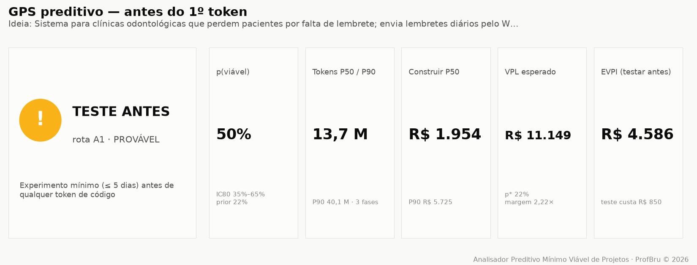</div>

**A dor que resolve:** você não precisa de um relatório de 40 páginas para decidir se começa; precisa de um veredito e dos cinco números que o sustentam.

Semáforo com rótulo (nunca só cor), rota recomendada, robustez, probabilidade de viabilidade com intervalo de 80%, tokens P50/P90, custo de construir, valor esperado e EVPI.

> **Leitura:** a ideia das clínicas tem 50% de viabilidade — boa —, mas o veredito é 🟡 **TESTE ANTES**: saber o resultado vale R$ 4.586 e o experimento custa R$ 850. Comprar informação barata antes de gastar tokens é a decisão racional, mesmo para uma ideia promissora.

### 2. `tokens` — quanto custa estruturar, planejar e codificar

<div align="center">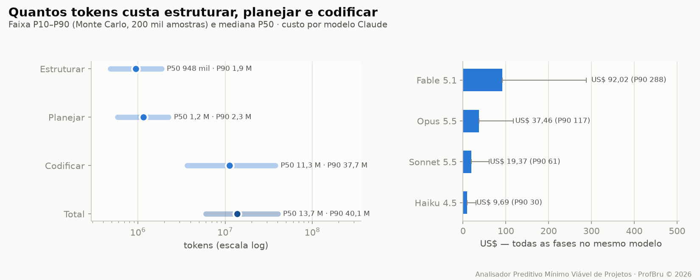</div>
<div align="center">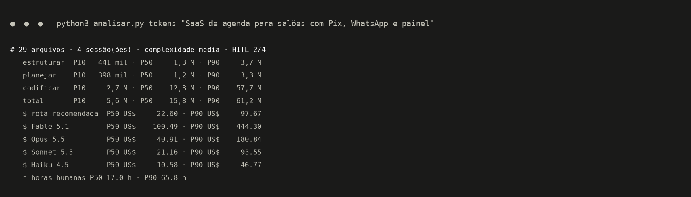</div>

**A dor que resolve:** "dá para fazer rápido" é a frase mais cara da engenharia. Agentes de IA variam até 30× em tokens na mesma tarefa (Bai et al., 2026) e 1 em cada 6 projetos de TI estoura o orçamento em 200% (Flyvbjerg & Budzier, 2011).

O estimador conta arquivos, integrações e complexidade a partir do texto, aplica o consumo por atividade (ler, escrever, editar, testar, revisar), o crescimento do contexto e o retrabalho, e roda 200 mil simulações com cauda gorda.

> **Leitura:** codificar é ~80% dos tokens, e a entrada (o contexto relido a cada passo) é 97% deles. A faixa P10–P90 tem uma ordem de grandeza — é por isso que o GPS decide pelo P90, não pela média.

### 3. Rotas — escolher **e** renunciar

<div align="center">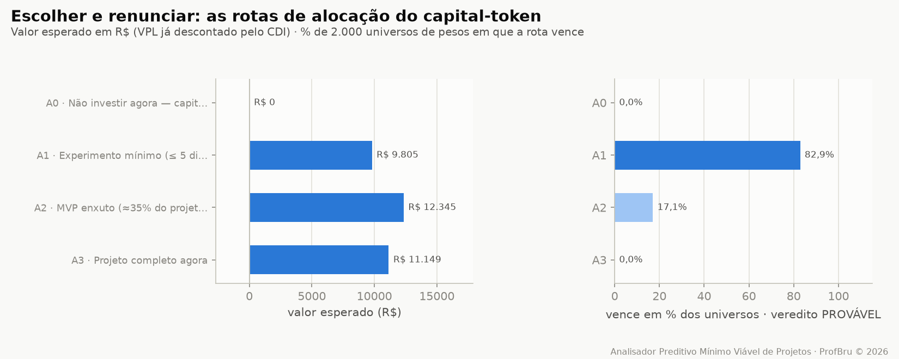</div>

**A dor que resolve:** a planilha compara ideias; ela nunca compara *formas de investir* na mesma ideia. E a forma importa mais do que a ideia.

Cinco rotas: **A0** não investir (dinheiro no CDI), **A1** experimento mínimo de 5 dias, **A2** MVP enxuto, **A3** projeto completo, **A4** reaproveitar código existente. Cada uma com capital comprometido, valor esperado, probabilidade de perda e tempo até a primeira evidência.

> **Leitura:** o MVP tem o maior valor esperado em reais, mas o experimento de 5 dias vence o consenso — chega à evidência 4× mais rápido, com 13% de chance de perda. O relatório explicita a **renúncia**: escolhendo A1, você deixa fora de risco a exposição P90 do projeto completo até ter evidência.

### 4. O voto das nove escolas multicritério

<div align="center">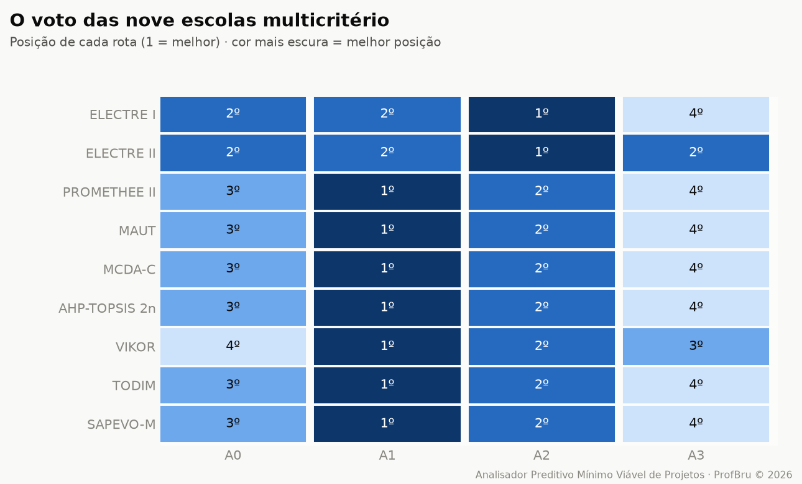</div>

**A dor que resolve:** cada método multicritério é uma teoria diferente do que significa "melhor". Usar um só é escolher a resposta junto com a pergunta.

MAUT soma utilidades; ELECTRE veta o desastre; PROMETHEE gradua a preferência; VIKOR recusa compensar o pior critério; TODIM pesa a perda mais que o ganho (Teoria dos Prospectos); SAPEVO-M aceita julgamento ordinal de comitê.

> **Leitura:** sete das nove escolas põem o experimento mínimo em 1º. Quando teorias independentes concordam, a decisão sobrevive à reunião.

### 5. Indicadores — e o que moveu a probabilidade

<div align="center">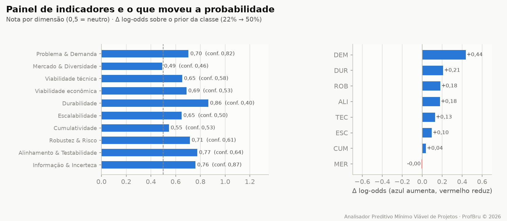</div>
<div align="center">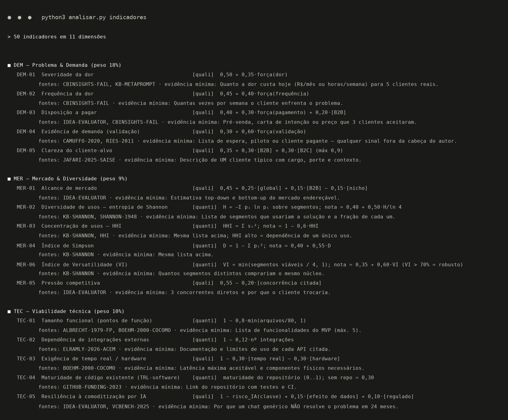</div>

**A dor que resolve:** "nota 7,8" sem explicação não convence ninguém. Aqui cada dimensão mostra a nota, a confiança e quanto ela empurrou a probabilidade para cima ou para baixo.

O catálogo completo (`analisar.py indicadores`) lista os 50 indicadores com fórmula, fonte científica e a **evidência mínima** que firmaria cada nota — em vez de inventar.

> **Leitura:** Problema & Demanda foi a dimensão que mais elevou a probabilidade (dor, frequência e 3 clínicas interessadas); Mercado & Diversidade ficou neutro — um único segmento de uso, entropia de Shannon zero. É exatamente o que a próxima conversa com clientes precisa testar.

### 6. `comparar` — várias ideias, uma decisão

<div align="center">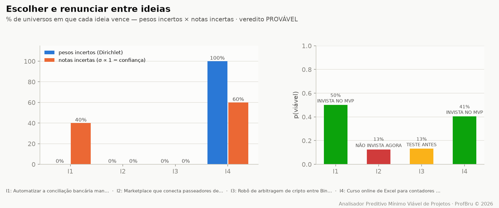</div>

**A dor que resolve:** você tem cinco ideias e energia para uma. Ranking com "vencedor por 0,3 ponto" é ruído vestido de certeza.

As ideias são analisadas em paralelo (`ProcessPoolExecutor`) e votadas nas nove escolas com **robustez dupla**: pesos incertos e notas incertas (SMAA). O veredito usa a menor das duas.

> **Leitura:** com pesos incertos, a ideia 4 vence sempre; com notas incertas, só 60% das vezes — empate técnico com a ideia 1. O GPS diz isso com todas as letras: não escolha pelo ranking, rode o experimento das duas. E manda **renunciar já** ao marketplace e ao robô de arbitragem, que não vencem em nenhum cenário plausível.

### 7. `repo` — a ideia já tem código no GitHub?

<div align="center">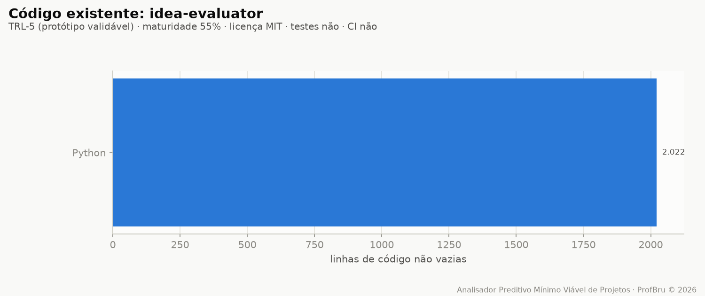</div>
<div align="center">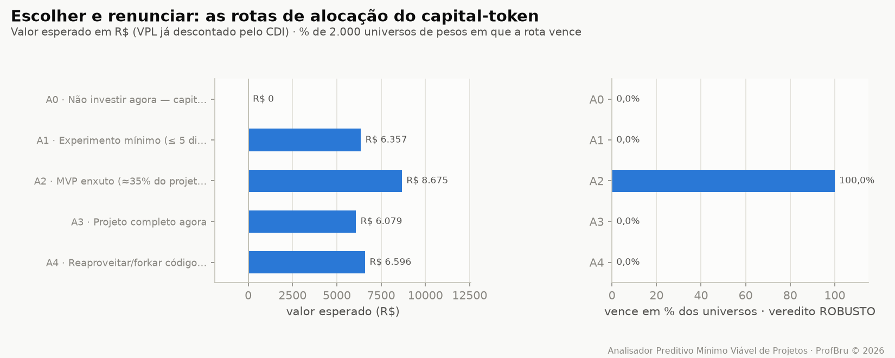</div>

**A dor que resolve:** código existente parece economia, mas custa leitura, adaptação e às vezes uma licença que você não pode usar.

O analisador faz um clone raso isolado (nada do repositório é executado), mede linhas por linguagem, testes, CI, licença e idade do último commit, e calcula a prontidão (TRL-software). A maturidade reduz os tokens de codificar; a leitura entra nos tokens de estruturar.

> **Leitura:** com um repositório MIT de nível TRL-5, a rota "reaproveitar" (A4) aparece entre as alternativas — e o consenso ainda prefere o MVP, porque adaptar o que existe não elimina a pergunta de mercado.

### 8. Arbitragem financeira e ganho de capital

<div align="center">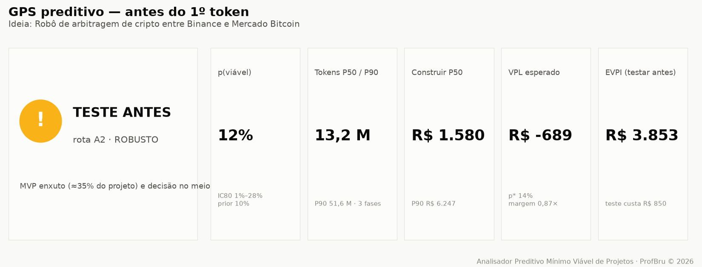</div>
<div align="center">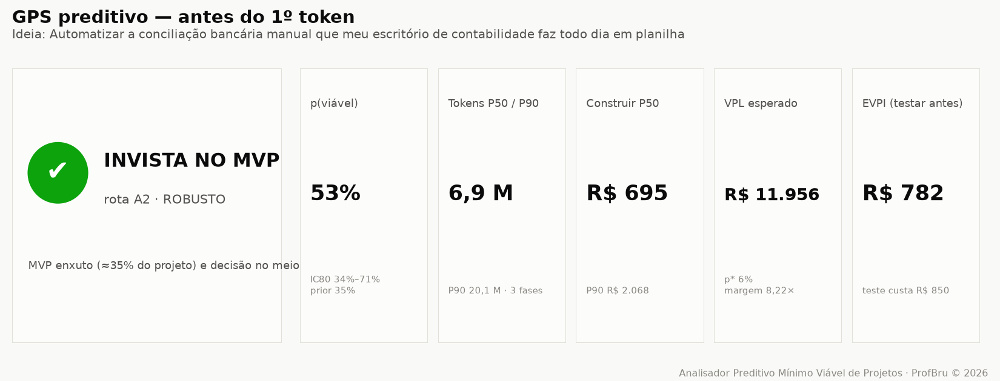</div>

**A dor que resolve:** ideias de trading e arbitragem parecem dinheiro grátis — até os custos de transação, o imposto e o decaimento do alfa aparecerem.

Quando a ideia é estratégia financeira, uma dimensão própria entra no modelo (persistência da vantagem, custos e latência, validação estatística, exposição regulatória) e o relatório exige backtest fora da amostra, Sharpe e drawdown antes de qualquer token de produto. Para qualquer ideia, o capital-token é comparado com a alternativa sem risco: o CDI.

> **Leitura:** o robô de arbitragem cripto descrito numa frase fica em 🟡 **TESTE ANTES** com 12% de viabilidade; a automação de conciliação bancária, ao lado, recebe 🟢 **INVISTA NO MVP** com payback de 4 meses. Mesmo autor, mesmo dia: a diferença é onde o tempo rende.

### 9. Quando a ideia ainda é vaga demais

<div align="center">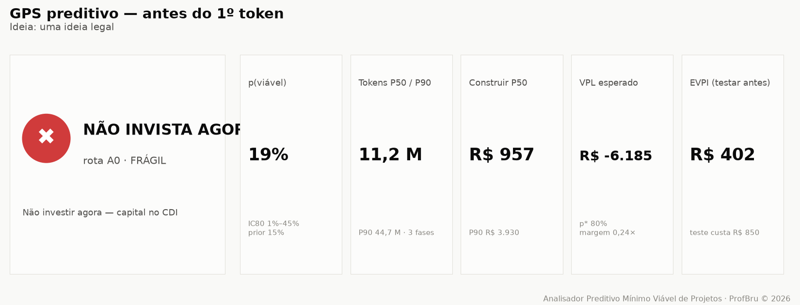</div>

**A dor que resolve:** a pior decisão não é dizer não a uma boa ideia — é dizer sim a uma ideia que ainda não existe.

Para "uma ideia legal", o GPS mede completude 0%, devolve um intervalo de probabilidade larguíssimo, lista as perguntas essenciais sem resposta e marca o veredito como FRÁGIL.

> **Leitura:** 🔴 **NÃO INVISTA AGORA** — e não por pessimismo: por falta de informação. O próprio relatório diz o que descobrir antes (quem tem a dor, quanto ela custa, como se ganha dinheiro).

### 10. `prompt` — aprofunde com um LLM, do jeito certo

<div align="center">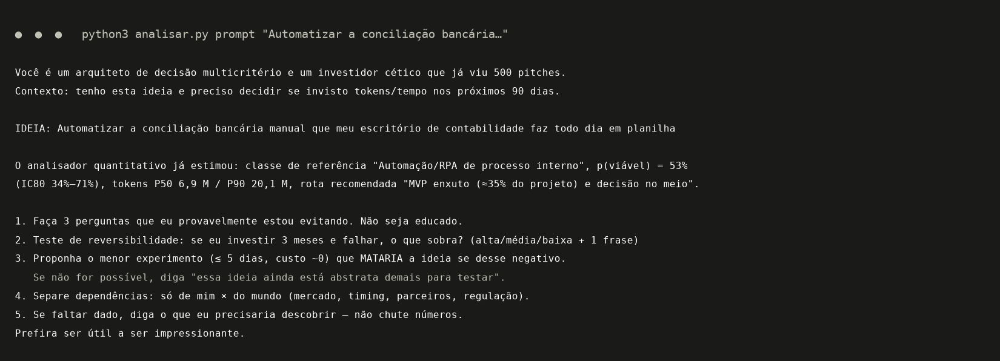</div>

**A dor que resolve:** LLMs são ótimos em achar furos lógicos e propor experimentos — e péssimos em inventar pesos e notas calibradas; como juízes, tendem a concordar com quase tudo.

Por isso o analisador faz a parte quantitativa e entrega um prompt-mestre pronto, já com classe, probabilidade, tokens e rota, pedindo ao LLM só o que ele faz bem: perguntas incômodas, teste de reversibilidade, experimento mínimo e mapa de dependências.

> **Leitura:** o número vem do modelo; o questionamento vem do LLM. Cada um no seu papel.

### 11. `--relatorio` — o dossiê em PDF, HTML e Markdown

<div align="center">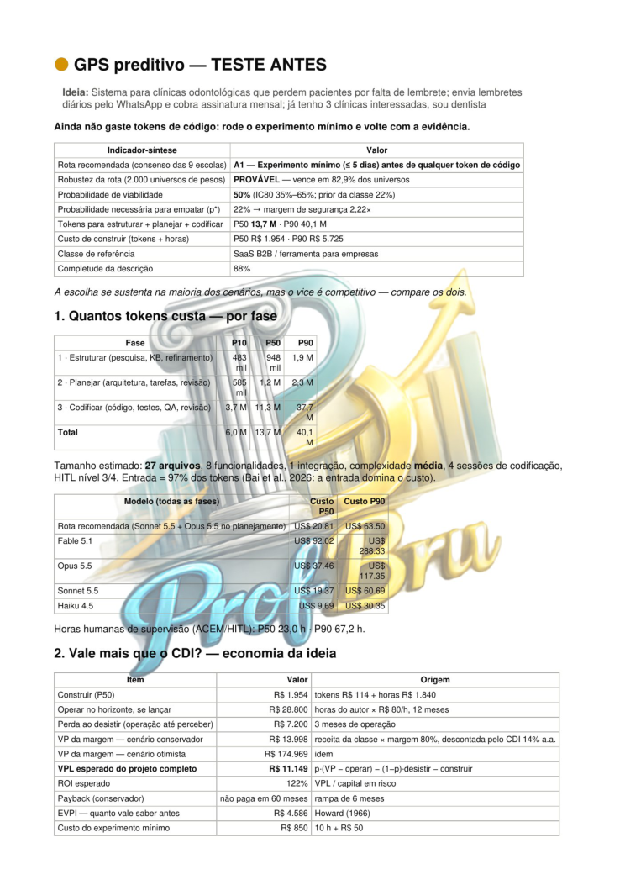 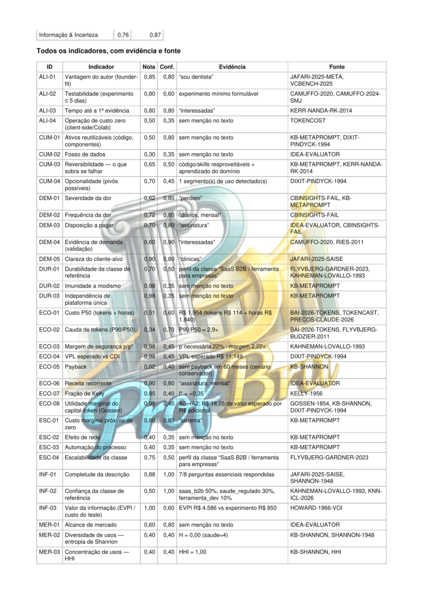</div>

**A dor que resolve:** decisão importante precisa circular — no comitê, com o sócio, no e-mail do investidor — e precisa provar quem a assinou.

Com `--relatorio`, cada análise sai em três formatos: **Markdown** (versionável), **HTML** autocontido (telas embutidas, tema claro e escuro) e **PDF em formato OCR** — cada página é imagem com a marca ProfBru grande, a 50% de transparência, ao fundo, e uma camada de texto invisível sobreposta que torna o documento pesquisável e copiável sem ser um PDF de texto puro.

> **Leitura:** o mesmo GPS que você leu no terminal vira um dossiê de seis páginas, com as cinco telas anexadas, pronto para ir à reunião — e a busca por "experimento mínimo" encontra cada ocorrência no PDF.

📎 [`docs/exemplos/gps_clinica.pdf`](docs/exemplos/gps_clinica.pdf) · [`.html`](docs/exemplos/gps_clinica.html) · [`.md`](docs/exemplos/gps_clinica.md)

---

## 🎯 Para que serve — a escolha e a renúncia sob medida

O mesmo método serve a qualquer decisão em que **opções se contradizem, a informação é incompleta e errar custa caro**:

<div align="center">

| Domínio | Decisão | Por que planilha falha |
|---|---|---|
| **Ideias e startups** | qual ideia merece tokens, tempo e capital nos próximos 90 dias | ignora a taxa-base da classe e o custo de operar |
| **Projetos com IA** | MVP, projeto completo ou só um teste — e com qual modelo | não estima tokens, cauda nem horas de revisão |
| **Decisões executivas e corporativas** | portfólio de projetos, fornecedor, make-or-buy | compensa veto com média; não mede robustez |
| **Equipamentos e celulares** | qual equipamento atende o portfólio real de usos | não mede diversidade de usos (Shannon) nem utilidade marginal |
| **Carros elétricos e frotas** | autonomia × custo total × infraestrutura | soma critérios correlacionados duas vezes |
| **Forças armadas** | blindados, aeronaves, sistemas de 30 anos | um critério crítico ruim precisa vetar, não ser compensado |
| **Trading e arbitragem** | vale construir o robô ou deixar no CDI? | esquece custos de transação, imposto e decaimento do alfa |
| **Pequenas e médias empresas** | automatizar o processo manual ou não | não compara economia anual com custo P90 |

</div>

> [!NOTE]
> As premissas (câmbio, CDI, horizonte, valor da sua hora, receita esperada, capital) são parâmetros da linha de comando e aparecem impressas em todo relatório. Mude-as e o veredito se recalcula — a decisão é sua, com as contas à vista.

---

## 🧩 Por que cada recurso existe

| Recurso | Por que existe | Fundamento |
|---|---|---|
| **Classe de referência** | a melhor previsão de um projeto é o histórico de projetos parecidos, não o otimismo de quem o propõe | Kahneman & Lovallo (1993); Flyvbjerg & Gardner (2023) |
| **Probabilidade em log-odds com confiança** | cada indicador mexe na probabilidade na proporção da evidência; sem evidência, quase nada | regras interpretáveis (LLM-AR, 2025); SAISE (2025) |
| **Tokens P10/P50/P90 por fase** | o consumo de agentes varia até 30× e a entrada domina o custo | Bai et al. (2026); ACEM (2026); tokencast |
| **Custo de operar, não só de construir** | com IA, construir ficou barato; o que quebra o negócio é operar | ACEM (2026); CB Insights |
| **VPL contra o CDI** | todo real em tokens tem um custo de oportunidade certo | Dixit & Pindyck (1994) |
| **EVPI — valor de testar antes** | às vezes a melhor compra é informação, não código | Howard (1966); Camuffo et al. (2020, 2024) |
| **Fração de Kelly** | quanto apostar é tão importante quanto em quê | Kelly (1956) |
| **Utilidade marginal na fronteira eficiente** | o que importa é o valor do PRÓXIMO real investido | Gossen (1854) |
| **Entropia de Shannon, Simpson, HHI, Índice de Versatilidade** | ideia com vários usos tem mais saídas se o primeiro mercado falhar | Shannon (1948); KPIs da base de conhecimento |
| **Nove escolas + consenso de Borda** | concordância entre teorias independentes é a evidência mais forte sem dados | Roy; Brans; Keeney & Raiffa; Saaty; Opricovic; Gomes |
| **Robustez dupla (pesos e notas)** | um vencedor que muda com 2 pontos de peso não é vencedor | SMAA — Lahdelma et al. (1998) |
| **Perguntas incômodas, reversibilidade, experimento mínimo, dependências** | é o que um investidor cético faria — e o que um LLM faz bem | base de conhecimento do projeto |
| **Relatório em PDF formato OCR, HTML e Markdown** | a decisão precisa circular, ser pesquisável e carregar a autoria em cada página | PyMuPDF + Pillow, tudo local |
| **Segundo motor em Rust** | dois motores independentes que concordam provam a matemática, não só o código | prova cruzada a cada execução da esteira |

---

## ⚙️ Instalação e uso

| Componente | Versão | Obrigatório | Para quê |
|---|---|---|---|
| Python | 3.13 | ✅ | motor, CLI, relatórios |
| NumPy | 2.x | ✅ | álgebra e simulação |
| numba | ≥ 0.60 | ⚠️ recomendado | JIT dos kernels (sem ele: mesma resposta, mais lento) |
| matplotlib | ≥ 3.7 | ⚠️ para telas | gráficos PNG |
| PyMuPDF · Pillow · markdown | recentes | ⚠️ para `--relatorio` | PDF, HTML |
| Rust / cargo | estável | ⭕ opcional | segundo motor de verificação |
| git · screen | — | ⭕ opcional | analisar repositórios · rodar em segundo plano |

```bash
cd public/foundations/pipeline
python3 analisar.py ideia "<ideia>" [--repo <url|pasta>] [--relatorio [base]] [--telas pasta/] [--json]
python3 analisar.py comparar "<ideia A>" "<ideia B>" "<ideia C>" [--relatorio]   # ou --arquivo ideias.txt
python3 analisar.py tokens "<ideia>" [--json]
python3 analisar.py repo https://github.com/<usuario>/<projeto>
python3 analisar.py indicadores [--bibliografia]
python3 analisar.py prompt "<ideia>"

# premissas (todas opcionais): --cambio 5.50 --cdi 0.14 --horizonte 12 --valor-hora 80
#                              --receita 3000 --receita-otimista 20000 --capital 50000 --infra-mes 0

./run_all.sh --demo          # < 60 s
./run_all.sh                 # testes + prova cruzada Rust + bench + telas + i18n
./run_all.sh --background    # screen + watchdog de 20 min (screen -r analisadorpreditivominimoviaveldeprojetos)
```

| Sub-skill | O que entrega |
|---|---|
| `ideia` | GPS completo de uma ideia: semáforo, rota, probabilidade, tokens, economia, nove escolas, indicadores, perguntas, experimento, dependências, renúncia (Markdown, JSON e telas) |
| `comparar` | várias ideias em paralelo: qual seguir, quais empatam, quais renunciar já |
| `tokens` | só o custo: tokens P10/P50/P90 por fase, US$ por modelo, horas humanas |
| `repo` | maturidade de um repositório: linhas, linguagens, testes, CI, licença, prontidão |
| `indicadores` | catálogo dos 50 indicadores com fórmula, fonte e evidência mínima; `--bibliografia` |
| `prompt` | prompt-mestre pronto para aprofundar a ideia num LLM |
| `--relatorio` | qualquer análise em Markdown, HTML e PDF em formato OCR com marca d'água |

---

## 🧠 Como funciona por dentro

O texto vira **sinais** (léxico em português e inglês, com a evidência que disparou cada um), os sinais definem a **classe de referência** e o **tamanho funcional**, o tamanho vira **tokens** (simulação com cauda gorda), os sinais e o tamanho viram **indicadores**, os indicadores deslocam o **prior** da classe em log-odds até a **probabilidade de viabilidade**, a probabilidade alimenta a **economia** das cinco rotas, e as nove escolas decidem a rota — com robustez medida.

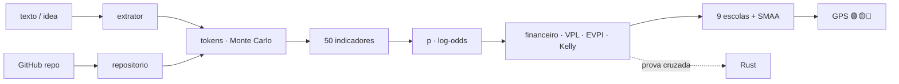

| Dimensão | O que pergunta |
|---|---|
| Problema & Demanda | a dor é real, frequente, paga? alguém fora da sua cabeça confirmou? |
| Mercado & Diversidade | quantos usos e segmentos (Shannon, Simpson, HHI, Versatilidade)? |
| Viabilidade técnica | tamanho, integrações, tempo real, código existente, resistência à comoditização por IA |
| Viabilidade econômica | custo, cauda, margem de segurança, VPL, payback, recorrência, Kelly, utilidade marginal |
| Durabilidade | resiste ao tempo, a modismos e a uma plataforma única? |
| Escalabilidade | custo marginal, efeito de rede, automação |
| Cumulatividade | o que sobra se falhar: código, dados, aprendizado, opções de pivô |
| Robustez & Risco | regulação, dependências externas, execução solo, perda máxima |
| Alinhamento & Testabilidade | vantagem do autor, experimento de 5 dias, tempo até evidência, custo zero |
| Informação & Incerteza | completude da descrição, confiança da classe, valor da informação |
| Arbitragem financeira | persistência do alfa, custos, validação estatística, regulação (CVM) |

### Na fronteira da ciência

Nenhum indicador entra no catálogo sem fonte — e um teste automático reprova o projeto se isso acontecer. Entre as 52 referências, a literatura recente sobre previsão de sucesso de startups com IA e LLMs (VCBench, SSFF, SAISE, meta-análise de preditores, LLM-AR, kNN-ICL — 2024 a 2026), consumo de tokens de agentes de código (Bai, Brynjolfsson, Pentland et al., 2026) e estimativa de custo de engenharia agêntica (ACEM, 2026), ao lado dos clássicos que sustentam cada método: Shannon, Gossen, Kelly, Howard, Kahneman & Tversky, Roy, Saaty, Keeney & Raiffa, Flyvbjerg, Lahdelma (SMAA) e a escola brasileira de apoio multicritério à decisão. A lista completa sai em `python3 analisar.py indicadores --bibliografia`.

---

## 🚀 Performance e prova cruzada

| Medição (4 CPUs, caso das clínicas) | Resultado |
|---|---|
| Análise completa de uma ideia (200 mil simulações de tokens + 9 escolas × 2.000 universos) | ≈ 1,8 s |
| Várias ideias | em paralelo com `ProcessPoolExecutor`, resultado idêntico ao serial |
| Concordância Python × Rust (5 casos, 10 grandezas cada) | diferença máxima de 2,2 × 10⁻¹⁵ |

Toda medição é registrada com a prova de que o resultado não mudou: otimização que altera a resposta não é ganho.

```text
✅ clinica      10 grandezas idênticas · Δ relativo máx 0.0e+00
✅ conciliacao  10 grandezas idênticas · Δ relativo máx 0.0e+00
✅ arbitragem   10 grandezas idênticas · Δ relativo máx 1.3e-15
✅ marketplace  10 grandezas idênticas · Δ relativo máx 2.2e-15
✅ vaga         10 grandezas idênticas · Δ relativo máx 0.0e+00
```

---

## 📁 O que tem dentro

```
AnalisadorPreditivoMinimoViaveldeProjetos/
├── README.md (+11)
├── projeto.toml
├── docs/                         logo, telas/, CUSTO.md, OPERACAO.md
└── public/foundations/
    ├── pipeline/
    │   ├── analisar.py           CLI (6 sub-skills)
    │   ├── apmv/                 extrator · repositorio · tokens · indicadores · preditivo
    │   │   │                     financeiro · decisao · gps · relatorio · telas · referencias
    │   │   └── mcdm/             ELECTRE I/II · PROMETHEE II · MAUT · MCDA-C · AHP-TOPSIS 2n
    │   │                         VIKOR · TODIM · SAPEVO-M · Borda · Dirichlet
    │   ├── testes_apmv.py · prova_cruzada_rust.py · bench.py · gerar_telas.py
    │   └── run_all.sh · watchdog.sh · verificar_publicacao.sh
    └── rust/analisadorpreditivominimoviaveldeprojetos_core/   apmv_core
```

Tudo roda localmente, sem custo recorrente: nenhum servidor, nenhuma chave de API, nenhuma chamada de rede na análise (só o `git clone` quando você passa um repositório).

---

## ❓ Perguntas que você vai fazer

<details>
<summary><b>Funciona mesmo com uma ideia de uma frase só?</b></summary>

Funciona — e é o caso para o qual foi desenhado. Com pouca informação, o GPS parte da taxa-base da classe, alarga o intervalo de probabilidade e não autoriza investir: diz exatamente quais perguntas responder antes.
</details>

<details>
<summary><b>Por que não perguntar direto a um LLM se a ideia é boa?</b></summary>

Porque LLMs, como juízes, concordam com quase tudo — e inventam pesos e notas que parecem calibrados. O analisador faz a conta com método e fonte; o LLM entra onde é forte, pelo prompt-mestre.
</details>

<details>
<summary><b>De onde vêm as receitas e as horas do relatório?</b></summary>

Da classe de referência, como cenário conservador e otimista — e aparecem como premissas. Se você souber a receita, o valor da sua hora ou o capital, passe na linha de comando e tudo se recalcula.
</details>

<details>
<summary><b>Serve para decisões que não são de software?</b></summary>

Sim. As nove escolas, a robustez e os indicadores de diversidade e utilidade marginal valem para equipamentos, frotas, fornecedores e projetos de qualquer natureza; os tokens são só uma das moedas.
</details>

<details>
<summary><b>Preciso pagar alguma coisa para rodar?</b></summary>

Não. Roda na sua máquina, offline. O único custo é o que o próprio relatório estima — os tokens que você decidir gastar depois.
</details>

---

## 📜 Licença e autoria

<div align="center">


**ProfBru © 2026**

**Analisador Preditivo Mínimo Viável de Projetos**
Autor: **ProfBru - Bruno Penedo** © 2026 — **TODOS OS DIREITOS RESERVADOS**
📧 profbruanbima@gmail.com

</div>

Software proprietário. Uso, cópia, modificação e distribuição dependem de autorização expressa do autor. Bibliotecas e referências de terceiros mantêm suas próprias licenças e créditos.

---

_AnalisadorPreditivoMinimoViaveldeProjetos_
_Autor: **ProfBru - Bruno Penedo** © 2026 — TODOS OS DIREITOS RESERVADOS · profbruanbima@gmail.com_
