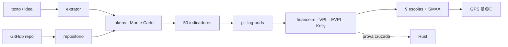

<!--
AnalisadorPreditivoMinimoViaveldeProjetos
Autor: ProfBru - Bruno Penedo © 2026 - TODOS OS DIREITOS RESERVADOS
E-mail: profbruanbima@gmail.com

TEMPLATE DO MOTOR DE READMEs — não editar os 12 READMEs à mão.
  • O que está aqui é ESTRUTURA (nunca traduzida): imagens, comandos, caminhos, badges de stack.
  • Marcadores b:<chave> entre chaves duplas são BLOCOS DE PROSA (traduzidos) — vêm de readme.blocos.json.
  • Marcadores lang:<nome> entre chaves duplas são preenchidos pelo gerador (seletor, frase de direitos).
Estilo: template do ECC (hero, seletor, badges, guia rápido, cards, o que tem dentro)
+ progressão D19: DOR → SOLUÇÃO → PROVA VISUAL → APLICAÇÃO → INSTALAÇÃO → PROFUNDIDADE → LICENÇA.
Gerar:  python3 public/foundations/pipeline/gerar_readmes.py
-->

<div align="center">

# 🧭 Analisador Preditivo Mínimo Viável de Projetos


**ProfBru © 2026**

### Предиктивный навигатор, который говорит, заслуживает ли идея ваших токенов, — ещё до первого токена.

**На входе — одна фраза с идеей. На выходе — вердикт 🟢🟡🔴, сколько токенов стоит структурировать, спланировать и закодировать её, сколько она стоит по сравнению с безрисковой ставкой — и от чего вам следует отказаться.**

   


[Português](README.md) · [English](README.en.md) · [Español](README.es.md) · [Français](README.fr.md) · [Deutsch](README.de.md) · [中文](README.zh.md) · [한국어](README.ko.md) · [हिन्दी](README.hi.md) · [עברית](README.he.md) · **Русский** · [Svenska](README.sv.md) · [Suomi](README.fi.md)

</div>

> [!IMPORTANT]
> **Мудро выбирать и отказываться до того, как тратить, — одно из самых сильных преимуществ.** Тот, кто знает, куда НЕ вкладывать время и деньги, уже выиграл половину игры. Этот проект превращает такую дисциплину в метод: предиктивный, проверяемый, с научным источником за каждым числом.

## ⚡ Старт за 60 секунд

Без сервера, без ключа API, без облака. Работает на вашем компьютере, офлайн. Вывод на бразильском португальском.

```bash
git clone <url-do-repositorio> AnalisadorPreditivoMinimoViaveldeProjetos
cd AnalisadorPreditivoMinimoViaveldeProjetos/public/foundations/pipeline
pip install -r requisitos.txt
python3 analisar.py ideia "App para clínicas lembrarem pacientes pelo WhatsApp com assinatura mensal"
```

Готово: отчёт выводится в терминал со светофором, рекомендуемым маршрутом, токенами P10/P50/P90 по фазам, ожидаемой ценностью относительно CDI (бразильской безрисковой базовой ставки) и вопросами, которых вы избегаете. Хотите сравнить несколько идей? Используйте `comparar`. Нужна только стоимость в токенах? Используйте `tokens`.

<div align="center">

<table>
<tr>
<td width="33%" align="center"><b>🧭 Одна идея, одна фраза</b><br/><sub>Даже без ниши, отрасли и цифр. Навигатор измеряет собственное незнание и никогда не разрешает инвестировать вслепую.</sub><br/><code>analisar.py ideia</code></td>
<td width="33%" align="center"><b>⚖️ Выбрать и отказаться</b><br/><sub>Несколько идей рядом: какую развивать, какую закрыть сейчас, какие действительно равны.</sub><br/><code>analisar.py comparar</code></td>
<td width="33%" align="center"><b>🪙 Сколько это в токенах</b><br/><sub>Структурировать, спланировать, закодировать — P10/P50/P90 и US$ по моделям, с риском хвоста.</sub><br/><code>analisar.py tokens</code></td>
</tr>
</table>

</div>

---

## 💀 Боль: вы решаете с помощью таблицы — а таблица ничего не решает

Вспомните ваш последний дорогой выбор. **Смартфоны** для отдела продаж. **Электромобиль** для автопарка. **Поставщик** по трёхлетнему контракту. **Идея стартапа**, в которую вы вложили полгода ночей. В большем масштабе — та же боль: **какую бронемашину, какой самолёт, какую систему обороны** армия покупает на тридцать лет; **какой проект** правление утверждает за годовой бюджет.

Почти всегда ритуал один и тот же: **таблица**, **матрица баллов**, несколько **фильтров**. И три ловушки, которых никто не видит:

| Что вы сделали | Что произошло на самом деле |
|---|---|
| 🔻 **Отсортировали таблицу по одному столбцу** | Вы решили по ОДНОМУ критерию. Остальные семь были там лишь для ощущения строгости. |
| 🔢 **Сложили баллы во взвешенной матрице** | Вы компенсировали катастрофу средним: вариант с ужасной безопасностью «сравнялся», потому что был отличным по цене. |
| 🔍 **Отфильтровали по «соответствует всему»** | Список опустел; вы ослабили мешающее требование — именно то, которое должно было стать вето. |

А теперь появилась новая статья затрат, невидимая в любой таблице: **токены**. С ИИ-агентами строить стало дёшево и быстро — и поэтому стало легко потратить недели и сотни долларов, безупречно построив **не ту идею**.

> [!WARNING]
> **Таблиц, матриц и фильтров ранжирования недостаточно для правильного выбора.** Они не умеют сказать, насколько вы *не уверены*, не наказывают провал по критическому критерию, не учитывают стоимость *эксплуатации* того, что вы построите, и — хуже всего — никогда не говорят **«не инвестируйте сейчас»**. Инструмент, который никогда не советует отказаться, — это не поддержка решений, а генератор оправданий.

### Момент, когда решение умирает

Это происходит на совещании, когда кто-то спрашивает: *«А если вес безопасности будет 30%, а не 25%?»* — и победитель меняется. Или через полгода, когда проект готов, работает, протестирован… и никто за него не платит. Разборы провалов стартапов уже десять лет называют одну и ту же причину номер один: **не было потребности рынка** (35–42% случаев, CB Insights). Правильный вопрос никогда не звучал как *«сможем ли мы это построить?»*. Он звучал как *«стоит ли?»* — и на него есть ответ **до** первого токена.

---

## 💊 Решение: предиктивный навигатор перед каждым токеном

**Опишите идею так, как она есть у вас в голове, — достаточно одной фразы.** За секунды анализатор делает то, на что серьёзному комитету понадобились бы недели:

1. **Определяет референтный класс** идеи (B2B SaaS, автоматизация, маркетплейс, трейдинг, здравоохранение…) и стартует с его базовой частоты — *взгляд снаружи*, защищающий от энтузиазма автора.
2. **Измеряет 50 показателей в 11 измерениях** — спрос, рынок, техническая реализуемость, экономика, долговечность, масштабируемость, накопительность, устойчивость, соответствие, информация и финансовый арбитраж — каждый с **оценкой, уверенностью, свидетельством и научным источником**.
3. **Оценивает токены** на структурирование, планирование и программирование: **200 тысяч симуляций** с тяжёлым хвостом ИТ-проектов, с пересчётом в US$ по моделям и в часы человеческого контроля.
4. **Делает расчёт, который забывает таблица:** стоимость создания **и эксплуатации**, ожидаемая ценность, дисконтированная по CDI, вероятность безубыточности, ценность предварительной проверки (EVPI), доля Келли и предельная полезность каждого дополнительного реала.
5. **Устраивает голосование девяти школ принятия решений** (ELECTRE I и II, PROMETHEE II, MAUT, MCDA-C, AHP-TOPSIS 2n, VIKOR, TODIM, SAPEVO-M) между пятью маршрутами — не инвестировать, сначала проверить, MVP, полный проект, повторно использовать код — и **тысячи раз возмущает веса и оценки**, чтобы сказать, является ли выбор УСТОЙЧИВЫМ, ВЕРОЯТНЫМ или ХРУПКИМ.

<div align="center">

| ❌ Что говорит таблица | ✅ Что говорит предиктивный навигатор |
|---|---|
| «У идеи оценка 7,8.» | **«🟡 СНАЧАЛА ПРОВЕРЬТЕ. Информация стоит R$ 4 586, а проверка — R$ 850. Проведите этот 5-дневный эксперимент; если результат отрицательный, закройте идею.»** |
| «Сделаем за две недели.» | **«P50 — 13,7 млн токенов, P90 — 40,1 млн, плюс 23 часа вашего ревью. Главная статья затрат — не создание, а эксплуатация.»** |
| *(никогда не говорит)* | **«🔴 НЕ ИНВЕСТИРУЙТЕ СЕЙЧАС. С учётом того, что известно сегодня, ни один маршрут не обгоняет CDI при приемлемом риске.»** |

</div>

**Честная система должна уметь сказать: «здесь мне не доверяйте».** Когда описание расплывчато, навигатор так и говорит — и решение никогда не становится зелёным вслепую.

---

## 🖼️ Смотрите в работе — по экрану на каждый навык

Все экраны ниже сгенерированы самим анализатором (`gerar_telas.py`) с фиксированным зерном: каждое число можно воспроизвести на своём компьютере. Подписи — на бразильском португальском, языке вывода инструмента.

### 1. `ideia` — навигатор на одной панели

<div align="center"></div>

**Какую боль решает:** чтобы решить, начинать ли, не нужен отчёт на 40 страниц; нужен вердикт и пять чисел, на которых он держится.

Светофор с подписью (никогда только цвет), рекомендуемый маршрут, устойчивость, вероятность жизнеспособности с 80%-м интервалом, токены P50/P90, стоимость создания, ожидаемая ценность и EVPI.

> **Прочтение:** у идеи для стоматологических клиник жизнеспособность 50% — хорошо, — но вердикт 🟡 **СНАЧАЛА ПРОВЕРЬТЕ**: знать результат стоит R$ 4 586, а эксперимент обходится в R$ 850. Купить дешёвую информацию до траты токенов — рациональное решение даже для многообещающей идеи.

### 2. `tokens` — сколько стоит структурировать, спланировать и закодировать

<div align="center"></div>
<div align="center"></div>

**Какую боль решает:** «сделаем быстро» — самая дорогая фраза в инженерии. ИИ-агенты на одной и той же задаче расходуют токены с разбросом до 30× (Bai et al., 2026), а каждый 6-й ИТ-проект превышает бюджет на 200% (Flyvbjerg & Budzier, 2011).

Оценщик считает по тексту файлы, интеграции и сложность, применяет расход по видам работ (чтение, запись, правка, тесты, ревью), рост контекста и переделки и запускает 200 тысяч симуляций с тяжёлым хвостом.

> **Прочтение:** программирование — около 80% токенов, а входные данные (контекст, перечитываемый на каждом шаге) — 97% из них. Диапазон P10–P90 охватывает порядок величины — поэтому навигатор принимает решение по P90, а не по среднему.

### 3. Маршруты — выбирать **и** отказываться

<div align="center"></div>

**Какую боль решает:** таблица сравнивает идеи; она никогда не сравнивает *способы инвестировать* в одну и ту же идею. А способ важнее идеи.

Пять маршрутов: **A0** не инвестировать (деньги в CDI), **A1** минимальный эксперимент на 5 дней, **A2** облегчённый MVP, **A3** полный проект, **A4** повторное использование существующего кода. У каждого — вложенный капитал, ожидаемая ценность, вероятность потери и время до первого свидетельства.

> **Прочтение:** у MVP самая высокая ожидаемая ценность в реалах, но консенсус выигрывает 5-дневный эксперимент: он приходит к свидетельству в 4 раза быстрее при 13% вероятности потери. Отчёт явно фиксирует **отказ**: выбирая A1, вы выводите из-под риска экспозицию P90 полного проекта, пока нет свидетельств.

### 4. Голосование девяти многокритериальных школ

<div align="center"></div>

**Какую боль решает:** каждый многокритериальный метод — это своя теория того, что значит «лучше». Использовать только один — значит выбрать ответ вместе с вопросом.

MAUT складывает полезности; ELECTRE накладывает вето на катастрофу; PROMETHEE градуирует предпочтение; VIKOR отказывается компенсировать худший критерий; TODIM считает потерю весомее выигрыша (теория перспектив); SAPEVO-M принимает порядковое суждение комитета.

> **Прочтение:** семь из девяти школ ставят минимальный эксперимент на 1-е место. Когда независимые теории согласны, решение переживает совещание.

### 5. Показатели — и что сдвинуло вероятность

<div align="center"></div>
<div align="center"></div>

**Какую боль решает:** «оценка 7,8» без объяснения никого не убеждает. Здесь каждое измерение показывает оценку, уверенность и то, насколько оно подняло или опустило вероятность.

Полный каталог (`analisar.py indicadores`) перечисляет 50 показателей с формулой, научным источником и **минимальным свидетельством**, которое подтвердило бы каждую оценку, — вместо того чтобы её выдумывать.

> **Прочтение:** сильнее всего вероятность подняло измерение «Проблема и спрос» (боль, частота и 3 заинтересованные клиники); «Рынок и разнообразие» осталось нейтральным — один сегмент использования, энтропия Шеннона равна нулю. Именно это и должен проверить следующий разговор с клиентами.

### 6. `comparar` — несколько идей, одно решение

<div align="center"></div>

**Какую боль решает:** у вас пять идей и сил на одну. Рейтинг с «победителем с отрывом 0,3 балла» — это шум, переодетый в уверенность.

Идеи анализируются параллельно (`ProcessPoolExecutor`), и девять школ голосуют с **двойной устойчивостью**: неопределённые веса и неопределённые оценки (SMAA). Вердикт берёт меньшую из двух.

> **Прочтение:** при неопределённых весах идея 4 побеждает всегда; при неопределённых оценках — лишь в 60% случаев: технически ничья с идеей 1. Навигатор говорит прямо: не выбирайте по рейтингу, проведите эксперимент по обеим. И велит **отказаться сразу** от маркетплейса и арбитражного бота, которые не побеждают ни в одном правдоподобном сценарии.

### 7. `repo` — у идеи уже есть код на GitHub?

<div align="center"></div>
<div align="center"></div>

**Какую боль решает:** существующий код выглядит как экономия, но требует чтения, адаптации и иногда несёт лицензию, которой нельзя воспользоваться.

Анализатор делает изолированный поверхностный клон (ничего из репозитория не запускается), измеряет строки по языкам, тесты, CI, лицензию и давность последнего коммита и вычисляет готовность (программный TRL). Зрелость снижает токены программирования; чтение добавляется к токенам структурирования.

> **Прочтение:** для репозитория под MIT уровня TRL-5 маршрут «повторно использовать» (A4) появляется среди вариантов — и консенсус всё равно предпочитает MVP, потому что адаптация существующего не снимает вопрос рынка.

### 8. Финансовый арбитраж и прирост капитала

<div align="center"></div>
<div align="center"></div>

**Какую боль решает:** идеи трейдинга и арбитража выглядят как бесплатные деньги — пока не появятся транзакционные издержки, налоги и затухание альфы.

Если идея — финансовая стратегия, в модель входит отдельное измерение (устойчивость преимущества, издержки и задержки, статистическая проверка, регуляторные риски), а отчёт требует бэктеста вне выборки, коэффициента Шарпа и просадки до любого токена на продукт. Для любой идеи токен-капитал сравнивается с безрисковой альтернативой — CDI.

> **Прочтение:** криптоарбитражный бот, описанный одной фразой, получает 🟡 **СНАЧАЛА ПРОВЕРЬТЕ** с жизнеспособностью 12%; автоматизация банковской сверки рядом получает 🟢 **ИНВЕСТИРУЙТЕ В MVP** с окупаемостью 4 месяца. Тот же автор, тот же день: разница в том, где время приносит отдачу.

### 9. Когда идея пока слишком расплывчата

<div align="center"></div>

**Какую боль решает:** худшее решение — не сказать «нет» хорошей идее, а сказать «да» идее, которой ещё не существует.

Для «классной идеи» навигатор фиксирует полноту 0%, возвращает очень широкий интервал вероятности, перечисляет оставшиеся без ответа ключевые вопросы и помечает вердикт как ХРУПКИЙ.

> **Прочтение:** 🔴 **НЕ ИНВЕСТИРУЙТЕ СЕЙЧАС** — не из пессимизма, а из-за нехватки информации. Отчёт сам говорит, что нужно выяснить сначала (у кого боль, сколько она стоит, как зарабатываются деньги).

### 10. `prompt` — углубиться с LLM, но правильно

<div align="center"></div>

**Какую боль решает:** LLM отлично находят логические дыры и предлагают эксперименты — и плохо выдумывают откалиброванные веса и оценки; в роли судей они склонны соглашаться почти со всем.

Поэтому анализатор берёт на себя количественную часть и выдаёт готовый мастер-промпт, уже заполненный классом, вероятностью, токенами и маршрутом, прося у LLM только то, что он делает хорошо: неудобные вопросы, тест обратимости, минимальный эксперимент и карту зависимостей.

> **Прочтение:** число даёт модель; сомнение — LLM. Каждый на своём месте.

### 11. `--relatorio` — досье в PDF, HTML и Markdown

<div align="center"> </div>

**Какую боль решает:** важное решение должно ходить по рукам — в комитете, у партнёра, в почте инвестора — и должно доказывать, кто его подписал.

С `--relatorio` каждый анализ выходит в трёх форматах: **Markdown** (под контролем версий), автономный **HTML** (встроенные экраны, светлая и тёмная тема) и **PDF в формате OCR** — каждая страница является изображением с крупным знаком ProfBru на фоне с прозрачностью 50%, поверх которого лежит невидимый текстовый слой: документ доступен для поиска и копирования, но не является чисто текстовым PDF.

> **Прочтение:** тот же навигатор, что вы видели в терминале, превращается в досье на шесть страниц с пятью экранами в приложении, готовое к совещанию, — а поиск «experimento mínimo» находит каждое вхождение в PDF.

📎 [`docs/exemplos/gps_clinica.pdf`](docs/exemplos/gps_clinica.pdf) · [`.html`](docs/exemplos/gps_clinica.html) · [`.md`](docs/exemplos/gps_clinica.md)

---

## 🎯 Для чего это — выбор и отказ под конкретную задачу

Тот же метод подходит для любого решения, где **варианты противоречат друг другу, информация неполна, а ошибка дорого стоит**:

<div align="center">

| Область | Решение | Почему таблица не справляется |
|---|---|---|
| **Идеи и стартапы** | какая идея заслуживает токенов, времени и капитала в ближайшие 90 дней | игнорирует базовую частоту класса и стоимость эксплуатации |
| **ИИ-проекты** | MVP, полный проект или только тест — и на какой модели | не оценивает токены, хвост и часы ревью |
| **Управленческие и корпоративные решения** | портфель проектов, поставщик, делать или покупать | компенсирует вето средним; не измеряет устойчивость |
| **Оборудование и смартфоны** | какое оборудование покрывает реальный набор сценариев использования | не измеряет разнообразие применений (Шеннон) и предельную полезность |
| **Электромобили и автопарки** | запас хода × совокупная стоимость × инфраструктура | дважды учитывает коррелированные критерии |
| **Вооружённые силы** | бронемашины, самолёты, системы на 30 лет | плохой критический критерий должен накладывать вето, а не компенсироваться |
| **Трейдинг и арбитраж** | строить бота или оставить деньги в CDI? | забывает транзакционные издержки, налоги и затухание альфы |
| **Малый и средний бизнес** | автоматизировать ручной процесс или нет | не сравнивает годовую экономию с затратами P90 |

</div>

> [!NOTE]
> Допущения (курс, CDI, горизонт, стоимость вашего часа, ожидаемая выручка, капитал) — это параметры командной строки, и они печатаются в каждом отчёте. Измените их — и вердикт пересчитается: решение остаётся за вами, а расчёты на виду.

---

## 🧩 Зачем нужна каждая функция

| Функция | Зачем она нужна | Основание |
|---|---|---|
| **Референтный класс** | лучший прогноз проекта — история похожих проектов, а не оптимизм автора | Kahneman & Lovallo (1993); Flyvbjerg & Gardner (2023) |
| **Вероятность в log-odds с учётом уверенности** | каждый показатель сдвигает вероятность пропорционально свидетельству; без свидетельства — почти никак | интерпретируемые правила (LLM-AR, 2025); SAISE (2025) |
| **Токены P10/P50/P90 по фазам** | расход агентов колеблется до 30×, а входные данные доминируют в стоимости | Bai et al. (2026); ACEM (2026); tokencast |
| **Стоимость эксплуатации, а не только создания** | с ИИ создавать стало дёшево; бизнес ломает эксплуатация | ACEM (2026); CB Insights |
| **ЧПС относительно CDI** | у каждого реала, потраченного на токены, есть гарантированная альтернативная стоимость | Dixit & Pindyck (1994) |
| **EVPI — ценность предварительной проверки** | иногда лучшая покупка — информация, а не код | Howard (1966); Camuffo et al. (2020, 2024) |
| **Доля Келли** | сколько ставить так же важно, как на что | Kelly (1956) |
| **Предельная полезность на эффективной границе** | важна ценность СЛЕДУЮЩЕГО вложенного реала | Gossen (1854) |
| **Энтропия Шеннона, Симпсон, HHI, индекс универсальности** | у идеи с несколькими применениями больше выходов, если первый рынок не сработает | Shannon (1948); KPI базы знаний |
| **Девять школ + консенсус Борда** | согласие независимых теорий — самое сильное свидетельство при отсутствии данных | Roy; Brans; Keeney & Raiffa; Saaty; Opricovic; Gomes |
| **Двойная устойчивость (веса и оценки)** | победитель, который меняется от 2 пунктов веса, — не победитель | SMAA — Lahdelma et al. (1998) |
| **Неудобные вопросы, обратимость, минимальный эксперимент, зависимости** | так поступил бы скептичный инвестор — и это LLM делает хорошо | база знаний проекта |
| **Отчёт в PDF формата OCR, HTML и Markdown** | решение должно распространяться, быть доступным для поиска и нести авторство на каждой странице | PyMuPDF + Pillow, всё локально |
| **Второй движок на Rust** | два независимых согласующихся движка доказывают математику, а не только код | перекрёстная проверка при каждом запуске |

---

## ⚙️ Установка и использование

| Компонент | Версия | Обязателен | Для чего |
|---|---|---|---|
| Python | 3.13 | ✅ | движок, CLI, отчёты |
| NumPy | 2.x | ✅ | алгебра и моделирование |
| numba | ≥ 0.60 | ⚠️ рекомендуется | JIT ядер (без него: тот же ответ, медленнее) |
| matplotlib | ≥ 3.7 | ⚠️ для экранов | графики PNG |
| PyMuPDF · Pillow · markdown | актуальные | ⚠️ для `--relatorio` | PDF, HTML |
| Rust / cargo | стабильная | ⭕ опционально | второй проверочный движок |
| git · screen | — | ⭕ опционально | анализ репозиториев · фоновый запуск |

```bash
cd public/foundations/pipeline
python3 analisar.py ideia "<ideia>" [--repo <url|pasta>] [--relatorio [base]] [--telas pasta/] [--json]
python3 analisar.py comparar "<ideia A>" "<ideia B>" "<ideia C>" [--relatorio]   # ou --arquivo ideias.txt
python3 analisar.py tokens "<ideia>" [--json]
python3 analisar.py repo https://github.com/<usuario>/<projeto>
python3 analisar.py indicadores [--bibliografia]
python3 analisar.py prompt "<ideia>"

# premissas (todas opcionais): --cambio 5.50 --cdi 0.14 --horizonte 12 --valor-hora 80
#                              --receita 3000 --receita-otimista 20000 --capital 50000 --infra-mes 0

./run_all.sh --demo          # < 60 s
./run_all.sh                 # testes + prova cruzada Rust + bench + telas + i18n
./run_all.sh --background    # screen + watchdog de 20 min (screen -r analisadorpreditivominimoviaveldeprojetos)
```

| Навык | Что даёт |
|---|---|
| `ideia` | полный навигатор по идее: светофор, маршрут, вероятность, токены, экономика, девять школ, показатели, вопросы, эксперимент, зависимости, отказ (Markdown, JSON и экраны) |
| `comparar` | несколько идей параллельно: какую развивать, какие равны, от каких отказаться сразу |
| `tokens` | только стоимость: токены P10/P50/P90 по фазам, US$ по моделям, человеко-часы |
| `repo` | зрелость репозитория: строки, языки, тесты, CI, лицензия, готовность |
| `indicadores` | каталог 50 показателей с формулой, источником и минимальным свидетельством; `--bibliografia` |
| `prompt` | готовый мастер-промпт для углублённого разбора идеи с LLM |
| `--relatorio` | любой анализ в Markdown, HTML и PDF формата OCR с водяным знаком |

---

## 🧠 Как это устроено

Текст превращается в **сигналы** (лексикон на португальском и английском с сохранением свидетельства, вызвавшего каждый сигнал); сигналы задают **референтный класс** и **функциональный размер**; размер превращается в **токены** (моделирование с тяжёлым хвостом); сигналы и размер превращаются в **показатели**; показатели сдвигают **априорную вероятность** класса в log-odds до **вероятности жизнеспособности**; вероятность питает **экономику** пяти маршрутов; и девять школ выбирают маршрут — с измеренной устойчивостью.



| Измерение | Что спрашивает |
|---|---|
| Проблема и спрос | боль реальна, частая, за неё платят? подтвердил ли её кто-то кроме вас? |
| Рынок и разнообразие | сколько применений и сегментов (Шеннон, Симпсон, HHI, универсальность)? |
| Техническая реализуемость | размер, интеграции, реальное время, существующий код, устойчивость к коммодитизации ИИ |
| Экономическая реализуемость | стоимость, хвост, запас прочности, ЧПС, окупаемость, регулярность выручки, Келли, предельная полезность |
| Долговечность | выдерживает ли время, моду и зависимость от одной платформы? |
| Масштабируемость | предельные издержки, сетевой эффект, автоматизация |
| Накопительность | что останется при неудаче: код, данные, опыт, варианты пивота |
| Устойчивость и риск | регулирование, внешние зависимости, работа в одиночку, максимальная потеря |
| Соответствие и проверяемость | преимущество автора, 5-дневный эксперимент, время до свидетельства, нулевая стоимость |
| Информация и неопределённость | полнота описания, уверенность в классе, ценность информации |
| Финансовый арбитраж | устойчивость альфы, издержки, статистическая проверка, регулирование |

### На переднем крае науки

Ни один показатель не попадает в каталог без источника — а если это случится, автоматический тест провалит проект. Среди 52 источников: свежая литература о прогнозировании успеха стартапов с помощью ИИ и LLM (VCBench, SSFF, SAISE, метаанализ предикторов, LLM-AR, kNN-ICL — 2024–2026), о расходе токенов агентами-программистами (Bai, Brynjolfsson, Pentland et al., 2026) и об оценке стоимости агентной разработки (ACEM, 2026), а также классика, на которой стоит каждый метод: Shannon, Gossen, Kelly, Howard, Kahneman & Tversky, Roy, Saaty, Keeney & Raiffa, Flyvbjerg, Lahdelma (SMAA) и бразильская школа многокритериальной поддержки решений. Полный список выводит `python3 analisar.py indicadores --bibliografia`.

---

## 🚀 Производительность и перекрёстная проверка

| Измерение (4 CPU, кейс клиник) | Результат |
|---|---|
| Полный анализ одной идеи (200 тысяч симуляций токенов + 9 школ × 2 000 вселенных) | ≈ 1,8 с |
| Несколько идей | параллельно через `ProcessPoolExecutor`, результат идентичен последовательному |
| Согласие Python × Rust (5 кейсов, по 10 величин) | максимальное расхождение 2,2 × 10⁻¹⁵ |

Каждое измерение записывается вместе с доказательством того, что результат не изменился: оптимизация, меняющая ответ, — не выигрыш.

```text
✅ clinica      10 grandezas idênticas · Δ relativo máx 0.0e+00
✅ conciliacao  10 grandezas idênticas · Δ relativo máx 0.0e+00
✅ arbitragem   10 grandezas idênticas · Δ relativo máx 1.3e-15
✅ marketplace  10 grandezas idênticas · Δ relativo máx 2.2e-15
✅ vaga         10 grandezas idênticas · Δ relativo máx 0.0e+00
```

---

## 📁 Что внутри

```
AnalisadorPreditivoMinimoViaveldeProjetos/
├── README.md (+11)
├── projeto.toml
├── docs/                         logo, telas/, CUSTO.md, OPERACAO.md
└── public/foundations/
    ├── pipeline/
    │   ├── analisar.py           CLI (6 sub-skills)
    │   ├── apmv/                 extrator · repositorio · tokens · indicadores · preditivo
    │   │   │                     financeiro · decisao · gps · relatorio · telas · referencias
    │   │   └── mcdm/             ELECTRE I/II · PROMETHEE II · MAUT · MCDA-C · AHP-TOPSIS 2n
    │   │                         VIKOR · TODIM · SAPEVO-M · Borda · Dirichlet
    │   ├── testes_apmv.py · prova_cruzada_rust.py · bench.py · gerar_telas.py
    │   └── run_all.sh · watchdog.sh · verificar_publicacao.sh
    └── rust/analisadorpreditivominimoviaveldeprojetos_core/   apmv_core
```

Всё работает локально и без регулярных затрат: ни сервера, ни ключа API, ни сетевых вызовов во время анализа (только `git clone`, если вы указываете репозиторий).

---

## ❓ Вопросы, которые вы зададите

<details>
<summary><b>Это правда работает с идеей из одной фразы?</b></summary>

Работает — именно для этого случая он и создан. При малом объёме информации навигатор стартует с базовой частоты класса, расширяет интервал вероятности и не разрешает инвестировать: он точно говорит, на какие вопросы нужно ответить сначала.
</details>

<details>
<summary><b>Почему бы просто не спросить у LLM, хороша ли идея?</b></summary>

Потому что LLM в роли судей соглашаются почти со всем — и выдумывают веса и оценки, которые выглядят откалиброванными. Анализатор считает по методу и с источниками; LLM подключается там, где он силён, — через мастер-промпт.
</details>

<details>
<summary><b>Откуда берутся выручка и часы в отчёте?</b></summary>

Из референтного класса — как консервативный и оптимистичный сценарии; они показаны как допущения. Если вы знаете выручку, стоимость своего часа или капитал, передайте их в командной строке — и всё пересчитается.
</details>

<details>
<summary><b>Подходит ли это для решений, не связанных с ПО?</b></summary>

Да. Девять школ, анализ устойчивости и показатели разнообразия и предельной полезности применимы к оборудованию, автопаркам, поставщикам и проектам любого рода; токены — лишь одна из валют.
</details>

<details>
<summary><b>Нужно ли что-то платить за запуск?</b></summary>

Нет. Он работает на вашем компьютере, офлайн. Единственная стоимость — та, которую оценивает сам отчёт: токены, которые вы решите потратить потом.
</details>

---

## 📜 Лицензия и авторство

<div align="center">


**ProfBru © 2026**

**Analisador Preditivo Mínimo Viável de Projetos**
Автор: **ProfBru - Bruno Penedo** © 2026 — **ВСЕ ПРАВА ЗАЩИЩЕНЫ**
📧 profbruanbima@gmail.com

</div>

Проприетарное программное обеспечение. Использование, копирование, изменение и распространение требуют явного разрешения автора. Сторонние библиотеки и источники сохраняют собственные лицензии и указания авторства.

---

_AnalisadorPreditivoMinimoViaveldeProjetos_
_Автор: **ProfBru - Bruno Penedo** © 2026 — ВСЕ ПРАВА ЗАЩИЩЕНЫ · profbruanbima@gmail.com_
