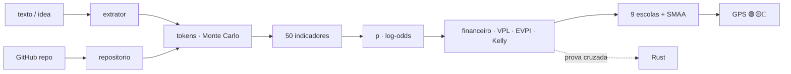

<!--
AnalisadorPreditivoMinimoViaveldeProjetos
Autor: ProfBru - Bruno Penedo © 2026 - TODOS OS DIREITOS RESERVADOS
E-mail: profbruanbima@gmail.com

TEMPLATE DO MOTOR DE READMEs — não editar os 12 READMEs à mão.
  • O que está aqui é ESTRUTURA (nunca traduzida): imagens, comandos, caminhos, badges de stack.
  • Marcadores b:<chave> entre chaves duplas são BLOCOS DE PROSA (traduzidos) — vêm de readme.blocos.json.
  • Marcadores lang:<nome> entre chaves duplas são preenchidos pelo gerador (seletor, frase de direitos).
Estilo: template do ECC (hero, seletor, badges, guia rápido, cards, o que tem dentro)
+ progressão D19: DOR → SOLUÇÃO → PROVA VISUAL → APLICAÇÃO → INSTALAÇÃO → PROFUNDIDADE → LICENÇA.
Gerar:  python3 public/foundations/pipeline/gerar_readmes.py
-->

<div align="center">

# 🧭 Analisador Preditivo Mínimo Viável de Projetos


**ProfBru © 2026**

### Den prediktiva GPS:en som säger om en idé förtjänar dina tokens — före den första token.

**En mening idé går in. Ut kommer ett utlåtande 🟢🟡🔴, hur många tokens det kostar att strukturera, planera och koda den, vad den är värd jämfört med en riskfri ränta — och vad du bör avstå från.**

   


[Português](README.md) · [English](README.en.md) · [Español](README.es.md) · [Français](README.fr.md) · [Deutsch](README.de.md) · [中文](README.zh.md) · [한국어](README.ko.md) · [हिन्दी](README.hi.md) · [עברית](README.he.md) · [Русский](README.ru.md) · **Svenska** · [Suomi](README.fi.md)

</div>

> [!IMPORTANT]
> **Att välja och avstå klokt, innan man spenderar, är en av de största fördelar som finns.** Den som vet var man INTE ska lägga tid och pengar har redan vunnit halva spelet. Projektet gör den disciplinen till en metod: prediktiv, granskningsbar, med en vetenskaplig källa bakom varje siffra.

## ⚡ Kom igång på 60 sekunder

Ingen server, ingen API-nyckel, inget moln. Körs på din dator, offline. Utdata på brasiliansk portugisiska.

```bash
git clone <url-do-repositorio> AnalisadorPreditivoMinimoViaveldeProjetos
cd AnalisadorPreditivoMinimoViaveldeProjetos/public/foundations/pipeline
pip install -r requisitos.txt
python3 analisar.py ideia "App para clínicas lembrarem pacientes pelo WhatsApp com assinatura mensal"
```

Klart: rapporten skrivs ut i terminalen med trafikljus, rekommenderad väg, tokens P10/P50/P90 per fas, förväntat värde jämfört med CDI (Brasiliens riskfria referensränta) och de frågor du undviker. Vill du jämföra flera idéer? Använd `comparar`. Bara tokenkostnaden? Använd `tokens`.

<div align="center">

<table>
<tr>
<td width="33%" align="center"><b>🧭 En idé, en mening</b><br/><sub>Även utan nisch, bransch eller siffror. GPS:en mäter sin egen okunskap och tillåter aldrig att man investerar i blindo.</sub><br/><code>analisar.py ideia</code></td>
<td width="33%" align="center"><b>⚖️ Välja och avstå</b><br/><sub>Flera idéer sida vid sida: vilken som ska drivas, vilken som ska läggas ned nu, vilka som verkligen är jämbördiga.</sub><br/><code>analisar.py comparar</code></td>
<td width="33%" align="center"><b>🪙 Vad det kostar i tokens</b><br/><sub>Strukturera, planera och koda — P10/P50/P90 och US$ per modell, med svansrisk.</sub><br/><code>analisar.py tokens</code></td>
</tr>
</table>

</div>

---

## 💀 Smärtan: du beslutar med ett kalkylblad — och kalkylbladet beslutar ingenting

Tänk på ditt senaste dyra val. **Telefonerna** till säljteamet. **Elbilen** till fordonsparken. **Leverantören** för ett treårsavtal. **Startup-idén** du lade sex månaders nätter på. I större skala samma smärta: **vilket pansarfordon, vilket flygplan, vilket försvarssystem** en försvarsmakt köper för trettio år; **vilket projekt** en ledningsgrupp godkänner med årets budget.

Nästan alltid är ritualen densamma: ett **kalkylblad**, en **poängmatris**, några **filter**. Och tre fällor som ingen ser:

| Vad du gjorde | Vad som egentligen hände |
|---|---|
| 🔻 **Sorterade kalkylbladet på en kolumn** | Du beslutade efter ETT kriterium. De andra sju fanns där bara för att det skulle kännas grundligt. |
| 🔢 **Summerade poäng i en viktad matris** | Du kompenserade katastrofen med medelvärdet: ett alternativ med usel säkerhet "kom ikapp" eftersom det var utmärkt i pris. |
| 🔍 **Filtrerade på "uppfyller allt"** | Listan blev tom; du mildrade det besvärliga kravet — just det som borde ha varit vetot. |

Och nu finns en ny kostnad, osynlig i varje kalkylblad: **tokens**. Med AI-agenter blev det billigt och snabbt att bygga — och därför blev det lätt att lägga veckor och hundratals dollar på att perfekt bygga **fel idé**.

> [!WARNING]
> **Kalkylblad, matriser och rangordningsfilter räcker inte för ett bra val.** De kan inte säga hur *osäker* du är, de straffar inte en katastrof i ett kritiskt kriterium, de räknar inte kostnaden för att *driva* det du bygger och — värst av allt — de säger aldrig **"investera inte nu"**. Ett verktyg som aldrig rekommenderar att avstå är inget beslutsstöd: det är en motiveringsgenerator.

### Ögonblicket då beslutet dör

Det är på mötet, när någon frågar: *"Tänk om säkerheten vägde 30 % i stället för 25 %?"* — och vinnaren byts ut. Eller sex månader senare, när projektet är klart, fungerar, är testat… och ingen betalar för det. Startup-obduktioner har i ett decennium pekat på samma orsak nummer ett: **det fanns inget marknadsbehov** (35–42 % av fallen, CB Insights). Den rätta frågan var aldrig *"kan vi bygga det?"*. Den var *"borde vi?"* — och den har ett svar **före** den första token.

---

## 💊 Lösningen: en prediktiv GPS före varje token

**Skriv idén som den ser ut i ditt huvud — en mening räcker.** På några sekunder gör analysatorn det som en seriös kommitté skulle göra på veckor:

1. **Känner igen idéns referensklass** (B2B-SaaS, automatisering, marknadsplats, trading, hälsa…) och utgår från dess basfrekvens — det *yttre perspektiv* som skyddar mot upphovspersonens entusiasm.
2. **Mäter 50 indikatorer i 11 dimensioner** — efterfrågan, marknad, teknisk genomförbarhet, ekonomi, hållbarhet, skalbarhet, kumulativitet, robusthet, förankring, information och finansiell arbitrage — var och en med **betyg, konfidens, belägg och vetenskaplig källa**.
3. **Uppskattar tokens** för att strukturera, planera och koda med **200 000 simuleringar** och IT-projektens tjocka svans, och räknar om dem till US$ per modell och mänskliga tillsynstimmar.
4. **Gör kalkylen som kalkylbladet glömmer:** kostnaden för att bygga **och driva**, förväntat värde diskonterat med CDI, break-even-sannolikhet, värdet av att testa först (EVPI), Kellyandel och marginalnyttan av varje ytterligare real.
5. **Låter nio beslutsskolor rösta** (ELECTRE I och II, PROMETHEE II, MAUT, MCDA-C, AHP-TOPSIS 2n, VIKOR, TODIM, SAPEVO-M) mellan fem vägar — inte investera, testa först, MVP, fullt projekt, återanvända kod — och **stör vikter och betyg tusentals gånger** för att avgöra om valet är ROBUST, TROLIGT eller SKÖRT.

<div align="center">

| ❌ Vad kalkylbladet säger | ✅ Vad den prediktiva GPS:en säger |
|---|---|
| "Idén får betyget 7,8." | **"🟡 TESTA FÖRST. Informationen är värd R$ 4 586 och testet kostar R$ 850. Kör detta 5-dagarsexperiment; blir det negativt, lägg ned idén."** |
| "Vi bygger det på två veckor." | **"P50 på 13,7 M tokens, P90 på 40,1 M — och 23 timmar av din granskning. Den dominerande kostnaden är inte att bygga: det är att driva."** |
| *(säger det aldrig)* | **"🔴 INVESTERA INTE NU. Ingen väg slår CDI med acceptabel risk utifrån det som är känt i dag."** |

</div>

**Ett ärligt system måste kunna säga "lita inte på mig här".** När beskrivningen är vag säger GPS:en det — och beslutet blir aldrig grönt i mörkret.

---

## 🖼️ Se det fungera — en skärm per delfärdighet

Alla skärmar nedan har genererats av analysatorn själv (`gerar_telas.py`) med fast slumpfrö: du kan återskapa varje siffra på din dator. Etiketterna är på brasiliansk portugisiska, verktygets utdataspråk.

### 1. `ideia` — GPS:en i en panel

<div align="center"></div>

**Smärtan den löser:** du behöver ingen 40-sidig rapport för att avgöra om du ska börja; du behöver ett utlåtande och de fem siffror som bär det.

Trafikljus med etikett (aldrig bara färg), rekommenderad väg, robusthet, sannolikhet för bärkraft med 80 %-intervall, tokens P50/P90, byggkostnad, förväntat värde och EVPI.

> **Tolkning:** idén för tandvårdskliniker har 50 % bärkraft — bra — men utlåtandet är 🟡 **TESTA FÖRST**: att känna till utfallet är värt R$ 4 586 och experimentet kostar R$ 850. Att köpa billig information innan man spenderar tokens är det rationella beslutet, även för en lovande idé.

### 2. `tokens` — vad det kostar att strukturera, planera och koda

<div align="center"></div>
<div align="center"></div>

**Smärtan den löser:** "det går fort" är den dyraste meningen inom ingenjörskonsten. AI-agenter varierar upp till 30× i tokens på samma uppgift (Bai et al., 2026), och vart sjätte IT-projekt spräcker budgeten med 200 % (Flyvbjerg & Budzier, 2011).

Estimatorn räknar filer, integrationer och komplexitet ur texten, tillämpar förbrukning per aktivitet (läsa, skriva, redigera, testa, granska), kontexttillväxt och omarbete, och kör 200 000 simuleringar med tjock svans.

> **Tolkning:** kodning står för ~80 % av tokens, och indata (kontexten som läses om i varje steg) för 97 % av dem. Spannet P10–P90 omfattar en storleksordning — därför beslutar GPS:en på P90, inte på medelvärdet.

### 3. Vägar — att välja **och** avstå

<div align="center"></div>

**Smärtan den löser:** kalkylbladet jämför idéer; det jämför aldrig *sätt att investera* i samma idé. Och sättet betyder mer än idén.

Fem vägar: **A0** inte investera (pengarna i CDI), **A1** minimalt experiment på 5 dagar, **A2** smal MVP, **A3** fullt projekt, **A4** återanvända befintlig kod. Var och en med bundet kapital, förväntat värde, förlustsannolikhet och tid till första belägg.

> **Tolkning:** MVP:n har högst förväntat värde i reais, men 5-dagarsexperimentet vinner konsensus — det når belägg 4× snabbare med 13 % risk för förlust. Rapporten gör **avståendet** uttryckligt: genom att välja A1 håller du det fulla projektets P90-exponering utanför risk tills det finns belägg.

### 4. De nio flerkriterieskolornas omröstning

<div align="center"></div>

**Smärtan den löser:** varje flerkriteriemetod är en egen teori om vad "bättre" betyder. Att bara använda en är att välja svaret tillsammans med frågan.

MAUT adderar nyttor; ELECTRE lägger in veto mot katastrofen; PROMETHEE graderar preferensen; VIKOR vägrar att kompensera det sämsta kriteriet; TODIM väger förlust tyngre än vinst (prospektteorin); SAPEVO-M godtar en kommittés ordinala bedömning.

> **Tolkning:** sju av nio skolor sätter det minimala experimentet på första plats. När oberoende teorier är överens överlever beslutet mötet.

### 5. Indikatorer — och vad som flyttade sannolikheten

<div align="center"></div>
<div align="center"></div>

**Smärtan den löser:** "betyg 7,8" utan förklaring övertygar ingen. Här visar varje dimension sitt betyg, sin konfidens och hur mycket den sköt sannolikheten uppåt eller nedåt.

Hela katalogen (`analisar.py indicadores`) listar de 50 indikatorerna med formel, vetenskaplig källa och det **minsta belägg** som skulle befästa varje betyg — i stället för att hitta på det.

> **Tolkning:** Problem & efterfrågan var den dimension som lyfte sannolikheten mest (smärta, frekvens och 3 intresserade kliniker); Marknad & mångfald förblev neutral — ett enda användningssegment, Shannonentropi noll. Det är exakt vad nästa kundsamtal behöver testa.

### 6. `comparar` — flera idéer, ett beslut

<div align="center"></div>

**Smärtan den löser:** du har fem idéer och ork för en. En rangordning med "vinnare med 0,3 poäng" är brus förklätt till säkerhet.

Idéerna analyseras parallellt (`ProcessPoolExecutor`) och röstas fram av de nio skolorna med **dubbel robusthet**: osäkra vikter och osäkra betyg (SMAA). Utlåtandet använder den lägre av de två.

> **Tolkning:** med osäkra vikter vinner idé 4 alltid; med osäkra betyg bara 60 % av gångerna — tekniskt oavgjort mot idé 1. GPS:en säger det rakt ut: välj inte efter rangordningen, kör experimentet för båda. Och den uppmanar dig att **avstå direkt** från marknadsplatsen och arbitrageboten, som inte vinner i något rimligt scenario.

### 7. `repo` — har idén redan kod på GitHub?

<div align="center"></div>
<div align="center"></div>

**Smärtan den löser:** befintlig kod ser ut som en besparing, men den kostar läsning, anpassning och ibland en licens du inte får använda.

Analysatorn gör en isolerad grund kloning (inget från arkivet körs), mäter rader per språk, tester, CI, licens och ålder på den senaste commiten, och beräknar mognaden (mjukvaru-TRL). Mognaden minskar kodningstokens; läsningen läggs till struktureringstokens.

> **Tolkning:** med ett MIT-arkiv på nivå TRL-5 dyker vägen "återanvända" (A4) upp bland alternativen — och konsensus föredrar ändå MVP:n, eftersom att anpassa det som finns inte tar bort marknadsfrågan.

### 8. Finansiell arbitrage och kapitalvinster

<div align="center"></div>
<div align="center"></div>

**Smärtan den löser:** trading- och arbitrageidéer ser ut som gratis pengar — tills transaktionskostnader, skatt och alfaförfall dyker upp.

När idén är en finansiell strategi tillkommer en egen dimension i modellen (fördelens beständighet, kostnader och latens, statistisk validering, regulatorisk exponering), och rapporten kräver backtest utanför urvalet, Sharpekvot och drawdown innan någon produkttoken. För varje idé jämförs tokenkapitalet med det riskfria alternativet: CDI.

> **Tolkning:** kryptoarbitrageboten som beskrivs i en mening får 🟡 **TESTA FÖRST** med 12 % bärkraft; automatiseringen av bankavstämning bredvid får 🟢 **INVESTERA I MVP** med 4 månaders återbetalningstid. Samma upphovsperson, samma dag: skillnaden är var tiden lönar sig.

### 9. När idén fortfarande är för vag

<div align="center"></div>

**Smärtan den löser:** det sämsta beslutet är inte att säga nej till en bra idé — det är att säga ja till en idé som ännu inte finns.

För "en cool idé" mäter GPS:en fullständighet 0 %, returnerar ett mycket brett sannolikhetsintervall, listar de obesvarade grundfrågorna och markerar utlåtandet som SKÖRT.

> **Tolkning:** 🔴 **INVESTERA INTE NU** — inte av pessimism, utan av brist på information. Rapporten säger själv vad du först ska ta reda på (vem som har smärtan, vad den kostar, hur pengar tjänas).

### 10. `prompt` — gå djupare med en LLM, på rätt sätt

<div align="center"></div>

**Smärtan den löser:** LLM:er är utmärkta på att hitta logiska luckor och föreslå experiment — och dåliga på att hitta på kalibrerade vikter och betyg; som domare tenderar de att hålla med om nästan allt.

Därför gör analysatorn den kvantitativa delen och lämnar en färdig huvudprompt, redan ifylld med klass, sannolikhet, tokens och väg, som bara ber LLM:en om det den är bra på: obekväma frågor, reversibilitetstest, minimalt experiment och beroendekarta.

> **Tolkning:** siffran kommer från modellen; ifrågasättandet från LLM:en. Var och en i sin roll.

### 11. `--relatorio` — dossiern som PDF, HTML och Markdown

<div align="center"> </div>

**Smärtan den löser:** ett viktigt beslut måste cirkulera — i kommittén, hos delägaren, i investerarens inkorg — och det måste kunna visa vem som undertecknade det.

Med `--relatorio` kommer varje analys ut i tre format: **Markdown** (versionsbar), fristående **HTML** (inbäddade skärmar, ljust och mörkt tema) och **PDF i OCR-format** — varje sida är en bild med det stora ProfBru-märket med 50 % transparens i bakgrunden, täckt av ett osynligt textlager som gör dokumentet sökbart och kopierbart utan att vara en ren text-PDF.

> **Tolkning:** samma GPS som du läste i terminalen blir en dossier på sex sidor med de fem skärmarna bifogade, redo för mötet — och en sökning på "experimento mínimo" hittar varje förekomst i PDF:en.

📎 [`docs/exemplos/gps_clinica.pdf`](docs/exemplos/gps_clinica.pdf) · [`.html`](docs/exemplos/gps_clinica.html) · [`.md`](docs/exemplos/gps_clinica.md)

---

## 🎯 Vad det är till för — skräddarsydda val och avståenden

Samma metod fungerar för varje beslut där **alternativen motsäger varandra, informationen är ofullständig och misstag kostar mycket**:

<div align="center">

| Område | Beslut | Varför kalkylbladet misslyckas |
|---|---|---|
| **Idéer och startups** | vilken idé som förtjänar tokens, tid och kapital de kommande 90 dagarna | ignorerar klassens basfrekvens och driftkostnaden |
| **AI-projekt** | MVP, fullt projekt eller bara ett test — och med vilken modell | uppskattar inte tokens, svans eller granskningstimmar |
| **Lednings- och företagsbeslut** | projektportfölj, leverantör, göra eller köpa | kompenserar ett veto med medelvärde; mäter inte robusthet |
| **Utrustning och telefoner** | vilken utrustning som täcker den verkliga användningsportföljen | mäter varken användningsmångfald (Shannon) eller marginalnytta |
| **Elbilar och fordonsparker** | räckvidd × totalkostnad × infrastruktur | räknar korrelerade kriterier två gånger |
| **Försvarsmakt** | pansarfordon, flygplan, system för 30 år | ett dåligt kritiskt kriterium ska ge veto, inte kompenseras |
| **Trading och arbitrage** | bygga boten eller låta pengarna stå i CDI? | glömmer transaktionskostnader, skatt och alfaförfall |
| **Små och medelstora företag** | automatisera den manuella processen eller inte | jämför inte den årliga besparingen med P90-kostnaden |

</div>

> [!NOTE]
> Antagandena (växelkurs, CDI, horisont, värdet av din timme, förväntade intäkter, kapital) är kommandoradsparametrar och skrivs ut i varje rapport. Ändra dem så räknas utlåtandet om — beslutet är ditt, med kalkylen fullt synlig.

---

## 🧩 Varför varje funktion finns

| Funktion | Varför den finns | Grund |
|---|---|---|
| **Referensklass** | den bästa prognosen för ett projekt är historiken för liknande projekt, inte förslagsställarens optimism | Kahneman & Lovallo (1993); Flyvbjerg & Gardner (2023) |
| **Sannolikhet i log-odds med konfidens** | varje indikator flyttar sannolikheten i proportion till beläggen; utan belägg nästan inget | tolkningsbara regler (LLM-AR, 2025); SAISE (2025) |
| **Tokens P10/P50/P90 per fas** | agenternas förbrukning varierar upp till 30× och indata dominerar kostnaden | Bai et al. (2026); ACEM (2026); tokencast |
| **Driftkostnad, inte bara byggkostnad** | med AI blev det billigt att bygga; det som knäcker verksamheten är driften | ACEM (2026); CB Insights |
| **Nettonuvärde mot CDI** | varje real som läggs på tokens har en säker alternativkostnad | Dixit & Pindyck (1994) |
| **EVPI — värdet av att testa först** | ibland är det bästa köpet information, inte kod | Howard (1966); Camuffo et al. (2020, 2024) |
| **Kellyandel** | hur mycket man satsar betyder lika mycket som på vad | Kelly (1956) |
| **Marginalnytta på den effektiva fronten** | det som räknas är värdet av NÄSTA investerade real | Gossen (1854) |
| **Shannonentropi, Simpson, HHI, mångsidighetsindex** | en idé med flera användningar har fler utvägar om den första marknaden misslyckas | Shannon (1948); KPI:er i kunskapsbasen |
| **Nio skolor + Borda-konsensus** | samstämmighet mellan oberoende teorier är det starkaste belägget utan data | Roy; Brans; Keeney & Raiffa; Saaty; Opricovic; Gomes |
| **Dubbel robusthet (vikter och betyg)** | en vinnare som byts med 2 viktpoäng är ingen vinnare | SMAA — Lahdelma et al. (1998) |
| **Obekväma frågor, reversibilitet, minimalt experiment, beroenden** | det är vad en skeptisk investerare skulle göra — och vad en LLM gör bra | projektets kunskapsbas |
| **Rapport som PDF i OCR-format, HTML och Markdown** | beslutet måste cirkulera, vara sökbart och bära upphovet på varje sida | PyMuPDF + Pillow, allt lokalt |
| **Andra motor i Rust** | två oberoende motorer som stämmer överens bevisar matematiken, inte bara koden | korskontroll vid varje körning |

---

## ⚙️ Installation och användning

| Komponent | Version | Obligatorisk | Till vad |
|---|---|---|---|
| Python | 3.13 | ✅ | motor, CLI, rapporter |
| NumPy | 2.x | ✅ | algebra och simulering |
| numba | ≥ 0.60 | ⚠️ rekommenderas | JIT för kärnor (utan: samma svar, långsammare) |
| matplotlib | ≥ 3.7 | ⚠️ för skärmar | PNG-diagram |
| PyMuPDF · Pillow · markdown | aktuella | ⚠️ för `--relatorio` | PDF, HTML |
| Rust / cargo | stabil | ⭕ valfri | andra verifieringsmotor |
| git · screen | — | ⭕ valfri | analysera arkiv · köra i bakgrunden |

```bash
cd public/foundations/pipeline
python3 analisar.py ideia "<ideia>" [--repo <url|pasta>] [--relatorio [base]] [--telas pasta/] [--json]
python3 analisar.py comparar "<ideia A>" "<ideia B>" "<ideia C>" [--relatorio]   # ou --arquivo ideias.txt
python3 analisar.py tokens "<ideia>" [--json]
python3 analisar.py repo https://github.com/<usuario>/<projeto>
python3 analisar.py indicadores [--bibliografia]
python3 analisar.py prompt "<ideia>"

# premissas (todas opcionais): --cambio 5.50 --cdi 0.14 --horizonte 12 --valor-hora 80
#                              --receita 3000 --receita-otimista 20000 --capital 50000 --infra-mes 0

./run_all.sh --demo          # < 60 s
./run_all.sh                 # testes + prova cruzada Rust + bench + telas + i18n
./run_all.sh --background    # screen + watchdog de 20 min (screen -r analisadorpreditivominimoviaveldeprojetos)
```

| Delfärdighet | Vad den levererar |
|---|---|
| `ideia` | fullständig GPS för en idé: trafikljus, väg, sannolikhet, tokens, ekonomi, nio skolor, indikatorer, frågor, experiment, beroenden, avstående (Markdown, JSON och skärmar) |
| `comparar` | flera idéer parallellt: vilken som ska drivas, vilka som är jämbördiga, vilka man ska avstå från direkt |
| `tokens` | bara kostnaden: tokens P10/P50/P90 per fas, US$ per modell, mänskliga timmar |
| `repo` | ett arkivs mognad: rader, språk, tester, CI, licens, beredskap |
| `indicadores` | katalog över de 50 indikatorerna med formel, källa och minsta belägg; `--bibliografia` |
| `prompt` | färdig huvudprompt för att fördjupa idén med en LLM |
| `--relatorio` | valfri analys som Markdown, HTML och PDF i OCR-format med vattenstämpel |

---

## 🧠 Under huven

Texten blir **signaler** (lexikon på portugisiska och engelska, där belägget som utlöste varje signal sparas); signalerna bestämmer **referensklassen** och den **funktionella storleken**; storleken blir **tokens** (simulering med tjock svans); signaler och storlek blir **indikatorer**; indikatorerna förskjuter klassens **apriorisannolikhet** i log-odds fram till **sannolikheten för bärkraft**; sannolikheten matar **ekonomin** för de fem vägarna; och de nio skolorna väljer väg — med uppmätt robusthet.



| Dimension | Vad den frågar |
|---|---|
| Problem & efterfrågan | är smärtan verklig, frekvent, betald? har någon utanför ditt huvud bekräftat den? |
| Marknad & mångfald | hur många användningar och segment (Shannon, Simpson, HHI, mångsidighet)? |
| Teknisk genomförbarhet | storlek, integrationer, realtid, befintlig kod, motståndskraft mot AI-kommodifiering |
| Ekonomisk genomförbarhet | kostnad, svans, säkerhetsmarginal, nettonuvärde, återbetalning, återkommande intäkter, Kelly, marginalnytta |
| Hållbarhet | klarar den tid, modeflugor och en enda plattform? |
| Skalbarhet | marginalkostnad, nätverkseffekt, automatisering |
| Kumulativitet | vad som blir kvar om den misslyckas: kod, data, lärdomar, möjligheter att svänga |
| Robusthet & risk | reglering, externa beroenden, ensamt genomförande, maximal förlust |
| Förankring & testbarhet | upphovspersonens fördel, 5-dagarsexperiment, tid till belägg, nollkostnad |
| Information & osäkerhet | beskrivningens fullständighet, klassens konfidens, informationens värde |
| Finansiell arbitrage | alfans beständighet, kostnader, statistisk validering, reglering |

### Vid vetenskapens front

Ingen indikator kommer in i katalogen utan källa — och ett automatiskt test underkänner projektet om det händer. Bland de 52 källorna finns den senaste litteraturen om att förutsäga startup-framgång med AI och LLM:er (VCBench, SSFF, SAISE, en metaanalys av prediktorer, LLM-AR, kNN-ICL — 2024 till 2026), kodagenters tokenförbrukning (Bai, Brynjolfsson, Pentland m.fl., 2026) och kostnadsuppskattning för agentisk mjukvaruutveckling (ACEM, 2026), vid sidan av klassikerna bakom varje metod: Shannon, Gossen, Kelly, Howard, Kahneman & Tversky, Roy, Saaty, Keeney & Raiffa, Flyvbjerg, Lahdelma (SMAA) och den brasilianska skolan för flerkriteriellt beslutsstöd. Hela listan fås med `python3 analisar.py indicadores --bibliografia`.

---

## 🚀 Prestanda och korskontroll

| Mätning (4 CPU:er, klinikfallet) | Resultat |
|---|---|
| Fullständig analys av en idé (200 000 tokensimuleringar + 9 skolor × 2 000 universum) | ≈ 1,8 s |
| Flera idéer | parallellt med `ProcessPoolExecutor`, resultat identiskt med seriell körning |
| Överensstämmelse Python × Rust (5 fall, 10 storheter vardera) | största avvikelse 2,2 × 10⁻¹⁵ |

Varje mätning registreras med bevis på att resultatet inte ändrades: en optimering som ändrar svaret är ingen vinst.

```text
✅ clinica      10 grandezas idênticas · Δ relativo máx 0.0e+00
✅ conciliacao  10 grandezas idênticas · Δ relativo máx 0.0e+00
✅ arbitragem   10 grandezas idênticas · Δ relativo máx 1.3e-15
✅ marketplace  10 grandezas idênticas · Δ relativo máx 2.2e-15
✅ vaga         10 grandezas idênticas · Δ relativo máx 0.0e+00
```

---

## 📁 Vad som finns inuti

```
AnalisadorPreditivoMinimoViaveldeProjetos/
├── README.md (+11)
├── projeto.toml
├── docs/                         logo, telas/, CUSTO.md, OPERACAO.md
└── public/foundations/
    ├── pipeline/
    │   ├── analisar.py           CLI (6 sub-skills)
    │   ├── apmv/                 extrator · repositorio · tokens · indicadores · preditivo
    │   │   │                     financeiro · decisao · gps · relatorio · telas · referencias
    │   │   └── mcdm/             ELECTRE I/II · PROMETHEE II · MAUT · MCDA-C · AHP-TOPSIS 2n
    │   │                         VIKOR · TODIM · SAPEVO-M · Borda · Dirichlet
    │   ├── testes_apmv.py · prova_cruzada_rust.py · bench.py · gerar_telas.py
    │   └── run_all.sh · watchdog.sh · verificar_publicacao.sh
    └── rust/analisadorpreditivominimoviaveldeprojetos_core/   apmv_core
```

Allt körs lokalt utan återkommande kostnad: ingen server, ingen API-nyckel, inga nätverksanrop under analysen (bara `git clone` när du anger ett arkiv).

---

## ❓ Frågor du kommer att ställa

<details>
<summary><b>Fungerar det verkligen med en idé på en enda mening?</b></summary>

Ja — det är just det fall verktyget är byggt för. Med lite information utgår GPS:en från klassens basfrekvens, vidgar sannolikhetsintervallet och godkänner inte någon investering: den säger exakt vilka frågor som ska besvaras först.
</details>

<details>
<summary><b>Varför inte bara fråga en LLM om idén är bra?</b></summary>

För att LLM:er som domare håller med om nästan allt — och hittar på vikter och betyg som ser kalibrerade ut. Analysatorn räknar med metod och källor; LLM:en kommer in där den är stark, via huvudprompten.
</details>

<details>
<summary><b>Varifrån kommer rapportens intäkter och timmar?</b></summary>

Från referensklassen, som ett försiktigt och ett optimistiskt scenario — och de visas som antaganden. Om du känner till intäkterna, värdet av din timme eller kapitalet anger du dem på kommandoraden, så räknas allt om.
</details>

<details>
<summary><b>Fungerar det för beslut som inte handlar om mjukvara?</b></summary>

Ja. De nio skolorna, robusthetsanalysen och indikatorerna för mångfald och marginalnytta gäller för utrustning, fordonsparker, leverantörer och projekt av alla slag; tokens är bara en av valutorna.
</details>

<details>
<summary><b>Måste jag betala något för att köra det?</b></summary>

Nej. Det körs på din dator, offline. Den enda kostnaden är den som rapporten själv uppskattar — de tokens du väljer att spendera efteråt.
</details>

---

## 📜 Licens och upphov

<div align="center">


**ProfBru © 2026**

**Analisador Preditivo Mínimo Viável de Projetos**
Upphovsperson: **ProfBru - Bruno Penedo** © 2026 — **ALLA RÄTTIGHETER FÖRBEHÅLLNA**
📧 profbruanbima@gmail.com

</div>

Proprietär programvara. Användning, kopiering, ändring och distribution kräver upphovspersonens uttryckliga tillstånd. Tredjepartsbibliotek och källor behåller sina egna licenser och erkännanden.

---

_AnalisadorPreditivoMinimoViaveldeProjetos_
_Upphovsperson: **ProfBru - Bruno Penedo** © 2026 — ALLA RÄTTIGHETER FÖRBEHÅLLNA · profbruanbima@gmail.com_
