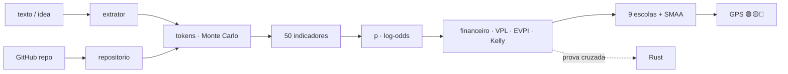

<!--
AnalisadorPreditivoMinimoViaveldeProjetos
Autor: ProfBru - Bruno Penedo © 2026 - TODOS OS DIREITOS RESERVADOS
E-mail: profbruanbima@gmail.com

TEMPLATE DO MOTOR DE READMEs — não editar os 12 READMEs à mão.
  • O que está aqui é ESTRUTURA (nunca traduzida): imagens, comandos, caminhos, badges de stack.
  • Marcadores b:<chave> entre chaves duplas são BLOCOS DE PROSA (traduzidos) — vêm de readme.blocos.json.
  • Marcadores lang:<nome> entre chaves duplas são preenchidos pelo gerador (seletor, frase de direitos).
Estilo: template do ECC (hero, seletor, badges, guia rápido, cards, o que tem dentro)
+ progressão D19: DOR → SOLUÇÃO → PROVA VISUAL → APLICAÇÃO → INSTALAÇÃO → PROFUNDIDADE → LICENÇA.
Gerar:  python3 public/foundations/pipeline/gerar_readmes.py
-->

<div align="center">

# 🧭 Analisador Preditivo Mínimo Viável de Projetos


**ProfBru © 2026**

### 预测型导航仪：在第一个令牌之前，告诉你一个创意是否值得投入令牌。

**输入一句话的创意，输出 🟢🟡🔴 结论、构建、规划和编码所需的令牌数、相对无风险利率的价值——以及你应该放弃什么。**

   


[Português](README.md) · [English](README.en.md) · [Español](README.es.md) · [Français](README.fr.md) · [Deutsch](README.de.md) · **中文** · [한국어](README.ko.md) · [हिन्दी](README.hi.md) · [עברית](README.he.md) · [Русский](README.ru.md) · [Svenska](README.sv.md) · [Suomi](README.fi.md)

</div>

> [!IMPORTANT]
> **在花钱之前明智地选择与放弃，是最大的优势之一。** 知道不该把时间和金钱投向哪里的人，已经赢了一半。本项目把这种纪律变成方法：可预测、可审计，每个数字背后都有科学依据。

## ⚡ 60 秒上手

无需服务器、无需 API 密钥、无需云端。在你的电脑上离线运行。输出语言为巴西葡萄牙语。

```bash
git clone <url-do-repositorio> AnalisadorPreditivoMinimoViaveldeProjetos
cd AnalisadorPreditivoMinimoViaveldeProjetos/public/foundations/pipeline
pip install -r requisitos.txt
python3 analisar.py ideia "App para clínicas lembrarem pacientes pelo WhatsApp com assinatura mensal"
```

完成：报告在终端中显示信号灯、推荐路径、各阶段 P10/P50/P90 令牌、相对 CDI（巴西无风险基准利率）的期望值，以及你正在回避的问题。想比较多个创意？使用 `comparar`。只想知道令牌成本？使用 `tokens`。

<div align="center">

<table>
<tr>
<td width="33%" align="center"><b>🧭 一个创意，一句话</b><br/><sub>即使没有细分市场、行业或数据。导航仪会衡量自身的无知，绝不批准盲目投资。</sub><br/><code>analisar.py ideia</code></td>
<td width="33%" align="center"><b>⚖️ 选择与放弃</b><br/><sub>多个创意并排比较：该推进哪个、该立刻放弃哪个、哪些真正打平。</sub><br/><code>analisar.py comparar</code></td>
<td width="33%" align="center"><b>🪙 令牌成本是多少</b><br/><sub>构建、规划、编码——P10/P50/P90 与各模型美元成本，含尾部风险。</sub><br/><code>analisar.py tokens</code></td>
</tr>
</table>

</div>

---

## 💀 痛点：你用电子表格做决策——而电子表格什么也决定不了

想想你最近一次昂贵的选择。销售团队的**手机**。车队的**电动车**。三年合同的**供应商**。你搭进去六个月夜晚的**创业想法**。放大来看，同样的痛点：军队要用三十年的**装甲车、飞机、防御系统**选哪一种；高管委员会用全年预算批准**哪个项目**。

几乎每次的流程都一样：一张**电子表格**、一个**评分矩阵**、几个**筛选条件**。还有三个没人看见的陷阱：

| 你做了什么 | 实际发生了什么 |
|---|---|
| 🔻 **按某一列排序** | 你只按一个标准做了决定。其余七个标准只是为了显得严谨。 |
| 🔢 **在加权矩阵里累加分数** | 你用平均值抵消了灾难：一个安全性极差的选项因为价格极好而“打平”。 |
| 🔍 **按“全部满足”筛选** | 列表空了；你放宽了碍事的那条要求——恰恰是本该一票否决的那条。 |

如今又多了一项在所有电子表格中都看不见的新成本：**令牌**。有了 AI 智能体，构建变得便宜又快——正因如此，人们很容易花上几周和数百美元，完美地构建出**错误的创意**。

> [!WARNING]
> **电子表格、矩阵和排序筛选不足以做出恰当的选择。** 它们无法说明你有多*不确定*，不会惩罚关键标准上的灾难，不计算*运营*你要构建之物的成本，而且——最糟的是——永远不会说**“现在不要投资”**。一个从不建议放弃的工具不是决策支持，而是理由生成器。

### 决策死亡的那一刻

就在会议上，有人问：*“如果安全性的权重是 30% 而不是 25% 呢？”*——赢家变了。或者六个月后，项目完成、运行正常、测试通过……却没人为它付钱。十年来，创业公司复盘一直指向同一个头号原因：**根本没有市场需求**（35–42% 的案例，CB Insights）。正确的问题从来不是*“我们能做出来吗？”*，而是*“我们应该做吗？”*——这个问题在第一个令牌之前**就有答案**。

---

## 💊 解决方案：每个令牌之前的预测型导航仪

**把创意照你脑中的样子写下来——一句话就够。** 几秒钟内，分析器完成一个严肃委员会需要几周才能做的事：

1. **识别创意的参照类别**（B2B SaaS、自动化、平台市场、交易、医疗……）并从其基础概率出发——这是防止作者过度乐观的*外部视角*。
2. **在 11 个维度上衡量 50 个指标**——需求、市场、技术可行性、经济性、持久性、可扩展性、累积性、稳健性、契合度、信息与金融套利——每个都有**评分、置信度、证据和科学来源**。
3. **估算构建、规划和编码的令牌**，进行 **20 万次模拟**并考虑 IT 项目的厚尾，再换算为各模型的美元成本和人工监督小时数。
4. **算出电子表格遗漏的账：**构建**与运营**的成本、以 CDI 折现的期望值、盈亏平衡概率、先测试的价值（EVPI）、凯利比例，以及每多投入一雷亚尔的边际效用。
5. **让九个决策学派投票**（ELECTRE I 与 II、PROMETHEE II、MAUT、MCDA-C、AHP-TOPSIS 2n、VIKOR、TODIM、SAPEVO-M），在五条路径中选择——不投资、先测试、MVP、完整项目、复用代码——并**数千次扰动权重与评分**，判断该选择是稳健、可能还是脆弱。

<div align="center">

| ❌ 电子表格说的 | ✅ 预测型导航仪说的 |
|---|---|
| “这个创意得 7.8 分。” | **“🟡 先测试。信息价值 R$ 4,586，测试成本 R$ 850。运行这个 5 天实验；如果结果为负，就放弃这个创意。”** |
| “两周就能做完。” | **“P50 为 1370 万令牌，P90 为 4010 万——外加你 23 小时的审查。主要成本不是构建，而是运营。”** |
| *（从来不说）* | **“🔴 暂不投资。按目前已知的信息，没有任何路径能以可接受的风险跑赢 CDI。”** |

</div>

**一个诚实的系统必须能说出“这里别信我”。** 当描述含糊时，导航仪会直说——决策永远不会在黑暗中亮绿灯。

---

## 🖼️ 实际效果——每个子技能一张截图

以下所有截图均由分析器自身（`gerar_telas.py`）以固定随机种子生成：你可以在自己的电脑上复现每个数字。界面标签为巴西葡萄牙语，即工具的输出语言。

### 1. `ideia`——一个面板里的导航仪

<div align="center"></div>

**它解决的痛点：**决定是否开始，你不需要 40 页的报告；你需要一个结论和支撑它的五个数字。

带文字标签的信号灯（从不只靠颜色）、推荐路径、稳健性、带 80% 区间的可行性概率、P50/P90 令牌、构建成本、期望值和 EVPI。

> **解读：**牙科诊所创意的可行性为 50%——不错——但结论是 🟡 **先测试**：知道结果价值 R$ 4,586，而实验只需 R$ 850。在花费令牌之前先购买廉价信息，是理性的决定，即使对一个有前景的创意也是如此。

### 2. `tokens`——构建、规划和编码要花多少

<div align="center"></div>
<div align="center"></div>

**它解决的痛点：**“很快就能做完”是工程界最昂贵的一句话。AI 智能体在同一任务上的令牌消耗可相差 30 倍（Bai 等，2026），每 6 个 IT 项目就有 1 个超支 200%（Flyvbjerg 与 Budzier，2011）。

估算器根据文本统计文件、集成和复杂度，套用按活动计的消耗（读、写、改、测、审）、上下文增长与返工，并运行 20 万次厚尾模拟。

> **解读：**编码约占令牌的 80%，而输入（每一步重新读取的上下文）占 97%。P10–P90 区间跨越一个数量级——这就是导航仪按 P90 而非平均值做决定的原因。

### 3. 路径——选择**与**放弃

<div align="center"></div>

**它解决的痛点：**电子表格比较的是创意；它从不比较对同一创意的*投资方式*。而方式比创意更重要。

五条路径：**A0** 不投资（资金放在 CDI）、**A1** 5 天最小实验、**A2** 精简 MVP、**A3** 完整项目、**A4** 复用现有代码。每条都列出投入资本、期望值、损失概率和获得首个证据的时间。

> **解读：**MVP 的雷亚尔期望值最高，但 5 天实验赢得共识——它获得证据的速度快 4 倍，损失概率仅 13%。报告明确写出**放弃**：选择 A1，就能在拿到证据之前，让完整项目的 P90 风险敞口免于风险。

### 4. 九个多准则学派的投票

<div align="center"></div>

**它解决的痛点：**每种多准则方法都是关于“更好”含义的不同理论。只用一种，就等于把答案和问题一起选好了。

MAUT 累加效用；ELECTRE 否决灾难；PROMETHEE 分级偏好；VIKOR 拒绝补偿最差标准；TODIM 认为损失比收益更重（前景理论）；SAPEVO-M 接受委员会的序数判断。

> **解读：**九个学派中有七个把最小实验排在第一。当相互独立的理论达成一致时，决策就能经受住会议的考验。

### 5. 指标——以及是什么推动了概率

<div align="center"></div>
<div align="center"></div>

**它解决的痛点：**没有解释的“7.8 分”说服不了任何人。这里每个维度都显示评分、置信度，以及它把概率推高或拉低了多少。

完整目录（`analisar.py indicadores`）列出全部 50 个指标的公式、科学来源，以及能证实每个评分的**最低证据**——而不是凭空编造。

> **解读：**“问题与需求”是最能提高概率的维度（痛点、频率以及 3 家有意向的诊所）；“市场与多样性”保持中性——只有一个使用细分，香农熵为零。这正是下一次客户访谈需要检验的。

### 6. `comparar`——多个创意，一个决定

<div align="center"></div>

**它解决的痛点：**你有五个创意，却只有精力做一个。“领先 0.3 分”的排名只是伪装成确定性的噪声。

创意通过 `ProcessPoolExecutor` 并行分析，并由九个学派以**双重稳健性**投票：权重不确定与评分不确定（SMAA）。结论取两者中较低者。

> **解读：**在权重不确定时，创意 4 总是胜出；在评分不确定时，只有 60% 的情况胜出——与创意 1 技术性打平。导航仪说得很清楚：不要按排名选择，两个都去做实验。并且让你**立即放弃**平台市场和套利机器人，它们在任何合理情景下都不会胜出。

### 7. `repo`——这个创意在 GitHub 上已经有代码了吗？

<div align="center"></div>
<div align="center"></div>

**它解决的痛点：**现成代码看似省钱，但需要阅读、改造，有时还附带一个你无法使用的许可证。

分析器进行隔离的浅克隆（不执行仓库中的任何内容），统计各语言代码行数、测试、CI、许可证和最近一次提交的时间，并计算成熟度（软件 TRL）。成熟度降低编码令牌；阅读成本计入构建令牌。

> **解读：**对于一个 TRL-5 级的 MIT 仓库，“复用”路径（A4）出现在备选之中——而共识仍偏向 MVP，因为改造现有代码并不能消除市场问题。

### 8. 金融套利与资本收益

<div align="center"></div>
<div align="center"></div>

**它解决的痛点：**交易和套利的创意看起来像白捡的钱——直到交易成本、税费和阿尔法衰减出现。

当创意是金融策略时，模型会加入专门的维度（优势的持续性、成本与延迟、统计验证、监管风险），报告要求在投入任何产品令牌之前提供样本外回测、夏普比率和最大回撤。对任何创意，令牌资本都会与无风险替代方案比较：CDI。

> **解读：**一句话描述的加密货币套利机器人得到 🟡 **先测试**，可行性 12%；旁边的银行对账自动化得到 🟢 **投资 MVP**，回本期 4 个月。同一作者、同一天：区别在于时间在哪里产生回报。

### 9. 当创意仍然过于模糊

<div align="center"></div>

**它解决的痛点：**最糟的决定不是对好创意说不——而是对一个尚不存在的创意说是。

对于“一个很酷的想法”，导航仪测得完整度为 0%，给出非常宽的概率区间，列出尚未回答的关键问题，并将结论标记为脆弱。

> **解读：**🔴 **暂不投资**——不是出于悲观，而是因为缺乏信息。报告本身会告诉你先要弄清什么（谁有痛点、代价多大、如何赚钱）。

### 10. `prompt`——用正确的方式借助 LLM 深入分析

<div align="center"></div>

**它解决的痛点：**LLM 擅长发现逻辑漏洞和提出实验——却不擅长编造经过校准的权重和评分；作为评判者，它们几乎什么都赞同。

因此分析器负责定量部分，并提供一个现成的主提示词，已填入类别、概率、令牌和路径，只请 LLM 做它擅长的事：尖锐问题、可逆性测试、最小实验和依赖关系图。

> **解读：**数字来自模型；质疑来自 LLM。各司其职。

### 11. `--relatorio`——PDF、HTML 和 Markdown 档案

<div align="center"> </div>

**它解决的痛点：**重要的决策需要流转——在委员会、与合伙人、在投资人的邮箱里——并且需要证明是谁签署的。

使用 `--relatorio`，每次分析都会输出三种格式：**Markdown**（可版本管理）、自包含 **HTML**（内嵌截图，支持浅色和深色主题），以及 **OCR 格式 PDF**——每一页都是图像，背景是 50% 透明度的大号 ProfBru 标志，上方叠加一层不可见文字层，使文档可搜索、可复制，但又不是纯文本 PDF。

> **解读：**你在终端里看到的同一份导航结果，变成附带五张截图、共六页的档案，可直接带去开会——在 PDF 中搜索“experimento mínimo”能找到每一处出现位置。

📎 [`docs/exemplos/gps_clinica.pdf`](docs/exemplos/gps_clinica.pdf) · [`.html`](docs/exemplos/gps_clinica.html) · [`.md`](docs/exemplos/gps_clinica.md)

---

## 🎯 适用场景——量身定制的选择与放弃

同一方法适用于任何**选项相互矛盾、信息不完整、犯错代价高昂**的决策：

<div align="center">

| 领域 | 决策 | 电子表格为何失灵 |
|---|---|---|
| **创意与创业** | 未来 90 天哪个创意值得投入令牌、时间和资本 | 忽视类别的基础概率和运营成本 |
| **AI 项目** | MVP、完整项目还是只做测试——用哪个模型 | 不估算令牌、尾部风险和审查小时数 |
| **高管与企业决策** | 项目组合、供应商、自制或外购 | 用平均值抵消否决；不衡量稳健性 |
| **设备与手机** | 哪台设备能覆盖真实的用途组合 | 不衡量用途多样性（香农）和边际效用 |
| **电动车与车队** | 续航 × 总成本 × 基础设施 | 重复计算相关的标准 |
| **武装部队** | 装甲车、飞机、服役 30 年的系统 | 关键标准表现差必须一票否决，而不是被补偿 |
| **交易与套利** | 开发机器人还是把钱留在 CDI？ | 忽略交易成本、税费和阿尔法衰减 |
| **中小企业** | 是否把手工流程自动化 | 不比较年度节省与 P90 成本 |

</div>

> [!NOTE]
> 各项假设（汇率、CDI、期限、你的时薪、预期收入、资本）都是命令行参数，并打印在每份报告中。修改它们，结论就会重新计算——决定权在你，账目一目了然。

---

## 🧩 每项功能为何存在

| 功能 | 为何存在 | 依据 |
|---|---|---|
| **参照类别** | 对一个项目最好的预测是同类项目的历史，而不是提出者的乐观 | Kahneman 与 Lovallo（1993）；Flyvbjerg 与 Gardner（2023） |
| **带置信度的对数几率概率** | 每个指标按证据强弱推动概率；没有证据，几乎不动 | 可解释规则（LLM-AR，2025）；SAISE（2025） |
| **各阶段 P10/P50/P90 令牌** | 智能体消耗可相差 30 倍，且输入主导成本 | Bai 等（2026）；ACEM（2026）；tokencast |
| **运营成本，而不只是构建成本** | 有了 AI，构建变便宜了；拖垮业务的是运营 | ACEM（2026）；CB Insights |
| **相对 CDI 的净现值** | 花在令牌上的每一雷亚尔都有确定的机会成本 | Dixit 与 Pindyck（1994） |
| **EVPI——先测试的价值** | 有时最好的购买是信息，而不是代码 | Howard（1966）；Camuffo 等（2020、2024） |
| **凯利比例** | 押多少与押什么同样重要 | Kelly（1956） |
| **有效前沿上的边际效用** | 关键是下一雷亚尔投入的价值 | Gossen（1854） |
| **香农熵、辛普森指数、HHI、通用性指数** | 用途多样的创意在第一个市场失败时有更多出路 | Shannon（1948）；知识库中的 KPI |
| **九个学派 + 博尔达共识** | 无数据时，独立理论之间的一致是最有力的证据 | Roy；Brans；Keeney 与 Raiffa；Saaty；Opricovic；Gomes |
| **双重稳健性（权重与评分）** | 权重变动 2 个百分点就易主的赢家不是赢家 | SMAA——Lahdelma 等（1998） |
| **尖锐问题、可逆性、最小实验、依赖关系** | 这是怀疑型投资人会做的事——也是 LLM 擅长的事 | 项目知识库 |
| **OCR 格式 PDF、HTML 与 Markdown 报告** | 决策需要流转、可搜索，并在每一页上标明作者 | PyMuPDF + Pillow，全部本地运行 |
| **Rust 第二引擎** | 两个独立引擎结果一致，证明的是数学，而不仅是代码 | 每次运行都交叉验证 |

---

## ⚙️ 安装与使用

| 组件 | 版本 | 必需 | 用途 |
|---|---|---|---|
| Python | 3.13 | ✅ | 引擎、CLI、报告 |
| NumPy | 2.x | ✅ | 代数与模拟 |
| numba | ≥ 0.60 | ⚠️ 推荐 | 内核 JIT（没有它：结果相同，速度更慢） |
| matplotlib | ≥ 3.7 | ⚠️ 截图需要 | PNG 图表 |
| PyMuPDF · Pillow · markdown | 较新版本 | ⚠️ `--relatorio` 需要 | PDF、HTML |
| Rust / cargo | 稳定版 | ⭕ 可选 | 第二校验引擎 |
| git · screen | — | ⭕ 可选 | 分析仓库 · 后台运行 |

```bash
cd public/foundations/pipeline
python3 analisar.py ideia "<ideia>" [--repo <url|pasta>] [--relatorio [base]] [--telas pasta/] [--json]
python3 analisar.py comparar "<ideia A>" "<ideia B>" "<ideia C>" [--relatorio]   # ou --arquivo ideias.txt
python3 analisar.py tokens "<ideia>" [--json]
python3 analisar.py repo https://github.com/<usuario>/<projeto>
python3 analisar.py indicadores [--bibliografia]
python3 analisar.py prompt "<ideia>"

# premissas (todas opcionais): --cambio 5.50 --cdi 0.14 --horizonte 12 --valor-hora 80
#                              --receita 3000 --receita-otimista 20000 --capital 50000 --infra-mes 0

./run_all.sh --demo          # < 60 s
./run_all.sh                 # testes + prova cruzada Rust + bench + telas + i18n
./run_all.sh --background    # screen + watchdog de 20 min (screen -r analisadorpreditivominimoviaveldeprojetos)
```

| 子技能 | 提供什么 |
|---|---|
| `ideia` | 单个创意的完整导航：信号灯、路径、概率、令牌、经济性、九个学派、指标、问题、实验、依赖、放弃（Markdown、JSON 和截图） |
| `comparar` | 并行分析多个创意：推进哪个、哪些打平、立即放弃哪些 |
| `tokens` | 仅成本：各阶段 P10/P50/P90 令牌、各模型美元成本、人工小时 |
| `repo` | 仓库成熟度：代码行、语言、测试、CI、许可证、就绪程度 |
| `indicadores` | 50 个指标的目录，含公式、来源和最低证据；`--bibliografia` |
| `prompt` | 现成的主提示词，用于借助 LLM 深入分析创意 |
| `--relatorio` | 任何分析均可输出为 Markdown、HTML 和带水印的 OCR 格式 PDF |

---

## 🧠 技术内幕

文本被转化为**信号**（葡萄牙语和英语词典，并保留触发每个信号的证据）；信号确定**参照类别**和**功能规模**；规模转化为**令牌**（厚尾模拟）；信号和规模转化为**指标**；指标以对数几率移动类别的**先验**，得到**可行性概率**；概率进入五条路径的**经济测算**；最后由九个学派选择路径——并测量其稳健性。



| 维度 | 它问什么 |
|---|---|
| 问题与需求 | 痛点是否真实、频繁、有人付费？除你之外有人确认过吗？ |
| 市场与多样性 | 有多少用途和细分（香农、辛普森、HHI、通用性）？ |
| 技术可行性 | 规模、集成、实时性、现有代码、抵御 AI 商品化的能力 |
| 经济可行性 | 成本、尾部、安全边际、净现值、回本期、经常性收入、凯利、边际效用 |
| 持久性 | 能否经受时间、潮流和单一平台的考验？ |
| 可扩展性 | 边际成本、网络效应、自动化 |
| 累积性 | 失败后还剩什么：代码、数据、经验、转型选项 |
| 稳健性与风险 | 监管、外部依赖、单人执行、最大损失 |
| 契合度与可检验性 | 作者优势、5 天实验、获得证据的时间、零成本 |
| 信息与不确定性 | 描述完整度、类别置信度、信息价值 |
| 金融套利 | 阿尔法持续性、成本、统计验证、监管 |

### 站在科学前沿

任何指标没有来源都不能进入目录——一旦发生，自动测试会让项目不通过。52 篇参考文献包括：关于用 AI 和 LLM 预测创业成功的最新研究（VCBench、SSFF、SAISE、预测因子元分析、LLM-AR、kNN-ICL——2024 至 2026 年）、编码智能体的令牌消耗（Bai、Brynjolfsson、Pentland 等，2026）以及智能体工程的成本估算（ACEM，2026），以及支撑各方法的经典文献：Shannon、Gossen、Kelly、Howard、Kahneman 与 Tversky、Roy、Saaty、Keeney 与 Raiffa、Flyvbjerg、Lahdelma（SMAA），以及巴西多准则决策支持学派。完整列表可通过 `python3 analisar.py indicadores --bibliografia` 获取。

---

## 🚀 性能与交叉验证

| 测量（4 个 CPU，诊所案例） | 结果 |
|---|---|
| 单个创意的完整分析（20 万次令牌模拟 + 9 个学派 × 2,000 个情景） | ≈ 1.8 秒 |
| 多个创意 | 使用 `ProcessPoolExecutor` 并行，结果与串行完全一致 |
| Python × Rust 一致性（5 个案例，每个 10 个量） | 最大差异 2.2 × 10⁻¹⁵ |

每次测量都会连同结果未改变的证明一起记录：改变答案的优化不是收益。

```text
✅ clinica      10 grandezas idênticas · Δ relativo máx 0.0e+00
✅ conciliacao  10 grandezas idênticas · Δ relativo máx 0.0e+00
✅ arbitragem   10 grandezas idênticas · Δ relativo máx 1.3e-15
✅ marketplace  10 grandezas idênticas · Δ relativo máx 2.2e-15
✅ vaga         10 grandezas idênticas · Δ relativo máx 0.0e+00
```

---

## 📁 项目结构

```
AnalisadorPreditivoMinimoViaveldeProjetos/
├── README.md (+11)
├── projeto.toml
├── docs/                         logo, telas/, CUSTO.md, OPERACAO.md
└── public/foundations/
    ├── pipeline/
    │   ├── analisar.py           CLI (6 sub-skills)
    │   ├── apmv/                 extrator · repositorio · tokens · indicadores · preditivo
    │   │   │                     financeiro · decisao · gps · relatorio · telas · referencias
    │   │   └── mcdm/             ELECTRE I/II · PROMETHEE II · MAUT · MCDA-C · AHP-TOPSIS 2n
    │   │                         VIKOR · TODIM · SAPEVO-M · Borda · Dirichlet
    │   ├── testes_apmv.py · prova_cruzada_rust.py · bench.py · gerar_telas.py
    │   └── run_all.sh · watchdog.sh · verificar_publicacao.sh
    └── rust/analisadorpreditivominimoviaveldeprojetos_core/   apmv_core
```

一切都在本地运行，没有持续成本：无服务器、无 API 密钥，分析过程中没有任何网络调用（只有在你提供仓库时才执行 `git clone`）。

---

## ❓ 你会问的问题

<details>
<summary><b>只有一句话的创意也真的能用吗？</b></summary>

能——这正是它的设计初衷。信息很少时，导航仪从类别的基础概率出发，放宽概率区间，并且不批准投资：它会准确告诉你先回答哪些问题。
</details>

<details>
<summary><b>为什么不直接问 LLM 这个创意好不好？</b></summary>

因为 LLM 作为评判者几乎什么都赞同——还会编造看似经过校准的权重和评分。分析器用方法和来源来计算；LLM 则通过主提示词在它擅长的地方发挥作用。
</details>

<details>
<summary><b>报告中的收入和工时从哪里来？</b></summary>

来自参照类别，作为保守和乐观两种情景——并以假设的形式列出。如果你知道收入、时薪或资本，就在命令行中传入，一切都会重新计算。
</details>

<details>
<summary><b>它适用于与软件无关的决策吗？</b></summary>

适用。九个学派、稳健性分析以及多样性和边际效用指标适用于设备、车队、供应商和任何性质的项目；令牌只是其中一种货币。
</details>

<details>
<summary><b>运行它需要付费吗？</b></summary>

不需要。它在你的电脑上离线运行。唯一的成本是报告本身估算的——你之后决定花费的令牌。
</details>

---

## 📜 许可与作者

<div align="center">


**ProfBru © 2026**

**Analisador Preditivo Mínimo Viável de Projetos**
作者： **ProfBru - Bruno Penedo** © 2026 — **保留所有权利**
📧 profbruanbima@gmail.com

</div>

专有软件。使用、复制、修改和分发须获得作者的明确授权。第三方库和参考文献保留其各自的许可与署名。

---

_AnalisadorPreditivoMinimoViaveldeProjetos_
_作者： **ProfBru - Bruno Penedo** © 2026 — 保留所有权利 · profbruanbima@gmail.com_
